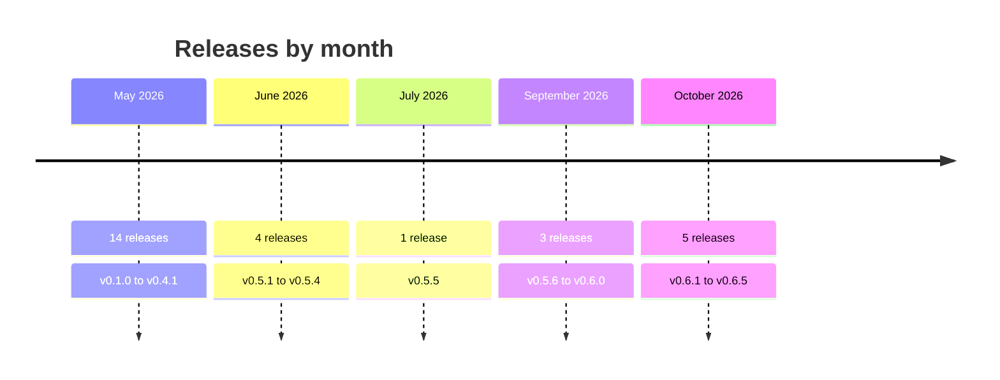

# Changelog

Every AerolVM release, newest first: its highlights, and anything to check before you upgrade. The full notes, the merged pull requests and the downloads are on [GitHub Releases](https://github.com/aerol-ai/microvm/releases).

Security fixes land on the newest release line only, which is **0.6** today. See [SUPPORT.md](SUPPORT.md). This project follows [Semantic Versioning](https://semver.org).

<!-- Generated from the GitHub release notes by `npm run releases:sync` in docs/. Edit the release notes on GitHub, then run it again. The docs Changelog page is built from the same notes. -->

| Release line | Releases | Dates | Latest |
|---|---|---|---|
| [0.6](#06-release-line) | 6 | Sep 28, 2026 to Oct 9, 2026 | [v0.6.5](#v065-agent-cli-and-mcp-server-egress-domain-filtering) |
| [0.5](#05-release-line) | 7 | Jun 1, 2026 to Sep 28, 2026 | [v0.5.7](#v057-dependency-updates) |
| [0.4](#04-release-line) | 1 | May 28, 2026 | [v0.4.1](#v041-firecracker-runtime-wiring) |
| [0.3](#03-release-line) | 1 | May 24, 2026 | [v0.3.1](#v031-custom-domains-and-image-garbage-collection) |
| [0.2](#02-release-line) | 4 | May 19, 2026 to May 24, 2026 | [v0.2.4](#v024-serverless-wake-on-http-and-snapshot-push) |
| [0.1](#01-release-line) | 8 | May 8, 2026 to May 16, 2026 | [v0.1.7](#v017-daytona-and-e2b-compatibility-snapshots-image-builds) |

## 0.6 release line

### v0.6.5: Agent CLI and MCP server, egress domain filtering

*October 9, 2026* · [Full notes](https://github.com/aerol-ai/microvm/releases/tag/v0.6.5)

> **Installer fix: upgrade if you install with `install.sh`.** Starting 2026-10-09, Caddy's Cloudsmith apt repo refuses downloads, so a new node comes up with no Caddy and no HTTPS. `install.sh` now installs Caddy from Caddy's GitHub release, with a checksum check. It also removes the broken apt repo from hosts that an older installer set up, so re-running the installer on them works again. (#627)

- **`aerolvm`, a CLI for agents.** Agents can drive sandboxes from their own shell tool, with no MCP setup. Its binaries for Linux, macOS and Windows (amd64 and arm64) are attached to this release.
- **MCP server, local or remote.** `aerolvm mcp` serves sandbox tools over stdio. sandboxd can also serve them at `/mcp` (opt-in, `SB_MCP_ENABLED`).
- **Egress domain filtering.** Allowlist by hostname, change a sandbox's policy while it runs, and use named profiles, learn mode, method and path rules, TLS inspection, and credential injection. Hostname allowlists work on every runtime, Firecracker included. Method and path rules, TLS inspection and credential injection are not available on Firecracker or WASM yet.
- **Sandbox names are unique per owner**, and `GET /v1/sandboxes?name=` looks a sandbox up by name.

**Before you upgrade:**

- **Sandbox names:** a name that starts with `owner:` or looks like a generated ID (`sb-` followed by 16 hex characters) is now rejected at create with a 400.
- **Raw sockets:** non-privileged sandboxes no longer have `CAP_NET_RAW`.
- **Hostname egress** (`SB_EGRESS_FQDN_ENABLED`) is on by default. It does nothing until a sandbox uses a hostname. Container runtimes need the `aerolvm-egress-gateway` unit, which `install.sh` installs; without it, hostname creates return 501.
- **Remote MCP** (`SB_MCP_ENABLED`) is off by default.
- **SDKs:** this release does not change SDK package versions. The SDK changes listed above reach the package registries with the next SDK publish.

### v0.6.4: OpenSSF baseline, required checks, release asset copies

*October 2, 2026* · [Full notes](https://github.com/aerol-ai/microvm/releases/tag/v0.6.4)

- **OpenSSF baseline.** The project publishes its security policies, threat model, and security assessment, and shows a passing OpenSSF Best Practices badge plus the Baseline badge.
- **Merge requirements.** Every commit needs a DCO sign-off. Test suites, dependency review, and gosec must pass before merge. Release tags and SDK versions that are not versions are rejected.
- **Release assets are copied under the release tag**, so each published file has a tag-scoped copy alongside the release.
- **containerd build contexts reject non-local tar names.** An entry whose name is absolute, empty, or contains `..` is refused before anything is written.

### v0.6.3: Security release, host escape and path traversal

*October 2, 2026* · [Full notes](https://github.com/aerol-ai/microvm/releases/tag/v0.6.3)

Security release. The issues below were found in a review of the sandbox control plane. No configuration change is required to pick up the fixes.

- **Mount sources can no longer run a command on the host.** An option-shaped external-storage mount source was parsed as a flag by the host mount tool and could run as the daemon user (GHSA-5pqm-4fh4-585q). Those sources are now rejected.
- **WASM toolhost no longer executes on the host.** `/process/exec/stream` and `/process/code-run` spawned a host shell or interpreter. Both fail closed with 501. `POST /process/execute` still runs inside the WASM engine.
- **Path checks on sandbox IDs, bundle digests, and WASM module refs.** A `..` id, digest, or relative module ref can no longer escape its directory.
- **Signed releases.** Each release publishes an SLSA provenance asset. Go fuzz targets cover the untrusted-input validators.

**Before you upgrade:**

- WASM `/process/exec/stream` and `/process/code-run` return 501.
- Sandbox ids outside `[A-Za-z0-9_-]{1,128}` are rejected at create.

### v0.6.2: macOS local install without root

*October 2, 2026* · [Full notes](https://github.com/aerol-ai/microvm/releases/tag/v0.6.2)

- **`install.sh --local` works on a Mac without root.** Managed Macs that cannot grant `sudo` can run sandboxd as the user.
- **Darwin `sandboxd` binaries are published.** toolboxd stays a Linux binary, because it runs inside the container.
- **Loopback toolbox.** With `SB_DOCKER_TOOLBOX_LOOPBACK`, sandboxd reaches toolboxd on `127.0.0.1` instead of the container IP, which macOS Local Network privacy blocks for an unsigned user process.

**Before you upgrade:**

- Re-run `install.sh --local` on a Mac that failed the earlier installer. Set `SB_DOCKER_TOOLBOX_LOOPBACK` only for that rootless macOS layout.

### v0.6.1: Test coverage to 96% and dependency updates

*October 1, 2026* · [Full notes](https://github.com/aerol-ai/microvm/releases/tag/v0.6.1)

- **Go line coverage is 96%.** The coverage harness cancels its context on the way out. (#520, #521)
- **Kubernetes deployment plan** is in `plans/`. It is a design doc, not a shipped installer. (#515)
- **Dependency updates:** containerd 2.3.6, Rust `quinn-proto` 0.11.18, Rust `openssl` 0.10.81, and the docs `sharp` / `wrangler` bump. (#516–#519)

### v0.6.0: Secrets hardening, enterprise mode, audited cluster security

*September 28, 2026* · [Full notes](https://github.com/aerol-ai/microvm/releases/tag/v0.6.0)

- **HA sandboxes keep their credentials when the owner node dies.** Secrets are sealed to the owner plus backups, and the sandbox is recreated on a backup with working credentials.
- **No plaintext secrets at rest or in the Raft log.** Env and toolbox tokens are sealed; a plaintext secret column refuses to boot.
- **Every secret access is audited.** The log is hash-chained and exportable off-node. The chain shows a changed record, but someone with root on a node could rebuild that node's chain, so keep an off-node copy. Anchoring the chain to an external witness needs a witness provider, which the open-source build does not include yet.
- **Cluster-internal traffic runs over node-bound mTLS**, and tenant tokens can never write secrets.
- **`SB_ENTERPRISE_MODE`**: the node refuses to boot in any unsafe configuration. It requires an external audit witness, so the open-source build cannot start in this mode yet.
- **AWS KMS** as a secrets provider (`SB_SECRET_PROVIDER=awskms`).
- **Hardened V8-isolate jail**: chroot, cgroup v2, uid drop, seccomp, PID namespace.
- **Opt-in ingress routing** with no Caddy reloads per sandbox: 0 dropped connections under churn (`SB_INGRESS_PROXY_ROUTING`).

## 0.5 release line

### v0.5.7: Dependency updates

*September 28, 2026* · [Full notes](https://github.com/aerol-ai/microvm/releases/tag/v0.5.7)

Dependency updates only. No sandbox behavior changes.

- Docs: Astro 7.3.5, Starlight 0.42.4, Prettier 3.9.9.
- containerd 1.7.35.
- TypeScript SDK `tsx` 4.23.15.
- Java SDK Jackson BOM 2.22.3.

### v0.5.6: containerd by default, V8 isolates, faster creates

*September 22, 2026* · [Full notes](https://github.com/aerol-ai/microvm/releases/tag/v0.5.6)

- **containerd is the container engine for every deployment except a local install.** `install.sh` stays on Docker. Terraform, Ansible, and `config/cluster.yml` default to containerd, with CNI networking, a warm pool, BuildKit image builds, and a gVisor seam.
- **V8 isolate runtime** (`runtime: "isolate"`), backed by workerd. Off unless `SB_ENABLE_ISOLATE` is set.
- **Faster creates.** Warm-create work targets 30ms or under (from 43ms). Recovery notes travel in the Raft log, so promote no longer waits on a blob copy. Firecracker create no longer burns a 2 second post-resume timeout.
- **WASM resident host** (off by default): compile once, instantiate many, with egress isolation, migrate-on-expose, and an idle reaper.

**Before you upgrade:**

- A cluster deployed from Terraform, Ansible, or `config/cluster.yml` comes up on containerd. Set `container_engine: docker` to keep dockerd. Local `install.sh` is unchanged.
- Do not roll a cluster that still emits recovery blobs onto this release in place. The blob path is gone.
- Isolate and the WASM resident host stay off until you opt in.

### v0.5.5: Private sandboxes and a Docker warm pool

*July 11, 2026* · [Full notes](https://github.com/aerol-ai/microvm/releases/tag/v0.5.5)

- **Sandboxes are private by default.** A new sandbox has no public URL. `exposePort` opts it in, or set `allowPublicTraffic: true` at create.
- **Docker warm pool.** Parked containers are adopted on create, aimed at sub-100ms creates. A pause-netns pool covers cold creates that do not match a parked image.
- **Firecracker snapshot resume** rebinds the TAP, pins the guest MAC, and loads the snapshot through the jailer. Create latency uses a verify-once cache and an async TCP probe.
- **Release assets include prebuilt custom Caddy binaries.**

**Before you upgrade:**

- Callers that assumed a public URL at create must pass `allowPublicTraffic: true` or call `exposePort`.
- toolboxd announces ready at listen, and the binary is stripped.

### v0.5.4: Firecracker on arm64, E2B egress and volumes

*June 25, 2026* · [Full notes](https://github.com/aerol-ai/microvm/releases/tag/v0.5.4)

- **Firecracker on arm64**, for a homogeneous arm64 cluster.
- **E2B selective egress** (`network.allowOut` / `network.denyOut`) and Host-header rewrite (`network.maskRequestHost`).
- **E2B volume mounts** replicate across the cluster. Delete and reclaim races are closed.
- **Firecracker guests get toolboxd**, including after a snapshot resume. Cold boot, TAP, and the vsock handshake work on the jailer path.

### v0.5.3: WASM runtime and live integration tests

*June 16, 2026* · [Full notes](https://github.com/aerol-ai/microvm/releases/tag/v0.5.3)

- **WASM runtime, phase 1.** A wazero engine, durable checkpoints, a module catalogue, and bring-your-own OCI modules with per-tenant auth.
- **Snapshots move through AOCR**, so a create on another node can pull the snapshot.
- **Cross-node SSH** is forwarded to the sandbox owner.
- **Live AWS integration harness** for deployment scenarios.

### v0.5.2: Registry pulls, DNS apex records, snapshot clones

*June 7, 2026* · [Full notes](https://github.com/aerol-ai/microvm/releases/tag/v0.5.2)

- **Authenticated AOCR pulls** for cluster snapshots and Firecracker templates.
- **DNS apex records.** Hostname ingress emits ANAME and ALIAS candidates so the zone apex can flatten to the ingress target.
- **Snapshot clones reseed.** The guest kernel is force-reseeded, a clone-generation signal fences the resumed sandbox, and vmgenid behavior is documented.

### v0.5.1: Managed fleet control plane

*June 1, 2026* · [Full notes](https://github.com/aerol-ai/microvm/releases/tag/v0.5.1)

- **Optional managed fleet control plane.** sandboxd can call an external control plane for token checks, usage, and quota. It stays off unless configured.

## 0.4 release line

### v0.4.1: Firecracker runtime wiring

*May 28, 2026* · [Full notes](https://github.com/aerol-ai/microvm/releases/tag/v0.4.1)

- **Firecracker is selectable.** Configuration, binary paths, and a driver that implements the runtime interface land here. The driver methods are still stubs: a Firecracker sandbox does not boot until the later 0.5.x releases.
- **Custom-domain verification** is added, and a follow-up uses the configured port in the check.
- **AOCR and observability config** are split so registry settings and trace export are not one block. (#143)

## 0.3 release line

### v0.3.1: Custom domains and image garbage collection

*May 24, 2026* · [Full notes](https://github.com/aerol-ai/microvm/releases/tag/v0.3.1)

- **Custom domains.** Attach a domain to a sandbox through the API, with DNS records and an ingress target the operator can publish.
- **Image garbage collection.** Images that are no longer referenced are eligible for deletion, with tests around the pending-GC path.

## 0.2 release line

### v0.2.4: Serverless wake-on-HTTP and snapshot push

*May 24, 2026* · [Full notes](https://github.com/aerol-ai/microvm/releases/tag/v0.2.4)

- **Serverless sandboxes wake on HTTP.** A request to a sleeping sandbox starts it and waits, with a direct-route bypass once it is warm.
- **Snapshots push in the background.** A reconciler retries a snapshot upload that did not finish at create time.
- **Cluster ownership is replayed on start**, and ingress routing is shard-aware.

### v0.2.3: Daytona log streaming and registry auto-import

*May 23, 2026* · [Full notes](https://github.com/aerol-ai/microvm/releases/tag/v0.2.3)

- **Daytona session logs stream over a WebSocket.** Short output no longer stalls waiting for an end marker, and command input is sent with a trailing newline.
- **AOCR auto-import.** sandboxd can ask AOCR to mirror an image the cluster does not have yet, and a reconciler retries imports that did not finish.
- **Serverless sandboxes** get their first create path in this release. Wake-on-HTTP follows in v0.2.4.

### v0.2.2: Cluster capacity, shared certificates, Daytona exec

*May 22, 2026* · [Full notes](https://github.com/aerol-ai/microvm/releases/tag/v0.2.2)

- **Nodes advertise capacity and can recover** sandboxes whose owner is gone.
- **Caddy certificates live in a shared S3 bucket**, so a second ingress node does not request a new certificate for the same name.
- **Daytona code execution** runs a snippet in the sandbox, and session commands accept stdin.
- **Ingress knows about replicated owners**, with tests for the small and large ingress tiers.

### v0.2.1: Cluster mode on AWS

*May 19, 2026* · [Full notes](https://github.com/aerol-ai/microvm/releases/tag/v0.2.1)

- **Cluster mode.** Sandbox specs replicate, and a dead owner's sandboxes can be recovered by another node.
- **AWS deploy.** Terraform builds the cluster. Ansible installs sandboxd and joins a node.
- **Leader election** is fixed.

## 0.1 release line

### v0.1.7: Daytona and E2B compatibility, snapshots, image builds

*May 16, 2026* · [Full notes](https://github.com/aerol-ai/microvm/releases/tag/v0.1.7)

- **Daytona-compatible API.** Create and drive a sandbox through the Daytona routes, with Daytona metadata stored beside the sandbox.
- **E2B-compatible API.** The E2B facade maps onto the same sandboxes.
- **Snapshots, image builds, and network quotas.** Create a snapshot, build an image from a Dockerfile, and enforce a per-sandbox network quota.

### v0.1.6: Wildcard TLS, API versions, admission control

*May 11, 2026* · [Full notes](https://github.com/aerol-ai/microvm/releases/tag/v0.1.6)

- **Wildcard TLS uses DNS-01 only.** Domain mode no longer falls back to HTTP-01.
- **API version pins** on all five SDKs, so a client can target the v1 surface on purpose.
- **Admission control releases capacity** when a sandbox is destroyed and reserves it at create.
- **Port expose** is consistent across the SDKs. A TCP hostname bug that pointed the route at the wrong host is fixed.

### v0.1.5: Egress block-all and safer sandbox teardown

*May 10, 2026* · [Full notes](https://github.com/aerol-ai/microvm/releases/tag/v0.1.5)

- **Per-sandbox egress block-all.** A sandbox can be denied all outbound traffic, enforced per guest IP.
- **The toolbox token is not inherited.** It is removed from the process environment so a child does not receive `SB_TOOLBOX_TOKEN`.
- **Teardown follows Docker events**, so a container that exits is recorded as destroyed.
- **The SQLite file and its directory are owner-only.**

### v0.1.4: TCP and TLS port exposure

*May 10, 2026* · [Full notes](https://github.com/aerol-ai/microvm/releases/tag/v0.1.4)

- **TCP and TLS-SNI ports.** Publish a native TCP service (Postgres, Redis, MySQL, gRPC) from a sandbox. Caddy layer-4 routes the connection, including TLS that is selected by SNI.
- **Destroyed sandboxes are deleted immediately.** The destroyed-row TTL is gone.

**Before you upgrade:**

- A destroyed sandbox row no longer lingers for `DestroyedRowTTL`. Clients that listed destroyed sandboxes from that window will not see them. (#17)

### v0.1.3: GPU sandboxes and multi-arch installs

*May 9, 2026* · [Full notes](https://github.com/aerol-ai/microvm/releases/tag/v0.1.3)

- **GPUs.** A sandbox can request an NVIDIA, AMD, or Apple Silicon GPU. The request is stored on the sandbox and documented for all five SDKs.
- **Multi-arch release binaries.** `install.sh` and the release workflow publish amd64 and arm64.
- **The API listens on port 21212**, not 8080.

**Before you upgrade:**

- Point clients and firewall rules at port **21212**. A process still bound to 8080 is the previous release.

### v0.1.2: Capacity overprovision and WebSocket errors

*May 9, 2026* · [Full notes](https://github.com/aerol-ai/microvm/releases/tag/v0.1.2)

- **CPU and memory can be overprovisioned.** `SB_CPU_OVERPROVISION_FACTOR` and `SB_MEMORY_OVERPROVISION_FACTOR` multiply the host capacity used for admission.
- **WebSocket failures are visible.** The SDKs surface why a stream closed instead of a generic disconnect.

### v0.1.1: Reconcile endpoint and process exit handling

*May 8, 2026* · [Full notes](https://github.com/aerol-ai/microvm/releases/tag/v0.1.1)

- **`POST /v1/admin/reconcile`** compares the sandbox table with the containers that are actually running and repairs the drift.
- **Process exit handles `ECHILD`.** A reaped child no longer surfaces as an unexpected wait error.
- **Docs** are updated per SDK language, including accessibility and layout.

### v0.1.0: gVisor, SDKs, and streaming exec

*May 8, 2026* · [Full notes](https://github.com/aerol-ai/microvm/releases/tag/v0.1.0)

First tagged release.

- **gVisor** as a sandbox runtime next to Docker.
- **SDKs in five languages:** Go, TypeScript, Python, Rust, and Java, with docs for each.
- **Streaming exec over a WebSocket.** Command output is a stream, not a buffered response.
- Rust examples and docs use the `aerolvm_sdk` import path.
