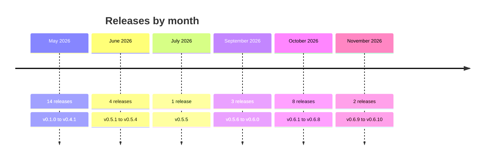

# Changelog

Every AerolVM release, newest first: its highlights, and anything to check before you upgrade. The full notes, the merged pull requests and the downloads are on [GitHub Releases](https://github.com/aerol-ai/microvm/releases).

Security fixes land on the newest release line only, which is **0.6** today. See [SUPPORT.md](SUPPORT.md). This project follows [Semantic Versioning](https://semver.org).

<!-- Generated from the GitHub release notes by `npm run releases:sync` in docs/. Edit the release notes on GitHub, then run it again. The docs Changelog page is built from the same notes. -->

| Release line | Releases | Dates | Latest |
|---|---|---|---|
| [0.6](#06-release-line) | 11 | Sep 28, 2026 to Nov 2, 2026 | [v0.6.10](#v0610-key-custody-enforced-and-safe-create-retries) |
| [0.5](#05-release-line) | 7 | Jun 1, 2026 to Sep 28, 2026 | [v0.5.7](#v057-dependency-updates) |
| [0.4](#04-release-line) | 1 | May 28, 2026 | [v0.4.1](#v041-firecracker-runtime-wiring) |
| [0.3](#03-release-line) | 1 | May 24, 2026 | [v0.3.1](#v031-custom-domains-and-image-garbage-collection) |
| [0.2](#02-release-line) | 4 | May 19, 2026 to May 24, 2026 | [v0.2.4](#v024-serverless-wake-on-http-and-snapshot-push) |
| [0.1](#01-release-line) | 8 | May 8, 2026 to May 16, 2026 | [v0.1.7](#v017-daytona-and-e2b-compatibility-snapshots-image-builds) |

## 0.6 release line

### v0.6.10: Key custody enforced, and safe create retries

*November 2, 2026* · [Full notes](https://github.com/aerol-ai/microvm/releases/tag/v0.6.10)

This release finishes the work v0.6.9 started. Enterprise servers that use your own key store now refuse to run with a plain server key. A create retried while the first attempt is still running gets the same sandbox. The last two plain hashes over request bodies that can hold secrets are now keyed with the server key. The SDKs, published as 0.8.0 alongside this release, send a retry-safe key on every create and expose the server's error code.

> **Enterprise servers with a key store must wrap the server key before they upgrade.** With `SB_ENTERPRISE_MODE=true` and `SB_SECRET_PROVIDER` set to `vault`, `pkcs11` or `awskms`, v0.6.10 refuses to start while `SB_CREDENTIAL_KEY_CUSTODY` is still `file`. v0.6.9 warned about this at start and with the `SandboxdServerKeyPlaintext` alert. Wrap the key on v0.6.9 first (see the upgrade notes).

- **A key store means a wrapped server key.** An enterprise server with a customer key store will not start while its server key is a plain file. `sandboxd key` still runs on such a server, so `sandboxd key wrap` is always available to fix it.
- **Retrying a create is safe, even while the first attempt runs.** A v1 or Daytona create retried with the same `Idempotency-Key` and the same request now waits for the create already running and returns its sandbox. Before, the retry started a second create of the same sandbox, and when that failed it could take away the first create's capacity reservation and mounts.
- **The SDKs send a key on every create.** Each SDK generates an `Idempotency-Key` once per create call and sends the same key on its own automatic retries, so a create retried after a timeout or a dropped connection no longer makes a second sandbox. Pass your own key to make your own retries of the whole call safe too.
- **Every SDK exposes the server's error code.** TypeScript, Python, Go, Rust and Java errors carry the HTTP status, the server's `code` (such as `idempotency_key_reused` or `overloaded`) and the `Retry-After` wait.
- **No plain hashes over secret-bearing bodies are left.** The Runloop devbox ID and the exec audit record's digest are now HMACs under a key derived from the server key, like the E2B fingerprint in v0.6.9. A guessed env value can no longer be checked offline against either.

**Before you upgrade:**

- **Enterprise servers with a key store: wrap first.** On v0.6.9, run `sandboxd key wrap` on one server, copy `credential_encryption.key.wrapped` to every server, set `SB_CREDENTIAL_KEY_CUSTODY=wrapped`, remove `SB_CREDENTIAL_ENCRYPTION_KEY` from the env files, run `sandboxd key verify`, delete the old key file, and restart one server at a time. Then upgrade. A server upgraded first refuses to start, and `sandboxd key wrap` still works on it. Terraform users set `key_custody = "wrapped"`. Servers without enterprise mode, or without a key store, are unaffected.
- **New answers on create.**

  | Status | Code | `Retry-After` | When |
  |---|---|---|---|
  | 503 | `create_in_progress` | 5 | A keyed retry waited the whole create timeout for the create it repeats. Nothing was changed. |
  | 503 | none | 1 | In a cluster, a keyed retry whose create settled while the retry was being routed, or whose reservation is gone. Was a `409` in one case. |

- **Exec audit digests change format.** Anything that reads the `digest` field of exec audit records, such as a SIEM rule, must accept `hmac:<key id>:<hex>` as well as the old 64-character hex. Digests change again when the server key is rotated.
- **Runloop devbox IDs change for new creates.** Existing devboxes keep their IDs. A Runloop create retried across nodes while they disagree on the current server key (during a rotation) or run different releases (during a rolling upgrade) can still make a second devbox.
- **SDK 0.8.0 is a breaking release for Rust.** HTTP errors are `Error::Api(ApiError)` instead of `Error::Api(String)`, and the SDK's own errors moved to a new `Error::Client(String)`. `Error` is `#[non_exhaustive]`, so a `match` on it needs a `_` arm. `CreateOptions` gains `idempotency_key`, so a struct literal without `..Default::default()` must add it. The other SDKs only add to their APIs.
- **Every SDK create is now a keyed create.** On the server, each one costs one HMAC at the API edge, one extra database read and one small row (`sandbox_create_digests`), a few microseconds in all.
- **Rolling upgrades.** Old and new servers work together in a cluster. The incarnation conflict travels as `409` only between upgraded nodes; an older node still sees a `500` and answers that create's retry with a `503` the SDKs retry.

### v0.6.9: Your own key store, and sandboxes fenced off by default

*November 2, 2026* · [Full notes](https://github.com/aerol-ai/microvm/releases/tag/v0.6.9)

This release has two parts. Customer key custody lets you keep the key that protects sandbox secrets in your own key store. The rest comes from a bank-readiness review: a live test campaign on AWS that tried to break sandbox isolation, use up a server's resources and overload the API, on every runtime. The fixes from that review are in this release, and the tests that found the problems are now part of the integration suite.

> **Stricter defaults. Read the upgrade notes before you upgrade.** Sandboxes can no longer reach the server they run on, other sandboxes on the same server, the cloud metadata service, or anything over IPv6. Firecracker templates built by an older release must be deleted and re-created. The Terraform module now requires `admin_allowed_cidrs`.

- **Keep the server key in your own key store.** Vault or OpenBao Transit, an HSM over PKCS#11, or AWS KMS can now hold the key that protects sandbox secrets. Each server keeps only a wrapped copy and unlocks it into memory when it starts. Revoke the key in your key store and every server that can reach it stops using your data within about 15 minutes, with no restart. Restore the key and they resume. The new `sandboxd key` command checks, wraps and rotates the server key. It is off until you turn it on.
- **Sandboxes are fenced off by default.** A sandbox cannot reach the cloud metadata service, the services on its own server, other sandboxes on the same server, or anything over IPv6. A server that cannot put one of these fences in place refuses new sandboxes with a `503` the SDKs retry, instead of running them without it.
- **The agent inside a Firecracker sandbox needs that sandbox's token.** Sandboxes started from a template or the warm pool used to run it with no token at all. Firecracker sandboxes also get the `env` they were created with now. Before, they ignored it.
- **Limits on what one sandbox can use.** Container sandboxes get a process limit (4,096 by default). A sandbox that writes past its disk size is stopped. A process killed for running out of memory no longer stops its sandbox or removes its network rules.
- **Busy servers say "retry later" instead of falling over.** In a cluster, each node runs at most 16 cluster-wide sandbox lists at once and shares them fairly between teams. The rest get `503 overloaded` or `429 rate_limited`, with `Retry-After: 1`. The health watchdog restarts only a server that has stopped answering, never a busy one. A node whose network slots are full answers `503` with `Retry-After: 30`, and the cluster places the create on another node.
- **All five SDKs wait as long as `Retry-After` asks.** A retry after a 429 or 503 waits for the server's hint, up to 30 seconds per retry by default. SDKs are published separately from the server.
- **Fewer copies of your secrets.** A Docker snapshot no longer keeps the sandbox's internal token or the `env` it was created with. The E2B create fingerprint, which was a plain hash that included `env` values, is now keyed with the server key.
- **A reused `Idempotency-Key` must come with the same create.** A v1 or Daytona create that reuses an `Idempotency-Key` with a different request now gets `422 idempotency_key_reused` instead of the first request's sandbox. A retry of the same request still returns the first sandbox.

**Before you upgrade:**

- **Key custody changes nothing until you turn it on.** The defaults are `SB_SECRET_PROVIDER=local` and `SB_CREDENTIAL_KEY_CUSTODY=file`, and a server with them contacts no key store. To wrap an existing server key: run `sandboxd key wrap` on one server, copy `credential_encryption.key.wrapped` to every server, set `SB_CREDENTIAL_KEY_CUSTODY=wrapped`, remove `SB_CREDENTIAL_ENCRYPTION_KEY` from the env files, run `sandboxd key verify`, delete the old key file, and restart one server at a time. Backups made before the wrap still hold the plain key until you destroy them or rotate the server key.
- **Server-key rotation is one-way.** Every server must run v0.6.9 before `sandboxd key rotate --stage`, which checks this. After `--stage` the wrapped key file uses a format older releases cannot read, and after `--promote` no server can go back to an older release.
- **AWS KMS users.** Key-store failures now answer `503` with a code (see the table below) instead of `400` or `500`. At most `SB_SECRET_PROVIDER_MAX_INFLIGHT` (8) key-store calls run at once per server; past that, calls back off and then fail with `503 key_store_throttled`.
- **Enterprise mode.** The new `SandboxdServerKeyPlaintext` alert (warning) fires on an enterprise server whose server key is not wrapped. This release only warns.
- **New and changed responses.** SDKs retry the `503` and `429` answers by default. They do not retry `501` or `422`.

  | Status | Code | `Retry-After` | When |
  |---|---|---|---|
  | 503 | `overloaded` | 1 | A cluster-wide list (v1, Daytona, E2B, Runloop) finds the node's list slots full. Cluster mode only. |
  | 429 | `rate_limited` | 1 | The caller's team or account already holds its share of the node's list slots. Cluster mode only. |
  | 503 | none | 30 | The node's network slots or Docker bridge are full. Was `400` or `500`. |
  | 503 | `node_guard_not_ready`, `ipv6_fence_not_ready`, `egress_floor_not_ready` | 5 | A container, gVisor or Firecracker create while the server's guard, IPv6 fence or metadata deny floor is not in place. |
  | 503 | none | 2 | A cluster write while the leader changes. Was `400`. |
  | 503 | none | 1 | A restarted cluster node has not caught up and cannot see the sandbox yet. Was `404`. |
  | 503 | `key_store_throttled` / `key_store_unavailable` | 1 / 5 | The key store is throttling or cannot be reached. |
  | 503 | `key_revoked`, `key_version_retired`, `key_store_denied` | none | The key store revoked the key, retired its version, or refused this server. |
  | 501 | `network_policy_unenforced` | none | A network policy on a server with the host firewall off. Was accepted and not enforced. |
  | 501 | `mount_tool_unavailable` | none | The node lacks the mount program. Was `400`. |
  | 501 | none | none | A Firecracker create from a template built by an older release, or a start of a Firecracker sandbox stopped before the upgrade. |
  | 409 | none | none | An exec, file call or session whose sandbox stopped while it ran. Was a `502` after minutes. The E2B facade keeps its `502`. |
  | 422 | `idempotency_key_reused` | none | A v1 or Daytona create reuses an `Idempotency-Key` with a different request. |

- **New settings.** All are optional. `setup/config-defaults.md` has the details.

  | Setting | Default |
  |---|---|
  | `SB_API_LIST_MAX_INFLIGHT` | `16` (`0` turns the gate off) |
  | `SB_API_LIST_MAX_INFLIGHT_PER_TENANT` | a quarter of the gate, at least 1 (`4`) |
  | `SB_API_LIST_QUEUE_WAIT` | `500ms` |
  | `SB_LIVENESS_SOCKET` | `/run/sandboxd/live.sock` (`off` disables it) |
  | `SB_SANDBOX_INTERCONNECT` | `false` |
  | `SB_SANDBOX_NODE_PORTS_ALLOW` | empty |
  | `SB_SANDBOX_PIDS_LIMIT` | `4096` (`0` = unlimited) |
  | `SB_DISK_LIMIT_CHECK_INTERVAL` | `15s` (`0` = off) |
  | `SB_ALLOW_UNENFORCED_NETWORK_POLICY` | `false` |
  | `SB_TOOLBOX_DEAD_PEER_TIMEOUT` | `30s` (`0` = off) |
  | `SB_DOCKER_BRIDGE_SLOTS` | `0`, sized at start (1,000 on a stock `docker0`) |
  | `SB_L4_PUBLIC_HOST` | empty |
  | `SB_ROUTE_DNS_LINK_ADDR` | empty (`install.sh --ingress-proxy-routing` sets `169.254.53.53:53053`) |
  | `SB_CREDENTIAL_KEY_CUSTODY` | `file` |
  | `SB_CREDENTIAL_ENCRYPTION_KEY_WRAPPED_PATH` | `/var/lib/sandboxd/credential_encryption.key.wrapped` |
  | `SB_CREDENTIAL_KEY_RING_PATH` | the key file path plus `.ring` |
  | `SB_SECRET_PROVIDER_MAX_INFLIGHT` | `8` |
  | `SB_SECRET_PROVIDER_RECHECK_INTERVAL` | `5m` |
  | `SB_SECRET_PROVIDER_REVOKE_AFTER` | `3` |
  | `SB_SECRET_VAULT_ADDR`, `_KEY_NAME`, `_TOKEN_FILE`, `_NAMESPACE`, `_CACERT` | empty |
  | `SB_SECRET_VAULT_TRANSIT_MOUNT` | `transit` |
  | `SB_SECRET_PKCS11_MODULE`, `_TOKEN_LABEL`, `_PIN_FILE`, `_KEY_LABEL`, `_DECRYPT_KEY_LABELS` | empty |
  | `SB_SECRET_PKCS11_GCM_IV` | `auto` |
  | `SB_SECRET_PKCS11_RUN_DIR` | `/run/sandboxd/pkcs11` |

- **Sandboxes lose access they had.** No sandbox reaches the cloud metadata service, and there is no setting to allow it. A program that used a service on its own server needs `SB_SANDBOX_NODE_PORTS_ALLOW`, unless it is the egress gateway, DNS, or ports 80 and 443 on a server that serves public URLs. Sandboxes that talked to each other on one server need `SB_SANDBOX_INTERCONNECT=true`. A program that listens only on `::1` no longer starts; one that listens on `[::]` still accepts IPv4. If you changed `SB_EGRESS_DNS_PORT` or `SB_EGRESS_PROXY_PORT` in `egress-gateway.env`, set them in `sandboxd.env` too.
- **New limits.** A container sandbox is stopped once it writes more than its disk size plus 5%. The default disk size is 10 GiB, so the default limit is 10.5 GiB. Raise `disk_gb` at create, or set `SB_DISK_LIMIT_CHECK_INTERVAL=0`. A sandbox that needs more than 4,096 processes needs a higher `SB_SANDBOX_PIDS_LIMIT`. A gVisor sandbox gets one process per MiB of memory.
- **Local installs.** On `install.sh --local` and any server with `SB_ENABLE_NETWORK_RULES=false`, a Docker or containerd create, start or update that asks for network policy gets `501`. A stopped sandbox with such a policy no longer starts there. `SB_ALLOW_UNENFORCED_NETWORK_POLICY=true` restores the old behavior for local development (not allowed in enterprise mode).
- **Firecracker templates.** Delete and re-create every Firecracker template. Rebuilding one is not enough, because a rebuild reuses the old disk. Until then, creates from it fail with `501`, and its warm-pool slots are released. A Firecracker sandbox stopped before the upgrade cannot start again: destroy it and create a new one. Upgrade `toolboxd` together with sandboxd (`SB_TOOLBOX_BINARY_PATH`). In a cluster, upgrade every Firecracker node before you re-create templates. A sandbox from a new template on an old node answers `503` to every call. A Firecracker create whose `env` has an empty key, a key with `=` or a NUL byte is now refused.
- **Docker-engine servers.** A create with network rules and no pool slot starts its own pause container. That adds about 100 ms at the median, and the server pulls `SB_DOCKER_NETNS_POOL_PAUSE_IMAGE` (`registry.k8s.io/pause:3.10`) when it starts. Point an air-gapped server at a mirror, or those creates fail. On a stock `docker0`, the bridge pool refuses the 1,001st running sandbox with `503`. `SB_DOCKER_BRIDGE_SLOTS=1023` gives back the 23 slots held in reserve on a server that never builds images.
- **Docker snapshots.** A sandbox created from a new Docker snapshot no longer inherits the source sandbox's `env`. Pass `env` at create, as containerd already requires. A snapshot saved by an older release can still hold the values: delete it and save it again.
- **E2B creates.** New E2B sandboxes get IDs from the keyed fingerprint, in the same `sb-<16 hex>` shape. Existing sandboxes keep theirs. For 4 minutes after an upgraded server starts, a retried E2B create still finds a claim made before the upgrade, so an in-flight retry still gets its sandbox.
- **`Idempotency-Key` on create is checked.** On `POST /v1/sandboxes` and the Daytona create, a retry that reuses a key with a different request (another image, `env` value or network policy, for example) gets `422 idempotency_key_reused`, with the key in the message and no `Retry-After`. Before, it got the first sandbox and the new request was dropped. The same request still replays. Sandboxes created before the upgrade, and creates on a server with no server key, replay unchecked, as before. None of the five SDKs sends this header, so only callers that set it themselves see the change.
- **Toolbox connections.** Every toolbox call opens its own connection, and a connection to a sandbox that stops answering ends after `SB_TOOLBOX_DEAD_PEER_TIMEOUT` (30 seconds). A sandbox that answers nothing for that long while it still exists, such as a VM paused that long, loses its open calls. Raise the setting, or set `0` and restart sandboxd.
- **Reconcile and audit.** A sandbox whose runtime cannot say whether it exists now stays as `error` until you destroy it, instead of being deleted. An address that keeps sending bad credentials adds up to one more `auth_denied` record per minute. In a cluster, SSH session records move to the sandbox's own server once every member runs v0.6.9.
- **SDKs 0.7.0.** The SDKs with the `Retry-After` change were published as 0.7.0 on 2026-11-02, to npm, PyPI, crates.io and GitHub Packages. The Go SDK comes with this tag. In Rust, `RetryConfig` gains a public field, `max_retry_after_ms`, so code that builds `RetryConfig` with a struct literal and no `..Default::default()` must add it.
- **Store schema.** One new table, `sandbox_create_digests`, is created automatically at start. Older releases ignore it. Nothing else in the database schema changes.
- **Re-run `install.sh`** to pick up the new watchdog. A binary-only upgrade keeps the old watchdog, which still works with the new daemon. On servers installed with `--ingress-proxy-routing`, re-run it to move the route resolver to the link address. New installs turn rpcbind off. Servers that already have it keep it as it is.
- **Terraform.** Set `admin_allowed_cidrs` (your office or VPN ranges) before the next `terraform plan`, or it fails. `0.0.0.0/0` also needs `allow_admin_from_anywhere = true`. The next apply sets the node metadata hop limit to 1.
- **Backups.** A backup made with an older `sandboxd-backup.sh` may not include the server key file, so it restores only onto the same machine. Update `sandboxd-backup.sh` and `sandboxd-restore.sh` from this release (the Ansible `configure-ops` playbook installs them), then take a new backup.
- **Rolling upgrades are safe.** Old and new servers work together in a cluster. Features that need every server, such as server-key rotation and the new SSH record placement, wait until every member runs v0.6.9.
- **Rolling back.** If you go back to v0.6.8, the firewall tables this release adds stay in place and only drop more traffic. Addresses blocked through the new `ip aerolvm_block` table stay blocked; once their sandboxes are re-created, run `nft delete table ip aerolvm_block`. The egress-gateway runbook has the steps. containerd network slots left in the new `releasing` state stay out of use until you free them by hand (#834 has the query).

### v0.6.8: SSO, roles, and the caller in every audit record

*October 19, 2026* · [Full notes](https://github.com/aerol-ai/microvm/releases/tag/v0.6.8)

Named callers, company SSO, roles, and the caller in every audit record. This closes the three questions a security review asks: can each person sign in with their company account, can access be limited by role, and is every action tied to a named person. It answers Discussions #646, #647 and #649 as one feature.

> **Identity is off by default.** With `SB_IDENTITY_ENABLED` unset, a server behaves exactly as before, except audit records now name `caller: operator` or `caller: system`. The operator token (PAT) is unchanged and stays the break-glass and node-to-node credential. Single-node and local Docker installs need nothing new.

- **Company SSO, with no login server.** People and CI sign in with your identity provider over OIDC; each node verifies the provider's signed token itself, so there is no session store and no new service to run. `aerolvm login --sso`, the dashboard, GitHub Actions and Kubernetes workload tokens all use it. Verified locally against Keycloak, with setup docs for Authentik and Zitadel; Okta, Entra ID and Google follow the same OIDC path.
- **Four roles, scoped to a team or the fleet.** `viewer`, `runner`, `auditor` and `admin`. Every route declares the permission it needs, and a team token sees only its own sandboxes.
- **Scoped API tokens for services and CI.** `avm_…` tokens are hashed, expiring and revocable within about 15 seconds across a cluster. Mint them with `aerolvm token create` or `POST /v1/tokens`.
- **The caller in every audit record.** A hash-chained `caller` field, plus a chain record for every create, delete, exec, file, port, snapshot and token call (kind `api`). A forwarded request is attributed on the owner node, with the edge node recorded as `via`.
- **Enforced SSO.** `SB_PAT_SCOPE=host` confines the shared operator token to the host and cluster peers, so remote people must use SSO or a scoped token.

**Before you upgrade:**

- **Nothing changes unless you set `SB_IDENTITY_ENABLED=true`.** The PAT is unchanged; audit records simply gain `caller: operator` or `caller: system`.
- **Rollback floor: do not roll back past v0.6.8 once a node has written a `caller` record.** An older binary fails strict audit-boot verification on that log. Recovery is to stay on v0.6.8 or boot once with `SB_SECRET_AUDIT_BOOT_VERIFY=warn`. Upgrade the `aerolvm` CLI first, because an older `aerolvm audit verify` fails the same way.
- **Rolling upgrades are safe.** In a cluster the new audit fields and record kinds are written only once every member runs this release (the gossip `fv` gate); until then records are written as before.
- **Enterprise mode now requires `SB_IDENTITY_ENABLED=true` and `SB_PAT_SCOPE=host`.**
- **`SB_PAT_SCOPE=host` moves remote PAT users to SSO or a scoped token.** The dashboard, remote `/mcp`, remote SDK scripts and the Prometheus scrape then need a named credential; set an optional `metrics_token` in `config/secrets.yml` for the scrape (leaving it unset keeps the PAT).
- **Re-run `install.sh`** to pick up the PROXY-protocol wrapper on the L4 fallback. A binary-only upgrade leaves it off, so nothing breaks.

### v0.6.7: Enterprise mode with the free download

*October 16, 2026* · [Full notes](https://github.com/aerol-ai/microvm/releases/tag/v0.6.7)

- **Enterprise mode works with the free download.** Set `SB_ENTERPRISE_MODE=true` and point the new `SB_AUDIT_WITNESS_*` settings at an S3 bucket with Object Lock. Each server then keeps the fingerprint of its audit log in that bucket, where the server cannot change or delete it. A server refuses to start on a bucket that would not protect what it stores, or when its local log disagrees with the bucket.
- **`aerolvm audit verify`.** An auditor checks a server's audit history from any machine, against the bucket and the exported audit records. The result is PASS, FAIL or INCOMPLETE (exit 0, 1 or 3) for a time window the auditor chooses with `--since`.
- **Terraform and Ansible set it up.** `audit_witness_enabled = true` creates the locked bucket and a node role that can write fingerprints but cannot delete them. Ansible and `install.sh` carry the settings.
- **Open shells and exec streams survive route changes.** A sandbox exposing a port no longer disconnects every open `aerolvm shell`, exec stream and session attach on that node.
- **Terraform cluster deploys on the default settings work again.** The release now ships `cluster-sign-node.sh`, which every seed node downloads.

**Before you upgrade:**

- **Nothing changes unless you set `SB_AUDIT_WITNESS_BACKEND`.** With it unset, no S3 request is made and boot is unchanged.
- **A witness needs a unique `SB_NODE_ID` on every node,** single servers included. The default `standalone` is refused. Rebuilding a node means a new id, because Object Lock keeps the old fingerprints.
- **Use a dedicated bucket with Object Lock enabled at creation,** in COMPLIANCE mode, with a default retention at least as long as `SB_SECRET_AUDIT_RETENTION_DAYS`. Enterprise mode needs an `https` endpoint.
- **Keep audit exports for at least as long as the window you verify.**
- **Re-run `install.sh` to pick up the Caddy change.** Routes written by an older sandboxd get the 10-minute delay when sandboxd next writes them.

### v0.6.6: Runloop SDK compatibility and aerolvm shell

*October 15, 2026* · [Full notes](https://github.com/aerol-ai/microvm/releases/tag/v0.6.6)

- **Runloop SDK compatibility.** Code written against the official Runloop SDKs (`@runloop/api-client`, `runloop_api_client`) runs on AerolVM. Set `RUNLOOP_BASE_URL` to `https://<host>/runloop` and `RUNLOOP_API_KEY` to the same token the rest of the API uses. Devboxes, commands, files, and disk snapshots work. A retried request does its work once.
- **`aerolvm shell`.** Open an interactive shell in a sandbox, and come back to it after you disconnect. `aerolvm exec -it` works the way `docker exec -it` does.
- **A command is not run twice.** All five SDKs re-send an exec only when it never reached the server. A Rust command longer than 30 seconds is no longer cut off and sent again.
- **Docker 29, Firecracker DNS, and warm pools.** Container stop, crash, and remove events are read again, so a stopped sandbox no longer leaves its firewall rules for the next one. A Firecracker guest gets DNS, so hostname allowlists and name lookups work. Warm-pool sandboxes survive a stop and start, a snapshot, and a sandboxd restart.
- **A snapshot no longer replaces an image.** Saving a snapshot named `python` used to overwrite the `python` image on that node. Snapshots are now stored under a name the server chooses.

**Before you upgrade:**

- **Snapshots.** Snapshots saved before this release keep their old image names and keep working. A new snapshot is stored under a name the server chooses, so it cannot replace another image.
- **Account-token image builds.** They always pull base images from the registry. A Dockerfile that names a snapshot or a previously built image is refused. Builds made with the operator token are unchanged.
- **WASM files.** A path that resolves outside the sandbox work directory, including through a symlink, is refused.
- **Multi-tenant auth.** `/debug/vars` and `/v1/metrics` are operator-only. A user token with an empty account is refused. Toolbox `/admin` paths are refused. A single-operator install is unchanged in practice, because every caller there is an operator.
- **Create retries.** v1 and Daytona still create a second sandbox when a create is retried, unless the request carries an `Idempotency-Key` header.
- **SDKs.** The packages published as 0.6.4 on 2026-10-10 do not include the exec-retry and create-option fixes. Those fixes are in this tag's SDK source and reach the package registries with the next SDK publish.

### v0.6.5: Agent CLI and MCP server, egress domain filtering

*October 9, 2026* · [Full notes](https://github.com/aerol-ai/microvm/releases/tag/v0.6.5)

> **Installer fix: upgrade if you install with `install.sh`.** Starting 2026-10-09, Caddy's Cloudsmith apt repo refuses downloads, so a new node comes up with no Caddy and no HTTPS. `install.sh` now installs Caddy from Caddy's GitHub release, with a checksum check. It also removes the broken apt repo from hosts that an older installer set up, so re-running the installer on them works again. (#627)

- **`aerolvm`, a CLI for agents.** Agents can drive sandboxes from their own shell tool, with no MCP setup. Its binaries for Linux, macOS and Windows (amd64 and arm64) are attached to this release.
- **MCP server, local or remote.** `aerolvm mcp` serves sandbox tools over stdio. sandboxd can also serve them at `/mcp` (opt-in, `SB_MCP_ENABLED`).
- **Egress domain filtering.** Allowlist by hostname, change a sandbox's policy while it runs, and use named profiles, learn mode, method and path rules, TLS inspection, and credential injection. Hostname allowlists work on every runtime, Firecracker included. Method and path rules, TLS inspection and credential injection are not available on Firecracker or WASM yet.
- **Sandbox names are unique per owner**, and `GET /v1/sandboxes?name=` looks a sandbox up by name.

**Before you upgrade:**

- **Sandbox names:** a name that starts with `owner:` or looks like a generated ID (`sb-` followed by 16 hex characters) is now rejected at create with a 400.
- **Raw sockets:** non-privileged sandboxes no longer have `CAP_NET_RAW`.
- **Hostname egress** (`SB_EGRESS_FQDN_ENABLED`) is on by default. It does nothing until a sandbox uses a hostname. Container runtimes need the `aerolvm-egress-gateway` unit, which `install.sh` installs; without it, hostname creates return 501.
- **Remote MCP** (`SB_MCP_ENABLED`) is off by default.
- **SDKs:** this release does not change SDK package versions. The SDK changes listed above reach the package registries with the next SDK publish.

### v0.6.4: OpenSSF baseline, required checks, release asset copies

*October 2, 2026* · [Full notes](https://github.com/aerol-ai/microvm/releases/tag/v0.6.4)

- **OpenSSF baseline.** The project publishes its security policies, threat model, and security assessment, and shows a passing OpenSSF Best Practices badge plus the Baseline badge.
- **Merge requirements.** Every commit needs a DCO sign-off. Test suites, dependency review, and gosec must pass before merge. Release tags and SDK versions that are not versions are rejected.
- **Release assets are copied under the release tag**, so each published file has a tag-scoped copy alongside the release.
- **containerd build contexts reject non-local tar names.** An entry whose name is absolute, empty, or contains `..` is refused before anything is written.

### v0.6.3: Security release, host escape and path traversal

*October 2, 2026* · [Full notes](https://github.com/aerol-ai/microvm/releases/tag/v0.6.3)

Security release. The issues below were found in a review of the sandbox control plane. No configuration change is required to pick up the fixes.

- **Mount sources can no longer run a command on the host.** An option-shaped external-storage mount source was parsed as a flag by the host mount tool and could run as the daemon user (GHSA-5pqm-4fh4-585q). Those sources are now rejected.
- **WASM toolhost no longer executes on the host.** `/process/exec/stream` and `/process/code-run` spawned a host shell or interpreter. Both fail closed with 501. `POST /process/execute` still runs inside the WASM engine.
- **Path checks on sandbox IDs, bundle digests, and WASM module refs.** A `..` id, digest, or relative module ref can no longer escape its directory.
- **Signed releases.** Each release publishes an SLSA provenance asset. Go fuzz targets cover the untrusted-input validators.

**Before you upgrade:**

- WASM `/process/exec/stream` and `/process/code-run` return 501.
- Sandbox ids outside `[A-Za-z0-9_-]{1,128}` are rejected at create.

### v0.6.2: macOS local install without root

*October 2, 2026* · [Full notes](https://github.com/aerol-ai/microvm/releases/tag/v0.6.2)

- **`install.sh --local` works on a Mac without root.** Managed Macs that cannot grant `sudo` can run sandboxd as the user.
- **Darwin `sandboxd` binaries are published.** toolboxd stays a Linux binary, because it runs inside the container.
- **Loopback toolbox.** With `SB_DOCKER_TOOLBOX_LOOPBACK`, sandboxd reaches toolboxd on `127.0.0.1` instead of the container IP, which macOS Local Network privacy blocks for an unsigned user process.

**Before you upgrade:**

- Re-run `install.sh --local` on a Mac that failed the earlier installer. Set `SB_DOCKER_TOOLBOX_LOOPBACK` only for that rootless macOS layout.

### v0.6.1: Test coverage to 96% and dependency updates

*October 1, 2026* · [Full notes](https://github.com/aerol-ai/microvm/releases/tag/v0.6.1)

- **Go line coverage is 96%.** The coverage harness cancels its context on the way out. (#520, #521)
- **Kubernetes deployment plan** is in `plans/`. It is a design doc, not a shipped installer. (#515)
- **Dependency updates:** containerd 2.3.6, Rust `quinn-proto` 0.11.18, Rust `openssl` 0.10.81, and the docs `sharp` / `wrangler` bump. (#516–#519)

### v0.6.0: Secrets hardening, enterprise mode, audited cluster security

*September 28, 2026* · [Full notes](https://github.com/aerol-ai/microvm/releases/tag/v0.6.0)

- **HA sandboxes keep their credentials when the owner node dies.** Secrets are sealed to the owner plus backups, and the sandbox is recreated on a backup with working credentials.
- **No plaintext secrets at rest or in the Raft log.** Env and toolbox tokens are sealed; a plaintext secret column refuses to boot.
- **Every secret access is audited.** The log is hash-chained and exportable off-node. The chain shows a changed record, but someone with root on a node could rebuild that node's chain, so keep an off-node copy. Anchoring the chain to an external witness needs a witness provider, which the open-source build does not include yet.
- **Cluster-internal traffic runs over node-bound mTLS**, and tenant tokens can never write secrets.
- **`SB_ENTERPRISE_MODE`**: the node refuses to boot in any unsafe configuration. It requires an external audit witness, so the open-source build cannot start in this mode yet.
- **AWS KMS** as a secrets provider (`SB_SECRET_PROVIDER=awskms`).
- **Hardened V8-isolate jail**: chroot, cgroup v2, uid drop, seccomp, PID namespace.
- **Opt-in ingress routing** with no Caddy reloads per sandbox: 0 dropped connections under churn (`SB_INGRESS_PROXY_ROUTING`).

## 0.5 release line

### v0.5.7: Dependency updates

*September 28, 2026* · [Full notes](https://github.com/aerol-ai/microvm/releases/tag/v0.5.7)

Dependency updates only. No sandbox behavior changes.

- Docs: Astro 7.3.5, Starlight 0.42.4, Prettier 3.9.9.
- containerd 1.7.35.
- TypeScript SDK `tsx` 4.23.15.
- Java SDK Jackson BOM 2.22.3.

### v0.5.6: containerd by default, V8 isolates, faster creates

*September 22, 2026* · [Full notes](https://github.com/aerol-ai/microvm/releases/tag/v0.5.6)

- **containerd is the container engine for every deployment except a local install.** `install.sh` stays on Docker. Terraform, Ansible, and `config/cluster.yml` default to containerd, with CNI networking, a warm pool, BuildKit image builds, and a gVisor seam.
- **V8 isolate runtime** (`runtime: "isolate"`), backed by workerd. Off unless `SB_ENABLE_ISOLATE` is set.
- **Faster creates.** Warm-create work targets 30ms or under (from 43ms). Recovery notes travel in the Raft log, so promote no longer waits on a blob copy. Firecracker create no longer burns a 2 second post-resume timeout.
- **WASM resident host** (off by default): compile once, instantiate many, with egress isolation, migrate-on-expose, and an idle reaper.

**Before you upgrade:**

- A cluster deployed from Terraform, Ansible, or `config/cluster.yml` comes up on containerd. Set `container_engine: docker` to keep dockerd. Local `install.sh` is unchanged.
- Do not roll a cluster that still emits recovery blobs onto this release in place. The blob path is gone.
- Isolate and the WASM resident host stay off until you opt in.

### v0.5.5: Private sandboxes and a Docker warm pool

*July 11, 2026* · [Full notes](https://github.com/aerol-ai/microvm/releases/tag/v0.5.5)

- **Sandboxes are private by default.** A new sandbox has no public URL. `exposePort` opts it in, or set `allowPublicTraffic: true` at create.
- **Docker warm pool.** Parked containers are adopted on create, aimed at sub-100ms creates. A pause-netns pool covers cold creates that do not match a parked image.
- **Firecracker snapshot resume** rebinds the TAP, pins the guest MAC, and loads the snapshot through the jailer. Create latency uses a verify-once cache and an async TCP probe.
- **Release assets include prebuilt custom Caddy binaries.**

**Before you upgrade:**

- Callers that assumed a public URL at create must pass `allowPublicTraffic: true` or call `exposePort`.
- toolboxd announces ready at listen, and the binary is stripped.

### v0.5.4: Firecracker on arm64, E2B egress and volumes

*June 25, 2026* · [Full notes](https://github.com/aerol-ai/microvm/releases/tag/v0.5.4)

- **Firecracker on arm64**, for a homogeneous arm64 cluster.
- **E2B selective egress** (`network.allowOut` / `network.denyOut`) and Host-header rewrite (`network.maskRequestHost`).
- **E2B volume mounts** replicate across the cluster. Delete and reclaim races are closed.
- **Firecracker guests get toolboxd**, including after a snapshot resume. Cold boot, TAP, and the vsock handshake work on the jailer path.

### v0.5.3: WASM runtime and live integration tests

*June 16, 2026* · [Full notes](https://github.com/aerol-ai/microvm/releases/tag/v0.5.3)

- **WASM runtime, phase 1.** A wazero engine, durable checkpoints, a module catalogue, and bring-your-own OCI modules with per-tenant auth.
- **Snapshots move through AOCR**, so a create on another node can pull the snapshot.
- **Cross-node SSH** is forwarded to the sandbox owner.
- **Live AWS integration harness** for deployment scenarios.

### v0.5.2: Registry pulls, DNS apex records, snapshot clones

*June 7, 2026* · [Full notes](https://github.com/aerol-ai/microvm/releases/tag/v0.5.2)

- **Authenticated AOCR pulls** for cluster snapshots and Firecracker templates.
- **DNS apex records.** Hostname ingress emits ANAME and ALIAS candidates so the zone apex can flatten to the ingress target.
- **Snapshot clones reseed.** The guest kernel is force-reseeded, a clone-generation signal fences the resumed sandbox, and vmgenid behavior is documented.

### v0.5.1: Managed fleet control plane

*June 1, 2026* · [Full notes](https://github.com/aerol-ai/microvm/releases/tag/v0.5.1)

- **Optional managed fleet control plane.** sandboxd can call an external control plane for token checks, usage, and quota. It stays off unless configured.

## 0.4 release line

### v0.4.1: Firecracker runtime wiring

*May 28, 2026* · [Full notes](https://github.com/aerol-ai/microvm/releases/tag/v0.4.1)

- **Firecracker is selectable.** Configuration, binary paths, and a driver that implements the runtime interface land here. The driver methods are still stubs: a Firecracker sandbox does not boot until the later 0.5.x releases.
- **Custom-domain verification** is added, and a follow-up uses the configured port in the check.
- **AOCR and observability config** are split so registry settings and trace export are not one block. (#143)

## 0.3 release line

### v0.3.1: Custom domains and image garbage collection

*May 24, 2026* · [Full notes](https://github.com/aerol-ai/microvm/releases/tag/v0.3.1)

- **Custom domains.** Attach a domain to a sandbox through the API, with DNS records and an ingress target the operator can publish.
- **Image garbage collection.** Images that are no longer referenced are eligible for deletion, with tests around the pending-GC path.

## 0.2 release line

### v0.2.4: Serverless wake-on-HTTP and snapshot push

*May 24, 2026* · [Full notes](https://github.com/aerol-ai/microvm/releases/tag/v0.2.4)

- **Serverless sandboxes wake on HTTP.** A request to a sleeping sandbox starts it and waits, with a direct-route bypass once it is warm.
- **Snapshots push in the background.** A reconciler retries a snapshot upload that did not finish at create time.
- **Cluster ownership is replayed on start**, and ingress routing is shard-aware.

### v0.2.3: Daytona log streaming and registry auto-import

*May 23, 2026* · [Full notes](https://github.com/aerol-ai/microvm/releases/tag/v0.2.3)

- **Daytona session logs stream over a WebSocket.** Short output no longer stalls waiting for an end marker, and command input is sent with a trailing newline.
- **AOCR auto-import.** sandboxd can ask AOCR to mirror an image the cluster does not have yet, and a reconciler retries imports that did not finish.
- **Serverless sandboxes** get their first create path in this release. Wake-on-HTTP follows in v0.2.4.

### v0.2.2: Cluster capacity, shared certificates, Daytona exec

*May 22, 2026* · [Full notes](https://github.com/aerol-ai/microvm/releases/tag/v0.2.2)

- **Nodes advertise capacity and can recover** sandboxes whose owner is gone.
- **Caddy certificates live in a shared S3 bucket**, so a second ingress node does not request a new certificate for the same name.
- **Daytona code execution** runs a snippet in the sandbox, and session commands accept stdin.
- **Ingress knows about replicated owners**, with tests for the small and large ingress tiers.

### v0.2.1: Cluster mode on AWS

*May 19, 2026* · [Full notes](https://github.com/aerol-ai/microvm/releases/tag/v0.2.1)

- **Cluster mode.** Sandbox specs replicate, and a dead owner's sandboxes can be recovered by another node.
- **AWS deploy.** Terraform builds the cluster. Ansible installs sandboxd and joins a node.
- **Leader election** is fixed.

## 0.1 release line

### v0.1.7: Daytona and E2B compatibility, snapshots, image builds

*May 16, 2026* · [Full notes](https://github.com/aerol-ai/microvm/releases/tag/v0.1.7)

- **Daytona-compatible API.** Create and drive a sandbox through the Daytona routes, with Daytona metadata stored beside the sandbox.
- **E2B-compatible API.** The E2B facade maps onto the same sandboxes.
- **Snapshots, image builds, and network quotas.** Create a snapshot, build an image from a Dockerfile, and enforce a per-sandbox network quota.

### v0.1.6: Wildcard TLS, API versions, admission control

*May 11, 2026* · [Full notes](https://github.com/aerol-ai/microvm/releases/tag/v0.1.6)

- **Wildcard TLS uses DNS-01 only.** Domain mode no longer falls back to HTTP-01.
- **API version pins** on all five SDKs, so a client can target the v1 surface on purpose.
- **Admission control releases capacity** when a sandbox is destroyed and reserves it at create.
- **Port expose** is consistent across the SDKs. A TCP hostname bug that pointed the route at the wrong host is fixed.

### v0.1.5: Egress block-all and safer sandbox teardown

*May 10, 2026* · [Full notes](https://github.com/aerol-ai/microvm/releases/tag/v0.1.5)

- **Per-sandbox egress block-all.** A sandbox can be denied all outbound traffic, enforced per guest IP.
- **The toolbox token is not inherited.** It is removed from the process environment so a child does not receive `SB_TOOLBOX_TOKEN`.
- **Teardown follows Docker events**, so a container that exits is recorded as destroyed.
- **The SQLite file and its directory are owner-only.**

### v0.1.4: TCP and TLS port exposure

*May 10, 2026* · [Full notes](https://github.com/aerol-ai/microvm/releases/tag/v0.1.4)

- **TCP and TLS-SNI ports.** Publish a native TCP service (Postgres, Redis, MySQL, gRPC) from a sandbox. Caddy layer-4 routes the connection, including TLS that is selected by SNI.
- **Destroyed sandboxes are deleted immediately.** The destroyed-row TTL is gone.

**Before you upgrade:**

- A destroyed sandbox row no longer lingers for `DestroyedRowTTL`. Clients that listed destroyed sandboxes from that window will not see them. (#17)

### v0.1.3: GPU sandboxes and multi-arch installs

*May 9, 2026* · [Full notes](https://github.com/aerol-ai/microvm/releases/tag/v0.1.3)

- **GPUs.** A sandbox can request an NVIDIA, AMD, or Apple Silicon GPU. The request is stored on the sandbox and documented for all five SDKs.
- **Multi-arch release binaries.** `install.sh` and the release workflow publish amd64 and arm64.
- **The API listens on port 21212**, not 8080.

**Before you upgrade:**

- Point clients and firewall rules at port **21212**. A process still bound to 8080 is the previous release.

### v0.1.2: Capacity overprovision and WebSocket errors

*May 9, 2026* · [Full notes](https://github.com/aerol-ai/microvm/releases/tag/v0.1.2)

- **CPU and memory can be overprovisioned.** `SB_CPU_OVERPROVISION_FACTOR` and `SB_MEMORY_OVERPROVISION_FACTOR` multiply the host capacity used for admission.
- **WebSocket failures are visible.** The SDKs surface why a stream closed instead of a generic disconnect.

### v0.1.1: Reconcile endpoint and process exit handling

*May 8, 2026* · [Full notes](https://github.com/aerol-ai/microvm/releases/tag/v0.1.1)

- **`POST /v1/admin/reconcile`** compares the sandbox table with the containers that are actually running and repairs the drift.
- **Process exit handles `ECHILD`.** A reaped child no longer surfaces as an unexpected wait error.
- **Docs** are updated per SDK language, including accessibility and layout.

### v0.1.0: gVisor, SDKs, and streaming exec

*May 8, 2026* · [Full notes](https://github.com/aerol-ai/microvm/releases/tag/v0.1.0)

First tagged release.

- **gVisor** as a sandbox runtime next to Docker.
- **SDKs in five languages:** Go, TypeScript, Python, Rust, and Java, with docs for each.
- **Streaming exec over a WebSocket.** Command output is a stream, not a buffered response.
- Rust examples and docs use the `aerolvm_sdk` import path.
