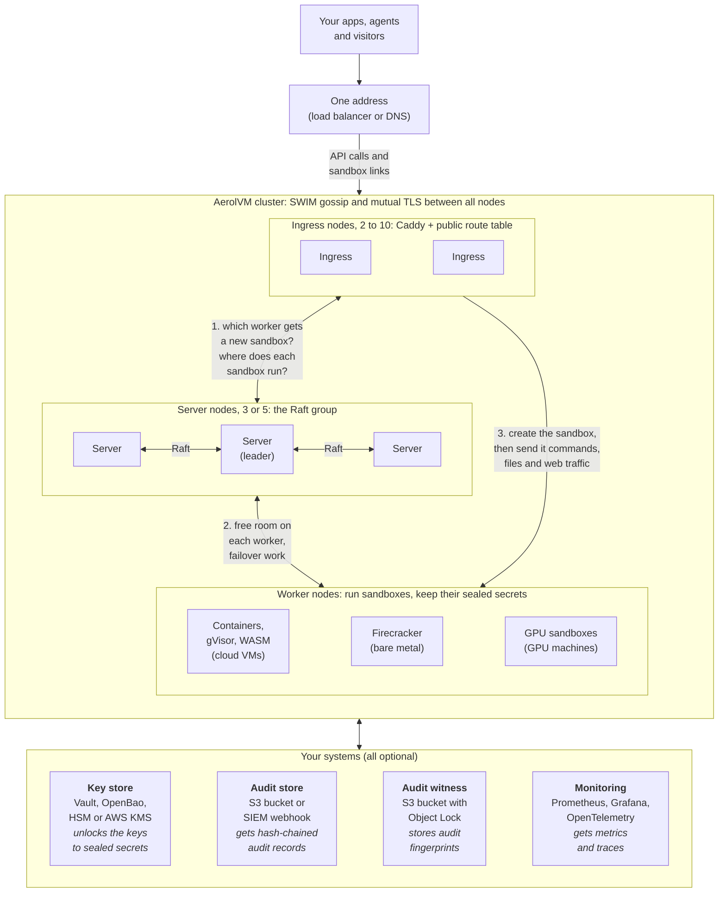

&nbsp;

<div align="center">
  <picture>
    <source media="(prefers-color-scheme: dark)" srcset="https://github.com/aerol-ai/microvm/raw/main/docs/public/aerol-logo.svg">
    <source media="(prefers-color-scheme: light)" srcset="https://github.com/aerol-ai/microvm/raw/main/docs/public/aerol-logo.svg">
    
  </picture>
</div>

<h3 align="center">
  Run Untrusted Code Safely.<br/>
  Multi-Cloud, Self-Hosted Sandbox Infrastructure for AI Agents and Short-Lived Workloads.
</h3>

<p align="center">
  <a href="https://microvm.aerol.ai">Documentation</a> ·
  <a href="https://microvm.aerol.ai/quick-start">Quick Start</a> ·
  <a href="https://github.com/aerol-ai/microvm/issues/new?labels=bug&template=bug_report.md">Report Bug</a> ·
  <a href="https://github.com/aerol-ai/microvm/issues/new?labels=enhancement&template=feature_request.md">Request Feature</a> ·
  <a href="https://github.com/sponsors/aerol-ai">Sponsor</a>
</p>

<p align="center">
  <a href="https://github.com/aerol-ai/microvm/actions/workflows/test.yml"></a>
  <a href="https://codecov.io/gh/aerol-ai/microvm"></a>
  <a href="https://github.com/aerol-ai/microvm/actions/workflows/release.yml"></a>
  <a href="https://github.com/aerol-ai/microvm/blob/main/LICENSE"></a>
  <a href="https://scorecard.dev/viewer/?uri=github.com/aerol-ai/microvm"></a>
  <a href="https://www.bestpractices.dev/projects/15170"></a>
</p>

&nbsp;

AerolVM is open-source sandbox infrastructure that you run yourself, on any cloud or on your own servers. Each sandbox is an isolated machine with its own files, its own network, and its own CPU and memory limits. You choose how strong the wall is for each sandbox: OCI containers on **containerd** (the default), gVisor, Firecracker microVMs, WASM, or V8 isolates. The fastest path creates a sandbox in about **4ms** on the server.

AerolVM is one Go binary (`sandboxd`). It uses Caddy for HTTPS and routing and SQLite for state. It needs no outside database and installs with one command.

What the project plans to do, and not do, through October 2027 is in [ROADMAP.md](ROADMAP.md).

## Multi-cloud and self-hosted

AerolVM runs where you run it. There is no hosted control plane you have to use, and no Aerol account is needed.

- **Any cloud.** Run it on AWS, Google Cloud, Azure, DigitalOcean, Hetzner, or any other cloud. Any Linux server works. Ubuntu 22.04 or newer is the tested path.
- **Your own hardware.** Run it in your data center or on bare metal. Firecracker needs KVM, so use bare metal or a VM with nested virtualization.
- **Your laptop.** `--local` runs it on macOS or Linux with Docker. You need no domain and no cloud account.
- **No lock-in.** AerolVM does not depend on any one cloud's services. You can move between clouds without changing your code. Key stores (AWS KMS, Vault, OpenBao, or an HSM) and audit sinks (S3, webhook, or file) are optional add-ons you pick.
- **Mix machines in one cluster.** A hetero cluster puts each job on the hardware that suits it: small VMs for containers, bare metal for Firecracker, GPU machines for GPU work. See [Architecture](#architecture).
- **Your data stays with you.** Sandboxes, code, secrets, and audit logs live on your machines.
- **Open source.** MIT licensed, with SDKs in five languages.

Install with the script on any Linux server. For fleets, use the [Ansible playbooks](Ansible/) or the [Terraform module](Terraform/) (the Terraform module targets AWS today). Our live test suite runs on AWS.

## Features

AerolVM gives you everything you need to build sandbox-backed products and agent workflows.

| Sandboxes | Execution | Networking & Ports | Storage & Secrets | Platform & Cluster |
| :--- | :--- | :--- | :--- | :--- |
| [Lifecycle (create / start / stop / destroy)](https://microvm.aerol.ai/sandboxes) | [Streaming exec & PTY](https://microvm.aerol.ai/exec-streaming) | [HTTP public URLs](https://microvm.aerol.ai/public-urls) | [External storage (S3, NFS, SSHFS, rclone)](https://microvm.aerol.ai/external-storage) | [Raft-coordinated cluster](https://microvm.aerol.ai/getting-started/cluster-setup) |
| [Environment & resource limits](https://microvm.aerol.ai/sandbox-env) | [Persistent PTY sessions w/ replay](https://microvm.aerol.ai/sessions) | [TCP port exposure](https://microvm.aerol.ai/tcp-ports) | [Encrypted sandbox secrets](https://microvm.aerol.ai/sandbox-env) | [HA failover & durability](https://microvm.aerol.ai/durability) |
| [Images & snapshots](https://microvm.aerol.ai/images-and-snapshots) | [SSH access per sandbox](https://microvm.aerol.ai/ssh-access) | [TLS + SNI port routing](https://microvm.aerol.ai/tcp-vs-tls-ports) | [Custom domains](https://microvm.aerol.ai/custom-domains) | [Cluster ingress](https://microvm.aerol.ai/cluster-ingress) |
| [Five runtimes (containerd / gVisor / Firecracker / WASM / Isolate)](https://microvm.aerol.ai/sandboxes) | [File system operations](https://microvm.aerol.ai/file-system) | [Per-sandbox egress control](https://microvm.aerol.ai/network-access) | [Sandbox tags & tenant scoping](https://microvm.aerol.ai/sandbox-tags) | [Reconciler & self-healing](https://microvm.aerol.ai/reconcile) |
| [GPU sandboxes](https://microvm.aerol.ai/gpu-sandboxes) | [MCP server & CLI for agents](https://microvm.aerol.ai/mcp) | [Per-sandbox network quotas](https://microvm.aerol.ai/network-usage) | [Dashboard](https://microvm.aerol.ai/dashboard) | [Operational runbooks](https://microvm.aerol.ai/operational-runbooks) |

## Architecture

The diagram shows a **hetero cluster**: each node has one job, and each job runs on the hardware that suits it. All nodes run the same `sandboxd` binary.



The numbers follow one new sandbox:

1. **Ingress nodes (2 to 10)** take every API call and every sandbox link. For a new sandbox, the ingress node asks the server nodes which worker should run it. Ingress nodes also follow the server nodes' record of where each sandbox runs, so their public route table stays current.
2. **Server nodes (3, 5 or at most 7)** form the Raft group. They keep the record of which worker runs which sandbox, and they agree on every change to it. They check how much free room each worker has, and pick a worker with room for each new sandbox. The voter count stays the same however many workers join, so adding workers does not slow down voting. They do little work, so small machines are enough.
3. **Worker nodes** run the sandboxes. The ingress node sends the create to the chosen worker, then sends that worker the sandbox's commands, file calls and web traffic. Each worker reports which runtimes and GPUs it has, so a sandbox only lands on a worker that can run it. Add as many workers as you need.

Every node finds the others with SWIM gossip, protected by a shared key. Every call between nodes uses mutual TLS.

- **Secret keys.** Sandbox secrets are always encrypted on disk: environment variables, registry passwords and storage credentials. Each worker keeps the sealed secrets of its sandboxes. By default, each node keeps the key in a file. You can keep it in your own key store instead: Vault, OpenBao, an HSM or AWS KMS. Each node then asks your key store to unlock the key at start, and checks again every 5 minutes. Disable the key, and every node stops using your secrets within about 15 minutes. See [Secrets providers](https://microvm.aerol.ai/cluster-secrets) and [Use your own key store](https://microvm.aerol.ai/enterprise/key-custody).
- **Audit.** Every node writes a record each time a secret is opened, an API call changes something, or a call is refused. Each record names the caller. Each record also holds a fingerprint (hash) of the one before it, so an edited or deleted record breaks the chain. Nodes ship the records to your S3 bucket or a webhook. The audit witness keeps each node's newest fingerprint in an S3 bucket with Object Lock, where no node can change it. So if someone with root on a node rewrites its log, `aerolvm audit verify` catches it. See [Audit and compliance](https://microvm.aerol.ai/enterprise/audit-evidence).
- **Failover.** If a worker dies, the server nodes give its failover sandboxes to healthy workers. Each one is rebuilt with the same ID, ports, and public link. Its sealed secrets were copied to at least one backup node when it was created, so they still open on the new worker. See [Durability](https://microvm.aerol.ai/durability).

You do not need a cluster to start. One server runs all three jobs on one machine. A **mixed cluster** of 2 to 10 alike servers gives you more room and survives a dead server. Move to a hetero cluster past 10 nodes, or when you want bare metal and GPU machines. Your code is the same in every layout. See [Clusters](https://microvm.aerol.ai/getting-started/cluster-setup) and [Reference architectures](https://microvm.aerol.ai/enterprise/deployment).

Inside each node, `sandboxd` uses three parts:

- **Caddy** handles wildcard TLS via DNS-01, HTTP routing (`<sandbox-id>.<domain>`), and TCP SNI routing (`<sandbox-id>-<port>.<domain>`). The daemon drives Caddy through its admin API, so no config files are reloaded at runtime.
- **Runtimes**: OCI containers (`runtime: "docker"` on the **containerd** engine by default; dockerd is optional), gVisor (`runsc`), Firecracker (microVM), WASM (WASI workers or a resident host), and V8 isolate (`workerd`).
- **SQLite** (WAL mode, one writer) stores sandbox state, the TCP host-port pool, exposed-port intents, and sealed secrets. One writer means no lock fights. WAL mode means reads never block writes.

## Runtimes

| Runtime | Status | Install / enable | Use case |
| :--- | :--- | :--- | :--- |
| OCI / `docker` API (`runc` via **containerd**) | ✅ Available | Default engine (`SB_CONTAINER_ENGINE=containerd`) | Broadest OCI image compatibility. |
| gVisor (`runsc`) | ✅ Available | `--with-gvisor` | User-space kernel for untrusted LLM code. |
| Firecracker | ✅ Available | `--with-firecracker` (bare metal / KVM) | MicroVM - dedicated kernel per sandbox. |
| WASM | ✅ Available | Config / cluster wasm workers | WASI modules; resident host ~22ms warm create. |
| Isolate (V8 / workerd) | ✅ Available (off by default) | `--with-isolate` / `SB_ENABLE_ISOLATE` | JS/TS `fetch` handlers; **~4ms** warm server create. |

## Create latency

Server-side create from `Server-Timing` (excludes client↔cluster WAN). Artifacts under `integration-tests/reports/`. Production deployments use the **containerd** engine for OCI sandboxes (`runtime: "docker"` on the wire).

| Runtime / engine | Server p50 | Server p90 | Server p99 | Topology | Notes |
| :--- | ---: | ---: | ---: | :--- | :--- |
| **Isolate** | **4ms** | 6ms | 19ms | `single-node-isolate` · t3.medium | Warm path (same tenant group); API p50 266ms is WAN |
| **WASM** (resident host) | **22ms** | 46ms | 50ms | `cluster-3-mixed-wasm` · t3.large | Flag-on resident host; no cold-compile tail |
| **Firecracker** (warm pool) | **34ms** | 36ms | 37ms | `single-node-fc` · c5.metal | Post warm-pool path; cold/template builds are higher |
| **containerd** (warm pool) | **31ms** | 33ms | 66ms | `cluster-mixed-benchmark-with-obs` · t3.large | All 10 samples came from the pool. Turn it on with `SB_CONTAINERD_POOL_ENABLED=true` (off by default) |
| **containerd** (OCI default, cold) | **189ms** | 225ms | 233ms | `cluster-3-mixed-containerd` · t3.medium | Default host engine, pool off; API runtime remains `docker` |
| **gVisor** (warm pool) | **34ms** | 37ms | 42ms | `cluster-mixed-benchmark-with-obs` · t3.large | Same containerd pool, with runsc. 8 of 10 samples came from the pool; the 2 misses were full creates and set the p90 and p99 |
| **gVisor** (cold) | **284ms** | 330ms | 346ms | `cluster-3-mixed-gvisor` · t3.medium | User-space kernel boot cost, pool off |

The warm-pool rows come from one 10-sample run (2026-10-04) with the pool on for `alpine:3.20`. Only plain creates use the pool: no environment variables, mounts, custom command, private registry or GPUs, running as root, with a warm slot ready for that image. Every other create takes the cold path.

Reproduce: `make integration-benchmark-isolate`, `integration-benchmark-wasm`, `integration-benchmark-containerd`, `integration-benchmark-fc`, `integration-benchmark-gvisor`, and `integration-cluster-mixed-obs` for the warm-pool rows.

## SDKs

AerolVM ships first-party SDKs for five languages. Install the one that matches your stack:

```bash
# TypeScript / Node.js
npm install @aerol-ai/aerolvm-sdk

# Python
pip install aerolvm-sdk

# Go
go get github.com/aerol-ai/microvm/sdk/go/pkg/microvm@latest

# Rust
cargo add aerolvm-sdk

# Java: from GitHub Packages, see the SDK Setup docs
# <dependency><groupId>ai.aerol</groupId><artifactId>aerolvm-sdk</artifactId></dependency>
```

### Quick Start

Every SDK reads the server address and token from two settings:

```bash
export SB_API_URL=http://localhost:21212
export SB_PAT_TOKEN=your-secret-pat
```

<details open>
<summary><strong>TypeScript</strong></summary>

```ts
import { MicroVM } from "@aerol-ai/aerolvm-sdk";

const client = new MicroVM(); // reads SB_API_URL and SB_PAT_TOKEN

const sandbox = await client.create({ image: "python:3.12-slim" });
const result = await sandbox.exec(`python3 -c "print('Hello from AerolVM!')"`);
console.log(result.stdout);

await sandbox.destroy();
```

</details>

<details>
<summary><strong>Python</strong></summary>

```python
from microvm import MicroVM

client = MicroVM()  # reads SB_API_URL and SB_PAT_TOKEN

sandbox = client.create(image="python:3.12-slim")
result = sandbox.exec("python3 -c \"print('Hello from AerolVM!')\"")
print(result["stdout"])

sandbox.destroy()
```

</details>

<details>
<summary><strong>Go</strong></summary>

```go
package main

import (
    "context"
    "fmt"
    "log"

    microvm "github.com/aerol-ai/microvm/sdk/go/pkg/microvm"
    sdktypes "github.com/aerol-ai/microvm/sdk/go/pkg/types"
)

func main() {
    ctx := context.Background()

    client, err := microvm.NewClient() // reads SB_API_URL and SB_PAT_TOKEN
    if err != nil {
        log.Fatal(err)
    }

    sandbox, err := client.Create(ctx, sdktypes.CreateSandboxOptions{Image: "python:3.12-slim"})
    if err != nil {
        log.Fatal(err)
    }
    defer sandbox.Destroy(ctx)

    result, err := sandbox.ExecCommand(ctx, `python3 -c "print('Hello from AerolVM!')"`)
    if err != nil {
        log.Fatal(err)
    }
    fmt.Print(result.Stdout)
}
```

</details>

<details>
<summary><strong>Rust</strong></summary>

```rust
use aerolvm_sdk::{Client, CreateOptions};

fn main() -> Result<(), aerolvm_sdk::Error> {
    let client = Client::new(None, None)?; // reads SB_API_URL and SB_PAT_TOKEN

    let sandbox = client.create(CreateOptions {
        image: "python:3.12-slim".into(),
        ..Default::default()
    })?;
    let result = sandbox.exec(r#"python3 -c "print('Hello from AerolVM!')""#)?;
    print!("{}", result.stdout);

    sandbox.destroy()?;
    Ok(())
}
```

</details>

<details>
<summary><strong>Java</strong></summary>

```java
import ai.aerol.microvm.MicroVMClient;
import ai.aerol.microvm.Sandbox;
import ai.aerol.microvm.model.CreateOptions;
import ai.aerol.microvm.model.ExecResult;

public class Hello {
    public static void main(String[] args) {
        MicroVMClient client = new MicroVMClient(); // reads SB_API_URL and SB_PAT_TOKEN

        Sandbox sandbox = client.create(new CreateOptions().setImage("python:3.12-slim"));
        ExecResult result = sandbox.exec("python3 -c \"print('Hello from AerolVM!')\"");
        System.out.print(result.stdout);

        sandbox.destroy();
    }
}
```

</details>

To give a port in the sandbox a public URL, see [Public URLs](https://microvm.aerol.ai/public-urls). More setup detail is in [SDK Setup](https://microvm.aerol.ai/sdk-setup).

### Drop-in SDK Compatibility

If your code already uses the e2b, Daytona, or Runloop SDK, AerolVM has API facades that accept their wire format unchanged:

| Existing SDK | AerolVM facade endpoint | Migration |
| :--- | :--- | :--- |
| `e2b` Python / TypeScript | `/e2b/...` | Set `E2B_API_URL=https://your-aerolvm-host` |
| `daytona` Python / TypeScript | `/daytona/...` | Set `DAYTONA_API_URL=https://your-aerolvm-host` |
| Runloop Python / TypeScript | `/runloop/...` | Set `RUNLOOP_BASE_URL=https://your-aerolvm-host/runloop` |

[Using the e2b SDK →](https://microvm.aerol.ai/using-e2b-sdk) · [Using the Daytona SDK →](https://microvm.aerol.ai/using-daytona-sdk) · [Using the Runloop SDK →](https://microvm.aerol.ai/using-runloop-sdk)

## Installation

Pick where you want to run it. The SDK code is the same in all three.

| Where | You need | Guide |
| :--- | :--- | :--- |
| Your computer | macOS or Linux with Docker | [Install on your computer](https://microvm.aerol.ai/getting-started/local-setup) |
| One server on any cloud, or your own | One Ubuntu or Debian server and a domain on Cloudflare | [Install on a server](https://microvm.aerol.ai/getting-started/single-node-setup) |
| A cluster | Several Linux servers. The step-by-step guide uses AWS with Terraform. | [Clusters](https://microvm.aerol.ai/getting-started/cluster-setup) |

The installer gets HTTPS certificates through Cloudflare DNS, which is the only DNS provider it supports today. All installer flags are in [Installer options](https://microvm.aerol.ai/getting-started/installer-options).

## Use Cases

| Use Case | Description |
| :--- | :--- |
| [AI Code Execution](https://microvm.aerol.ai/use-cases/coding-agents) | Run LLM-generated code safely in kernel-isolated environments. Handle untrusted Python, JS, and shell from agent workflows without risking the host. |
| [Ephemeral CI / Build Agents](https://microvm.aerol.ai/use-cases) | Spin up a fresh environment per job, run tests, collect artifacts, destroy. No persistent state, no environment drift. |
| [Customer-Facing Products](https://microvm.aerol.ai/use-cases/customer-facing-product-experiences) | Ship interactive code runners, coding interview sandboxes, and per-user compute environments backed by AerolVM's isolation and port exposure. |
| [Data Processing Pipelines](https://microvm.aerol.ai/use-cases) | Attach S3 or NFS storage, run transforms in parallel across sandboxes, extract results - with per-sandbox network quotas to prevent runaway egress. |

## Documentation

| Guide | Description |
| :--- | :--- |
| [Quick Start](https://microvm.aerol.ai/quick-start) | Spin up a sandbox and run a command in under five minutes. |
| [Server Setup](https://microvm.aerol.ai/getting-started) | Install AerolVM on your computer, one server, or a cluster. |
| [SDK Setup](https://microvm.aerol.ai/sdk-setup) | Connect an SDK to your AerolVM server. |
| [Sandboxes](https://microvm.aerol.ai/sandboxes) | Lifecycle states, runtimes, resource limits, and configuration. |
| [Sessions](https://microvm.aerol.ai/sessions) | Persistent PTY sessions that survive reconnects with output replay. |
| [Snapshots](https://microvm.aerol.ai/images-and-snapshots) | Stop a sandbox, snapshot its state, restart it later exactly where it left off. |
| [Clusters](https://microvm.aerol.ai/getting-started/cluster-setup) | Mixed and hetero clusters with Raft placement and SWIM gossip. |
| [Reference architectures](https://microvm.aerol.ai/enterprise/deployment) | Single server, mixed cluster, and hetero cluster, with diagrams. |
| [Actors and actions](DESIGN.md) | Who acts on a released node, and which component carries out each action. |
| [Security assessment](SECURITY-ASSESSMENT.md) | The most likely and most severe problems for a released node, and where the 0.6.3 review left each one. |
| [Releasing](RELEASING.md) | How the maintainer publishes a release and keeps the changelog in sync. |

## Dependencies

A released version's dependencies are the ones recorded in the committed manifests and lockfiles. A new dependency is added only in a reviewed pull request that names the package, the version, and why it is needed. Builds obtain those dependencies with the standard tool for that language, from the lockfile, so a release does not resolve an unpinned range.

| Component | Recorded in | Obtained with |
| :--- | :--- | :--- |
| Go daemon and Go SDK | `go.mod`, `go.sum` | Go modules (`go build`, `go test`) |
| TypeScript SDK | `sdk/typescript/package-lock.json` | `npm ci` |
| Docs site | `docs/package-lock.json` | `npm ci` |
| Release npm CLI | `.github/npm-cli/package-lock.json` | `npm ci` |
| Python SDK | `sdk/python/pyproject.toml`, `sdk/python/requirements-ci.txt` | `pip install --require-hashes` |
| Java SDK | `sdk/java/pom.xml` | Maven (`mvn`) |
| Rust SDK | `sdk/rust/Cargo.lock` | `cargo test --locked` / `cargo publish` |

[Dependabot](.github/dependabot.yml) opens a weekly pull request for Go modules, GitHub Actions, npm (the docs site and the TypeScript SDK), pip, Maven, and Cargo. Dependabot security updates are enabled on the repository. The pinned npm CLI under `.github/npm-cli` is outside that schedule; it changes only when its lockfile is updated in a pull request. The Go CI job also runs `govulncheck` against the module graph.

## Access to sensitive resources

These GitHub accounts can reach the repository's sensitive resources. Registry publish tokens (npm, PyPI, Maven, crates.io) are GitHub Actions secrets. They are not in the git tree. The release workflow and the SDK publish workflow are what read them.

| GitHub account | Access |
| :--- | :--- |
| [`sumansaurabh`](https://github.com/sumansaurabh) | Organization owner and repository admin. Can change branch rules, Actions secrets, security settings, and publish a release. |
| [`akanshasinha19`](https://github.com/akanshasinha19) | Write. Can push branches, open pull requests, publish a GitHub release, and dispatch the SDK publish workflow. |

Merges to the default branch still require a reviewed pull request. [Code owners](.github/CODEOWNERS) are the review list, separate from this access list. How the project keeps creating issues, accepting changes, and publishing releases if one person is unavailable, and why the bus factor is 2, is in [CONTINUITY.md](CONTINUITY.md).

## Roles and responsibilities

How these roles make decisions is in [GOVERNANCE.md](GOVERNANCE.md).

| Role | Members | Responsibilities |
| :--- | :--- | :--- |
| Maintainer | [`sumansaurabh`](https://github.com/sumansaurabh) | Approve pull requests. Publish official releases and the SDK packages. Change branch rules, Actions secrets, and security settings. Triage reports sent to [security@aerol.ai](mailto:security@aerol.ai) and [GitHub private advisories](https://github.com/aerol-ai/microvm/security/advisories/new). |
| Code owner | [`sumansaurabh`](https://github.com/sumansaurabh), [`akanshasinha19`](https://github.com/akanshasinha19) | Review pull requests. A code owner other than the pull request author approves changes to the default branch. |
| Write collaborator | [`akanshasinha19`](https://github.com/akanshasinha19) | Push branches and open pull requests. Official releases stay with the maintainer. |
| Contributor | Anyone else | Open issues and pull requests. No access to Actions secrets, branch rules, or release publishing. |

## Contributing

AerolVM is open source under the [MIT License](LICENSE). The [contributor guide](CONTRIBUTING.md) states what an acceptable change must include: a reviewed pull request, a filled pull request description, tests, and no secrets in the diff. Open an issue first for a non-trivial change. Community spaces follow the [code of conduct](CODE_OF_CONDUCT.md).

```bash
make fmt      # format Go code
make test     # run tests
make build    # build sandboxd + toolboxd into bin/
```

## License

[MIT](LICENSE) · © Aerol AI, Inc.
