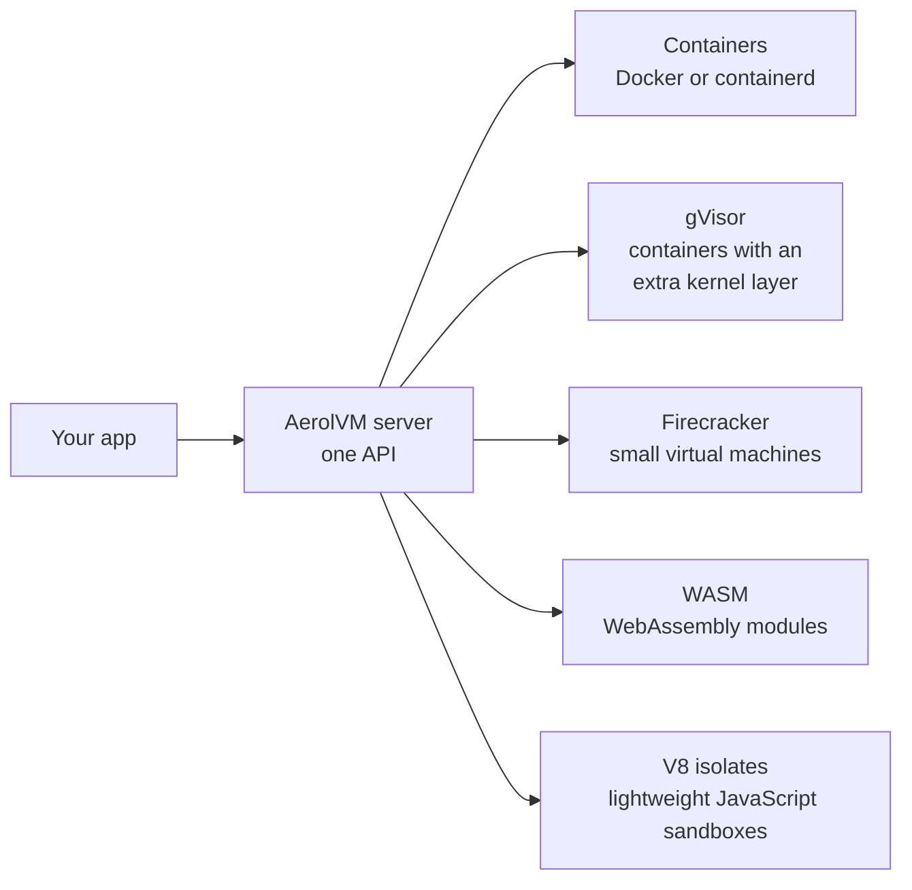
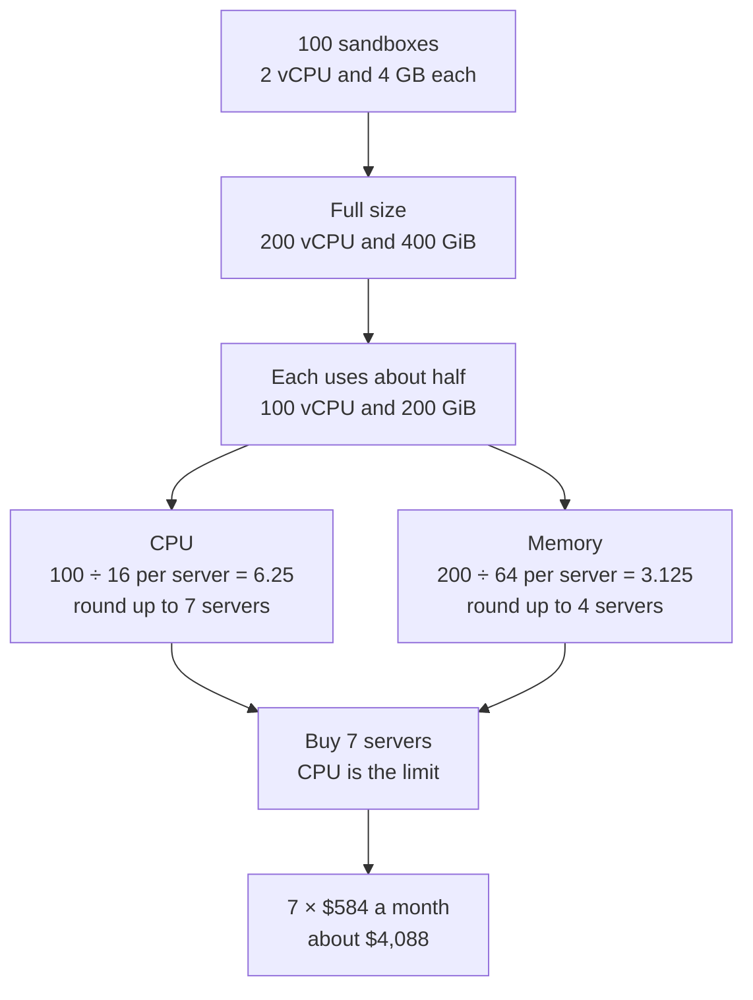
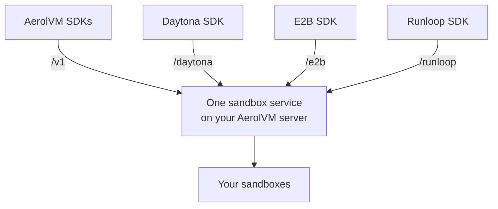
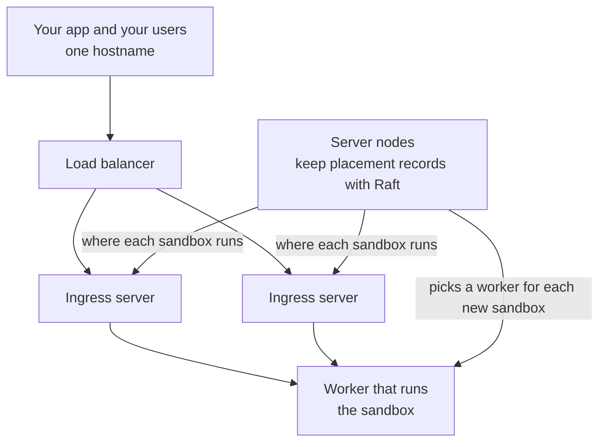
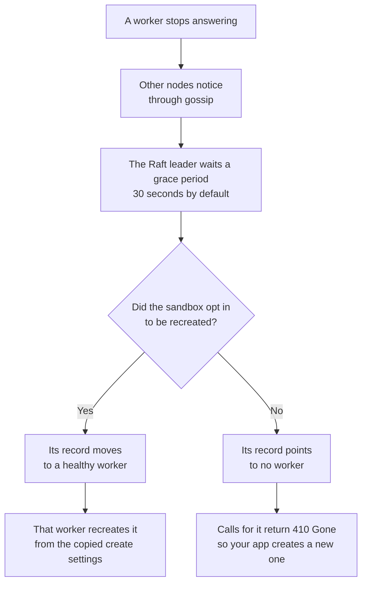

import { Aside } from '@astrojs/starlight/components';

Daytona and E2B are two other products that run code in sandboxes. This page compares them with AerolVM, and explains why we built AerolVM.

The Daytona and E2B columns come from their own docs and code repositories, as we read them in October 2026. Check their docs for the latest.

## Side by side

| | AerolVM | E2B | Daytona |
|---|---|---|---|
| **Where it runs** | Your own servers, or a managed multi-tenant service | E2B's cloud, a deployment E2B runs in your cloud account, or one machine you run yourself (E2B Embed) | Daytona's cloud. Bring your own compute (BYOC) adds your own machines, still managed by Daytona's control plane. |
| **Setup effort** | Easy on one server | One Linux machine with KVM, with Docker Compose. More than one machine needs a deployment from E2B. | Nothing to set up on Daytona's cloud. The public version you could host yourself is no longer maintained. |
| **Runs on your laptop** | ✅ | Linux laptops with KVM only | ✗ |
| **Open source** | ✅ MIT | ✅ Apache-2.0 | Only up to v0.190.0 (AGPL-3.0). Development moved to a private codebase in June 2026. |
| **Main use** | AI agents and short-lived CI jobs | Running code for AI agents | Sandboxes for AI agents |
| **Sandbox start time (median)** | V8 isolate about 4 ms · WASM about 22 ms · Firecracker about 34 ms · containers on containerd about 189 ms | About 200 ms | Under 90 ms |
| **Isolation options** | Containers (Docker or containerd), gVisor, Firecracker virtual machines, WebAssembly (WASM), V8 isolates | Firecracker | Containers by default. Linux and Windows virtual machines, and macOS on Apple hardware. |
| **Serverless sandboxes** | ✅ WASM and V8 isolates, in the style of AWS Lambda or Cloudflare Workers | ✗ | ✗ |
| **Extra security layers** | gVisor, Firecracker, the isolate jail, WASM sandboxing | Firecracker | Virtual machine sandboxes |
| **Port isolation** | ✅ | A sandbox's URLs can require a token (`allowPublicTraffic: false`) | Preview URLs need a token unless the sandbox is public |
| **Persistent sandboxes** | ✅ | ✅ Pausing keeps the files and the memory | ✅ |
| **Longest sandbox life** | No limit | No limit while paused. On E2B's cloud, up to 24 hours running at a stretch on the Pro plan, 1 hour on Hobby. | No limit |
| **Clusters of many servers** | ✅ Shared placement records kept by Raft. Separate server, worker and ingress roles. | E2B's cloud, or a deployment E2B runs in your cloud account. E2B Embed is one machine. | Daytona's cloud, plus your own machines through BYOC |
| **Failover when a server dies** | ✅ Copied placement records, detection of dead servers, and [reconcile](/reconcile/) (repair when the records and the running sandboxes disagree) | Managed for you | Not described in their docs |
| **Works with existing Daytona, E2B and Runloop SDKs** | ✅ Compatibility APIs at `/daytona`, `/e2b` and `/runloop`. You change the server URL, not your code. | ✗ | ✗ |
| **Terminal sessions you can reconnect to** | ✅ Reconnect and see the output you missed | Reconnect to a running command | Reconnect to a named terminal (PTY) session |
| **Cloud storage mounts** | S3, NFS, SSHFS, rclone | Volumes. Buckets through FUSE in a custom template. | S3, Cloudflare R2, Google Cloud Storage, Azure Blob and more |
| **GPUs** | ✅ | ✗ | ✅ NVIDIA and AMD |
| **Raw TCP ports** | ✅ | ✗ | ✗ |
| **TLS ports routed by hostname (SNI)** | ✅ | ✗ | ✗ |
| **SSH access** | ✅ An Ed25519 key per sandbox, through a gateway | Through a WebSocket proxy you add to a template | ✅ |
| **Outbound traffic rules per sandbox** | ✅ | ✅ Allow and deny lists, including domain names | ✅ Block all, or allow lists of IP ranges and domain names |
| **Network data caps per sandbox** | ✅ Byte limits for traffic in and out. Traffic is dropped once a limit is reached. | ✗ | ✗ |
| **Tags for multi-tenant apps** | ✅ Filter the sandbox list by tags. A sandbox must match every tag you pass. | ✅ Metadata, with list filters | ✅ Labels, with list filters |
| **Port allowlist** | ✅ Public traffic reaches a port only after you expose it | ✗ | ✗ |
| **SDK languages** | TypeScript, Python, Go, Rust, Java | TypeScript, Python | TypeScript, Python, Ruby, Go, Java |
| **Cost per month for 100 sandboxes running at once** (2 vCPU, 4 GB RAM and 16 GB disk each) | About $4,000 ([see the math](#how-we-worked-out-the-cost)) | About $12,000 | About $12,000 |

A few terms from the table:

- **Raft** is a method for several servers to agree on one shared record. AerolVM uses it to track which server runs each sandbox.
- **Ingress** servers take in public traffic and pass it to the server that runs the sandbox.
- **SNI** is the hostname a client sends at the start of a TLS (encrypted) connection. AerolVM routes on it, so many sandboxes can share port 443.

One AerolVM server can run every kind of sandbox in the table. You pick the kind for each sandbox when you create it.

- The server operator chooses which kinds to turn on.
- You create every kind with the same SDK. Some features differ between kinds.

### What the start times measure

Each AerolVM number is a median: half of the sandbox creates were faster. We measured it inside the AerolVM server on our AWS test servers. It does not count the network trip between your app and the server. In every test the image, module or code bundle was already on the server.

| Sandbox kind | Median start | Test servers |
|---|---|---|
| V8 isolate | about 4 ms | One `t3.medium`. The tenant's isolate group was already running. |
| WASM | about 22 ms | Three `t3.large` servers in a cluster, with the WASM module already loaded |
| Firecracker | about 34 ms | One `c5.metal`, using the snapshot warm pool (copies of an already-booted VM, ready to resume) |
| Containers on containerd | about 189 ms | Three `t3.medium` servers in a cluster |

The E2B and Daytona numbers are the vendors' own published figures. We did not measure them.

### How we worked out the cost

<Aside>
These sandboxes run on shared servers. You pay for 2 vCPU and 4 GB of memory per sandbox, but most sandboxes use much less.
</Aside>

We used the AWS on-demand `m4.4xlarge` server as the reference. It has 16 vCPU and 64 GiB of memory and costs about $0.80 an hour. Over a month that is 0.80 × 730 hours, or about $584.

At full size, 100 sandboxes need 200 vCPU and 400 GiB of memory. But sandboxes like these rarely use their full size. Here is the cost if they use a quarter of it, or half of it:

| | Each sandbox uses 1/4 of its size | Each sandbox uses 1/2 of its size |
|---|---|---|
| vCPU needed | 200 ÷ 4 = 50 | 200 ÷ 2 = 100 |
| Memory needed | 400 ÷ 4 = 100 GiB | 400 ÷ 2 = 200 GiB |
| Servers needed for CPU | 50 ÷ 16 = 3.125, so 4 | 100 ÷ 16 = 6.25, so 7 |
| Servers needed for memory | 100 ÷ 64 = 1.56, so 2 | 200 ÷ 64 = 3.125, so 4 |
| Servers to buy (CPU is the limit) | 4 | 7 |
| Monthly cost | 4 × $584 = $2,336 | 7 × $584 = $4,088 |

Here is the half-size case as a chain of steps.

The table above uses the more cautious case, about $4,000. The $12,000 figure is the vendor price for 100 full-size sandboxes. Sharing servers is what closes that gap.

The 16 GB of disk per sandbox costs extra, but compute is the main cost here.

## AerolVM vs E2B

E2B is a cloud service built for AI agent sandboxes. It is the fastest way to start if you do not want to run any servers. Its runtime is open source (Apache-2.0), and E2B Embed runs the whole stack on one machine you own. The trade-offs:

- **Self-hosting stops at one machine.** E2B Embed runs on a single Linux host. Past one machine, E2B runs a dedicated deployment in your cloud account for you. AerolVM's clusters are part of the open-source server.
- **Every host needs KVM.** Every E2B sandbox is a Firecracker virtual machine, so E2B needs Linux with KVM, the Linux feature for running virtual machines. That rules out macOS laptops, and cloud servers without KVM, such as standard AWS types like `t3` and `m5`. AerolVM's container and gVisor sandboxes need no KVM, and containers also run on macOS for local work.
- **You pay per sandbox-second on E2B's cloud.** Cost grows with every sandbox you run. A team running more than 1,000 sandboxes can pay over $500 a month on E2B. With AerolVM, the same team could pay about $20 a month for one server.
- **A limit on running time.** On E2B's cloud, a sandbox runs for at most 24 hours at a stretch on the Pro plan, and 1 hour on Hobby. Then it has to be paused, which keeps its files and memory. AerolVM sandboxes have no time limit.
- **Missing features.** E2B has no GPUs, raw TCP ports, TLS ports routed by hostname or network data caps.

**Already using the E2B SDK?** AerolVM has an `/e2b` compatibility API. Set three environment variables so the E2B SDK talks to your AerolVM server, and keep your code. See [Use the E2B SDK](/using-e2b-sdk/).

AerolVM covers the same AI use case on your own servers. You pick the isolation for each sandbox, from containers to Firecracker, and pay a fixed server bill instead of metered billing.

## AerolVM vs Daytona

Daytona runs sandboxes for AI agents as a cloud service. Sandboxes are containers by default, with virtual machine, GPU and macOS sandboxes as options.

- **No longer open source.** In June 2026 Daytona moved its core development to a private codebase. Its public repository stopped at v0.190.0 (AGPL-3.0) and gets no more fixes. AerolVM is MIT-licensed and developed in the open.
- **Your machines, Daytona's control plane.** Bring your own compute (BYOC) runs sandboxes on your own machines, but Daytona's control plane still manages them. AerolVM runs entirely on your servers, from one binary, and installs with a one-line script.
- **More isolation choices.** Daytona offers containers and virtual machines. AerolVM adds gVisor, WASM and V8 isolates. Its outbound rules can also limit a site to some methods and paths, keep an API key out of the sandbox, and let only some programs connect. See [Advanced network rules](/advanced-network-rules/).

**Already using the Daytona SDK?** AerolVM has a `/daytona` compatibility API. Point the Daytona SDK at `https://your-host/daytona`, use your AerolVM token, and keep your code. See [Use the Daytona SDK](/using-daytona-sdk/).

All three compatibility APIs sit in front of the same sandbox service as AerolVM's own API.

- Each compatibility API turns the other SDK's calls into AerolVM's own sandbox calls.
- All four APIs are served by the same AerolVM server. There is no separate Daytona, E2B or Runloop server to run.

If you want a hosted service with virtual machine, GPU and macOS sandboxes and no servers to run, Daytona is a reasonable fit. If you need the whole stack on your own servers, under an open-source license, AerolVM is built for that.

## Growing past one server

E2B, Daytona and AerolVM are all built for heavy sandbox traffic. The difference is who runs the servers. With AerolVM you run a [cluster](/cluster-setup/) on your own servers, instead of paying a vendor for every sandbox you run.

- **Shared placement records.** Raft keeps a copy of where each sandbox lives on every `server` node. Any `server` node can answer "where is sandbox X?" without asking the leader.
- **Separate roles.** Each server takes one or more roles: `server` (keeps the Raft records and votes), `worker` (runs sandboxes) or `ingress` (holds the public route table). You keep 3 or 5 `server` nodes however many workers you add. Kubernetes splits control-plane nodes from worker nodes the same way. See [Ingress nodes](/cluster-ingress/).
- **One public address.** Put a load balancer in front of the ingress servers. A cloud load balancer, a MetalLB virtual IP or round-robin DNS all work. Round-robin DNS means one name that points to several IP addresses. Your app and your users use one hostname, whichever worker runs the sandbox.
- **Failover.** Servers notice a dead worker through gossip, a constant exchange of short status messages. Calls for its sandboxes then return `410 Gone`, so clients know to create new ones. Sandboxes that opt in are recreated for you. Raft also keeps copies of each sandbox's create settings, sealed credentials and exposed ports. See [Durability and failover](/durability/).

This is how a request reaches a sandbox in a cluster.

- Any ingress server can take a request, because each one learns where every sandbox runs.
- You add workers to run more sandboxes. The number of `server` nodes stays small.

This is what happens when a worker dies.

- The grace period stops a worker that drops off for a moment from losing its sandboxes.
- If no healthy worker can take an opted-in sandbox, it ends up like one that did not opt in.

## Why we built AerolVM

We built AerolVM because running AI-generated code safely kept forcing the same hard choice.

1. **Hosted sandboxes were easy to start with, but the pricing made us nervous.** If an agent got stuck in a loop, the meter kept running. E2B charges while sandboxes run, and Modal uses usage-based serverless pricing too.
2. **Running it ourselves was not much better.** Firecracker gave us a solid virtual machine layer. But it was not the whole product: we still needed files, logs, commands, networking, cleanup and SDKs around it.
3. **We did not want to run random AI code in plain Docker and hope for the best.** Docker's own docs warn about the attack surface of its background service, which runs as root unless you use rootless mode.
4. **We wanted gVisor built in from day one.** It adds another layer between the code and the server's operating system.

We also did not want to spend weeks gluing together the basics before we could ship: file upload, streaming command output, logs, exposed ports, outbound traffic rules, cleanup and SDKs in several languages.

So we built AerolVM: a sandbox system you run on your own servers, with strong isolation, fast start times and network controls.

## Next steps

- [Quickstart](/quick-start/): run your first sandbox in about five minutes.
- [Choose a setup](/getting-started/): your computer, one server, or a cluster.
- [Create and manage sandboxes](/sandboxes/): every option for creating a sandbox.
- [Use the E2B SDK](/using-e2b-sdk/), [Use the Daytona SDK](/using-daytona-sdk/) or [Use the Runloop SDK](/using-runloop-sdk/): move existing code to AerolVM.
