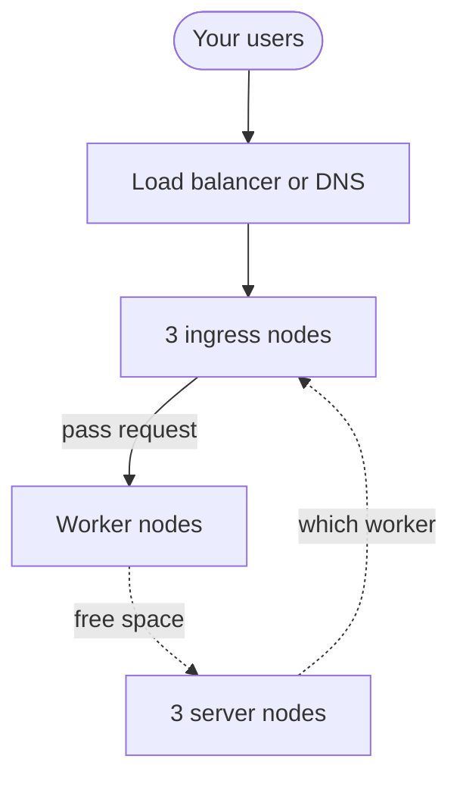

import { Aside } from '@astrojs/starlight/components';

In a small cluster, every node does three jobs at once. A large cluster gives each node one job. This page explains how to split the jobs, and how users reach your sandboxes.

A **node** is one machine in the cluster. `sandboxd` is the AerolVM program on each node.

## Words to know

| Word | What it means |
|---|---|
| **Server node** | A node that votes on cluster changes, and keeps the cluster's records. |
| **Worker node** | A node that runs sandboxes. |
| **Ingress node** | A node that takes web traffic from the internet. It passes each request to the worker that runs the sandbox. "Ingress" means traffic coming in. |
| **Mixed node** | A node that does all three jobs. |
| **Role** | The jobs a node does. The setting `SB_NODE_ROLE` sets it. |
| **Voter** | A server or mixed node that votes on cluster changes. |
| **Majority** | More than half of the voters. A cluster change needs a majority. |
| **Placement map** | The record of which worker runs which sandbox. |
| **Route table** | The list of which web address leads to which sandbox. |
| **Load balancer** | A service that spreads connections across healthy ingress nodes. |
| **Admin token** | The cluster's password for apps and admins. `--pat-token` and `SB_PAT_TOKEN` hold it. |

## Why split the jobs

A mixed node votes, runs sandboxes and takes public traffic. That works up to 10 live nodes.

Every mixed node keeps a full copy of the cluster's records. It also keeps a full copy of the public route table. Past 10 live nodes, those copies cost too much. So the cluster refuses new sandboxes until each node has one job. Kubernetes splits its nodes the same way.

`SB_NODE_ROLE` picks a node's jobs. The setup scripts take it as `--role`, and Terraform as `role`. A node without it is a mixed node. Any role other than `mixed` also needs `SB_ENABLE_CLUSTER=true`.

## The four roles

| Role | Votes | Runs sandboxes | Holds the public route table |
|---|---|---|---|
| `server` | Yes | No | No |
| `worker` | No | Yes | No |
| `ingress` | No | No | Yes |
| `mixed` (default) | Yes | Yes | Yes |

`mixed` is the default. It keeps one-server setups and small clusters working as they are. The cluster refuses it above 10 live nodes.

## Combine roles in a small cluster

`SB_NODE_ROLE` also takes two or three of `server`, `worker` and `ingress`, split by commas. Use this when a small cluster needs nodes with two jobs.

| Value | Votes | Runs sandboxes | Holds route table | When to use it |
|---|---|---|---|---|
| `worker,ingress` | No | Yes | Yes | An **edge node**. It runs sandboxes and serves their public traffic. It does not vote. Good for nodes you add as you grow. |
| `server,ingress` | Yes | No | Yes | A voter that also serves public traffic. It runs no sandboxes. |
| `server,worker` | Yes | Yes | No | A voter that also runs sandboxes. Use it in a cluster with dedicated ingress nodes. |
| `server,worker,ingress` | Yes | Yes | Yes | The same jobs as `mixed`. Write `mixed` instead, because it is clearer. |

Rules for these values:

- A single role, such as `worker`, does that one job.
- Order does not matter. `ingress,worker` and `worker,ingress` are the same.
- You cannot add anything to `mixed`. `SB_NODE_ROLE=mixed,worker` stops the node at start, because `mixed` already means all three.
- A value without `server`, such as `worker,ingress`, cannot start a new cluster. Start the cluster on a node whose role has `server` in it, or is `mixed`.
- Combined roles work only in clusters of 10 live nodes or fewer. Above that, the cluster refuses new sandboxes until every node has one job.

## What a split cluster looks like



| Nodes | `SB_NODE_ROLE` | What they do |
|---|---|---|
| 3 ingress nodes | `ingress` | Run Caddy and `caddy-l4`. Hold the public route table. |
| Any number of worker nodes | `worker` | Run the sandboxes. |
| 3 server nodes | `server` | Vote. Keep the placement map. |

Only the 3 server nodes vote, however many workers join. The public route table lives on the 3 ingress nodes, not on every worker.

## Pick the address users connect to

Each ingress node runs **Caddy**, a web server that passes traffic on. It also runs Caddy's add-on `caddy-l4`, for raw TCP and TLS connections. **TLS** is the encryption behind `https://`. The ingress node reads the placement map from the server nodes. So it already knows where to send each request.

You choose the address that apps and users connect to. Set it with `SB_INGRESS_ADVERTISE_HOST`, or with `--ingress-advertise-host` on the setup scripts. Sandbox URLs from the API then use this host name. `sandboxd init` and `sandboxd join` set it to your domain when you do not pass it. If it is empty, URLs use `SB_PUBLIC_HOST` or `SB_DOMAIN`, as on a one-server setup.

Put one address in front of the ingress nodes. There are three common ways:

1. **DNS records.** **DNS** is the system that turns names into IP addresses. Add one `A` or `AAAA` record for each ingress node's public IP, all with the same name. This is called DNS round-robin. It costs nothing. When an ingress node dies, DNS still sends it its share of users. With 3 ingress nodes, that is 1 user in 3. This lasts until you delete its record, and each user's saved DNS answer expires.
2. **A cloud TCP load balancer**, such as AWS NLB, GCP TCP load balancing or Cloudflare Spectrum. It spreads connections across the ingress nodes. It checks their health. It stops using a dead node within seconds. Terraform can make an AWS one for you. See [Add a load balancer](/cluster/aws/#step-6-add-a-load-balancer-for-production).
3. **MetalLB or a BGP virtual IP**, for your own hardware. MetalLB gives a group of machines one shared IP address on your network. It does not know which worker runs which sandbox. So it does not replace the ingress nodes. Put it in front of them.

DNS records have one more weak spot. Say `sandboxd` stops on an ingress node, but Caddy keeps running. Clients sent there still connect, so they never try the next record. They get `502` until `sandboxd` is back. A load balancer avoids this when its health check reaches `sandboxd`, not just Caddy.

Outside Terraform, AerolVM does not build, run or manage any of these. The ingress nodes do the routing. You choose what sits in front of them.

## Pick a layout for your cluster size

| Cluster size | Suggested layout |
|---|---|
| 10 nodes or fewer | `mixed` nodes, or a small split. Combined roles are allowed. |
| 11 nodes or more | You must split. Use 3 or 5 `server` nodes and any number of `worker` nodes. Add 2 to 10 `ingress` nodes behind a plain load balancer. The cluster refuses `mixed` and combined roles. |
| About 1,000 workers | Use 3 or 5 `server` nodes and 1,000 `worker` nodes. Size the ingress nodes on their own. Up to 10 ingress nodes work behind any of the three choices above. More than 10 needs a router that knows shards. See the next section. |

Rules for clusters with more than 10 live nodes:

- **One job per node.** Each node is `server`, `worker` or `ingress`.
- **At least one node of each job.**
- **At most 7 live `server` nodes.** Every server node keeps a full copy of the placement map, even one that does not vote. Grow the workers and ingress nodes instead.
- **Only nodes with `server` in their role vote.** `SB_CLUSTER_MAX_AUTO_VOTERS` (default 5) caps how many of them vote. The other server nodes keep a copy without voting. A node without `server` in its role never votes, whatever the cap.

While a rule is broken, every create returns `503`.

## Run more than 10 ingress nodes

A plain load balancer sends any user to any ingress node. That works only while every ingress node holds the full route table. AerolVM does this for up to **10 live ingress nodes**. That count includes every node with `ingress` in its role, and every `mixed` node.

Above 10, each ingress node holds only its share of the table. The table is cut into pieces called **shards**. A fixed formula gives each shard a main owner and one backup. A plain load balancer would then send most connections to a node with no route for them.

The cluster cannot see what sits in front of it. So at that size, it refuses public traffic until you say your router knows shards:

| Edition | More than 10 ingress nodes, and the setting is off |
|---|---|
| Enterprise | `sandboxd` does not start. The error names `SB_CLUSTER_SHARD_AWARE_INGRESS` and the route lookup. |
| Open source | `sandboxd` logs the problem. The ingress node does not route public traffic. `GET /health` reports `degraded`, with the reason. The metric `aerolvm_cluster_topology_ok` is 0. The alert `SandboxdClusterTopologyViolation` fires. |

New sandboxes are refused too. Every create checks this rule. It returns `503` until the setting is on.

To run more than 10 ingress nodes, your router must look up the owner of each sandbox first:

1. Find the sandbox for each connection. A connection names it by its ID, or by a host name made from the ID.
2. Call `GET /v1/cluster/ingress-route/{id}` with that sandbox ID and the admin token.
3. Forward to one of the returned `owners[]`, at its `data_plane_host`. The first owner is the shard's main owner. The second is its backup.
4. Cache each answer for a short time only. Owners change when ingress nodes join or leave.
5. If the lookup fails, refuse the connection. Do not send it to every ingress node.

Only after that router is live, set `SB_CLUSTER_SHARD_AWARE_INGRESS=true` on every node. With Terraform, set `shard_aware_ingress = true`. Terraform refuses to plan more than 10 ingress nodes without it.

<Aside type="caution">
Never turn on this setting just to quiet the check while a plain load balancer sits in front. The check goes quiet, and most public sandbox traffic is dropped with no error. The full procedure is in the [cluster ingress topology runbook](https://github.com/aerol-ai/microvm/blob/main/setup/runbooks/cluster-ingress-topology.md). The router's exact rules are in [the load balancer design](https://github.com/aerol-ai/microvm/blob/main/plans/data-plane-load-balancer.md).
</Aside>

## Start a split cluster by hand

Terraform does all of this for you. See [Build it on AWS](/cluster/aws/). Use these steps only when you set up the machines yourself. They follow [Build a cluster](/cluster/create/), which explains each step in full. Only the roles differ.

This example builds three server nodes, two workers and two ingress nodes.

### Step 1: Start the cluster on the first server node

```bash title="On the first server node"
export CLOUDFLARE_API_TOKEN=your-cloudflare-token

curl -fsSL https://aerolvm.aerol.ai | sudo bash -s -- \
    --domain sandbox.example.com --pat-token your-admin-token \
    --dns-provider cloudflare --dns-api-token "$CLOUDFLARE_API_TOKEN" \
    init --role server --ingress-advertise-host ingress.sandbox.example.com
```

Then copy `/etc/sandboxd/admin-context.json` from it to your computer. Run `aerolvm config import admin-context.json --use`. See [Build a cluster, step 7](/cluster/create/#step-7-connect-your-computer).

### Step 2: Join every other node

Make one join command per machine, with its role. Make the ones for server nodes on the first server node. The cluster makes a server token only when a server node asks.

```bash title="On the first server node"
sudo sandboxd join-command --role server     # once for each other server node
```

```bash title="On your computer"
aerolvm join-command --role worker     # once for each worker
aerolvm join-command --role ingress    # once for each ingress node
```

Each join command carries the cluster's domain and `--ingress-advertise-host ingress.sandbox.example.com`. On each machine, set your Cloudflare token. Then paste its join command as it is:

```bash title="On each new machine"
export CLOUDFLARE_API_TOKEN=your-cloudflare-token

# Paste this machine's join command here.
```

The token decides the role. The server nodes sign each new node's node certificate, so nothing is copied between machines. `aerolvm get nodes` shows every node `Ready` when you are done.

### Step 3: Send DNS to the ingress nodes

Make your wildcard DNS record (`*.sandbox.example.com`) lead to the ingress nodes. If a load balancer sits in front of them, make it lead to the load balancer. Make `ingress.sandbox.example.com` lead to the same place.

Sandbox URLs from the SDK then lead there. A client sends a site name when it opens an HTTPS connection. Each ingress node reads that name. It uses the name to pick the worker that runs the sandbox.

### A smaller layout with edge nodes

For 10 nodes or fewer, you can skip the separate ingress nodes. This layout uses three server nodes and five `worker,ingress` edge nodes. Start and join the server nodes as above. For each edge node, make its join command with both jobs:

```bash title="On your computer"
aerolvm join-command --role worker,ingress
```

It makes a worker token, and the join command adds `--role worker,ingress`. Make the DNS records or load balancer for `ingress.sandbox.example.com` lead to every edge node. Each one holds the full route table, so any of them can answer for any sandbox. Before the cluster grows past 10 live nodes, move to dedicated `worker` and `ingress` nodes.

## What runs where

| Part | server | worker | ingress | mixed |
|---|---|---|---|---|
| Votes on cluster changes | Yes | No | No | Yes |
| Keeps the cluster's records | Yes | No | No | Yes |
| Sandboxes | No | Yes | No | Yes |
| Caddy routes for its own sandboxes | No | Yes | No | Yes |
| Public route updates for the whole cluster | No | No | Yes | Yes |
| `caddy-l4` listener for TLS and TCP | No | Yes, for its own sandboxes | Yes, public | Yes |
| Lifecycle checks, image cleanup, container event watcher | No | Yes | No | Yes |

Only nodes with `server` in their role, or `mixed`, keep the cluster's records and vote. Worker and ingress nodes do not. They ask the server nodes for what they need. Both sides of that connection show their node certificate first.

## When a node fails

**A worker node dies.** The cluster waits `SB_DEAD_OWNER_GRACE` (30 seconds by default). Then:

- Normal sandboxes on it become **orphaned**: no node runs them. Clients get `410 Gone`. They must create the sandbox again.
- Sandboxes created with `failover.policy="recreate"` are rebuilt on a healthy worker, from their saved settings. They keep their ID, links and settings. They lose the files on their own disk, and the programs that were running. See [Durability and failover](/durability/).

**An ingress node dies.** A load balancer stops sending traffic to it. Public URLs keep working through the other ingress nodes. Voting does not change. With DNS records alone, the dead node still gets its share of users, as explained above.

**An ingress node loses contact with the server nodes.** An ingress node keeps a read-only copy of the placement map. It gets that copy from the server nodes. This is true with `SB_INGRESS_PROXY_ROUTING` on or off. Say no server node answers it for half of `SB_DEAD_OWNER_GRACE` (15 seconds by default). Then it stops trusting its copy for sandboxes with `failover.policy="recreate"`.

- Their URLs through that node return `503` with `sandbox is moving; retry`. This lasts until a server node answers again. It stops the node sending traffic to the wrong worker, if the cluster moved the sandbox meanwhile.
- Other sandboxes keep working, even when every server node is down. The cluster never moves them to another worker. So their worker is still the only place they run.

**A server node dies.** While a majority of the voters is up, the cluster keeps making changes. Without a majority, changes stop until enough server nodes return. Running sandboxes keep running, but creates and deletes fail. See [Back up and recover](/cluster/backup/) if the voters do not come back.

## Limits

- **Failover is off unless you turn it on for a sandbox.** The server nodes keep each sandbox's settings, sealed passwords and exposed ports. Only sandboxes with `failover.policy="recreate"` are rebuilt after a worker dies. See [Durability and failover](/durability/).
- **Routes on ingress nodes can lag.** Server and mixed nodes learn about changes right away. A dedicated ingress node checks again every 5 seconds. So a new route can take up to about 5 seconds. Just after a change, you can see `503` with `Sandbox placement in flux` until the next check.
- **No UDP.** `caddy-l4` carries TCP and TLS traffic only.

## Next steps

- [How a cluster works](/cluster/how-it-works/): the three jobs, and what happens when a machine dies.
- [Build it on AWS](/cluster/aws/): make a split cluster with Terraform.
- [Durability and failover](/durability/): keep sandboxes alive when a worker dies.
- [Glossary](/cluster-glossary/): every cluster setting in one place.
- [Runbooks](/operational-runbooks/): fixes for topology alerts and outages.
- [Staying up under overload](/overload-protection-architecture/): what an ingress node does when it gets more list calls than it can serve.
