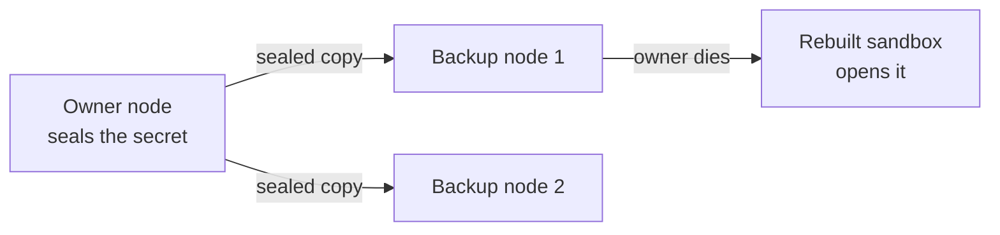

import { Aside } from '@astrojs/starlight/components';

A sandbox can carry secrets. One example is a password for a private image registry. Another is the login for a [cloud storage mount](/external-storage/). In a cluster, AerolVM **seals** these secrets. To seal a secret is to encrypt it so that only chosen nodes can open it.

This matters for sandboxes with **failover** (`failover.policy=recreate`). When the node of such a sandbox dies, the cluster rebuilds the sandbox on another node. That node needs the secrets too. Without them, the rebuilt sandbox cannot pull its image or mount its storage.

`sandboxd` is the AerolVM program on each node. This page shows how it seals secrets. It also helps you choose a key store, and check that a sandbox is ready to move.

## Words to know

| Word | What it means |
|---|---|
| **Owner** | The node that runs a sandbox. |
| **Backup node** | A node that keeps a sealed copy of the secrets of a sandbox. It can open them if the owner dies. |
| **Recipient list** | The nodes allowed to open one sealed secret: the owner and its backup nodes. |
| **Server key** | The key a node uses to open stored secrets. Every node in a cluster has the same one. `sandboxd init` makes it. Each join command gives it to the new node. |
| **Key store** | A service outside the cluster that keeps keys: AWS KMS, Vault, OpenBao or an HSM. |
| **Provider** | Who holds the keys that seal secrets: the nodes themselves, or a key store. `SB_SECRET_PROVIDER` picks it. |
| **Generation** | The version number of a sealed copy. It goes up each time the cluster seals the secret again. |
| **Admin token** | The cluster's password for apps and admins. `SB_PAT_TOKEN` holds it. |
| **Node certificate** | The signed ID card of a node. Nodes show it to each other before they talk. |
| **Leader** | The server node that writes down each cluster change. |

## How a secret reaches the backup nodes

1. You create a sandbox with failover and a secret.
2. The owner seals the secret for its recipient list. By default, that is the owner and 2 backup nodes. A smaller cluster uses every node it can.
3. The owner sends a sealed copy to each backup node.
4. The create waits for one backup node to confirm its copy. The wait has a fixed limit: `SB_SECRET_FANOUT_MIN_ACK_WAIT`, 2 seconds by default.
5. The owner sends the other copies in the background.

The sealed secret is not in the cluster's shared records. Those are the records the server nodes vote on. They hold only a reference to the secret, its generation and its recipient list. For the whole failover story, see [Durability and failover](/durability/).

## Why secrets failed to open after failover

A rebuilt sandbox used to fail to open its secrets, for two reasons:

| Problem | Error you saw | Fix |
|---|---|---|
| The sealed secret never left the node that sealed it. | `cluster secret ref ... not found` on the new owner | The create now waits for one backup node to confirm its copy. Then the owner copies the secret to the other backup nodes, in the background. |
| The sealed secret named who can open it. The new owner was not on that list. | `recipient ... is not allowed to open` | With `local`, the secret is sealed for the owner and its backup nodes. With AWS KMS, AWS permissions decide who can open it. |

In a cluster, every node needs the same server key (`SB_CREDENTIAL_ENCRYPTION_KEY`, or a key file). A node does not start in cluster mode without one. Only `SB_CLUSTER_INSECURE_CREDENTIALS=true` skips this check, for test setups. But the same key is **not enough** on its own. The sealed copy must also reach the backup nodes. That is true with AWS KMS too.

## Choose a provider

`SB_SECRET_PROVIDER` picks who holds the keys. The default is `local`. With `local` and no key store settings, a node never contacts AWS, Vault, an HSM or any other outside service.

| Value | Who holds the key | Who can open a secret | When to use it |
|---|---|---|---|
| `local` (default) | Each node, in its server key | Only the nodes on the recipient list | Most clusters. Nothing outside the cluster is needed. |
| `awskms` | **AWS KMS** (Amazon's Key Management Service). Each secret has its own key. KMS locks that key. The sealed format does not change. | Any node that AWS lets decrypt, **and** that got a sealed copy | You want one central place for keys, with AWS IAM permissions and CloudTrail logs. |
| `vault` | Vault or OpenBao, with its Transit engine. It locks the key of each secret. | Any node whose Vault token can decrypt, **and** that got a sealed copy | Your keys already live in Vault or OpenBao. |
| `pkcs11` | An **HSM** (hardware security module: a device that keeps keys in hardware). It locks the key of each secret. The node talks to it through its PKCS#11 library. | Any node logged in to the HSM, **and** that got a sealed copy | Your rules need keys in hardware. |

Every provider keeps the sealed secret in the database of each node, in the `cluster_secrets` table. A key store protects only the keys. It does not store your secret. Nodes copy sealed secrets to each other the same way with every provider.

A node that seals with `local` can still open secrets sealed by a key store. Add the settings of that key store, and keep `SB_SECRET_PROVIDER=local`. This is the first step when you switch providers. [Use your own key store](/enterprise/key-custody/) has the full switch. It also shows how to keep the server key in your key store, and how to revoke or change keys.

### Settings

| Setting | What it does | Default |
|---|---|---|
| `SB_ENTERPRISE_MODE` | Turns on strict rules for production. Each node then needs 2 backup nodes, and refuses `SB_CLUSTER_INSECURE_GOSSIP` and `SB_CLUSTER_INSECURE_CREDENTIALS`. It also needs an **audit witness**: an S3 bucket with Object Lock that keeps proof of each node's audit log. See [Enterprise mode](/enterprise/enterprise-mode/). | `false` |
| `SB_SECRET_PROVIDER` | `local`, `awskms`, `vault` or `pkcs11`. Any other value stops the node from starting. The `vault` and `pkcs11` settings are on [Use your own key store](/enterprise/key-custody/). | `local` |
| `SB_SECRET_AWS_KMS_KEY_ID` | The KMS key to use: its ID, ARN or alias. Required with `awskms`. | Empty |
| `SB_SECRET_PROVIDER_STRICT_BOOT` | With `true`, the node does not start if the startup check of the key store fails. Enterprise mode requires `true` for every key store. | `false` |
| `SB_SECRET_RECIPIENT_BACKUP_COUNT` | How many backup nodes, besides the owner, can open each secret. Cluster mode needs at least 1. Enterprise mode needs at least 2. | `2` |
| `SB_SECRET_FANOUT_MIN_ACK_WAIT` | How long a create waits for the first backup node to confirm. Cluster mode needs a value above zero. | `2s` |
| `SB_CREDENTIAL_ENCRYPTION_KEY` | The server key. Cluster mode needs this, or the key file at `SB_CREDENTIAL_ENCRYPTION_KEY_PATH`. | Empty. The key file is `/var/lib/sandboxd/credential_encryption.key`. |
| `SB_SECRET_AUDIT_STRICT_BOOT` | With `true`, the node does not start if it cannot open its local audit log. Enterprise mode requires `true`. | `true` |
| `SB_SECRET_AUDIT_RETENTION_DAYS` | How many days a node keeps its local secret audit records. Enterprise mode needs a value above 0. | `30` |
| `SB_SECRET_TOMB_RETENTION_DAYS` | How many days a node keeps the record of a deleted secret, after every node confirmed the delete. Enterprise mode needs a value above 0. | `30` |
| `SB_SECRET_OUTBOX_STANDALONE_GRACE` | How long a node that left the cluster keeps its unfinished secret work. After that, it drops the work. See item 9 of the [checklist](#production-checklist). | `1h` |

Sandbox environment variables and toolbox tokens are always encrypted on disk. A toolbox token is the token for the helper program inside each sandbox. No setting turns this off.

## Know when a sandbox is safe to fail over

Each sandbox with `failover.policy=recreate` has a `failover_ready` field. It says whether a backup copy of its secrets exists. Other sandboxes do not have the field.

| `failover_ready` | What it means |
|---|---|
| `true` | The owner and at least one backup node hold the current sealed copy. Both are live. A sandbox with no secrets also shows `true`. |
| `false` | No live backup node has confirmed a copy yet. It also shows `false` when the node cannot read the data it needs for the check. |

- A sandbox with secrets shows `false` until a backup node confirms its copy.
- If no backup node confirms within `SB_SECRET_FANOUT_MIN_ACK_WAIT`, the create fails. The owner takes the secret back. It queues deletes for any copy a backup node saved. So every successful create has at least one confirmed backup node.
- If a later copy fails, the metric `aerolvm_secret_fanout_failures_total` goes up. The owner tries again from a saved to-do list, called an **outbox**. It waits longer between tries.
- After a restart, a node sends its copies again with a fixed pool of 64 workers. The pool does not grow with the number of sandboxes.

Wait for `failover_ready` to be `true` before you treat a sandbox as safe to fail over. You can also watch it in your monitoring.

## Replace a backup node that died

Each sealed copy has a generation. The recipient list comes from the cluster's choice of nodes for the sandbox. The list stays fixed for that generation.

When a node on the list dies, the cluster seals a new generation for a live replacement:

1. The owner opens the current generation. For a secret with no owner, the leader does this.
2. It seals the secret again, for a list with a live replacement node.
3. It waits for the replacement to confirm its copy.
4. It writes the new generation into the cluster's shared records.

The new sealed copy and the list of retired nodes are saved together, in one step. The old copies are deleted only after the new generation is in place. So a crash in the middle never deletes the last copies you can still open.

A removed node stays on a saved delete list until it confirms the delete. The delete request proves which node sent it. It names the exact generation. A node that only vanishes from the cluster does not count as cleaned up.

Repair needs one live node that holds the current copy and can reach the key. If no live node holds it, the cluster cannot repair the secret. A rebuilt sandbox then cannot pull its private image or mount its storage.

A key store changes who holds keys, and who can use them. It does not replace the copies on backup nodes, their confirmations, or the cleanup of old copies.

## How nodes prove who they are

Cluster mode requires `SB_CLUSTER_TLS_DIR`: the folder that holds the node certificate. Nodes call each other on a separate HTTPS port, the **internal port** (`7002` by default). Both sides show their node certificate.

- The cluster's signing key must have signed the node certificate.
- The caller must be a live node that the cluster let in.
- A node that holds the admin token also sends it.
- A worker or ingress node joined with a join command holds only a fingerprint (hash) of the admin token. It proves who it is with its node certificate alone. See [Keep it safe](/cluster/security/#which-nodes-hold-the-admin-token).
- Calls between nodes are refused on the public port.
- A node never falls back to the public port with only the admin token.

| Who calls | Result |
|---|---|
| No token and no node certificate | Refused (`401`) |
| A managed **tenant token**: a token for one customer, from a managed AerolVM service | Refused on secret writes, secret deletes and audit reads of one node (`403`). Only admins can do these. |
| A valid node certificate and the admin token | Allowed on the internal port |
| A valid node certificate of a live node, with no token | Allowed on the internal port. This is a node joined without the admin token. |

A node that receives a sealed copy checks it before it saves it:

- The reference of the secret must match its sandbox ID and version.
- **This node** must be on the recipient list.
- The request must match a live sandbox and its exact current recipient list. This stops a late message from bringing back a deleted secret.

Every node certificate must carry the name `node:<SB_NODE_ID>`. It is in a name field of the certificate, called a SAN. `sandboxd init`, and the server nodes that sign joining nodes, write it as a DNS name. The `role:<role>` name sits next to it. A URI name with the same value works too. The calling node checks this name. The receiving node requires it to belong to a live node.

<Aside type="caution">
Guard the key that signs node certificates, and the admin token, like root passwords. Server and mixed nodes keep the signing key in `/etc/sandboxd/cluster-ca` (`SB_CLUSTER_CA_DIR`). They need it to sign joins and renew node certificates. Never put it in `SB_CLUSTER_TLS_DIR`. In enterprise mode, a node with `ca.key` there refuses to start. Change both after any leak you suspect. See [After a leak](/cluster/security/#after-a-leak). Keep the internal port on a private network.
</Aside>

## Startup check

With `SB_SECRET_PROVIDER` set to `awskms`, `vault` or `pkcs11`, the node runs a test once at start. It locks a test key with your key store, then unlocks it. The test is **not** part of creating sandboxes. So it adds no time to creates.

| Result | What you see |
|---|---|
| It works | The log shows `secret provider boot canary ok`. The metric `aerolvm_secret_provider_canary_ok` is `1`. |
| It fails | The metric is `0`. The node logs a warning and keeps running. With `SB_SECRET_PROVIDER_STRICT_BOOT=true`, it stops instead. Enterprise mode requires strict startup for every key store. |
| The server key is locked by the key store (`SB_CREDENTIAL_KEY_CUSTODY=wrapped`) | The node skips the test key. It unlocked the server key through the key store at start, which already proves the store works. The log shows `secret provider ok: the server key unwrapped through it at boot`. The metric is `1`. |

## Production checklist

1. Use a random admin token (`SB_PAT_TOKEN`) of at least 32 bytes. Keep privileged containers (`SB_CONTAINER_PRIVILEGED`) and the resource-limit bypass (`SB_RESOURCE_LIMITS_DISABLED`) turned off.
2. On every node, set `SB_CLUSTER_TLS_DIR`, the server key, and the key nodes use to find each other (`SB_GOSSIP_SECRET_KEY`). Never open the internal port to the internet.
3. Keep at least 2 backup nodes (`SB_SECRET_RECIPIENT_BACKUP_COUNT`). Keep `SB_SECRET_FANOUT_MIN_ACK_WAIT` above zero. Copying to backup nodes is always on for failover sandboxes.
4. Keep audit records and delete records for more than 0 days: `SB_SECRET_AUDIT_RETENTION_DAYS` and `SB_SECRET_TOMB_RETENTION_DAYS`. Environment variables and toolbox tokens are always sealed.
5. With `local`, use the same server key (`SB_CREDENTIAL_ENCRYPTION_KEY`, or the key file) on all nodes.
6. For one central place for keys, set `SB_SECRET_PROVIDER` to `awskms`, `vault` or `pkcs11`. Turn on strict startup. Give each node only the key store permissions it needs.
7. To keep the server key out of plain files, lock it with your key store (`SB_CREDENTIAL_KEY_CUSTODY=wrapped`). Enterprise mode requires this when you use a key store. See [Use your own key store](/enterprise/key-custody/).
8. Treat `failover_ready` as your readiness signal. A create promises one confirmed backup node. It does not promise that every background copy is done.
9. You can take a worker node out of the cluster with `SB_ENABLE_CLUSTER=false`. It keeps running its upkeep loop. After `SB_SECRET_OUTBOX_STANDALONE_GRACE` (1 hour by default), it drops its unfinished secret work. It also drops leftover sealed copies it can no longer use. To keep them, restart it in cluster mode before then.
10. Keep every mount secret in `credentials`. Mount `source` and `options` are not encrypted. They travel with the settings of the sandbox, because another node needs them to mount again. Only mount `credentials` and the registry password are sealed. A create is refused when a name looks like a password. This covers names in `options`, and in the settings part of an rclone `source`. Such names contain words like `password`, `secret`, `token` or `access_key`.
11. Set `SB_ENTERPRISE_MODE=true`. Set up the audit witness with it: an S3 bucket with Object Lock, and a unique `SB_NODE_ID` on every node. Each node then refuses to start when a required rule is missing. Examples: a short admin token, or fewer than 2 backup nodes. See [Enterprise mode](/enterprise/enterprise-mode/).

## Next steps

- [Durability and failover](/durability/): how `failover.policy=recreate` rebuilds sandboxes.
- [Attach cloud storage](/external-storage/): where mount `credentials` come from.
- [Keep it safe](/cluster/security/): the secrets you hold for a cluster, and what to do after a leak.
- [Runbooks](/operational-runbooks/): the secrets and audit runbook, for alerts.
- [Enterprise mode](/enterprise/enterprise-mode/): make every node enforce this checklist, with an audit witness.
- [Glossary](/cluster-glossary/): every cluster setting in one place.
