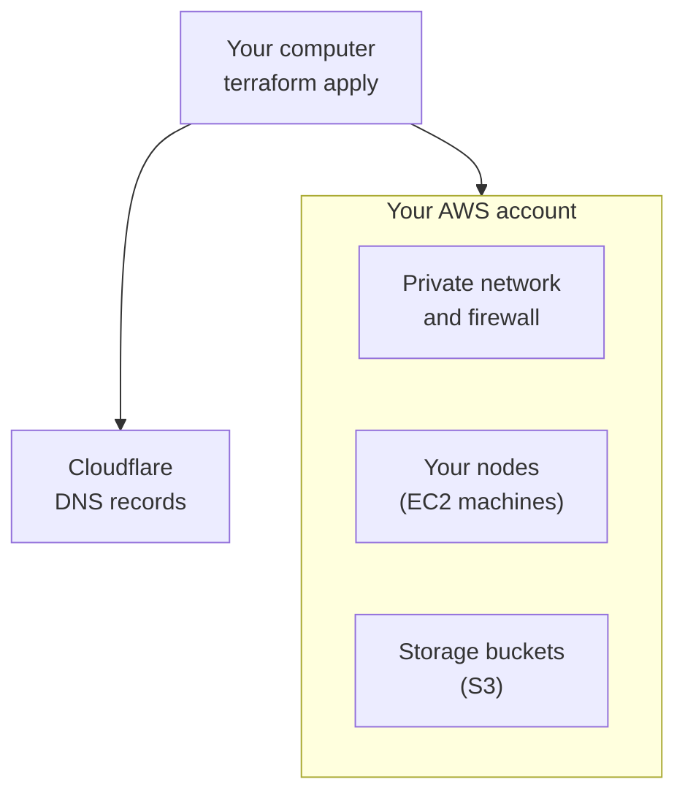

import { Aside } from '@astrojs/starlight/components';

**Terraform** is a tool that makes cloud machines from config files. AerolVM ships a Terraform module: a ready-made set of those files. It makes a whole cluster on AWS for you. Each machine then installs AerolVM and joins the cluster by itself.

You keep three small files in a folder on your computer. You need only that one folder from the AerolVM code.

**What you will do:**

- Make a folder with three files.
- Add your secrets and your cluster address.
- Choose your nodes.
- Run `terraform apply`, and check that every node joined.

## What Terraform makes



- A private network (a **VPC**) and the firewall rules (**security groups**) for it.
- One EC2 machine for each node you list.
- S3 storage buckets. The ingress nodes share their HTTPS certificates through one of them.
- The DNS records for your cluster address, in Cloudflare.

## Before you start

- **Terraform 1.5 or newer** on your computer. [Download it here](https://developer.hashicorp.com/terraform/install).
- **An AWS account,** and AWS credentials on your computer. The easiest way is the [AWS CLI](https://docs.aws.amazon.com/cli/latest/userguide/getting-started-install.html): run `aws configure` once. The account must be able to make EC2 machines, VPCs, IAM roles, S3 buckets and security groups.
- **A domain whose DNS is on Cloudflare,** and a Cloudflare token. [Step 3 of Install on a server](/getting-started/single-node-setup/#step-3-create-a-cloudflare-api-token) shows how to make the token.
- **An EC2 key pair** in your AWS region, so you can log in to the nodes with SSH. Keep its `.pem` file on your computer.
- **The `aerolvm` CLI** on your computer. See [Install the CLI](/cli/#install).

## Set up the folder

### Step 1: Make a folder with three files

Copy the example folder, [`Terraform/examples/from-url`](https://github.com/aerol-ai/microvm/tree/v0.7.0/Terraform/examples/from-url), to your computer. These commands copy only that folder:

```bash title="On your computer"
git clone --depth 1 --branch v0.7.0 --filter=blob:none --sparse https://github.com/aerol-ai/microvm.git aerolvm-src
git -C aerolvm-src sparse-checkout set Terraform/examples/from-url
cp -r aerolvm-src/Terraform/examples/from-url my-cluster
rm -rf aerolvm-src
cd my-cluster
```

**What you should see** in `my-cluster`:

```text title="Your folder"
main.tf
config/cluster.yml
config/secrets.example.yml
```

`main.tf` uses the AerolVM **module** (a ready-made set of Terraform files) by its address on GitHub, pinned to one release. Its `module` block looks like this:

```hcl title="main.tf"
module "aerolvm" {
  source = "git::https://github.com/aerol-ai/microvm//Terraform?ref=v0.7.0"

  cluster_name        = local.cluster_name
  aws_region          = var.aws_region
  config_dir          = local.config_dir
  admin_allowed_cidrs = var.admin_allowed_cidrs
  ssh_key_name        = var.ssh_key_name

  default_instance_type = "t3.large"

  nodes = {
    node1 = { role = "mixed", seed = true }
    node2 = { role = "mixed" }
    node3 = { role = "mixed" }
  }
}
```

You give two values when you run Terraform, in step 7:

- `admin_allowed_cidrs`: the IP addresses that can reach SSH and the API from outside AWS. Use your own office or home range. The module refuses `0.0.0.0/0` (the whole internet), unless you also set `allow_admin_from_anywhere = true`.
- `ssh_key_name`: the name of your EC2 key pair.

Every other setting the module takes is listed in its [`variables.tf`](https://github.com/aerol-ai/microvm/blob/v0.7.0/Terraform/variables.tf). They all go in the same `module` block.

<Aside type="caution" title="Never change the release in source to upgrade">
Keep `ref=v0.7.0` as it is. A new `ref` can change every machine's setup, and Terraform then replaces every machine, with its sandboxes. To move the cluster to a new release, use [`aerolvm upgrade`](/cluster/upgrade/).
</Aside>

<Aside type="caution" title="Keep Terraform's state private">
Terraform writes what it made to a **state** file. The state holds your join tokens and your admin token. Keep it in an encrypted, private place, such as an S3 bucket with encryption on. To do that, make the bucket first. Then remove the `#` signs in front of the `backend "s3"` block in `main.tf`, and put in your bucket's name.
</Aside>

### Step 2: Add your secrets

```bash title="On your computer, in your folder"
cp config/secrets.example.yml config/secrets.yml
```

Open `config/secrets.yml` and fill in two values. Leave the other values in the file empty.

```yaml title="config/secrets.yml"
cluster:
  pat_token: ""     # the cluster's admin token: make one with openssl rand -hex 32
cloudflare:
  api_token: ""     # your Cloudflare token
```

The **admin token** is the cluster's password. Your apps and your computer send it with every request. Never commit this file to Git.

### Step 3: Set your cluster address

Open `config/cluster.yml` and change the `ingress` section:

```yaml title="config/cluster.yml"
ingress:
  domain_name: "cluster.example.com"   # your cluster address
  acme_email:  "you@example.com"        # gets a warning before an HTTPS certificate runs out
```

Each sandbox link uses a name under this address, such as `abc123.cluster.example.com`. Terraform makes the DNS records in Cloudflare for you.

### Step 4: Choose your nodes

Each entry in `nodes` is one machine. Exactly one has `seed = true`. The **seed** starts the cluster, like node 1 in [Build a cluster](/cluster/create/). Its role must be `mixed`, or include `server`.

The smallest cluster that keeps working when a machine dies is three mixed nodes. That is the example in step 1.

A larger cluster gives each node one job. See [How a cluster works](/cluster/how-it-works/#the-three-jobs):

```hcl title="main.tf, in the module block"
nodes = {
  srv1 = { role = "server", seed = true, instance_type = "t3.small" }
  srv2 = { role = "server",              instance_type = "t3.small" }
  srv3 = { role = "server",              instance_type = "t3.small" }
  wrk1 = { role = "worker",              instance_type = "t3.large", volume_size_gb = 200 }
  wrk2 = { role = "worker",              instance_type = "t3.large", volume_size_gb = 200 }
  ing1 = { role = "ingress",             instance_type = "t3.medium" }
  ing2 = { role = "ingress",             instance_type = "t3.medium" }
}
```

`instance_type` is the EC2 machine size. `volume_size_gb` is the disk size, in GB.

### Step 5: Turn on more kinds of sandbox (optional)

Every worker runs container sandboxes. Add one of these to a worker's entry for more:

| Add this | What it gives | What the machine needs |
|---|---|---|
| `with_gvisor = true` | [gVisor](/gvisor-sandbox/): an extra wall between each container and the machine | Any EC2 type |
| `with_firecracker = true` | [Firecracker](/firecracker-sandbox/): each sandbox in its own small virtual machine | A bare-metal type, such as `c5.metal` |
| `with_isolate = true` | [V8 isolates](/isolate-sandbox/): small JavaScript and TypeScript web handlers | Any EC2 type |
| `with_nvidia_gpu = true` | [NVIDIA GPUs](/gpu-sandboxes/) in sandboxes | A GPU type, such as `g5.xlarge`, and an `ami_id` with the NVIDIA driver |
| `with_amd_gpu = true` | [AMD GPUs](/gpu-sandboxes/) in sandboxes | An AMD GPU type, such as `g4ad.xlarge` |

For example, a worker with Firecracker:

```hcl title="main.tf, in nodes"
wrk3 = { role = "worker", with_firecracker = true, instance_type = "c5.metal" }
```

The cluster sends each sandbox only to a worker that can run its kind.

<Aside type="caution" title="Firecracker needs bare-metal machines">
Firecracker needs the `/dev/kvm` device. Normal EC2 types, such as `t3`, `c6i` and `m5`, do not have it. Use a bare-metal type, one whose name ends in `.metal`. They cost more, so use them only for the workers that run Firecracker. All nodes in one cluster must use the same kind of CPU: ARM types such as `c7g.metal` need ARM types for every other node too.
</Aside>

The [Terraform README](https://github.com/aerol-ai/microvm/blob/main/Terraform/README.md) has every option for each kind.

#### Firecracker files and the download mirror

By default, each Firecracker worker downloads the official Firecracker release and a matching Linux kernel from GitHub. To use your own files, add a `firecracker` block to the module block:

```hcl title="main.tf, in the module block"
firecracker = {
  binary_url        = "https://example.com/firecracker"
  jailer_url        = "https://example.com/jailer"
  kernel_url        = "https://example.com/vmlinux"
  kernel_config_url = "https://example.com/vmlinux.config"
  kernel_path       = "/var/lib/sandboxd/firecracker/vmlinux"
}
```

- If `kernel_config_url` is empty, setup tries `kernel_url` with `.config` added to the end.
- The kernel config must turn on `CONFIG_VMGENID=y`, or setup stops.
- If your machine image already has the files, set `auto_install_artifacts = false`, and leave the addresses empty.

So that a GitHub outage cannot stop a new node, add `download_mirror = "https://aerolvm-downloads.s3.us-east-1.amazonaws.com"` to the module block. Every file a node downloads then falls back to the [download mirror](/getting-started/installer-options/#where-downloads-come-from) when GitHub fails. Set it before your first apply: changing it later replaces every node.

### Step 6: Add a load balancer (for production)

By default, your cluster address gets one DNS record for each ingress node. Say the AerolVM program on one node stops, during an upgrade for example. Visitors that DNS sends to that node get error `502` until it is back.

A **load balancer** fixes this. It checks each ingress node every 5 seconds. About 10 seconds after a node stops answering, it sends that node no new visitors. Add this line to the module block:

```hcl title="main.tf, in the module block"
api_load_balancer = "nlb"
```

<Aside type="caution" title="Choose it before your first apply">
This setting changes every node's setup. On a running cluster, Terraform then replaces every node, and the sandboxes on them are lost.
</Aside>

It adds an AWS Network Load Balancer and one fixed IP address. Raw TCP ports then use the name `tcp.cluster.example.com`. [Ingress nodes](/cluster-ingress/#pick-the-address-users-connect-to) explains the choice.

## Make the cluster

### Step 7: Run Terraform

```bash title="On your computer, in your folder"
terraform init
terraform apply -var 'admin_allowed_cidrs=["203.0.113.0/24"]' -var ssh_key_name=my-key
```

`init` downloads the module. `apply` shows a list of everything it will make. Read it, then type `yes`. It takes 3 to 5 minutes.

**What you should see** at the end: each node's public IP address, and an `ssh_command_seed` line, the SSH command for the seed.

### Step 8: Watch the nodes join

Each machine sets itself up after Terraform finishes. Watch one machine's setup log:

```bash title="On your computer"
ssh -i ~/my-key.pem ubuntu@<node-ip> sudo tail -f /var/log/aerolvm-bootstrap.log
```

`-i` names your EC2 key pair's `.pem` file. Use its real path.

The seed's log ends with `seed started the cluster with sandboxd init`. Every other machine waits for the seed. Then its log says `joined the cluster with sandboxd join`. Press `Ctrl-C` to stop watching.

### Step 9: Check that every node joined

Log in with your cluster address:

```bash title="On your computer"
aerolvm login https://cluster.example.com
```

It asks for a token:

```text
API token (typing is hidden):
```

Paste the admin token from `config/secrets.yml`, and press Enter. Nothing shows while you paste. Then list the nodes:

```bash title="On your computer"
aerolvm get nodes
```

**What you should see:**

```text
NAME    ROLE    STATUS         VERSION   SANDBOXES
node1   mixed   Ready,Leader   v0.7.0    0
node2   mixed   Ready          v0.7.0    0
node3   mixed   Ready          v0.7.0    0
```

Every node shows `Ready`, and one shows `Leader`. To use the cluster from your code, see [SDK setup](/sdk-setup/).

## Add a node later

**A worker or an ingress node:** add it to `nodes`, and run `terraform apply` again. It joins by itself. The module's worker and ingress join tokens never expire, so this works weeks later.

**A server node, or a mixed node:** it needs a new join token. The module's server token lasts 24 hours, like a `kubeadm` token. Make a new one on a node that is a server or mixed node, not on your computer:

```bash title="On a server or mixed node"
sudo sandboxd join-command --role server --ttl 2h --json
```

Copy the `token` value from the output. Then add the node, and give it the token in `node_join_tokens`:

```hcl title="main.tf, in the module block"
nodes = {
  # ... your other nodes ...
  srv4 = { role = "server", instance_type = "t3.small" }
}

node_join_tokens = {
  srv4 = "<the token>"
}
```

Run `terraform apply` within 2 hours. Only `srv4` changes. Keep the entry after the node joins: if you delete it, Terraform replaces the machine.

Why on a node? The cluster makes a server token only when a server or mixed node asks. A request from your computer goes to your cluster address first. If that address leads to an ingress node, the cluster refuses the request. On a server or mixed node, it always works.

## Remove a node

1. On your computer, run `aerolvm drain <node>`, then `aerolvm delete node <node>`. See [Add and remove nodes](/cluster/nodes/#remove-a-node).
2. Delete its entry from `nodes`, and run `terraform apply`.

## Take it down

```bash title="On your computer, in your folder"
terraform destroy
```

<Aside type="caution">
This deletes every machine, network and S3 bucket in the cluster, and every sandbox on it. You cannot undo it.
</Aside>

## If something goes wrong

| What you see | What it means | What to do |
|---|---|---|
| `apply` refuses `0.0.0.0/0` | You opened SSH and the API to the whole internet. | Use your own IP range, or set `allow_admin_from_anywhere = true`. |
| `ssh` says `Permission denied (publickey)` | SSH did not use your EC2 key pair. | Add `-i` and the path of its `.pem` file: `ssh -i ~/my-key.pem ubuntu@<node-ip>`. |
| A node never joins | Its setup failed. | Read its log: `ssh -i ~/my-key.pem ubuntu@<node-ip> sudo tail -n 50 /var/log/aerolvm-bootstrap.log`. |
| The log says the join token was refused for 5 minutes | A server node's token ran out, or was cancelled. | Make a new one, as in [Add a node later](#add-a-node-later). |
| `apply` wants to replace every node | A setting that changes every node's setup changed, such as `api_load_balancer`. | Do not apply. Put the old value back. |

## Older clusters made from a copy of the code

A cluster made with `scripts/terraform.sh` from a copy of the AerolVM code keeps working. That cluster keeps the old way of joining. Do not set `one_line_join = true` on it: Terraform would then replace every machine. The [Terraform README](https://github.com/aerol-ai/microvm/blob/main/Terraform/README.md) has the details.

## Next steps

- [Add and remove nodes](/cluster/nodes/): grow the cluster, or take a machine out.
- [Upgrade](/cluster/upgrade/): move every node to a new release, from your computer.
- [Keep it safe](/cluster/security/): protect the admin token, the join tokens and Terraform's state.
