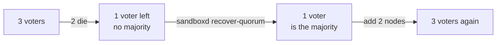

import { Aside } from '@astrojs/starlight/components';

The server nodes keep the cluster's records: which nodes are in the cluster, and which node runs each sandbox. Back them up, so you can bring the cluster back after a bad failure.

`sandboxd` is the AerolVM program on each node. It has three commands for this: `backup`, `restore` and `recover-quorum`.

**What you will do:**

- Back up each server node to one file.
- Put a node back from that file.
- Replace one dead server node.
- Bring the cluster back after most server nodes died.

## What to back up

| What | Where it lives | How to keep it safe |
|---|---|---|
| Each server or mixed node's records | On the node | `sudo sandboxd backup`, below |
| The admin token | Your password manager | Keep it there |
| Terraform's state, if you used Terraform | Where your `main.tf` keeps it | An encrypted, private S3 bucket |

Worker and ingress nodes hold no cluster records, so you do not need to back them up. A backup does not hold the sandboxes themselves, their files, or your container images. Keep files that matter on [attached storage](/external-storage/).

## Back up a node

Run this on each server or mixed node:

```bash title="On each server or mixed node"
sudo sandboxd backup --output /var/backups/aerolvm-$(hostname)-$(date +%F).tar.gz --stop
```

It writes one file. The file holds the node's database, its cluster records, its settings in `/etc/sandboxd`, and the key that opens stored secrets. `--stop` stops `sandboxd` for the copy, then starts it again. The copy takes seconds. The node's sandboxes keep running.

<Aside type="caution" title="A backup holds secrets">
The file holds the admin token and the key that opens stored secrets, unless you use [wrapped key custody](/enterprise/key-custody/). Copy it off the node, to a private and encrypted place. Treat it like the admin token.
</Aside>

Back up every day, and before every upgrade. Keep copies on another machine. A backup on a dead machine does not help you.

## Put a node back from a backup

Use a restore in two cases only:

- **A one-server install** lost its disk, or its records broke.
- **The chosen survivor**, before you run `recover-quorum` below, if its own records broke.

In a cluster that still works, do not restore a server node from a backup. Its old records would disagree with the other voters. [Replace it](#one-server-node-died) instead.

```bash title="On the node to put back"
sudo systemctl stop sandboxd
sudo sandboxd restore --input /var/backups/aerolvm-node-1-2026-11-10.tar.gz --force --start
```

`restore` checks the whole file before it changes anything. It moves the node's database and cluster records aside, with `.pre-restore-` and the time in their names. It never deletes them. Your settings in `/etc/sandboxd` are replaced by the backup's. `--start` starts `sandboxd` again, and waits until it answers.

Restore a backup only on the node it came from. A backup holds that node's name, keys and cluster records.

## One server node died

If one of three server nodes died and its disk is gone, the other two still form a majority. The cluster keeps working. Replace the dead node:

1. On your computer, remove the dead node: `aerolvm delete node node-3 --force`.
2. Add a new machine as a server or mixed node. See [Add and remove nodes](/cluster/nodes/#add-a-node).

Do it the same day. Until then, one more dead server node stops the cluster from making changes.

## Most server nodes died

If most server nodes died for good, the cluster cannot vote. Sandboxes that are running keep running. But creating or deleting a sandbox fails.



`recover-quorum` makes one surviving server node the only voter. It is the last thing to try. First, try to start the dead machines again with their disks.

<Aside type="caution" title="Last resort">
The surviving node's records become the cluster's records. Changes that only the dead nodes had are lost. Follow the steps in order.
</Aside>

### Step 1: Stop every surviving server node

On every server or mixed node that is still alive:

```bash title="On every surviving server node"
sudo systemctl stop sandboxd
```

### Step 2: Choose one survivor and recover it

Choose the survivor with the newest records. The [recovery runbook](https://github.com/aerol-ai/microvm/blob/main/setup/runbooks/lost-quorum-recovery.md#pick-the-recovery-node) shows how to compare them. On that node only:

```bash title="On the chosen node"
sudo sandboxd recover-quorum --start
```

It backs the node up first. Then it makes this node the only voter, and starts `sandboxd`. It waits until the node leads the cluster.

### Step 3: Bring back the other survivors

On each other surviving server node, one at a time:

```bash title="On each other survivor, one at a time"
sudo sandboxd recover-quorum --rejoin --start
```

It moves the node's old cluster records aside, and starts `sandboxd`. The node then joins the recovered cluster as a new voter. Wait until `aerolvm get nodes` shows it `Ready` before the next one.

If the node is the one where you ran `init`, `--rejoin` refuses. The [runbook](https://github.com/aerol-ai/microvm/blob/main/setup/runbooks/lost-quorum-recovery.md#rejoin-other-nodes) shows the one setting to change first.

### Step 4: Replace the dead nodes

On your computer, remove each dead node with `aerolvm delete node <name> --force`. Then add new server or mixed nodes until you have 3 voters again. See [Add and remove nodes](/cluster/nodes/#add-a-node).

## Practice it

Run a restore and a recovery on a test cluster before you need them. The [backup and restore runbook](https://github.com/aerol-ai/microvm/blob/main/setup/runbooks/backup-restore.md) has a drill.

## Next steps

- [Keep it safe](/cluster/security/): the secrets in a backup, and who can hold them.
- [Fix problems](/cluster/troubleshooting/): what to run when something looks wrong.
