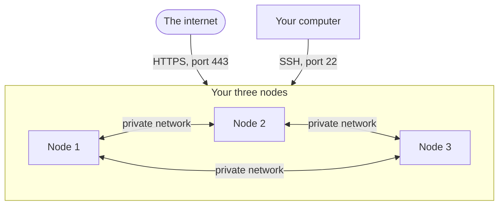
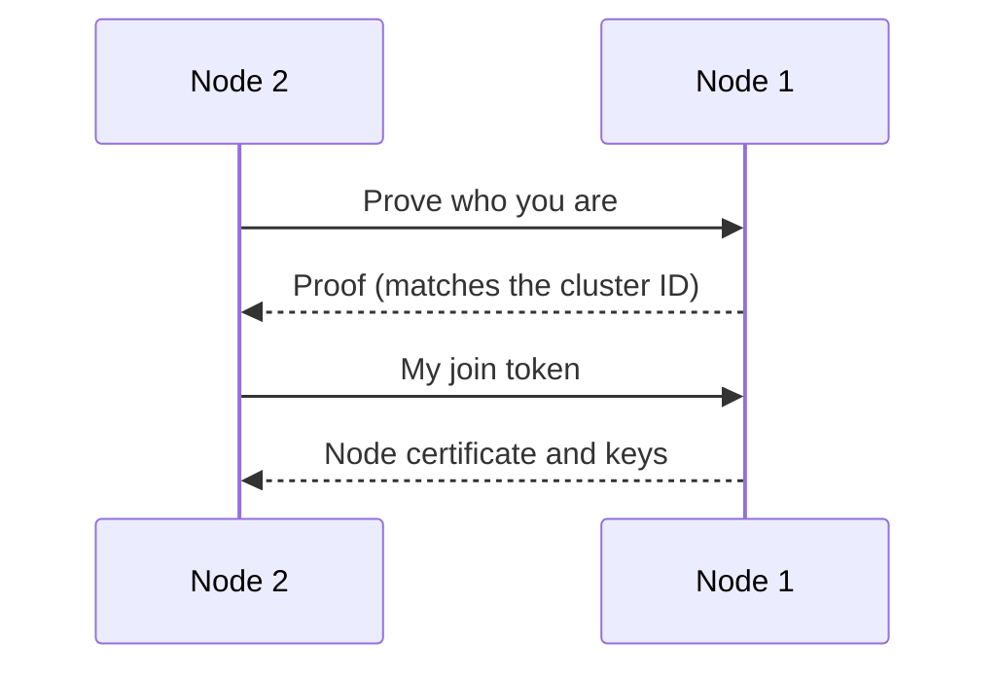

import { Aside } from '@astrojs/starlight/components';

This guide turns three Linux machines into one cluster. Each node runs sandboxes, takes web traffic, and votes on **cluster changes**. Cluster changes are things like adding a node, or choosing the node for a sandbox. If one machine dies, the cluster keeps working.

It takes about 30 minutes. You copy and paste every command. Each command block says where to run it: **on your computer**, or **on node 1, 2 or 3**.

**What you will do:**

- Start the cluster on node 1.
- Connect your own computer to it.
- Add node 2 and node 3.
- Check that all three nodes are healthy.

## What you will build



The internet reaches every node on port 443, for HTTPS. Your computer reaches them on port 22, for SSH. The nodes talk to each other on ports 7000 to 7003, over the private network only.

All three nodes are **mixed nodes**. A mixed node does every job: it runs sandboxes, takes web traffic, and votes on cluster changes. This is the simplest cluster that keeps working when a machine dies. [How a cluster works](/cluster/how-it-works/) explains the jobs.

## Before you start

You need:

- **Three Linux machines** with Ubuntu 22.04 or newer. Give each one at least 2 CPUs, 4 GB of memory and 30 GB of disk. Rent all three in the same region of one cloud.
- **A private network** between them. On AWS and DigitalOcean, machines in the same region share one by default. On Hetzner, create a network in the dashboard, then add each machine to it.
- **A domain whose DNS is on Cloudflare,** such as `example.com`. You can buy the domain anywhere, then move its DNS to Cloudflare on the free plan.
- **A terminal on your computer.**

Write down two addresses for each machine. Your cloud's dashboard shows both.

| Machine | Public IP address | Private IP address |
|---|---|---|
| Node 1 | `203.0.113.10` | `10.0.1.5` |
| Node 2 | `203.0.113.11` | `10.0.1.6` |
| Node 3 | `203.0.113.12` | `10.0.1.7` |

The **public** address is how the internet reaches a machine. The **private** address is how the machines reach each other. This guide uses the example addresses above. Use your own instead.

The commands log in as `ubuntu`, the user name on AWS. On DigitalOcean and Hetzner it is `root`. Use your cloud's user name. If your cloud gave you a key file, add `-i` and its path to each `ssh` command, such as `ssh -i ~/my-key.pem ubuntu@203.0.113.10`. Without it, `ssh` says `Permission denied (publickey)`.

## Set up the machines

### Step 1: Open the firewall

In your cloud's firewall settings, allow this traffic. AWS calls these settings a **security group**.

| Allow traffic | From | Ports |
|---|---|---|
| HTTPS, for your apps and sandbox links | Anywhere | TCP `443` |
| SSH, so you can log in | Your computer's IP address | TCP `22` |
| Between the nodes | The other nodes only. On AWS, choose the security group itself. Elsewhere, use your private network's range, such as `10.0.1.0/24`: every address from `10.0.1.0` to `10.0.1.255`. | TCP `7000` to `7003`, and UDP `7001` |

Keep every other port closed. Never open ports `7000` to `7003` to the internet. For SSH into sandboxes, or for TCP ports, also open the optional ports from [Install on a server](/getting-started/single-node-setup/#step-2-open-the-firewall).

### Step 2: Send your cluster address to node 1

Pick your **cluster address**: the name your apps will use, such as `cluster.example.com`. In Cloudflare, open your domain and go to **DNS** → **Records**. Add these two records:

| Type | Name | IPv4 address | Proxy status |
|---|---|---|---|
| `A` | `cluster` | Node 1's public IP | DNS only |
| `A` | `*.cluster` | Node 1's public IP | DNS only |

The first record is for your apps and the `aerolvm` CLI. The second one covers every name that ends in `.cluster.example.com`, such as `abc123.cluster.example.com`. Each sandbox link uses a name like that. You add node 2 and node 3 in [step 11](#step-11-send-traffic-to-every-node).

<Aside type="caution">
Click the orange cloud so it turns gray and says **DNS only**. With the orange cloud on, traffic goes through Cloudflare's servers first, and sandbox links do not work.
</Aside>

### Step 3: Make a Cloudflare token

The nodes get free HTTPS certificates from Let's Encrypt. A **Cloudflare token** lets them prove that you own the domain. Follow [step 3 of Install on a server](/getting-started/single-node-setup/#step-3-create-a-cloudflare-api-token) to make one. Save it in your password manager. You need it on every node.

### Step 4: Install the CLI on your computer

`aerolvm` is the command-line tool you use to manage the cluster from your computer.

```bash title="On your computer"
curl -fsSL https://aerolvm.aerol.ai | bash -s -- --cli-only
```

Your terminal finds programs in the folders listed in `PATH`. If the installer prints `Add /Users/you/.local/bin to your PATH`, run this line, then open a new terminal:

```bash title="On your computer"
echo 'export PATH="$HOME/.local/bin:$PATH"' >> ~/.zshrc
```

On Linux, use `~/.bashrc` in place of `~/.zshrc`. On Windows, see [other ways to install](/cli/#install).

## Start the cluster

### Step 5: Make the admin token

The **admin token** is the cluster's password. Your apps and your computer send it with every request.

```bash title="On your computer"
openssl rand -hex 32
```

It prints one long line of letters and numbers. Save it in your password manager. You need it in step 6, and in your code later.

### Step 6: Start the cluster on node 1

Log in to node 1:

```bash title="On your computer"
ssh ubuntu@203.0.113.10
```

Set your Cloudflare token, then install AerolVM and start the cluster. Put your own values in place of the examples:

```bash title="On node 1"
export CLOUDFLARE_API_TOKEN=your-cloudflare-token

curl -fsSL https://aerolvm.aerol.ai | sudo bash -s -- \
    --domain cluster.example.com \
    --pat-token your-admin-token \
    --dns-provider cloudflare \
    --dns-api-token "$CLOUDFLARE_API_TOKEN" \
    init
```

- `your-cloudflare-token`: the token from step 3.
- `cluster.example.com`: your cluster address from step 2.
- `your-admin-token`: the admin token from step 5.

Everything before the word `init` installs AerolVM, the same way as a [one-server install](/getting-started/single-node-setup/). The word `init` then makes this machine the first node of a new cluster.

It takes 3 to 5 minutes. **What you should see** at the end:

```text
The cluster is up. This node, node-1, is its first server and its leader.
Cluster ID: sha256:9a1c... (a new node checks it with --ca-cert-hash)

To add a worker node, run this on it (the token is valid until 2026-11-10T14:00:00Z):
...
```

Your node's name is the machine's **host name**, its name on the network. So your node's name is likely different from `node-1`.

Stay logged in to node 1 for now. The next step runs on your computer, so open a second terminal window for it.

What just happened:

- Node 1 made the cluster's secret keys, and its own node certificate. A **node certificate** is a signed ID card. Nodes show it to each other before they talk.
- Node 1 became the **leader**: the node that writes down every cluster change. If the leader dies, the other nodes pick a new one.
- The **cluster ID** is a fingerprint of your cluster. A new machine checks it before it joins, so it cannot join the wrong cluster by mistake.

The output also prints a join command for a worker node. You do not need it. You make your own join commands in step 8.

### Step 7: Connect your computer

Run this step in a terminal on your computer, not on node 1. Node 1 saved an **admin login file**, `admin-context.json`. It holds the cluster address and the admin token. Copy it to your computer, and import it:

```bash title="On your computer"
ssh ubuntu@203.0.113.10 sudo cat /etc/sandboxd/admin-context.json > ~/admin-context.json
aerolvm config import ~/admin-context.json --use
```

**What you should see:**

```text
aerolvm: imported "aerolvm-node-1"
aerolvm: "aerolvm-node-1" is now the current context
```

`aerolvm` keeps its own copy of each login, and calls it a **context**. `--use` makes this one the login it uses from now on. You can delete the file now:

```bash title="On your computer"
rm ~/admin-context.json
```

Ask the cluster for its nodes:

```bash title="On your computer"
aerolvm get nodes
```

**What you should see:**

```text
NAME     ROLE    STATUS         VERSION   SANDBOXES
node-1   mixed   Ready,Leader   v0.7.0    0
```

`Ready` means the node is healthy. `Leader` marks the leader.

If you see an HTTPS certificate error instead, wait two minutes and try again. Node 1 can need that long to get its HTTPS certificate.

## Add the other machines

### Step 8: Make a join command

A machine joins the cluster with a **join token**: a short secret that lets one machine in. The **join command** installs AerolVM and joins with the token.

```bash title="On your computer"
aerolvm join-command --role mixed
```

**What you should see:**

```text
curl -fsSL https://aerolvm.aerol.ai | sudo bash -s -- --domain cluster.example.com --dns-provider cloudflare --dns-api-token "$CLOUDFLARE_API_TOKEN" join https://10.0.1.5:7003 --token 4kq7zp.ad0b... --ca-cert-hash sha256:9a1c... --role mixed
aerolvm: server token 4kq7zp expires at 2026-11-10T14:00:00Z and works for one machine. To cancel it: aerolvm delete jointoken 4kq7zp
aerolvm: on the new machine, first set your Cloudflare API token: export CLOUDFLARE_API_TOKEN=<token>
```

The first line is the join command. Copy all of it. It works for one machine, for 2 hours.

The note says **server token**. That is expected. A mixed node is a server node that also runs sandboxes and takes web traffic. So it joins with a server token, and `--role mixed` gives it the other two jobs.

The join command does not hold your Cloudflare token. It reads it from `CLOUDFLARE_API_TOKEN` on the new machine. So a join command you paste into a chat or a log does not leak your Cloudflare token.

### Step 9: Join node 2

Log in to node 2:

```bash title="On your computer"
ssh ubuntu@203.0.113.11
```

Set your Cloudflare token, then paste your join command from step 8, as it is:

```bash title="On node 2"
export CLOUDFLARE_API_TOKEN=your-cloudflare-token

# Paste your join command from step 8 here. It starts with: curl -fsSL https://aerolvm.aerol.ai
```

It takes 3 to 5 minutes. **What you should see** at the end:

```text
[join] node-2 joined the cluster as a mixed node, with a server token
[join] it does not vote on cluster changes yet: the leader makes it a voter by itself, up to the cluster's voter limit (5 by default)
```

The second line is normal. A **voter** is a node that votes on cluster changes. The leader adds node 2 to the voters by itself. To check later, run `aerolvm describe node node-2` on your computer. It shows `Voter: true`.

What just happened:



First, node 2 used the cluster ID in the join command to check that node 1 belongs to your cluster. Then node 2 sent its join token. Node 1 checked the token and signed a node certificate for node 2. Then it sent node 2 the cluster's keys and the admin token.

### Step 10: Join node 3

Type `exit` to leave node 2 and go back to your computer. Each join command works for one machine only, so make a new one for node 3:

```bash title="On your computer"
aerolvm join-command --role mixed
```

It prints a new join command, with a new token. Log in to node 3 (`ssh ubuntu@203.0.113.12`). Set your Cloudflare token, and paste the new join command, the same way as step 9:

```bash title="On node 3"
export CLOUDFLARE_API_TOKEN=your-cloudflare-token

# Paste the new join command here.
```

### Step 11: Send traffic to every node

Type `exit` to leave node 3. In Cloudflare, add node 2 and node 3 to the same two names. You then have six records:

| Type | Name | IPv4 address | Proxy status |
|---|---|---|---|
| `A` | `cluster` | Node 1's public IP | DNS only |
| `A` | `cluster` | Node 2's public IP | DNS only |
| `A` | `cluster` | Node 3's public IP | DNS only |
| `A` | `*.cluster` | Node 1's public IP | DNS only |
| `A` | `*.cluster` | Node 2's public IP | DNS only |
| `A` | `*.cluster` | Node 3's public IP | DNS only |

Now visitors spread across all three nodes.

If a node dies, the cluster keeps working. But DNS still sends about one visitor in three to the dead node, until you delete its two records. For real users, use a **load balancer** instead. A load balancer is a service from your cloud that sends visitors only to healthy nodes. See [Ingress nodes](/cluster-ingress/#pick-the-address-users-connect-to).

## Check your cluster

### Step 12: List the nodes

```bash title="On your computer"
aerolvm get nodes
```

**What you should see:**

```text
NAME     ROLE    STATUS         VERSION   SANDBOXES
node-1   mixed   Ready,Leader   v0.7.0    0
node-2   mixed   Ready          v0.7.0    0
node-3   mixed   Ready          v0.7.0    0
```

Every node shows `Ready`, and one shows `Leader`. Your cluster is built.

### Step 13: Run a first sandbox

```bash title="On your computer"
aerolvm create --name hello --image python:3.12
aerolvm exec hello -- python -V
aerolvm destroy hello
```

The cluster picks a node for the sandbox. Your commands work the same, whichever node runs the sandbox.

To use the cluster from your code, set two values:

```bash title="On your computer"
export SB_API_URL=https://cluster.example.com
export SB_PAT_TOKEN=your-admin-token
```

Then follow [SDK setup](/sdk-setup/).

## If something goes wrong

`sandboxd` is the AerolVM program on each node. Start with this check, on the machine that has the problem. It lists what is wrong, and how to fix it:

```bash title="On the node with the problem"
sudo sandboxd preflight
```

| What you see | What it means | What to do |
|---|---|---|
| `init` or `join` stops before it changes anything | A check failed: disk space, a port, or the machine's clock is wrong. | Read the `fix:` line it printed. Fix that, then run the same command again. |
| `--dns-provider requires --dns-api-token` | `CLOUDFLARE_API_TOKEN` is not set on this machine. | Run the `export CLOUDFLARE_API_TOKEN=...` line, then the join command again. |
| `join token has expired`, or `was already used` | The join token is over 2 hours old, or another machine used it. | Make a new join command with `aerolvm join-command --role mixed`. The `fix:` line says the same. |
| `the join server could not reach this node back` | The firewall blocks the nodes from each other. | Open TCP `7000` to `7003` and UDP `7001` between the nodes ([step 1](#step-1-open-the-firewall)). |
| `get nodes` shows the node's role as `worker` or `server`, not `mixed` | It joined with a join command for another role. | On that node, run `sudo sandboxd reset --yes`. Then do step 8 and step 9 again. |
| A node shows `NotReady` | The cluster cannot reach that node. | Log in to it, and run `sudo journalctl -u sandboxd -n 50` to read its last 50 log lines. |

`init` and `join` are safe to run again. If one stopped part of the way through, run the same command again.

More fixes are in [Fix problems](/cluster/troubleshooting/).

## Grow it later

To make space for more sandboxes, add **worker nodes**: nodes that only run sandboxes. They join the same way, with `aerolvm join-command` (worker is the default role). See [Add and remove nodes](/cluster/nodes/).

## Take it down

On each node, run:

```bash title="On each node"
sudo sandboxd reset --yes
```

It takes the machine out of the cluster. It deletes the cluster's keys, node certificate and records from that machine. AerolVM stays installed, with its database and its settings. Then delete the machines in your cloud, and delete the DNS records.

## Next steps

- [Add and remove nodes](/cluster/nodes/): grow the cluster, or take a machine out.
- [Upgrade](/cluster/upgrade/): move every node to a new release, from your computer.
- [Keep it safe](/cluster/security/): protect the admin token and the join tokens.
