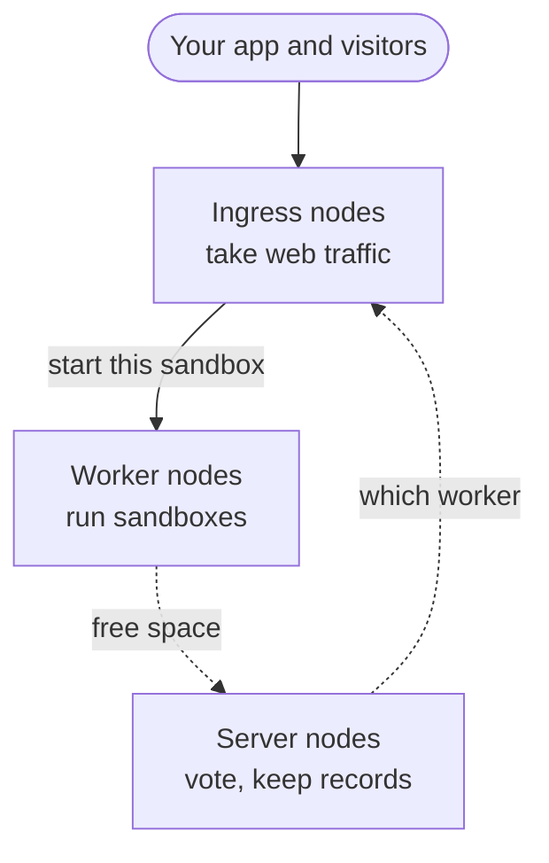
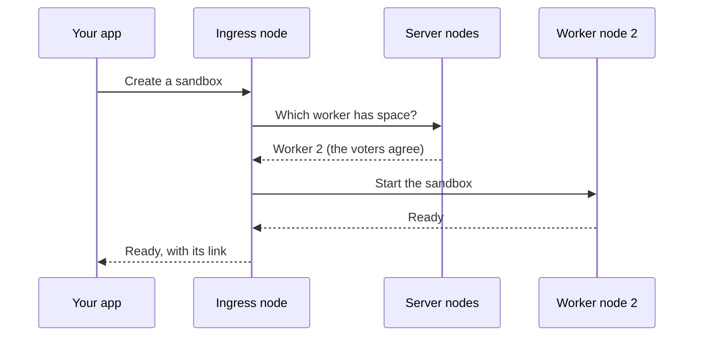
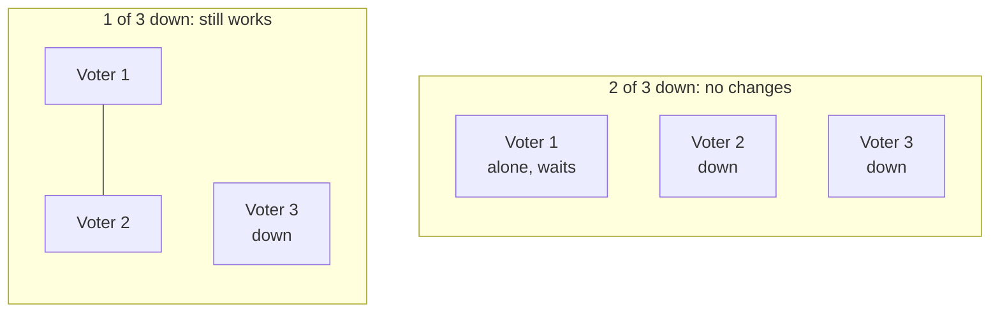

This page explains the ideas behind a cluster. You do not need them to [build one](/cluster/create/). They help when you plan its size, and when something breaks. A **node** is one machine in the cluster.

## The three jobs

Every node does one or more of three jobs:

- **Server nodes** vote on cluster changes. They keep the record of which worker runs which sandbox. They do little work, so small machines are enough.
- **Worker nodes** run the sandboxes. They need the most memory and disk.
- **Ingress nodes** take web traffic from the internet. They pass each request to the worker that runs its sandbox.

A **mixed node** does all three jobs. A small cluster is made of mixed nodes. [Build a cluster](/cluster/create/) builds three of them.

## Words to know

| Word | What it means |
|---|---|
| **Cluster** | A group of machines that work together like one big AerolVM server. |
| **Node** | One machine in the cluster. A machine becomes a node when it joins. |
| **Cluster address** | The one name your app uses, such as `cluster.example.com`. |
| **`sandboxd`** | The AerolVM program on each node. |
| **Cluster change** | A change every node must agree on, such as adding a node, or choosing the node for a sandbox. |
| **Server node** | A node that votes on cluster changes, and keeps the cluster's records. |
| **Worker node** | A node that runs sandboxes. |
| **Ingress node** | A node that takes web traffic from the internet, and passes it on. |
| **Mixed node** | A node that does all three jobs. |
| **Voter** | A server or mixed node that votes on cluster changes. Up to 5 of them vote, by default. The rest keep a copy of the records without voting. |
| **Leader** | The voter that writes down each cluster change. The voters pick it. |
| **Majority** | More than half of the voters. A change needs a majority to go through. |
| **Join token** | A short secret that lets one machine join. |
| **Admin token** | The cluster's password. Your apps and your computer send it with every request. |
| **Node certificate** | A node's signed ID card. Nodes show it to each other before they talk. |
| **Failover** | An option on a sandbox: if its node dies, the sandbox is rebuilt on a healthy node. |

## What happens when you create a sandbox

1. Your app asks the cluster address for a sandbox. An ingress node gets the request.
2. The server nodes pick a worker node with free space. The worker must be able to run that kind of sandbox, such as a GPU sandbox.
3. A majority of the voters agrees on the choice, and the leader writes it down. Now every node knows where the sandbox runs.
4. The worker node starts the sandbox. Your app gets back the sandbox and its link.

Later requests for that sandbox go to any ingress node. The ingress node looks up the worker, and passes the request on.

## Why three server nodes

A cluster change goes through only when a majority of the voters agrees. A **majority** is more than half. This rule stops two halves of a broken network from making different choices.

| Voters | Majority | How many can die, and the cluster still works |
|---|---|---|
| 1 | 1 | None |
| 3 | 2 | 1 |
| 5 | 3 | 2 |
| 7 | 4 | 3 |

So use 3 voters, or 5 for more safety. An even number does not help: 4 voters survive one loss, the same as 3.

With 2 of 3 voters down, one voter is not a majority. Sandboxes that are already running keep running. But creating or deleting a sandbox fails, until a second voter is back. If the dead voters never come back, see [Back up and recover](/cluster/backup/#most-server-nodes-died).

## What happens when a machine dies

| What died | What happens | What you do |
|---|---|---|
| A worker node | Its sandboxes stop. Sandboxes with failover are rebuilt on other workers, with the same ID and links. The others return `410 Gone`. | Replace the machine when you can. |
| A server node | The other voters keep working, if they are a majority. If the leader died, they pick a new one, usually in under 10 seconds. | Replace the machine before another one dies. |
| An ingress node | The other ingress nodes keep taking traffic. A load balancer stops sending visitors to the dead node. With DNS records alone, it still gets its share of visitors: one in three, with three ingress nodes. | Remove its DNS records, or use a load balancer. |
| A mixed node | All three of the above. | Replace the machine before another one dies. |

A rebuilt sandbox starts fresh from its image. It keeps its ID, links and settings. It loses the files on its own disk, and the programs that were running. Keep files that matter on [attached storage](/external-storage/). See [Durability and failover](/durability/).

## Small and large clusters

| | A small cluster | A large cluster |
|---|---|---|
| Size | 2 to 10 nodes | Any size. Needed above 10 nodes. |
| What each node does | Every job: a mixed node | One job each: server, worker or ingress |
| Machines | All alike | Each kind sized for its job |
| How to build it | [Build a cluster](/cluster/create/) | [Build it on AWS](/cluster/aws/), or [Ingress nodes](/cluster-ingress/) |

A small cluster stops at 10 nodes. Every mixed node keeps a full copy of the cluster's records, and of every public route. Up to 5 of them vote. The rest keep copies without voting. Past 10 live nodes, those copies cost too much. So the cluster refuses new sandboxes until you split the jobs.

A large cluster keeps 3, 5 or at most 7 server nodes, however many workers it has. It runs up to about 1,000 worker nodes, and 2 to 10 ingress nodes. Past 10 ingress nodes, you need a router in front that knows which ingress node holds which sandbox. See [Ingress nodes](/cluster-ingress/).

## How nodes trust each other

- **Each node has a node certificate.** Node 1 makes the cluster's signing key when you run `init`. It signs a node certificate for each machine that joins. Nodes show their certificates to each other before they talk.
- **A machine needs a join token to join.** You make join tokens on your computer with `aerolvm join-command`. A token works for one machine, for 2 hours, unless you choose otherwise.
- **A deleted node stays out.** After `aerolvm delete node`, every other node refuses it. Its machine can come back only with a new token.
- **Certificates renew themselves.** A node certificate lasts 90 days. Each node renews its own certificate when two thirds of that time has passed.

[Keep it safe](/cluster/security/) says which secret opens what.

## Next steps

- [Build a cluster](/cluster/create/): three mixed nodes, step by step.
- [Add and remove nodes](/cluster/nodes/): grow the cluster, or take a machine out.
- [Glossary](/cluster-glossary/): the exact names of every cluster setting.
