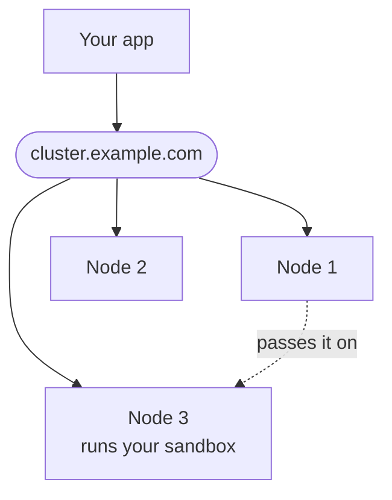
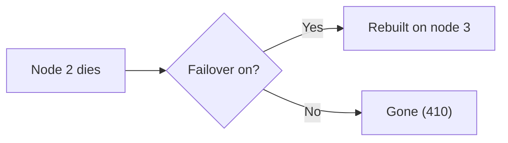

import { Aside, CardGrid, LinkCard, Tabs, TabItem } from '@astrojs/starlight/components';
import BookCall from '../../../components/BookCall.astro';
import { BOOKING_URL as bookingUrl } from '../../../utils/links';

A **cluster** is a group of machines that work together like one big AerolVM server. Each machine in the cluster is called a **node**. Your app sends its requests to one address. The cluster decides which node runs each sandbox.

If one node stops, the other nodes keep working. When you need space for more sandboxes, you add a node.

## Do you need a cluster?

Most people start with [one server](/getting-started/single-node-setup/). It is simpler. It is enough while you build your app and for your first users.

Move to a cluster when one of these is true:

- One server cannot fit all your sandboxes.
- Your product must keep working when a machine dies.

You can move later. Your code stays the same.

## What you need

- **Three Linux machines.** Use Ubuntu 22.04 or newer. Give each one at least 2 CPUs, 4 GB of memory and 30 GB of disk. Rent them from any cloud, such as AWS, DigitalOcean or Hetzner, or use your own hardware. For a test, three small machines cost well under 1 US dollar an hour on most clouds.
- **A private network.** This is a network that only your machines can use. The nodes talk to each other on it. On AWS and DigitalOcean, machines you create in the same region share one by default. On Hetzner, create a network in the dashboard, then add each machine to it.
- **A domain whose DNS is on Cloudflare.** **DNS** is the internet's address book. The cluster uses Cloudflare's DNS to get HTTPS certificates for your domain. You can buy the domain anywhere, then move its DNS to Cloudflare. The free plan is enough. Cloudflare is the only DNS service the installer works with today.
- **The `aerolvm` CLI on your computer.** You manage the cluster from your own computer with this command-line tool. It works on macOS, Linux and Windows. [Install it](/cli/#install).

<Aside type="caution" title="Your own computer cannot be a node">
Each node must be a Linux machine. A Mac or a Windows computer cannot be one, even with Docker Desktop. Docker only runs the sandboxes inside each node. It does not make the cluster. To try a cluster, rent three small cloud machines for an hour, then delete them.
</Aside>

## What a cluster looks like



Your app sends every request to one address, such as `cluster.example.com`. We call it the **cluster address**. The node that gets a request passes it to the node that runs the sandbox.

## How you build one

You run one command on each machine. The rest runs on your computer. The **installer** is the one `curl` command that installs AerolVM on a Linux machine.

| Where | What you run | What it does |
|---|---|---|
| Node 1 | The AerolVM installer, with the word `init` at the end: `curl -fsSL https://aerolvm.aerol.ai \| sudo bash -s -- ... init` | Installs AerolVM and starts a new cluster. |
| Your computer | `aerolvm config import`, with a file you copy from node 1 | Connects your computer to the cluster, as its admin. |
| Your computer | `aerolvm join-command --role mixed` | Prints a **join command**: one command that lets one more machine join. |
| Each other machine | Set your Cloudflare token, then paste the join command | Installs AerolVM and joins the cluster. |
| Your computer | `aerolvm get nodes` | Shows every node, and whether it is healthy. |

You do not copy the cluster's keys or node certificates. Node 1 sends them to each machine as it joins. [Build a cluster](/cluster/create/) gives every command, and what you should see after each one.

## What you get

- **Space for more sandboxes.** Each node you add can run more sandboxes.
- **It keeps working when a machine dies.** The nodes vote on every **cluster change**, such as adding a node, or choosing the node for a sandbox. With three nodes, one can die and the cluster keeps working. If two die at the same time, sandboxes already running on the last node keep running. But creating or deleting a sandbox fails until a second node is back. [How a cluster works](/cluster/how-it-works/) explains why.
- **One address.** Your app, public sandbox links and [TCP ports](/tcp-ports/) all use the cluster address.
- **Safe by default.** Before two nodes talk, each one shows a **node certificate**: a signed ID card. A machine can only join with a join command that you made.
- **Upgrades from your computer.** `aerolvm upgrade plan` shows what will happen. `aerolvm upgrade apply` then upgrades every node, one at a time. If a node's upgrade fails, that node goes back to its old version, and the upgrade stops.
- **One dashboard.** The [dashboard](/dashboard/) shows every node and every sandbox, from any node.

## Your code does not change

The SDKs work the same with one server or a cluster. Set two **environment variables**, the settings your app reads when it starts:

- `SB_API_URL`: the cluster address, such as `https://cluster.example.com`.
- `SB_PAT_TOKEN`: the cluster's **admin token**. It is the password you make when you build the cluster.

One option matters only in a cluster: **failover**. With failover on, if a node dies, its sandboxes start again on a healthy node.



A rebuilt sandbox starts fresh from its image. This is what it keeps:

| | With failover | Without failover |
|---|---|---|
| Sandbox ID, links and settings | Kept | Lost |
| Exposed ports | Exposed again. A TCP port keeps its number only if that number is still free. | Lost |
| Files on the sandbox's own disk | Lost | Lost |
| Programs that were running | Lost. The sandbox starts again from its image. | Lost |
| Files on [attached storage](/external-storage/) | Kept | Kept |

Turn failover on when you create a sandbox:

<Tabs syncKey="lang">
  <TabItem label="TypeScript">
    ```ts
    const sandbox = await client.create({
      image: "ubuntu:22.04",
      failover: { policy: "recreate" },
    });
    ```
  </TabItem>
  <TabItem label="Python">
    ```python
    sandbox = client.create(image="ubuntu:22.04", failover={"policy": "recreate"})
    ```
  </TabItem>
  <TabItem label="Go">
    ```go
    sandbox, err := client.Create(ctx, sdktypes.CreateSandboxOptions{
        Image:    "ubuntu:22.04",
        Failover: &sdktypes.Failover{Policy: sdktypes.FailoverPolicyRecreate},
    })
    ```
  </TabItem>
  <TabItem label="Rust">
    ```rust
    use aerolvm_sdk::Failover;

    let sandbox = client.create(CreateOptions {
        image: "ubuntu:22.04".into(),
        failover: Some(Failover { policy: "recreate".into() }),
        ..Default::default()
    })?;
    ```
  </TabItem>
  <TabItem label="Java">
    ```java
    Sandbox sandbox = client.create(new CreateOptions()
        .setImage("ubuntu:22.04")
        .setFailover(new Failover().setPolicy("recreate")));
    ```
  </TabItem>
</Tabs>

Without failover, calls for a sandbox on a dead node return `410 Gone`. Your app must then create a new sandbox. See [Durability and failover](/durability/).

## Pick your path

<CardGrid>
  <LinkCard title="Build a cluster" description="Any Linux machines, any cloud. One command on each machine. Never used Terraform? Start here." href="/cluster/create/" />
  <LinkCard title="Build it on AWS" description="Terraform, a tool that makes cloud machines from config files, makes the machines, the network and the DNS records for you." href="/cluster/aws/" />
</CardGrid>

Want the ideas first? Read [How a cluster works](/cluster/how-it-works/).

## Pages in this guide

1. [How a cluster works](/cluster/how-it-works/): the words, the three jobs a node can do, and what happens when a machine dies.
2. [Build a cluster](/cluster/create/): three machines, step by step.
3. [Build it on AWS](/cluster/aws/): the same cluster, made by Terraform (a tool that makes cloud machines from config files).
4. [Add and remove nodes](/cluster/nodes/): add a node, pause one, empty one, remove one.
5. [Upgrade](/cluster/upgrade/): move every node to a new release.
6. [Back up and recover](/cluster/backup/): save the cluster's records, and bring it back after a bad failure.
7. [Keep it safe](/cluster/security/): the secrets you hold, and what each one opens.
8. [Fix problems](/cluster/troubleshooting/): what to run when something looks wrong.
9. [Command cheat sheet](/cluster/cheat-sheet/): every cluster command on one page.
10. [Coming from Kubernetes](/cluster/kubernetes/): Kubernetes words and commands, and their AerolVM match.

## If you know Kubernetes

Most commands have a direct match:

| In Kubernetes | In AerolVM |
|---|---|
| `kubeadm` on the nodes, `kubectl` on your computer | `sandboxd` (the AerolVM program on each node) on the nodes, `aerolvm` on your computer |
| `kubeadm init` | The installer, with `init` |
| `kubeadm token create --print-join-command` | `aerolvm join-command` |
| `kubeadm join` with `--discovery-token-ca-cert-hash` | The join command, with `--ca-cert-hash` |
| Copy `/etc/kubernetes/admin.conf` to `~/.kube/config` | Copy `/etc/sandboxd/admin-context.json`, then `aerolvm config import` |
| `kubectl get nodes`, `cordon`, `uncordon`, `delete node` | The same words, after `aerolvm` |
| `kubeadm upgrade plan` | `aerolvm upgrade plan` |
| `kubeadm upgrade apply`, then `kubeadm upgrade node` on every node | One `aerolvm upgrade apply`, for every node |
| `kubeadm reset` | `sudo sandboxd reset --yes` |

Two things work differently:

- **`aerolvm drain` does not move sandboxes.** It stops new sandboxes from starting on the node. Then it waits until the node runs none. Add `--delete-sandboxes` to delete them instead. To move sandboxes, turn on [failover](#your-code-does-not-change) when you create them. Then `aerolvm delete node` rebuilds them on other nodes.
- **There is less to install.** You run the installer on each node. There is no YAML to write, no network plugin to add, and no separate database to run. You still [back up](/cluster/backup/) the cluster's records.

See [Coming from Kubernetes](/cluster/kubernetes/) for the full list.

## Want help?

<BookCall href={bookingUrl} title="Plan your cluster with us">
  We can size your cluster with you, and set it up together. Bring the number of sandboxes you expect, and the kinds you need: containers, Firecracker microVMs, WebAssembly or V8 isolates.
</BookCall>
