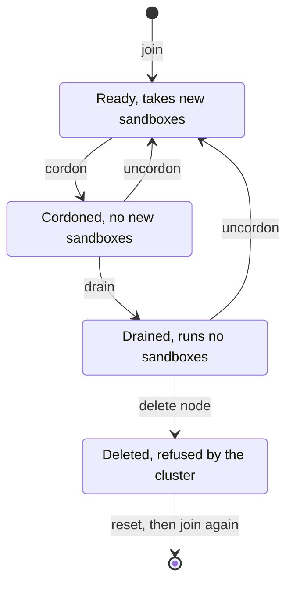

import { Aside } from '@astrojs/starlight/components';

You manage the nodes from your own computer, with the `aerolvm` command-line tool. You do not need SSH for most of it. Each command here is safe to run again.

A **node** is one machine in the cluster. `sandboxd` is the AerolVM program on each node.

## A node's life



- **Ready**: the node is healthy, and new sandboxes can start on it.
- **Cordoned**: no new sandboxes start on it. Its running sandboxes keep running.
- **Drained**: it runs no sandboxes, and none start on it.
- **Deleted**: the cluster refuses it. Its machine can come back only with a new join token.

## See your nodes

```bash title="On your computer"
aerolvm get nodes
```

**What you should see:**

```text
NAME     ROLE     STATUS                     VERSION   SANDBOXES
node-1   mixed    Ready,Leader               v0.7.0    12
node-2   mixed    Ready                      v0.7.0    9
wrk-1    worker   Ready,SchedulingDisabled   v0.7.0    3
wrk-2    worker   NotReady                   v0.7.0    -
```

| `STATUS` says | What it means |
|---|---|
| `Ready` | The node is healthy. |
| `NotReady` | The cluster cannot reach the node. |
| `SchedulingDisabled` | The node is cordoned: no new sandboxes start on it. |
| `Leader` | This node writes down each cluster change. |

`SANDBOXES` is how many sandboxes the node runs. It shows `-` when the node cannot run sandboxes, such as a server node. It also shows `-` when the cluster cannot reach the node.

More ways to look:

| To see | Run on your computer |
|---|---|
| More columns: CPU, memory, zone and API URL | `aerolvm get nodes -o wide` |
| One node in detail, such as whether it votes | `aerolvm describe node node-2` |
| The CPU and memory each node has given out | `aerolvm top nodes` |
| The leader, the members, how many nodes vote (it says "Raft voters"), and the cluster's version | `aerolvm cluster-info` |

## Add a node

To make space for more sandboxes, add a **worker node**: a node that only runs sandboxes. It needs the same kind of machine as in [Build a cluster](/cluster/create/#before-you-start), on the same private network. Give it the same firewall rules as the other nodes: on AWS, the same security group.

### Step 1: Make a join command

```bash title="On your computer"
aerolvm join-command
```

`worker` is the default role. The command prints one **join command**, and a note:

```text
curl -fsSL https://aerolvm.aerol.ai | sudo bash -s -- --domain cluster.example.com --dns-provider cloudflare --dns-api-token "$CLOUDFLARE_API_TOKEN" join https://10.0.1.5:7003 --token 7mxq2c.e81f... --ca-cert-hash sha256:9a1c...
aerolvm: worker token 7mxq2c expires at 2026-11-10T14:00:00Z and works for one machine. To cancel it: aerolvm delete jointoken 7mxq2c
aerolvm: on the new machine, first set your Cloudflare API token: export CLOUDFLARE_API_TOKEN=<token>
```

### Step 2: Run it on the new machine

Log in to the new machine. Set your Cloudflare token, then paste the join command:

```bash title="On the new machine"
export CLOUDFLARE_API_TOKEN=your-cloudflare-token

# Paste your join command here.
```

**What you should see** at the end:

```text
[join] wrk-3 joined the cluster as a worker node
[join] it does not hold the admin token, only a fingerprint (hash) to check it. Its own SB_PAT_TOKEN works only for tools on this machine.
```

A worker node checks your admin token against a fingerprint of it. It does not keep the token itself. See [Keep it safe](/cluster/security/#which-nodes-hold-the-admin-token).

### Other roles

`--role` chooses the job:

| Run on your computer | The new node |
|---|---|
| `aerolvm join-command` | A worker node: runs sandboxes. |
| `aerolvm join-command --role ingress` | An ingress node: takes web traffic. |
| `aerolvm join-command --role mixed` | A mixed node: votes, runs sandboxes and takes web traffic. |
| `aerolvm join-command --role server` | A server node: votes, and keeps the cluster's records. |

A server or mixed node joins with a **server token**. The cluster makes a server token only when a server or mixed node asks. If your cluster address leads to ingress nodes, make it on a server or mixed node instead. `sudo sandboxd join-command` is the same command, run on the node itself:

```bash title="On a server or mixed node"
sudo sandboxd join-command --role server    # for a new server node
sudo sandboxd join-command --role mixed     # for a new mixed node
```

It prints the same kind of join command.

### Token options

| Option | What it does |
|---|---|
| `--ttl 30m` | How long the join token works. The default is 2 hours. A server token works for at most 24 hours. |
| `--ttl 0` | The token never expires. Only for worker and ingress tokens, such as for machines that start by themselves to handle load. |
| `--reusable` | Many machines can use the same token. Without it, a token works for one machine. |

List the join tokens, or cancel one:

```bash title="On your computer"
aerolvm get jointokens
aerolvm delete jointoken 7mxq2c
```

With Terraform, add the node to `nodes` instead. See [Build it on AWS](/cluster/aws/#add-a-node-later).

## Pause a node

To **cordon** a node is to stop new sandboxes from starting on it. Its running sandboxes keep running. Use it before you look into a problem on a node.

```bash title="On your computer"
aerolvm cordon wrk-1
```

**What you should see:** `node/wrk-1 cordoned`. To let new sandboxes start on it again:

```bash title="On your computer"
aerolvm uncordon wrk-1
```

## Empty a node

**Drain** a node before you remove it, or before you work on its machine. `drain` cordons the node. Then it waits until the node runs no sandboxes.

```bash title="On your computer"
aerolvm drain wrk-1 --timeout 30m
```

`drain` does not move sandboxes to other nodes. It waits for your users to stop or delete them. To delete them yourself instead, add `--delete-sandboxes`:

```bash title="On your computer"
aerolvm drain wrk-1 --delete-sandboxes
```

<Aside type="caution" title="--delete-sandboxes deletes your users' work">
It deletes every sandbox on the node: running ones, stopped ones, and ones with failover on. Nothing moves to another node. Use it only when you are sure.
</Aside>

| Option | What it does |
|---|---|
| `--timeout 30m` | How long to wait. The default is 10 minutes. `0` waits with no limit. On a timeout, the node stays cordoned. |
| `--delete-sandboxes` | Deletes every sandbox on the node, running or stopped, then waits until none are left. |
| `--migrate` | First moves the node's WebAssembly sandboxes to another worker, while they run. Other kinds of sandbox cannot move this way. |

## Remove a node

Empty the node first, then delete it:

```bash title="On your computer"
aerolvm drain wrk-1 --timeout 30m
aerolvm delete node wrk-1
```

**What you should see:** `node "wrk-1" deleted`. The node leaves the cluster. Every other node refuses it from now on.

`delete node` refuses a node that still runs sandboxes. You then have two choices:

- **Move the sandboxes that have [failover](/cluster/#your-code-does-not-change) on.** Delete the node with `--force`: `aerolvm delete node wrk-1 --force`. Sandboxes with failover on are rebuilt on other workers. They start fresh from their image. Sandboxes without failover are lost.
- **Delete them all first,** with `aerolvm drain wrk-1 --delete-sandboxes`. Then delete the node.

The machine itself keeps AerolVM installed. To use it again, first clear its cluster files. Then join it again with a new join command:

```bash title="On the removed machine"
sudo sandboxd reset --yes
```

`reset` deletes the cluster's keys, the node certificate and the cluster records from this machine. It keeps AerolVM installed, with its database and its settings.

### Remove a server or mixed node

Server and mixed nodes vote. Keep a majority of the voters up at all times:

- With 3 voters, remove one at a time. Add its replacement before you remove the next one.
- Never remove 2 of 3 voters at once. The cluster then stops accepting creates and deletes.

[How a cluster works](/cluster/how-it-works/#why-three-server-nodes) explains why.

## Choose where sandboxes run

Give a node labels, such as its zone, or the kind of GPU it has. Then a create can ask for a node with those labels. See [Choose where a sandbox runs](/engineering-placement-failover/#choose-where-a-sandbox-runs).

## If something goes wrong

| What you see | What it means | What to do |
|---|---|---|
| `this key was revoked (its node was deleted)` | The machine was a node that you deleted. "Revoked" means cancelled. | On that machine, run `sudo sandboxd reset --yes`, then join again with a new join command. |
| `only server nodes may call this`, or `which is not an admitted server` | You asked for a server token through an ingress node. | Run `sudo sandboxd join-command --role server` on a server or mixed node. |
| `the join server could not reach this node back` | The new machine is outside the other nodes' firewall rules. ("Join server" is the server node that answers joins.) | Give it the same firewall rules, or security group, as the other nodes. |
| A node stays `NotReady` | The cluster cannot reach it. | Log in to it, and run `sudo journalctl -u sandboxd -n 50` to read its last 50 log lines. |
| `drain` ends with a timeout | Sandboxes still run on the node. | Wait longer, or add `--delete-sandboxes`. |

More fixes are in [Fix problems](/cluster/troubleshooting/).

## Next steps

- [Upgrade](/cluster/upgrade/): move every node to a new release.
- [Command cheat sheet](/cluster/cheat-sheet/): every cluster command on one page.
