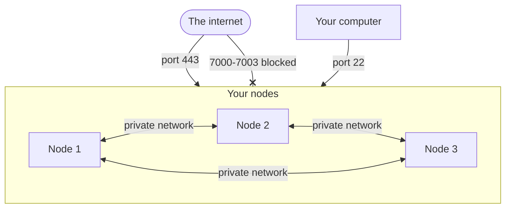

import { Aside } from '@astrojs/starlight/components';

You hold four secrets: the admin token, join tokens, the Cloudflare token and the admin login file. Backups and Terraform's state hold copies of them, so guard those too. This page says what each one opens, where it lives, and how to keep it safe.

## The secrets you hold

| Secret | What it opens | Who holds it |
|---|---|---|
| **Admin token** | Everything: every sandbox, every node, every setting. Apps send it as `SB_PAT_TOKEN`. | You, your apps, and every server and mixed node |
| **Join token** | Lets one machine join the cluster. A server token gives the new node the admin token and the cluster's keys. | You, for 2 hours (or the time limit you chose) |
| **Cloudflare token** | Lets a node change your domain's DNS records, to get HTTPS certificates. | You, and every node |
| **Admin login file** (`admin-context.json`) | The same as the admin token: it holds it. | Node 1, and your computer after `aerolvm config import` |

These hold copies:

| Copy | What it holds | Where it lives |
|---|---|---|
| **Backups** | The admin token, and the key that opens **stored secrets** (the sandbox passwords and settings the cluster keeps encrypted). | Wherever you keep them |
| **Terraform's state** (the file where Terraform records what it made) | The admin token, and the join tokens Terraform made. | Wherever `main.tf` keeps it |

Keep each of them like a password: in a password manager or an encrypted store. Never put one in Git, or in a chat.

## Which nodes hold the admin token

- **Server and mixed nodes** hold the admin token. They need it to manage the cluster.
- **Worker and ingress nodes** do not hold it. They keep a fingerprint (a hash) of the admin token instead, to check the token your apps send. They talk to other nodes with their node certificate.

If someone breaks into a worker or ingress node, they do not get your admin token. They do get the Cloudflare token, and the key that opens stored secrets, unless you use [wrapped key custody](/enterprise/key-custody/). The node's own `SB_PAT_TOKEN`, in `/etc/sandboxd/sandboxd.env`, is a random token for that node alone. It works only for tools on that machine.

There is one exception. While any node still runs a release before v0.7.0, every new worker and ingress node gets the admin token. Once every node runs v0.7.0 or later, fix those nodes. On each one, run `sudo sandboxd reset --yes`, then join it again with a new join command. It then holds the fingerprint of the admin token, not the token.

## Join tokens

A join token decides what a new node gets:

| Join token role | What the new node gets |
|---|---|
| `server` (also used for `mixed`) | Its own node certificate. The admin token. The key that signs node certificates. The key that opens stored secrets. The key nodes use to find each other. |
| `worker`, `ingress` | Its own node certificate. The key that opens stored secrets. The key nodes use to find each other. A fingerprint of the admin token. |

With [wrapped key custody](/enterprise/key-custody/), the key that opens stored secrets is locked by your own key store, such as AWS KMS. A join then hands out only the locked copy. A node can open it only with your key store's permission.

So treat a server token like the admin token. Rules:

- **Give them a short time limit.** A token works for 2 hours by default. A server token works for at most 24 hours.
- **Use one token for one machine.** Add `--reusable` only when you add many machines at once.
- **Use never-expiring tokens (`--ttl 0`) only for worker and ingress nodes,** such as machines that start by themselves to handle load.
- **Cancel tokens you no longer need:**

```bash title="On your computer"
aerolvm get jointokens
aerolvm delete jointoken 7mxq2c
```

A worker or ingress node cannot make a server token. It cannot get the key that signs node certificates either. Server and mixed nodes refuse both requests.

Every join, and every refused join, is written to the **audit log**: the cluster's record of who did what.

## The Cloudflare token

Every node holds the Cloudflare token, because every node gets HTTPS certificates for your domain. Worker nodes run your users' code. So give the token as little power as it needs:

- In Cloudflare, give it only two permissions: **Zone → DNS → Edit** and **Zone → Zone → Read**.
- Under **Zone Resources**, choose only the one domain the cluster uses.

The join command does not hold the Cloudflare token. It reads it from `CLOUDFLARE_API_TOKEN` on the new machine. So a join command you paste into a chat does not leak it.

## Keep the private ports private



| Port | Open it to | What it carries |
|---|---|---|
| TCP `443` | The internet, on nodes that take web traffic | HTTPS: your apps and sandbox links |
| TCP `22` | Your own IP address only | SSH, for you |
| TCP `7000` | Server and mixed nodes only | The voters' votes |
| TCP and UDP `7001` | All nodes, on the private network only | How nodes find each other |
| TCP `7002` | All nodes, on the private network only | Calls from node to node |
| TCP `7003` | Every node, to server and mixed nodes only | Joins: a new machine asks to join here |

Never open ports `7000` to `7003` to the internet. They are for the nodes only.

## Node certificates

- **Each node has its own node certificate.** It names the node. Other nodes accept it only from a node that is still in the cluster.
- **They renew themselves.** A node certificate lasts 90 days. Each node renews its own after 60 days.
- **A node whose node certificate expired cannot renew it.** This happens if a node was off for over 90 days. Run `sudo sandboxd reset --yes` on it, then join it again with a new join command.

## Change the admin token

You can change the admin token without stopping the cluster. Follow the steps in order.

**Step 0, only if you use [platform volumes](/platform-volumes/).** Each node's boot log has a line like `operator volume scope scope=op-...`. Set `SB_OPERATOR_VOLUME_SCOPE` to that value in `/etc/sandboxd/sandboxd.env` on every node. Restart them one at a time. Skip this, and a node with platform volumes on refuses to start in step 3.

1. Make the new token, and its fingerprint:

```bash title="On your computer"
NEW_TOKEN=$(openssl rand -hex 32)
echo "$NEW_TOKEN"
printf %s "$NEW_TOKEN" | sha256sum | cut -d' ' -f1
```

The first line it prints is the new token. Save it in your password manager. The second line is its fingerprint. Make the old token's fingerprint the same way.

2. On each server and mixed node, edit `/etc/sandboxd/sandboxd.env`. Set `SB_PAT_TOKEN` to the new token, and `SB_PAT_TOKEN_PREVIOUS` to the old one. A worker or ingress node can have no `SB_PAT_TOKEN_SHA256` in `/etc/sandboxd/cluster.env`. Such a node joined on an older release, so it holds the token itself. Do the same on it.
3. On each other worker and ingress node, edit `/etc/sandboxd/cluster.env`. Set `SB_PAT_TOKEN_SHA256` to both fingerprints: the new one, a comma, then the old one.
4. Restart one node at a time with `sudo systemctl restart sandboxd`. Old and new tokens both work now.
5. Move your apps and your computer (`aerolvm login`) to the new token.
6. On every node, remove `SB_PAT_TOKEN_PREVIOUS`, and the old fingerprint. Restart them one at a time again. The old token stops working.

The [identity and access runbook](https://github.com/aerol-ai/microvm/blob/main/setup/runbooks/identity-and-access.md#rotatepat) has the same steps, for operators.

## After a leak

| What leaked | What to do |
|---|---|
| A join token | Cancel it: `aerolvm delete jointoken <id>`. Check `aerolvm get nodes` for nodes you did not add, and delete them. |
| The admin token, or the admin login file | [Change the admin token](#change-the-admin-token). |
| The Cloudflare token | Make a new token in Cloudflare, and delete the old one. On each node, set the new one with `export CLOUDFLARE_API_TOKEN=<new token>`. Then run the installer with only that option: `curl -fsSL https://aerolvm.aerol.ai \| sudo bash -s -- --dns-api-token "$CLOUDFLARE_API_TOKEN"`. The installer keeps every other setting. |
| Someone broke into a node | Delete the node (`aerolvm delete node <name> --force`), and rebuild its machine. Change the Cloudflare token. If it was a server or mixed node, also change the admin token. |
| A server token, or a backup | Change the admin token. Treat the cluster's keys as known. For a high-security cluster, build a new cluster and move to it. |

## Next steps

- [Back up and recover](/cluster/backup/): backups hold secrets too.
- [Secrets providers](/cluster-secrets/): keep sandbox passwords in AWS KMS.
- [SSO](/enterprise/sso/): give people and services their own tokens, in place of the admin token.
