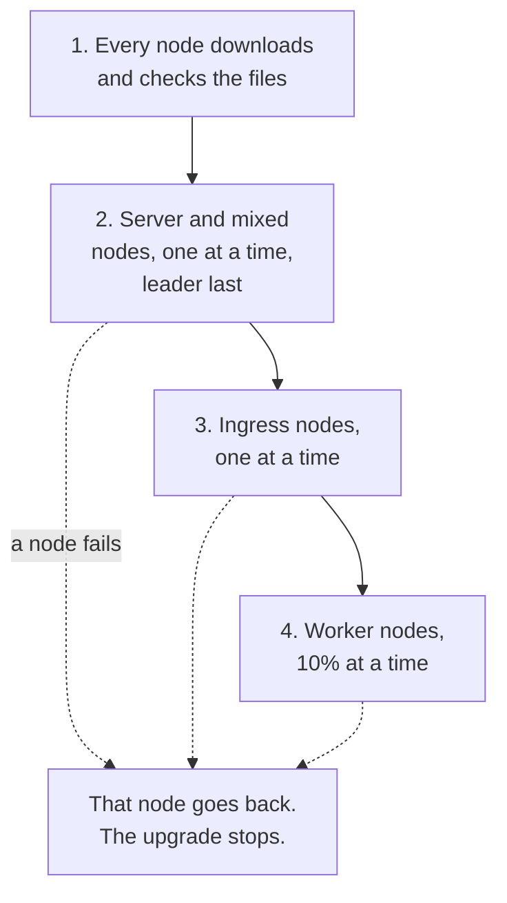

import { Aside } from '@astrojs/starlight/components';

You upgrade the whole cluster from your own computer, with two commands. `plan` shows what will happen. `apply` does it, one node at a time. Running sandboxes keep running.

The same two commands upgrade a [one-server install](/getting-started/single-node-setup/) too.

**What you will do:**

- See the plan.
- Apply it, and watch it.
- Know how to pause, stop or undo it.

`sandboxd` is the AerolVM program on each node. An upgrade replaces it with a newer release.

## Upgrade the cluster

### Step 1: See the plan

Pick the release to move to. The [releases page](https://github.com/aerol-ai/microvm/releases) lists them. This page uses `v0.7.1` as the example.

```bash title="On your computer"
aerolvm upgrade plan v0.7.1
```

`plan` changes nothing. **What you should see** (shortened):

```text
Upgrade plan: v0.7.1 (cluster, 3 node(s), 3 up)
...
ORDER   NODE     ROLE    VERSION   STATUS         BATCH   ACTION
1       node-2   mixed   v0.7.0    Ready          -       upgrade
2       node-3   mixed   v0.7.0    Ready          -       upgrade
3       node-1   mixed   v0.7.0    Ready,Leader   -       upgrade (last server: it hands off leadership first)

Version skew:        allowed ...
...
To go ahead: aerolvm upgrade apply v0.7.1
```

Read three things in it:

- **The order** the nodes go in. The leader goes last.
- **Version skew: allowed.** The jump from your version to the new one is safe. If it says the jump is not allowed, it lists the releases to upgrade through first.
- **Warnings**, at the end, if there are any. For example, a node that is down is skipped, and upgraded when it is back.

### Step 2: Apply it

```bash title="On your computer"
aerolvm upgrade apply v0.7.1 --wait
```

`apply` first checks every file of the release against its published checksums: a fingerprint of each file. Then it hands the upgrade to the leader. The leader runs the upgrade. So it goes on even if your computer sleeps or loses its connection. `--wait` follows it and prints each node's progress.

**What you should see** at the end: every node on the new version. Check with:

```bash title="On your computer"
aerolvm get nodes
```

Every node shows `Ready` and `v0.7.1` under `VERSION`.

## What happens, in order



1. **Every node downloads the new files, and checks them.** If one node cannot, nothing restarts.
2. **The server nodes go one at a time.** The leader goes last. It first hands its job to another server node. Mixed nodes go in this step.
3. **The ingress nodes go one at a time.**
4. **The worker nodes go in batches** of 10% of the workers, at least one at a time. Each batch stops taking new sandboxes before it restarts.

On each node, the upgrade backs up the node's database and keeps the old files. If the new version does not come up healthy, the node goes back to the old files by itself. The upgrade then stops, so one bad release cannot reach every node.

## What running sandboxes see

On each node, `sandboxd` stops for a few seconds while it swaps its files. The sandboxes on the node keep running:

| Sandbox | During the upgrade |
|---|---|
| Containers, including gVisor | Keep running. The new `sandboxd` takes them over again. |
| Firecracker | Keep running. |
| WebAssembly | Keep running, with their files. |
| V8 isolate | Keep running, with what they hold in memory. |
| Attached cloud storage | Keeps working. |
| The node's API | Down for a few seconds. Calls to that node fail for that time. |

Two things to know:

- **The first upgrade from a release before v0.7.0** restarts WebAssembly and V8 isolate sandboxes once. A WebAssembly sandbox keeps its files. An isolate starts fresh on its next request. To avoid that, [drain](/cluster/nodes/#empty-a-node) the node first.
- **The helper inside a running sandbox stays the old one.** Sandboxes you create after the upgrade get the new one.

With DNS records alone, visitors that DNS sends to a node while it restarts get error `502`. A [load balancer](/cluster/aws/#step-6-add-a-load-balancer-for-production) avoids that.

## Watch, pause, stop and undo

| To do this | Run on your computer |
|---|---|
| See where the upgrade stands | `aerolvm upgrade status` |
| Upgrade 2 workers first, then pause, to test the new release | `aerolvm upgrade apply v0.7.1 --pause-after 2` |
| Go on after a pause | `aerolvm upgrade resume` |
| Finish the nodes in progress, and start no more | `aerolvm upgrade stop` |
| Go on after a stop, or after a failed node is fixed | `aerolvm upgrade apply v0.7.1 --wait` again, with the same version |
| Put every node back on the old version | `aerolvm upgrade rollback --wait` |
| Upgrade more workers at a time | `aerolvm upgrade apply v0.7.1 --batch 25%` |

Each of these is safe to run again.

`rollback` works only while the upgrade is paused, stopped or failed. A running upgrade must be stopped first. When an upgrade finishes, it turns on the new version by itself (this is called **finalize**). After that, `rollback` no longer works. To keep the choice to roll back after every node is done, use `--hold`, below.

### Keep new features off until you are sure

A release can change the cluster's records in a way the old version cannot read. `plan` says so in its `One-way migrations` line. For those releases, use `--hold`:

```bash title="On your computer"
aerolvm upgrade apply v0.7.1 --hold --wait
```

Every node then runs the new version, but the upgrade stops at `done`, before finalize. You can still roll back. When you are sure, finalize it yourself:

```bash title="On your computer"
aerolvm upgrade finalize
```

After `finalize`, `rollback` no longer works.

## A cluster with one or two server nodes

With one or two voting nodes, the cluster cannot vote while one of them restarts. So the cluster's API is down for a few seconds, each time one of those nodes restarts. Sandboxes keep running. `apply` asks you to accept that:

```bash title="On your computer"
aerolvm upgrade apply v0.7.1 --allow-downtime --wait
```

## Nodes with no internet access

Download the release into one file on a machine that has internet. Carry the file to your computer, and upgrade from it:

```bash title="On a machine with internet"
aerolvm release pull v0.7.1 -o aerolvm-v0.7.1.tgz
```

```bash title="On your computer"
aerolvm upgrade apply v0.7.1 --from aerolvm-v0.7.1.tgz --wait
```

`release pull` checks every file against the release's checksums as it downloads. `apply` checks them again before it sends anything. The server nodes pass the files on to the other nodes, so the nodes need no internet.

## Upgrade one server

On a one-server install, the same commands upgrade that one server:

```bash title="On your computer"
aerolvm upgrade plan v0.7.1
aerolvm upgrade apply v0.7.1 --wait
```

Its API is down for a few seconds while `sandboxd` restarts. Its sandboxes keep running.

## The first upgrade from a release before v0.7.0

Releases before v0.7.0 do not have `aerolvm upgrade`. Upgrade those once with the installer, one node at a time: server nodes first, then ingress nodes, then workers. On each node, run:

```bash title="On each node, one at a time"
curl -fsSL https://aerolvm.aerol.ai | sudo bash
```

The installer keeps the node's settings and its admin token. Before you move to the next node, wait until `aerolvm get nodes` shows this one `Ready` on the new version. After this first upgrade, use `aerolvm upgrade` for every later release.

### Let an older cluster use join commands

A cluster first built with `cluster-init.sh` keeps its signing key on its first server node only. Its nodes cannot renew their own node certificates. After the first upgrade, run this once:

1. On the first server node, run `sudo sandboxd adopt`.
2. Then on every other server node, run `sudo sandboxd adopt`.
3. Worker and ingress nodes need nothing.

From then on, `aerolvm join-command` works, and every node renews its own node certificate. `adopt` is safe to run again.

## If something goes wrong

| What you see | What it means | What to do |
|---|---|---|
| `plan` exits with an error | The upgrade would be refused, for example a version jump that is not allowed. | Read the reason. Upgrade through the releases it lists first. |
| `status` shows a node `failed` | That node's new version did not come up. It went back to the old version, and the upgrade stopped. | Read its log (`sudo journalctl -u sandboxd -n 50` on that node). Then `aerolvm upgrade rollback --wait`. Or fix the node, then run `aerolvm upgrade apply v0.7.1 --wait` again. |
| `status` shows a node `skipped` | The node was down when its turn came. The upgrade waits at `done`, and does not finalize, until that node is upgraded or deleted. | Start the machine again. The leader upgrades it when it is back. Or remove it with `aerolvm delete node`. |
| `status` shows a node `manual` | That node does not take upgrades from the API. | Run the command `status` prints for it, on that node. |

The [cluster upgrades runbook](https://github.com/aerol-ai/microvm/blob/main/setup/runbooks/cluster-upgrades.md) has more.

## Next steps

- [Back up and recover](/cluster/backup/): take a backup before a big upgrade.
- [Fix problems](/cluster/troubleshooting/): what to run when something looks wrong.
