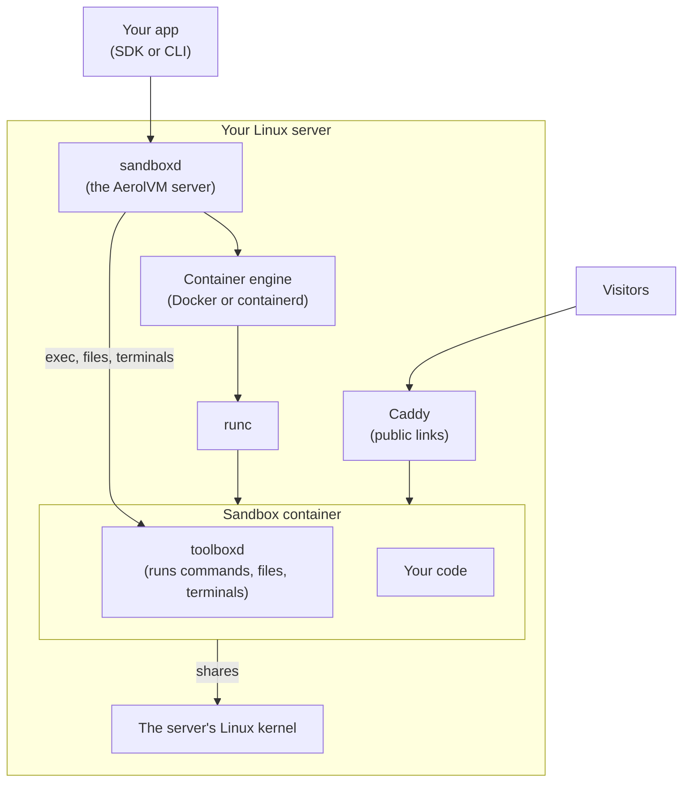

import { Tabs, TabItem } from '@astrojs/starlight/components';

A container sandbox is the default kind. It is a normal Linux container: your code gets its own files, its own network and its own list of processes, with limits on CPU and memory. It starts from any container image, so the tools you already use work as they are.

Choose a container for most work: AI agents, builds, tests, dev environments and data jobs. It starts fast and runs almost any program. For code you do not trust at all, add a stronger wall with [gVisor](/gvisor-sandbox/) or [Firecracker](/firecracker-sandbox/).

## How it works



1. **Your app asks the server** for a sandbox, with an image and limits.
2. **The server asks the container engine** to start a container from that image. The engine is usually Docker on a single server and containerd on a cluster. See [Docker or containerd](#docker-or-containerd).
3. **runc starts the container.** Linux gives it its own view of files, network and processes (namespaces), and enforces its CPU and memory limits (cgroups).
4. **toolboxd runs inside every container.** The server mounts this small helper read-only. It runs your commands, moves files and keeps terminal sessions for the server.
5. **Traffic in and out goes through the server.** Caddy sends public links to the container, and firewall rules on the server decide what the container can reach.

## What keeps it apart

| Part | What the sandbox gets |
|---|---|
| Files | Its own file system, built from the image. Other sandboxes and the server's files are out of reach. |
| Network | Its own network stack. Nothing from outside reaches it until you share a port. Sandboxes on one server share a private network, so use [network rules](/network-access/) to limit what each can reach. |
| Processes | Its own process list. It cannot see programs outside the sandbox. |
| CPU and memory | Hard limits. CPU can be a fraction of a core. Memory is a hard cap, with no extra swap. |
| Kernel | **Shared** with the server. This is the one thing a container does not wall off. |

A bug in the Linux kernel could let code escape a container. That is why [gVisor](/gvisor-sandbox/) adds its own kernel layer, and [Firecracker](/firecracker-sandbox/) gives each sandbox a kernel of its own.

## Create a container sandbox

Containers are the default, so you only need an image.

<Tabs syncKey="lang">
  <TabItem label="TypeScript">
    ```ts
    const sandbox = await client.create({ image: "python:3.12-slim" });
    const result = await sandbox.exec(`python3 -c "print('Hello from a container')"`);
    console.log(result.stdout);
    ```
  </TabItem>
  <TabItem label="Python">
    ```python
    sandbox = client.create(image="python:3.12-slim")
    result = sandbox.exec("python3 -c \"print('Hello from a container')\"")
    print(result["stdout"])
    ```
  </TabItem>
  <TabItem label="Go">
    ```go
    sandbox, err := client.Create(ctx, sdktypes.CreateSandboxOptions{Image: "python:3.12-slim"})
    if err != nil {
        log.Fatal(err)
    }
    result, err := sandbox.ExecCommand(ctx, `python3 -c "print('Hello from a container')"`)
    if err != nil {
        log.Fatal(err)
    }
    fmt.Print(result.Stdout)
    ```
  </TabItem>
  <TabItem label="Rust">
    ```rust
    let sandbox = client.create(CreateOptions {
        image: "python:3.12-slim".into(),
        ..Default::default()
    })?;
    let result = sandbox.exec(r#"python3 -c "print('Hello from a container')""#)?;
    print!("{}", result.stdout);
    ```
  </TabItem>
  <TabItem label="Java">
    ```java
    Sandbox sandbox = client.create(new CreateOptions().setImage("python:3.12-slim"));
    ExecResult result = sandbox.exec("python3 -c \"print('Hello from a container')\"");
    System.out.print(result.stdout);
    ```
  </TabItem>
</Tabs>

The API calls this runtime `docker`, whichever engine the server uses. You can pass `runtime: "docker"` to say so, but you do not need to.

## Docker or containerd

The server runs containers with one of two engines. Your code does not change between them.

| | Docker | containerd |
|---|---|---|
| Used by | A single server, and local installs on Mac and Linux | Clusters set up with Terraform, or the installer's `--with-containerd-engine` flag |
| Disk limit (`diskGB`) | Enforced | Recorded, but not enforced |

containerd is the engine Docker itself is built on. AerolVM talks to it directly, which skips a layer.

## Good to know

- **The fastest general-purpose sandbox.** On our AWS test servers, with warm pools on, the median create took about 189 ms on the server.
- **GPUs work only here.** See [GPU](/gpu-sandboxes/).
- **Snapshots.** Save a set-up container and start copies of it. See [Images and snapshots](/images-and-snapshots/#snapshots).

## Next steps

- [Create and manage](/sandboxes/): every create option, plus stop, start and delete.
- [Images and snapshots](/images-and-snapshots/): choose what a container starts from.
- [gVisor](/gvisor-sandbox/): the same container, with an extra kernel layer.
- [Firecracker](/firecracker-sandbox/): a small virtual machine with its own kernel.
