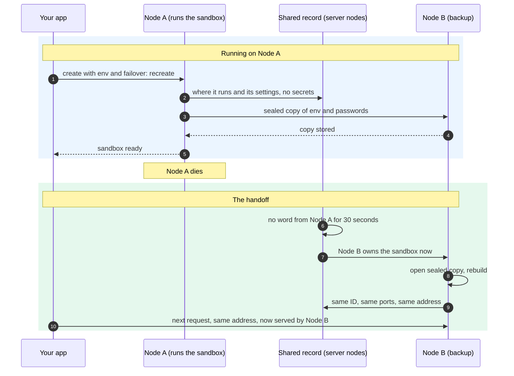

import { Aside, Tabs, TabItem } from '@astrojs/starlight/components';

Files a sandbox writes to its own disk last only as long as the sandbox. That covers `/tmp`, the working folder, and anywhere else that is not attached storage. If you delete the sandbox, or the cluster node running it dies, those files are gone. A server restart keeps them for container and Firecracker sandboxes, but not for WebAssembly and V8 isolate sandboxes by default.

To keep data, write it to [attached cloud storage](/external-storage/). Treat the sandbox itself as replaceable: if you lose one, create a new one and attach the same storage.

A cluster is a group of AerolVM servers. In a cluster, you can also ask for a sandbox to be rebuilt on a healthy node when its node dies.

## What survives, and what does not

| What | You delete the sandbox | The server restarts or crashes (one server) | A cluster node dies |
|---|---|---|---|
| Files on the sandbox's own disk | Lost | Kept for container and Firecracker sandboxes. Lost for WebAssembly and V8 isolate sandboxes by default. | Lost |
| Files on attached storage (S3, NFS, SSHFS, rclone) | Kept (they live outside the sandbox) | Kept | Kept. A new sandbox can attach them again. |
| Sandbox ID | Gone. A new sandbox gets a new ID. | Kept if the server saved its record | Lost by default (`410 Gone`). With recreate: kept, if the rebuild works. |
| Environment variables, image, CPU and memory | Gone | Restored on `start` | Lost by default. With recreate: restored from the cluster's copy. |
| Lifecycle timers | Gone | Restored on `start` | Lost by default. With recreate: restored. |
| Exposed ports (web, TCP, TLS) | Removed | Restored on `start` | Lost by default. With recreate: exposed again when possible. |
| Traffic routes to the sandbox | Removed | Restored on `start` | Lost by default. With recreate: rebuilt by the new node. |
| TCP host port number | Gone | Same server, same port | Lost by default. With recreate: the same port is reused when it is free. |
| Public URL | Removed | Restored on `start` | Lost by default. With recreate: the URL stays the same and now points at the new node. |

## The handoff: what happens when a node dies

In a cluster, a sandbox created with [failover](#rebuild-sandboxes-when-a-cluster-node-dies) moves to a healthy node when its node dies. It keeps its identity: the same ID, the same public address, the same ports and the same environment variables. Your app keeps using the address it already has.



What moves with the sandbox:

| | On Node A | After the handoff, on Node B |
|---|---|---|
| Sandbox ID | `sb-...` | The same |
| Public URL | `https://<sandbox-id>-3000.<domain>` | The same, now pointing at Node B |
| TCP ports | `<cluster-host>:22041` | The same port, when it is free on Node B |
| Environment variables | Set at create | The same, from the sealed copy |
| Image, CPU, memory, lifecycle timers | Set at create | The same, from the shared record |
| Attached cloud storage | Mounted | Mounted again |
| Running programs and memory | Running | Started fresh |
| Files on the sandbox's own disk | Present | Gone. Keep files that matter on [attached storage](#keep-your-files-on-attached-storage). |

<Aside>
This is a rebuild, not a live migration. Node B starts the sandbox again from its image, so running programs and local files start over. Everything your app uses to reach and set up the sandbox stays the same.
</Aside>

### How long it takes

- **The cluster waits 30 seconds first.** A node must be silent that long before anything moves, so a short network blip does not trigger a handoff. Operators can change this with `SB_DEAD_OWNER_GRACE`.
- **Then the new node takes over within about 5 seconds** and rebuilds the sandbox. A rebuild takes as long as a normal create, or longer if the node must download the image first.
- **If a rebuild keeps failing,** 5 times in a row (about 25 seconds), the cluster hands the sandbox to another node.
- **Requests during the handoff fail.** A request that arrives while the sandbox is moving can get `503` with "Sandbox placement in flux". Retry it.

### Where the environment variables are

- **In the shared record: never.** Every node can read that record, so the cluster strips every secret from it first.
- **On the node that runs the sandbox:** encrypted, and tied to that one sandbox.
- **On backup nodes:** a sealed copy, only for sandboxes with failover. Two backups by default. The create waits until at least one backup confirms its copy.
- **During a handoff:** the sandbox can only move to a node that holds a sealed copy, and only that new owner opens it.

See [Environment variables in a cluster](/sandbox-env/#in-a-cluster) for how the values are encrypted and audited.

### How the cluster keeps track

- **A shared record on the server nodes** says which node runs each sandbox. It also holds the sandbox's settings without secrets, its exposed ports, and a pointer to its sealed secrets. A change goes through only when most server nodes agree, so every node gives the same answer.
- **Nodes check on each other constantly.** That is how the cluster learns a node has died.
- **The [dashboard](/dashboard/)** shows each sandbox's owner node and state. A sandbox without failover whose node died shows as `orphaned`.

## Keep your files on attached storage

Attach storage at the folder you want to keep. The server, not the sandbox, connects the storage, so your storage passwords never enter the sandbox. The data lives on its own, apart from any one sandbox or server.

Attached storage works with Docker, gVisor and WebAssembly sandboxes. Firecracker and V8 isolate sandboxes cannot attach it.

<Tabs syncKey="lang">
  <TabItem label="TypeScript">
    ```ts
    const sandbox = await client.create({
      image: "ubuntu:22.04",
      mounts: [
        {
          type: "s3",
          target: "/workspace",
          source: "s3://my-bucket/project-42",
          credentials: {
            access_key_id: "AKIA...",
            secret_access_key: "secret...",
          },
        },
      ],
    });
    ```
  </TabItem>
  <TabItem label="Python">
    ```python
    sandbox = client.create(
        image="ubuntu:22.04",
        mounts=[
            {
                "type": "s3",
                "target": "/workspace",
                "source": "s3://my-bucket/project-42",
                "credentials": {
                    "access_key_id": "AKIA...",
                    "secret_access_key": "secret...",
                },
            },
        ],
    )
    ```
  </TabItem>
  <TabItem label="Go">
    ```go
    sandbox, err := client.Create(ctx, sdktypes.CreateSandboxOptions{
        Image: "ubuntu:22.04",
        Mounts: []sdktypes.MountSpec{
            {
                Type:   "s3",
                Target: "/workspace",
                Source: "s3://my-bucket/project-42",
                Credentials: map[string]string{
                    "access_key_id":     "AKIA...",
                    "secret_access_key": "secret...",
                },
            },
        },
    })
    ```
  </TabItem>
  <TabItem label="Rust">
    ```rust
    use aerolvm_sdk::{CreateOptions, MountSpec, MountType};
    use std::collections::HashMap;

    let creds = HashMap::from([
        ("access_key_id".to_string(), "AKIA...".to_string()),
        ("secret_access_key".to_string(), "secret...".to_string()),
    ]);

    let sandbox = client.create(CreateOptions {
        image: "ubuntu:22.04".into(),
        mounts: Some(vec![MountSpec {
            mount_type: MountType::S3,
            target: "/workspace".into(),
            source: "s3://my-bucket/project-42".into(),
            options: None,
            credentials: Some(creds),
            read_only: None,
        }]),
        ..Default::default()
    })?;
    ```
  </TabItem>
  <TabItem label="Java">
    ```java
    Sandbox sandbox = client.create(new CreateOptions()
        .setImage("ubuntu:22.04")
        .setMounts(List.of(new MountSpec()
            .setType("s3")
            .setTarget("/workspace")
            .setSource("s3://my-bucket/project-42")
            .setCredentials(Map.of(
                "access_key_id", "AKIA...",
                "secret_access_key", "secret...")))));
    ```
  </TabItem>
</Tabs>

Anything written under `/workspace` outlives the sandbox. Anything written elsewhere does not. [Attach cloud storage](/external-storage/) covers every storage type: S3, NFS, SSHFS and rclone.

## Rebuild sandboxes when a cluster node dies

By default, when a cluster node dies, its sandboxes are lost. Any call for one of them returns `410 Gone`. Your app should then create a new sandbox on the nodes that are left.

If your app can live without the sandbox's own disk but needs the same ID and the same ports, turn on recreate at create time:

<Tabs syncKey="lang">
  <TabItem label="TypeScript">
    ```ts
    const sandbox = await client.create({
      image: "ubuntu:22.04",
      failover: { policy: "recreate" },
    });
    ```
  </TabItem>
  <TabItem label="Python">
    ```python
    sandbox = client.create(image="ubuntu:22.04", failover={"policy": "recreate"})
    ```
  </TabItem>
  <TabItem label="Go">
    ```go
    sandbox, err := client.Create(ctx, sdktypes.CreateSandboxOptions{
        Image:    "ubuntu:22.04",
        Failover: &sdktypes.Failover{Policy: sdktypes.FailoverPolicyRecreate},
    })
    ```
  </TabItem>
  <TabItem label="Rust">
    ```rust
    use aerolvm_sdk::Failover;

    let sandbox = client.create(CreateOptions {
        image: "ubuntu:22.04".into(),
        failover: Some(Failover { policy: "recreate".into() }),
        ..Default::default()
    })?;
    ```
  </TabItem>
  <TabItem label="Java">
    ```java
    Sandbox sandbox = client.create(new CreateOptions()
        .setImage("ubuntu:22.04")
        .setFailover(new Failover().setPolicy("recreate")));
    ```
  </TabItem>
</Tabs>

`failover.policy` is `none` (the default) or `recreate`.

The cluster keeps each sandbox's create request in its shared record, with every secret removed: image, resources, attached storage, lifecycle and failover policy, plus every port you exposed. The environment variables and the registry and storage passwords travel separately, as a sealed (encrypted) copy that only backup nodes can open. When a node with a recreate sandbox dies, the cluster hands that sandbox to a healthy node that holds a sealed copy. That node rebuilds the sandbox with the same ID and exposes the same ports again. See [The handoff](#the-handoff-what-happens-when-a-node-dies).

Good to know:

- **The image must be reachable from every node.** Recreate is refused for an image that exists on only one node. Examples are a local build, or a [snapshot](/images-and-snapshots/#snapshots) (a saved copy of a sandbox) that was not shared.
- **The sandbox's own disk is still lost.** Put data you need on attached storage.

### Expose a port again by hand

Exposing a port is safe to repeat. If the port is already exposed, `exposePort` returns the existing URL. Call it again if you are unsure an earlier call went through, for example after a network outage.

<Tabs syncKey="lang">
  <TabItem label="TypeScript">
    ```ts
    const result = await sandbox.exposePort(3000);
    console.log(result.url);
    ```
  </TabItem>
  <TabItem label="Python">
    ```python
    result = sandbox.expose_port(3000)
    print(result.url)
    ```
  </TabItem>
  <TabItem label="Go">
    ```go
    result, err := sandbox.ExposePort(ctx, 3000)
    if err != nil {
        log.Fatal(err)
    }
    fmt.Println(result.PublicURL)
    ```
  </TabItem>
  <TabItem label="Rust">
    ```rust
    use aerolvm_sdk::{ExposeOptions, ExposeResult};

    if let ExposeResult::Http { url } = sandbox.expose_port(3000, ExposeOptions::http())? {
        println!("{}", url);
    }
    ```
  </TabItem>
  <TabItem label="Java">
    ```java
    ExposeResult result = sandbox.exposePort(3000);
    System.out.println(result.url);
    ```
  </TabItem>
</Tabs>

## Choose how a sandbox survives a server restart

`durability` decides what happens to a sandbox when the AerolVM server itself restarts. It is a create option on every runtime (the technology that walls off the sandbox).

| Value | What it means |
|---|---|
| `ephemeral` | The sandbox is lost when the server restarts. |
| `passivatable` | The sandbox is kept across a server restart. A WebAssembly sandbox is saved to local disk when the server shuts down and brought back when it starts. |
| `durable` | Planned: also send the saved state to another node for failover. It is not available yet. The server rejects it on every runtime today. |

If you leave it out, you get the default for the runtime. Containers and virtual machines survive a server restart on their own, but WebAssembly and V8 isolate sandboxes do not:

| Runtime | Default |
|---|---|
| `docker`, `gvisor`, `firecracker` | `passivatable` |
| `wasm` | `ephemeral` |
| `isolate` | `ephemeral` (`passivatable` is rejected, because an isolate has nothing to save) |

<Tabs syncKey="lang">
  <TabItem label="TypeScript">
    ```ts
    const sandbox = await client.create({
      image: "ubuntu:22.04",
      durability: "passivatable",
    });
    ```
  </TabItem>
  <TabItem label="Python">
    ```python
    sandbox = client.create(image="ubuntu:22.04", durability="passivatable")
    ```
  </TabItem>
  <TabItem label="Go">
    ```go
    sandbox, err := client.Create(ctx, sdktypes.CreateSandboxOptions{
        Image:      "ubuntu:22.04",
        Durability: sdktypes.DurabilityPassivatable,
    })
    ```
  </TabItem>
  <TabItem label="Rust">
    ```rust
    let sandbox = client.create(CreateOptions {
        image: "ubuntu:22.04".into(),
        durability: Some("passivatable".into()),
        ..Default::default()
    })?;
    ```
  </TabItem>
  <TabItem label="Java">
    ```java
    Sandbox sandbox = client.create(new CreateOptions()
        .setImage("ubuntu:22.04")
        .setDurability("passivatable"));
    ```
  </TabItem>
</Tabs>

Durability only covers server restarts. Keeping files (attached storage) and losing a cluster node (failover) are separate, as the sections above show. For how WebAssembly saves and restores sandboxes, see [WebAssembly (WASM)](/wasm-sandbox/).

## Limits

- **Rebuilding is opt-in.** When a node dies, its sandboxes return `410 Gone` and your app must create new ones. Only sandboxes created with `failover.policy = "recreate"` are rebuilt.
- **New ports take a moment to reach every node.** Public URLs and TCP ports are shared across the cluster. But ingress nodes (the nodes that receive outside traffic) refresh their routes on a timer, up to about every 5 seconds. Right after a new `exposePort`, a request can briefly fail. Retry it.
- **The sandbox's own disk is never copied.** Treat anything outside attached storage as a cache. If you need it after a crash, write it to attached storage.
- **One server keeps files across a restart, not across a lost disk.** Container and Firecracker sandboxes come back with their files after a restart. If the machine's disk is lost, so are they. Attach storage for anything that must survive.

## A pattern that works

1. Pick the folder your app writes lasting data to, such as a project folder, a database data folder or a model cache.
2. Attach storage at that folder when you create the sandbox.
3. Treat everything else in the sandbox as scratch space.
4. In a cluster, have your app create a new sandbox when it gets `410 Gone`. The new sandbox attaches the same storage and picks up where the old one stopped.

This works the same on one server and in a cluster, for Docker, gVisor and WebAssembly sandboxes. The create request describes the sandbox, the storage holds the data, and the sandbox itself can be replaced.

## Next steps

- [Attach cloud storage](/external-storage/): every storage type and its options.
- [Images and snapshots](/images-and-snapshots/#snapshots): save a set-up sandbox as a snapshot to start new ones from.
- [Cluster setup](/cluster-setup/): build a cluster with failover.
- [Placement and failover](/engineering-placement-failover/): the deep dive on how the cluster picks and replaces nodes.
