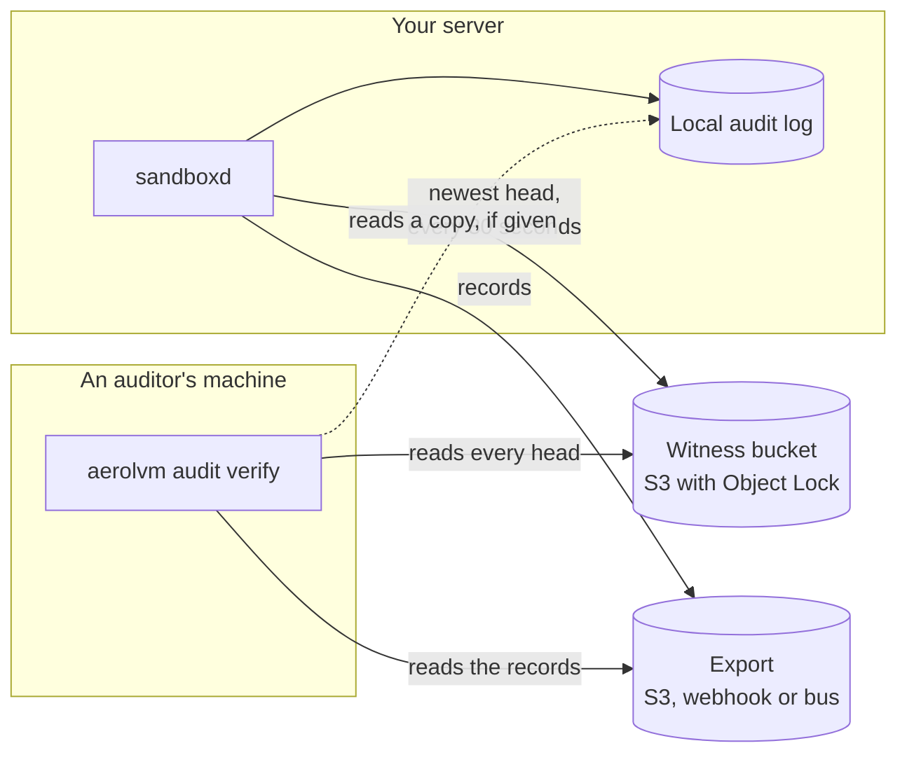
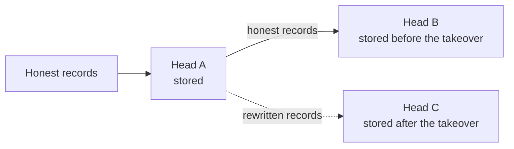

import { Tabs, TabItem } from '@astrojs/starlight/components';

*By [Suman Saurabh](https://www.linkedin.com/in/ssumansaurabh/), maintainer of AerolVM.*

AerolVM writes a record every time a secret is opened. The records are chained, so an edited record is easy to catch. But someone who takes over a server can rebuild the whole chain, and the server cannot tell. This post explains how the audit witness catches that, and why each of its checks is there.

[Enterprise mode](/enterprise/enterprise-mode/) has the settings. This post tells the story behind them.

## In short

- A hash chain catches an edited record. It does not catch a whole chain rebuilt by someone who controls the server.
- The witness keeps each server's newest fingerprint in an S3 bucket with Object Lock. The server that wrote a fingerprint cannot change or delete it until the lock ends. In compliance mode, nobody can.
- At every start, the server checks that the bucket is really locked. It tries to delete a test object the way an attacker would.
- Fingerprints go to one key per server per UTC day. That keeps each key under AWS's guidance on versions per object.
- The start-up check reads only the newest fingerprint. `aerolvm audit verify` checks every fingerprint in a window the auditor picks.
- It has limits. The newest 30 seconds can still be rewritten, and an S3 outage blocks restarts.

## The problem: a chain its owner can rebuild

[The logbook section](/engineering-security-overview/#the-logbook-audit) of the security overview shows how the audit log works. Each record stores a fingerprint (hash) of the record before it. Edit one record, and the next record no longer matches. The server checks the chain at every start, and refuses to start if it is broken.

That stops someone who edits a record by hand. It does not stop someone with root on the server. They can rewrite the records they want, then compute every fingerprint again from that point on. The new chain is whole and correct. Nothing on the server remembers the old one.

Exporting the records helps, but only so far. The server holds the credentials for its own export, so whoever takes it over holds them too. They can overwrite old batches in the export to match the forged chain. What was missing was a record of the chain that the server itself cannot change.

## The witness: fingerprints in a locked bucket

The newest fingerprint in a chain is called the **head**. It vouches for every record before it. Change any earlier record, and the head changes too. So a copy of each head, kept where the server cannot touch it, pins the history down.

That copy is the **witness**. It stores heads only, never records. Each one is a small JSON document: the server's id, the head, the record it came from and the time.

Enterprise mode always required a witness. But the free download shipped only a placeholder, and the server refuses to start on a placeholder. So enterprise mode refused to start on every free install. Only a managed build could plug in a real witness.

The witness in the free download is an S3 bucket with **Object Lock**. With Object Lock on, every write adds a new version, and each version is locked for a set number of days. In compliance mode, nobody can delete a locked version early, not even the AWS account root. S3 also stamps each version with its own time. The server cannot change that time, so it cannot backdate a forged head.



- **Every 30 seconds**, the server sends its newest head, if it changed.
- **At every start**, the server reads its newest head from the bucket. That head must be in its local chain, or it refuses to start.
- **Whenever the auditor chooses**, `aerolvm audit verify` checks every head against the records. It writes nothing.

## Making sure the bucket is really locked

A witness on an ordinary bucket would look healthy and protect nothing. A head could be deleted, or overwritten with no trace. That is the one outcome the witness exists to prevent. So the server checks the bucket at every start, before it trusts it.

All four checks share one 30-second deadline. Without one, a server that cannot reach S3 would hang for a long time. Then it would fail with an error that never mentions the witness.

1. **Versioning is on.** Object Lock needs it.
2. **Object Lock is on, with a default retention.** The lock must last at least as long as the server keeps its own records. A head should outlive the records it vouches for.
3. **A random missing key comes back "not found".** Without the `s3:ListBucket` permission, S3 answers "access denied" for a missing key instead. The server would then misread the normal "no head yet" case as an error. The first start on an empty bucket would fail. The key is random, so no writer can make it exist.
4. **A test object cannot be deleted.** This one is called the canary. The server writes it, then tries to remove it the way an attacker would.

The canary is where the details matter. Its first delete names the exact version and sends the governance bypass header. Here is why. In governance mode, a principal with the bypass permission can delete a locked version early, but only if it sends that header. Without the header, S3 refuses the delete for everyone. So a test delete without the header would pass even a role that an attacker could use. An attacker would send the header, so the test does too.

The second delete names no version. On a versioned bucket, that does not remove anything. It adds a **delete marker**, which makes the key look empty while the old versions stay. Object Lock does not stop that, only permissions do. A server that could do it could hide its newest head. So if it works, the server refuses to start.

Both deletes must answer "access denied". Any other answer also stops the start, because an unknown answer is not proof that the lock holds.

That is six requests at each start: two bucket reads, the probe read, the canary write and two deletes. Then the server reads its newest head. Each start leaves one small canary version, locked like any other.

## One key per day

Every write adds a locked version, and a locked version cannot be removed until its lock ends. AWS's guidance is to keep each object under about 100,000 versions. Past that, S3 can slow down requests for the bucket.

The obvious layout is one key per server. At one write every 30 seconds, that is up to 2,880 versions a day. With a lock longer than about 34 days, one key would hold more than 100,000 locked versions. None of them could be removed until their locks ended.

So each server writes to one key per UTC day: `node=<id>/day=<date>/head.json`. A key holds at most 2,880 versions at the default interval, however long the lock is.

Reading the newest head is then one read of today's key. A server that was off across midnight has no key for today yet. It lists its days and reads the newest one instead.

That listing has a trap. S3 has two ways to list keys. The simpler one, `ListObjectsV2`, skips any key whose newest version is a delete marker. Suppose someone hid today's head with a marker. The simple list would show yesterday as the newest day. The server would check yesterday's head, which still matches, and start. The hiding would work.

So the server lists with `ListObjectVersions`, which shows delete markers. The server never deletes anything. A delete marker on the newest head means someone else tried to hide it, so the server refuses to start.

One more detail: a server writes only when its head changes. An idle server would have no key for today, and every check would fall back to the list. So the first check of each UTC day sends the unchanged head again. Every running server then has today's key. An auditor can also tell an idle server from one that stopped sending.

## The attack the start-up check misses

The start-up check reads only the newest head. That leaves a gap.

Say an attacker takes over a server. They rewrite the records after head A. Then, with the server's own credentials, they store a new head C that matches the rewrite. At the next start, the newest head is C. C is in the local chain, so the server starts normally.

But the older heads are still in the bucket, locked. That includes head B, stored before the takeover. `aerolvm audit verify` reads every head in a time window. It then walks the records from one head to the next, in the order the bucket stored them.



No single chain of records passes through B and then reaches C. If the export still holds the honest records, the walk reaches B and then gets stuck. If the attacker overwrote the export to match the rewrite, the walk reaches C but never B. Either way, the result is FAIL, and the report names the head.

The records come from the export first, then from a copy of the local log, if the auditor gives one. The export matters because the local log is trimmed after its retention period. The trimmed log keeps only a checkpoint record that the server writes about itself, and a taken-over server could forge that. The export keeps the real records.

Two rules keep the walk honest:

- **The window comes from the auditor.** It is a required flag, `--since`. Suppose the window started at the oldest record the verifier could find. Then an attacker could delete the oldest export batches to move the start past the last honest head. Instead, every head newer than `--since` must be reached, or the result is FAIL.
- **A head newer than the records is pending, not passed.** Exports run a little behind. A head may wait up to 15 minutes by default for its records. After that, the result is INCOMPLETE, never PASS. A server that stopped exporting cannot hide a forged newest head that way.

The verifier exits with `0` for PASS, `1` for FAIL and `3` for INCOMPLETE. Code `2` keeps its usual meaning in the CLI: the command line was wrong.

It also never sorts exported batches by their names. A retention trim starts the byte offsets in batch names again in the middle of a day. So the verifier follows the chain itself: each batch's first record names the hash it follows.

## What it does not protect

The witness proves one thing well. Someone who takes over a server *after* a head was stored cannot rewrite the history that head covers without being caught. Here is what it does not prove.

- **The newest records.** Heads go out every 30 seconds. Records written since the last one can still be rewritten.
- **A server that was taken over before it wrote.** It can store a forged chain from the start.
- **Who wrote a head.** Servers in a cluster share one cloud role, so one server can write into another server's key. It cannot erase anything, because the lock stops that. It can make the other server's next start fail, if the foreign head is still the newest then. The victim notices on its next check and raises an alert. CloudTrail data events on the bucket show the writer.
- **Every foreign write.** A write can land between a server's read and its own send. The server's own version then buries it, and no alert fires. Only the verifier sees it. S3's conditional writes could close that gap. We found no AWS documentation saying they work with Object Lock, so the witness does not rely on them.
- **Restarts during an S3 outage.** A server with a witness will not start until S3 answers. A server that cannot reach its witness cannot prove its log is intact. That is strict on purpose. A running server keeps working, and catches up when S3 is back.
- **A rebuilt server under its old id.** Object Lock forbids clearing the old head. A server rebuilt on an empty disk comes back under a new `SB_NODE_ID`. The old id's history stays in the bucket as the record of the loss.
- **A lost log.** The bucket holds fingerprints, not records. It can prove a log was changed, but it cannot bring one back. That is why enterprise mode also requires the export.

## What it costs

The witness adds no work to creating a sandbox. It runs at start-up and in one background loop. With the setting off, it makes no S3 requests at all. Per server, at the default 30-second interval:

| When | S3 requests |
|---|---|
| At each start | Six to check the bucket, then a read of the newest head. A first start also sends its first head. |
| Every 30 seconds | One read of today's key, which is 2,880 a day |
| When the head changed | One write. At most 2,880 a day on a busy server, and one a day on an idle one |
| Once a day, after UTC midnight | One list and one extra read, before today's key exists |

A server with no audit records yet skips the loop's requests. Each stored version is a few hundred bytes. It stays locked for the lock period. A lifecycle rule then removes it, once a newer version has replaced it. The verifier only reads, and runs on the auditor's side.

## Try it

[Enterprise mode](/enterprise/enterprise-mode/) walks through the bucket, the permissions and the settings. Your code reads the records the witness protects the same way it always has:

<Tabs syncKey="lang">
  <TabItem label="TypeScript">
    ```ts
    const page = await sandbox.audit({ kind: "secret_open" });
    if (page.coverage.partial) {
      console.warn("Some servers did not answer:", page.coverage.missing);
    }
    for (const event of page.events) {
      console.log(event.time, event.ref, event.result);
    }
    ```
  </TabItem>
  <TabItem label="Python">
    ```python
    page = sandbox.audit({"kind": "secret_open"})
    if page["coverage"]["partial"]:
        print("Some servers did not answer:", page["coverage"]["missing"])
    for event in page["events"]:
        print(event["time"], event.get("ref"), event["result"])
    ```
  </TabItem>
  <TabItem label="Go">
    ```go
    page, err := sandbox.Audit(ctx, sdktypes.AuditOptions{Kind: "secret_open"})
    if err != nil {
        log.Fatal(err)
    }
    if page.Coverage.Partial {
        log.Println("Some servers did not answer:", page.Coverage.Missing)
    }
    for _, event := range page.Events {
        fmt.Println(event.Time, event.Ref, event.Result)
    }
    ```
  </TabItem>
  <TabItem label="Rust">
    ```rust
    let page = sandbox.audit(AuditOptions {
        kind: Some("secret_open".to_string()),
        ..Default::default()
    })?;
    if page.coverage.partial {
        eprintln!("Some servers did not answer: {:?}", page.coverage.missing);
    }
    for event in &page.events {
        println!("{} {:?} {}", event.time, event.r#ref, event.result);
    }
    ```
  </TabItem>
  <TabItem label="Java">
    ```java
    AuditPage page = sandbox.audit(new AuditOptions().setKind("secret_open"));
    if (page.coverage.partial) {
        System.err.println("Some servers did not answer: " + page.coverage.missing);
    }
    for (AuditEvent event : page.events) {
        System.out.println(event.time + " " + event.ref + " " + event.result);
    }
    ```
  </TabItem>
</Tabs>

`coverage.partial` is true when some servers in a cluster did not answer. Treat that page as incomplete.

## Next steps

- [Enterprise mode](/enterprise/enterprise-mode/): set up the bucket and run the verifier.
- [How AerolVM keeps everything safe](/engineering-security-overview/): the logbook, and every other part of the security picture.
- [Audit and compliance](/enterprise/audit-evidence/): the evidence an auditor can collect.
- [Keeping API keys out of the sandbox](/engineering-secret-handling/): what the audit trail records when a secret is used.
