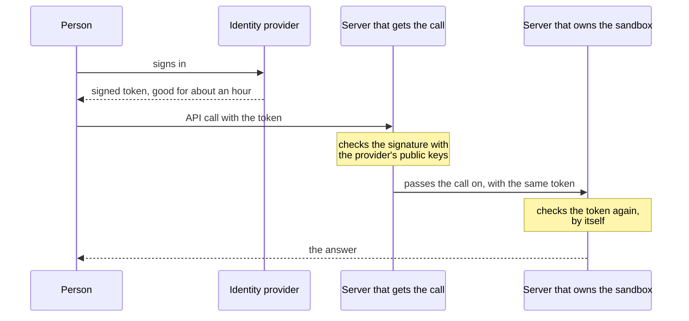
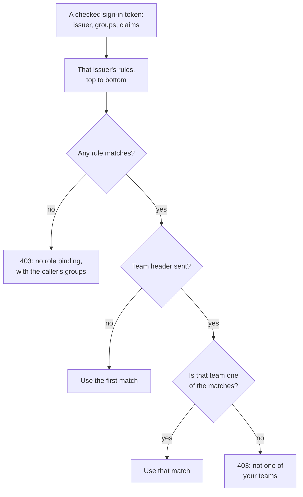
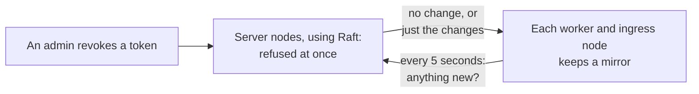

import { Tabs, TabItem } from '@astrojs/starlight/components';

*By [Suman Saurabh](https://www.linkedin.com/in/ssumansaurabh/), maintainer of AerolVM.*

Until now, an AerolVM server had one secret key for its API. Everyone who used the server shared it. AerolVM now supports single sign-on (SSO). People sign in with their company account. Services get keys of their own. Every action names the person or service that did it. This post explains how it works, and why there is no login server behind it.

[SSO](/enterprise/sso/) has the settings. This post tells the story behind them.

## In short

- Before, one shared token could do everything, and the audit log named the server, not the person.
- Now people sign in with their company's identity provider, such as Okta, Entra ID, Google or Keycloak. AerolVM never sees their password.
- AerolVM runs no login service and keeps no sessions. Every server checks the provider's signed token by itself, with no network call per request. That is the same model the Kubernetes API server uses.
- In a cluster, the call is checked on the server that receives it, and again on the server that owns the sandbox. No server trusts another server's word.
- Each caller gets one of four roles, on one team or on every team. The rules live in a file you can review in Git.
- Services and CI get named tokens that expire and can be revoked. A revoke reaches every server within about 6 seconds (each worker polls every 5 seconds, with up to a second of random delay). CI on GitHub Actions or Kubernetes needs no stored secret at all.
- Every API call that changes something writes a hash-chained audit record with the caller's name.
- It has limits. A person you remove keeps access until their last sign-in token expires, about an hour, unless you block them by hand.

## The problem: one key for everyone

A new AerolVM server has one API token, `SB_PAT_TOKEN`. We call it the server token. A token is a long secret string that code sends with each call to prove it may make the call. The server token works like a master key. It opens every door.

That was fine for one developer. It is not fine for a company. Every person and every script used the same key. So the audit log could not say who did what. A record said "the operator did it", and every caller was the operator. To remove one person, you had to change the key for everybody.

A company's security review asks three questions before it approves a tool like this:

1. **Can each person sign in with their own company account?** That way, when someone leaves, IT turns off one account and they lose access everywhere.
2. **Are there roles?** A CI job should run sandboxes, not create admin keys. An auditor should read records, not change them.
3. **Is every action tied to a named person?** When a sandbox is deleted, the log must say who did it.

The answer to all three was "no". That made AerolVM hard to approve.

## The big choice: no login server

The usual way to add sign-in is to build a login service. You sign in once. The service creates a session, and every later call checks that session with the service. That adds a new server to run, to secure and to keep online. AerolVM is designed for fleets of up to 2,000 servers; we have run it on 8. With a login service, every one of those servers would have to call it, or share its session data.

We chose a different model. AerolVM is a **resource server**. It holds the resources, but it does not log anyone in. Your company's **identity provider** does that. The identity provider is the service that already holds your company's accounts and checks passwords.

This is how the Kubernetes API server works when you give it `--oidc-issuer-url`. A sign-in plugin for `kubectl` gets a token from the identity provider, and the API server checks it. Security teams already know and accept this pattern.

Here is how one call works:

1. A person signs in at the identity provider, with their password and any second step their company requires.
2. The provider gives back a **signed token**. It says who the person is and which groups they are in. It lasts about an hour.
3. The person's code sends that token with each API call.
4. The AerolVM server checks the signature with the provider's **public keys**. A public key can check a signature but cannot make one, so it is safe to share. The server fetched those keys earlier. So checking a token needs no call to anyone.

In a cluster, a call often reaches one server and then moves to the server that owns the sandbox. The token travels with it, and the owner checks it again:



Why we built it this way:

- **No new single point of failure.** There is no login server to go down. If the identity provider is down, new sign-ins fail. But tokens it already gave out keep working until they expire, and API tokens are not affected.
- **It grows with the cluster.** Each server checks tokens by itself. Adding servers adds checking power. Nothing is shared between them per request.
- **Nothing new to secure.** AerolVM stores no passwords and no sessions. No provider needs a client secret on the server.
- **No identity header is trusted.** A server never believes a header that says "this is Alice". It checks the token itself. When one server passes a call to another, the second server learns which server sent it from that server's certificate, never from a header.

A few details keep the check honest:

- **Keys are fetched at start, then every hour.** If a token names a key the server has not seen, it fetches again. That happens at most once a minute for each provider. The call waits up to 2 seconds for it.
- **Only strong signature types are accepted:** RS256, ES256 and EdDSA. A token that says "no signature" is refused, and so is one signed with a shared secret.
- **The issuer must match exactly,** and the token must be made for AerolVM's own apps. The issuer is the provider's address, written inside the token.
- **Clocks may differ by up to 60 seconds.** A token that lasts longer than the issuer's limit is refused. The limit is 24 hours by default.
- **A checked token is remembered until it expires.** The cache holds up to 10,000 tokens or 16 MB. The next call with the same token skips the signature math.

## Where people sign in

People sign in in three places. All three use the same provider and the same check.

### The dashboard

Every AerolVM server serves a small web dashboard at `/ui`. It now shows a button for each provider you set up:

<div style="max-width: 440px; margin: 0 auto 8px;">
  
</div>

*The sign-in box on our demo cluster. The token box stays closed while a sign-in button is shown.*

The button sends you to your provider's own sign-in page. AerolVM never sees this page or your password:

<div style="max-width: 640px; margin: 0 auto 8px;">
  
</div>

*The demo uses Keycloak. Okta, Entra ID, Google, Authentik and Zitadel send you to their own page the same way.*

The dashboard is for admins, because every panel on it shows the whole cluster. An admin sees the overview, with their name and role in the top right corner:

<div style="max-width: 980px; margin: 0 auto 8px;">
  
</div>

*Signed in as `demo-admin` on an 8-node demo cluster. The `admin` badge comes from the access rule that matched.*

Everyone else gets a short screen that says who they are and points them to the command-line tool. The page never loads the admin panels for them, so they never see a wall of errors:

<div style="max-width: 440px; margin: 0 auto 8px;">
  
</div>

*A runner on the `demo` team sees who they are and what to do next.*

**Sign out** clears the token from the tab and returns to the sign-in box. It does not sign you out of your company account, the same as other SSO apps. To switch people, use **Use a different account**:

<div style="max-width: 440px; margin: 0 auto 8px;">
  
</div>

*After Sign out, the box says so. Your company sign-in may still be open, so the button can sign you straight back in.*

The dashboard keeps the sign-in token only in that browser tab. It uses no cookies. It renews the token about two minutes before it expires. Google gets its own button, made by Google, so no client secret is needed anywhere on the server. The page also sends a strict Content-Security-Policy, a browser rule that blocks scripts from anywhere it did not list.

### The command line

`aerolvm login` opens your browser to sign in. Over SSH, `aerolvm login --device` prints a short code that you type on any other device. After that, the login renews itself while your provider allows it.

When a call is refused, `aerolvm whoami --explain` answers "why do I have this role?". Here is real output from the demo cluster:

```text
$ aerolvm whoami --explain
demo-runner
role     runner
team     demo
via      Keycloak
expires  in 29m (06:28 UTC)

Why:
  binding 3 matched, in effect: keycloak group="demo-team" -> runner/demo

Your sign-in carried (issuer keycloak):
  username  demo-runner
  groups    demo-team
  roles     (none)
```

It shows only the caller's own groups and the rule they matched, never anyone else's. A refused call names the role that would have worked:

```text
$ aerolvm token list
aerolvm: role runner on team demo cannot token.read; ask an admin for role auditor on all teams
```

For scripts, `aerolvm auth token` prints a fresh sign-in token.

### AI agents over MCP

MCP (Model Context Protocol) is how AI tools such as Claude Code call outside tools. The local `aerolvm mcp` server uses your CLI login, so it gets SSO for free. The remote `/mcp` endpoint takes the same tokens. For hosted products such as claude.ai and ChatGPT, which sign in with OAuth, `/mcp` also accepts access tokens made only for it. Each tool call is checked and recorded as the person who signed in. We have not yet confirmed this with either hosted product. See the limits below.

## Roles and teams

Each caller gets one role:

| Role | What it can do |
|---|---|
| `viewer` | Look at sandboxes and read their audit records. |
| `runner` | Everything a viewer can, plus create, change, delete and run commands in sandboxes. |
| `auditor` | Read every team's sandboxes and records, list tokens and check the audit chain. It can never change anything. |
| `admin` | Everything, including creating tokens and running the cluster. |

A **team** is a name, such as `payments`. Inside AerolVM, a team is simply an owner. Sandboxes already had owners, so teams reuse that code. A team cannot see another team's sandboxes. Another team's sandbox answers `404 Not Found`, as if it were not there. A call on your own team's sandbox with a role that is too small gets `403 Forbidden`, with the role you would need.

Viewers and runners can be bound to one team or to every team. Auditors and admins always cover every team. We added the auditor role because security reviews ask for it: someone must be able to read all the evidence without being able to change it.

### Rules live in a file

The **identity file** maps provider groups to roles. Each mapping is called a **binding**. For example:

```yaml
bindings:                               # every-team rules first, then team rules
  - { issuer: okta, group: platform-admins, role: admin }
  - { issuer: okta, group: secops,          role: auditor }
  - { issuer: okta, group: payments-eng,    role: runner, team: payments }
```

We put rules in a file, not in a database, on purpose. Rules change rarely, and each change should be reviewed. A file can live in Git, so the history shows who changed what. Every server reads the file again within 10 seconds of a change. Each change writes an audit record with the old and new file fingerprints and the rules that were added or removed.

How the server picks a role:



- **The first match wins.** So put every-team rules, such as admin and auditor, at the top. If a team rule came first, an admin who is also in `payments-eng` would act as a payments runner.
- **The `X-AerolVM-Team` header selects, but never grants.** A person in two teams can name the one they want to act for. The team must be one of their matches. Naming any other team gets `403`.
- **A sign-in that matches nothing is told why.** The dashboard shows this screen, with the groups the person carried, so they can tell an admin what to add:

<div style="max-width: 440px; margin: 0 auto 8px;">
  
</div>

*`demo-nobody` is a real Keycloak user with no groups. The sign-in works, but no rule gives them a role.*

## Tokens for services and CI

People sign in. Scripts and services cannot type a password, so they get **API tokens**. An admin creates each one with a name, a role, a team and an end date.

- **The secret is shown once.** The server stores only its SHA-256 hash. A hash is a fingerprint that cannot be turned back into the secret.
- **Every token expires.** The longest allowed is 365 days, or 90 days in enterprise mode.
- **A typo is caught without a lookup.** Each token looks like `avm_<id>_<secret>_<checksum>`. A token with a wrong checksum is refused at once. The `avm_` prefix also lets secret scanners find leaked tokens.
- **Revoking is safe to repeat.** Revoking a token that is already gone still succeeds.

### How a revoke reaches every server

In a cluster, a few **server nodes** vote on shared state using Raft. Raft is a method that lets a group of servers agree on one copy of the data, even if some fail. The token list lives there. When an admin revokes a token, the server nodes stop accepting it at once.

Most nodes are not server nodes. Workers run sandboxes, and ingress nodes take traffic. Each of them keeps a full copy of the token list in memory, called a **mirror**. Every 5 seconds, plus a small random delay of up to a second, the mirror asks a server node, "anything new since version N?". The answer is usually "no change", which costs almost nothing. Otherwise it gets just the changes.



- **Checking a token is a local lookup.** A flood of fake tokens never reaches the server nodes. In a test, 10,000 bad tokens caused zero calls to them.
- **A stale mirror fails closed.** If a node cannot reach the server nodes for 60 seconds, it refuses API tokens with `503`. The one exception is reading metrics, so monitoring keeps working during an outage. Sign-in tokens and the server token keep working, because they need no shared list.

### CI with no stored secret

GitHub Actions and Kubernetes can give each job a signed token that says who the job is. To AerolVM, these are just two more identity providers. A rule can match, for example, "the `main` branch of `acme/payments`":

```yaml
  - { issuer: github-actions, claim: { repository: acme/payments, ref: refs/heads/main }, role: runner, team: payments }
```

So there is no AerolVM secret to store in CI, and nothing to rotate. For Kubernetes, the server checks the token with the cluster's published keys. It never calls the Kubernetes API, because that would be a network call on every request.

## Every action tied to a person

AerolVM already kept a hash-chained audit log. Each record holds a fingerprint of the record before it, so changing one record breaks the chain. Records now carry a `caller` field, and the chain covers it. Changing who did something breaks the chain too.

```json
"caller": {
  "kind": "oidc",
  "id": "oidc:keycloak:<subject>",
  "name": "demo-runner",
  "team": "demo",
  "via": "<the server that passed the call on>"
}
```

The `id` comes from the provider's stable user ID, not the email. So a person who changes their email keeps one history.

- **One record per API call.** Every call that changes something is recorded. So is every command and file call inside a sandbox, because files can hold secrets. Plain reads are recorded only if you ask for them.
- **Refused calls are recorded too.** A `403` is a record with `result: denied`. A bad credential (`401`) is an `auth_denied` record, at most one per address per minute. Together, those records count every refused call.
- **Commands are stored as a fingerprint.** The fingerprint proves which command ran, without keeping secrets the command may hold.
- **Floods are capped.** By default, each sandbox and caller pair can write 20 records a second, after a burst of 100. Extra calls are counted in one summary record that names the caller. A server that hosts more than one team always applies this cap, so one team cannot push another team's records out.
- **A forwarded call is recorded once,** on the server that ran it. `via` says which server passed it on.
- **The server's own work is named too.** A sandbox deleted by a lifecycle timer names `system:lifecycle`.

### Upgrading a cluster safely

An older AerolVM server does not know the `caller` field. When it reads a record that has one, it computes a different hash, and the chain looks broken. During a rolling upgrade, old and new servers run side by side. So no server writes the new field until every live server says it understands it. Each server announces its feature version to the others, and the field turns on only when the lowest version is high enough. Until then, records look exactly as they did before.

The other side of this is a rollback floor. Once a server has written a caller, an older release cannot check that log. So do not roll back below this release. The [SSO page](/enterprise/sso/#upgrades-and-rollback) says so too.

## What it does not protect

- **A removed person keeps access for a while.** Removing them at the provider stops their login from renewing. But their last sign-in token works until it expires. That is about an hour for most providers, and 12 hours by default for Zitadel. To block them at once, add them to the deny list in the identity file. Each server applies it within 10 seconds.
- **Some providers have gaps.**
  - Above 200 groups, Entra ID leaves groups out of the token. Bind on Entra app roles instead.
  - Zitadel puts roles in a shape AerolVM can't match. A small Zitadel Action has to copy them into a flat `groups` list.
  - Google and Authentik can't be used for MCP connectors. Checking Google's access tokens would need a call to Google on every request. Authentik can't give connector tokens an audience of their own.
- **Hosted MCP connectors are not proven yet.** The OAuth path for claude.ai and ChatGPT is built, and tested with a test provider and with Keycloak. But no hosted connector has passed our live check yet.
- **So far, we have tested live only against Keycloak.** Our live tests used Keycloak end to end: first on a laptop, then on the 8-node AWS cluster these screenshots come from. For Okta, Entra ID, Google, Authentik and Zitadel, the setup steps come from each provider's own documentation. We have not run them against a live account yet. The test suite also runs every case on live clusters with a test provider of its own.
- **It is off by default.** A new server still has only the server token until the operator turns this on.
- **The server token still exists.** Servers use it to call each other, so it cannot be removed. `SB_PAT_SCOPE=host` limits it to the server itself and other cluster servers. Enterprise mode requires that.
- **A new token can lag on other nodes.** A token just created may be refused for up to one mirror poll, about 6 seconds at most, on a node that has not synced yet.
- **A taken-over server or provider is out of scope.** Someone with root on a server holds the server token and can act as anyone. Someone who controls your identity provider can sign in as anyone. The [audit witness](/engineering-audit-witness/) limits what a taken-over server can rewrite afterwards.
- **No SAML or SCIM.** Every provider on our list speaks OIDC. A company that uses only SAML can bridge through Keycloak or Dex.

## What it costs

Each step was measured on an Apple M1 Max laptop, by the benchmarks and tests in the pull requests that built the feature. The last column names the source. We did not re-run them for this post.

| Step | Cost | Source |
|---|---|---|
| Checking the server token | 494 ns per request, up from 157 ns, when this part landed. Each request now also builds a caller record and counts it in the metrics. | [#739](https://github.com/aerol-ai/microvm/pull/739) |
| Checking the role for a route | About 46 ns, with no memory allocated | [#741](https://github.com/aerol-ai/microvm/pull/741) |
| Checking an API token | About 1.4 µs. The slowest 1 in 100 took 4.5 µs. | [#744](https://github.com/aerol-ai/microvm/pull/744) |
| Checking a sign-in token seen before | About 2.3 µs, with a 10,000-rule identity file. The slowest 1 in 100 took about 5 µs. | [#742](https://github.com/aerol-ai/microvm/pull/742), [#748](https://github.com/aerol-ai/microvm/pull/748) |
| Checking a sign-in token the first time | 174 µs in our benchmark, which includes the signature math and a scan of 10,000 rules. It happens once per token on each server. | [#742](https://github.com/aerol-ai/microvm/pull/742) |
| Writing one audit record | About 1.5 µs. The slowest 1 in 100 took 3 µs. | [#743](https://github.com/aerol-ai/microvm/pull/743) |
| 10,000 fake or broken tokens | Zero calls to the server nodes | [#744](https://github.com/aerol-ai/microvm/pull/744) |
| Keeping the token list fresh | One small request every 5 seconds, plus up to a second of random delay, from each worker and ingress node | Code default |
| Provider keys | One fetch at start and one every hour on each server, plus at most one a minute when a new key appears | Code default |

Creating a sandbox gains no network call and no disk wait. It gains one in-memory role check and one audit record, which is written to disk in the background.

## Try it

Turn it on with `SB_IDENTITY_ENABLED=true`. The [SSO page](/enterprise/sso/#set-it-up) walks through the identity file and each provider. Then any credential can ask who it is:

<Tabs syncKey="lang">
  <TabItem label="TypeScript">
    ```ts
    import { MicroVM } from "@aerol-ai/aerolvm-sdk";

    const client = new MicroVM(); // reads SB_API_URL and SB_API_TOKEN

    const me = await client.whoami();
    console.log(me.principal.name ?? me.principal.id, me.role, me.team);
    ```
  </TabItem>
  <TabItem label="Python">
    ```python
    from microvm import MicroVM

    client = MicroVM()  # reads SB_API_URL and SB_API_TOKEN

    me = client.whoami()
    print(me["principal"].get("name", me["principal"]["id"]), me["role"], me.get("team"))
    ```
  </TabItem>
  <TabItem label="Go">
    ```go
    client, err := microvm.NewClient() // reads SB_API_URL and SB_API_TOKEN
    if err != nil {
        log.Fatal(err)
    }

    me, err := client.WhoAmI(ctx)
    if err != nil {
        log.Fatal(err)
    }
    fmt.Println(me.Principal.Name, me.Role, me.Team)
    ```
  </TabItem>
  <TabItem label="Rust">
    ```rust
    use aerolvm_sdk::Client;

    let client = Client::new(None, None)?; // reads SB_API_URL and SB_API_TOKEN

    let me = client.whoami()?;
    println!("{} {} {:?}", me.principal.name, me.role, me.team);
    ```
  </TabItem>
  <TabItem label="Java">
    ```java
    import ai.aerol.microvm.MicroVMClient;
    import ai.aerol.microvm.model.WhoAmI;

    MicroVMClient client = new MicroVMClient(); // reads SB_API_URL and SB_API_TOKEN

    WhoAmI me = client.whoami();
    System.out.println(me.principal.name + " " + me.role + " " + me.team);
    ```
  </TabItem>
</Tabs>

An admin can give a CI job its own token, and take it back later:

<Tabs syncKey="lang">
  <TabItem label="TypeScript">
    ```ts
    const created = await client.tokens.create({
      name: "ci-deploy",
      role: "runner",
      team: "payments",
      expiresIn: "90d",
    });
    console.log(created.token); // avm_…, shown once: store it now

    await client.tokens.revoke(created.id);
    ```
  </TabItem>
  <TabItem label="Python">
    ```python
    created = client.tokens.create(
        name="ci-deploy",
        role="runner",
        team="payments",
        expires_in="90d",
    )
    print(created["token"])  # avm_…, shown once: store it now

    client.tokens.revoke(created["id"])
    ```
  </TabItem>
  <TabItem label="Go">
    ```go
    created, err := client.Tokens().Create(ctx, sdktypes.CreateAPITokenOptions{
        Name:      "ci-deploy",
        Role:      "runner",
        Team:      "payments",
        ExpiresIn: "90d",
    })
    if err != nil {
        log.Fatal(err)
    }
    fmt.Println(created.Token) // avm_…, shown once: store it now

    if err := client.Tokens().Revoke(ctx, created.ID); err != nil {
        log.Fatal(err)
    }
    ```
  </TabItem>
  <TabItem label="Rust">
    ```rust
    use aerolvm_sdk::CreateApiTokenOptions;

    let created = client.tokens().create(CreateApiTokenOptions {
        name: "ci-deploy".into(),
        role: "runner".into(),
        team: "payments".into(),
        expires_in: "90d".into(),
    })?;
    println!("{}", created.token); // avm_…, shown once: store it now

    client.tokens().revoke(&created.api_token.id)?;
    ```
  </TabItem>
  <TabItem label="Java">
    ```java
    import ai.aerol.microvm.model.CreateApiTokenOptions;
    import ai.aerol.microvm.model.CreatedApiToken;

    CreatedApiToken created = client.tokens().create(
        new CreateApiTokenOptions()
            .setName("ci-deploy")
            .setRole("runner")
            .setTeam("payments")
            .setExpiresIn("90d")
    );
    System.out.println(created.token); // avm_…, shown once: store it now

    client.tokens().revoke(created.id);
    ```
  </TabItem>
</Tabs>

A person in several teams picks one with the `team` client option, or `SB_TEAM`. In Go that is `MicroVMConfig.Team`, and in Java `new MicroVMConfig().setTeam(...)`.

## Next steps

- [SSO](/enterprise/sso/): turn it on, write the identity file, and set up each provider.
- [aerolvm CLI](/cli/#save-your-login): sign in, check who you are, and manage tokens from a terminal.
- [Dashboard](/dashboard/): the web console and its sign-in screens.
- [MCP server](/mcp/#sign-in-with-oauth): OAuth for AI agents.
- [Audit and compliance](/enterprise/audit-evidence/): every audit field, the SOC 2 mapping and the access review.
- [Catching a rewritten audit log](/engineering-audit-witness/): how the audit chain is protected from a taken-over server.
