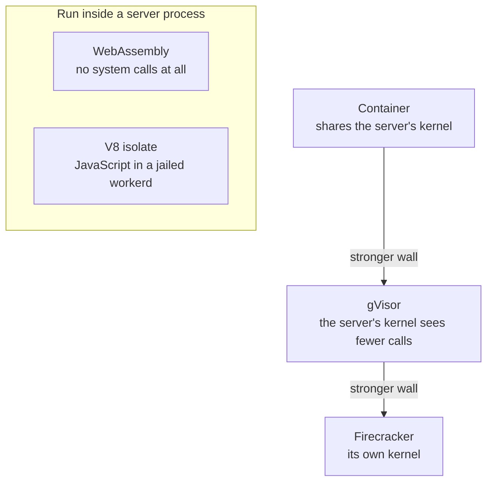
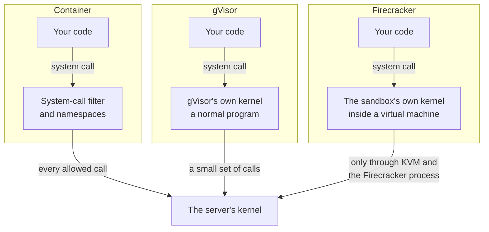
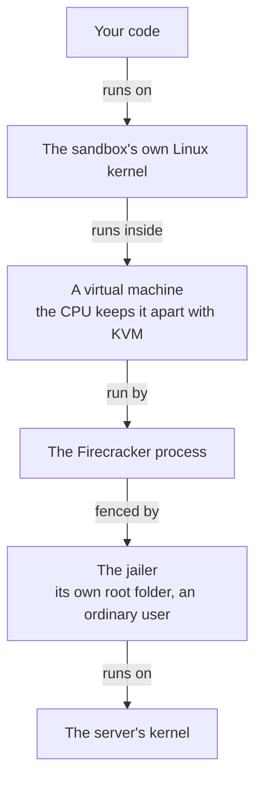
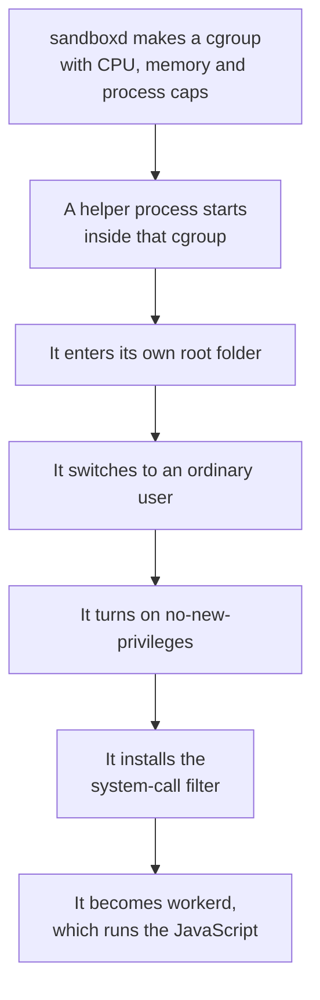
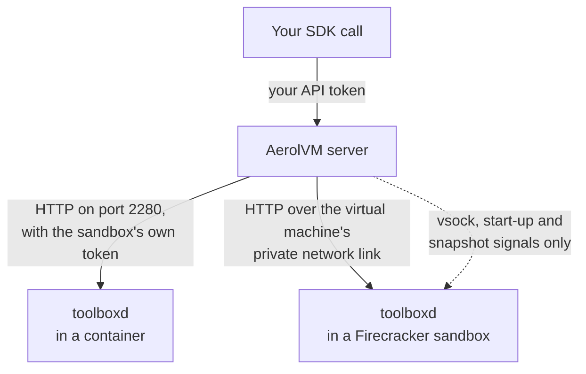
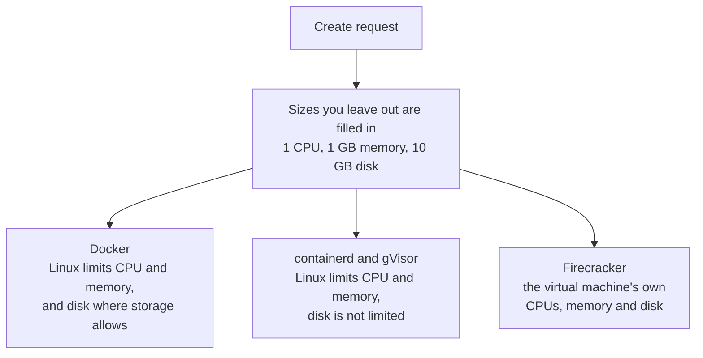

import { Tabs, TabItem } from '@astrojs/starlight/components';

*By [Suman Saurabh](https://www.linkedin.com/in/ssumansaurabh/), maintainer of AerolVM.*

The isolation boundary is the wall between code in a sandbox and the server it runs on. AerolVM has five runtimes, and each one builds that wall a different way. This post explains each wall, how the server talks to a sandbox, who the code runs as, and which limits apply.

## Five runtimes, five walls



| Runtime | The wall | Best for |
|---|---|---|
| Containers | Linux namespaces and a system-call filter. The sandbox shares the server's kernel. | Code you mostly trust, and anything that needs a full Linux system |
| gVisor | A kernel in user space answers the sandbox's system calls, so few of them reach the server's kernel | Untrusted code that still needs Linux |
| Firecracker | A virtual machine with its own Linux kernel, run by the hardware (KVM) | Untrusted code, with the strongest wall |
| WebAssembly | The wazero runtime. The code can only use what the server hands it. | Short functions that need no full system |
| V8 isolate | JavaScript in workerd, inside a jail | Many small JavaScript functions |

Containers are the default. gVisor must be added at install, and Firecracker, WebAssembly and V8 isolates stay off until the operator turns them on.

The three Linux runtimes differ in where a system call goes. A system call is a program's request to the kernel, such as "open this file".



- In a container, allowed calls run on the server's kernel itself. That is why a kernel bug matters most there.
- gVisor and Firecracker answer most calls in a kernel of their own.

## Containers

Containers run on Docker on a single server, and on containerd in a cluster. Each one gets its own Linux namespaces: its own view of processes, files, the network and its name.

What else fences a container in:

- **Fewer privileges.** Every sandbox loses `NET_RAW`, so it cannot forge network packets. Privileged mode is off, and enterprise mode refuses to turn it on.
- **A system-call filter.** On containerd, sandboxes get the default seccomp profile (a list of allowed system calls), a short list of allowed capabilities, hidden or read-only parts of `/proc` and `/sys`, and `no-new-privileges`, which stops programs from gaining privileges. On Docker, sandboxes get Docker's own default profile.
- **A read-only helper.** The `toolboxd` program is mounted read-only, so code in the sandbox cannot replace it.

What a container does not do:

- **It shares the server's kernel.** A bug in the Linux kernel can let code out. For code you do not trust, use gVisor or Firecracker.
- **There is no read-only root and no user namespace.** Without a user namespace, root in the container is user 0 on the server's kernel. It is fenced in by the namespaces, the filter and the dropped privileges, not by being a different user.

## gVisor

gVisor runs containers with `runsc`, a kernel written in Go that runs in user space. It answers the sandbox's system calls itself, so far fewer of them reach the server's kernel. It refuses privileged mode and GPUs. It does not enforce the disk limit.

## Firecracker

A Firecracker sandbox is a real virtual machine. It runs its own Linux kernel on the hardware's virtualization (KVM). A bug in the guest kernel stays in that virtual machine.

The virtual machine monitor runs under the jailer, a launcher that puts it in its own root folder (a chroot) and drops it to an ordinary user. The jailer is on by default.

Each layer in this picture wraps the one above it.



- To reach the server, code must break out of the virtual machine first.
- With the jailer on, a breakout lands in the jailed Firecracker process, not as root on the server.

To see the wall for yourself, print the kernel version. A Firecracker sandbox shows its own kernel, not the server's:

<Tabs syncKey="lang">
  <TabItem label="TypeScript">
    ```ts
    import { MicroVM } from "@aerol-ai/aerolvm-sdk";

    const client = new MicroVM(); // reads SB_API_URL and SB_PAT_TOKEN

    const sandbox = await client.create({ image: "ubuntu:22.04", runtime: "firecracker" });
    const result = await sandbox.exec("uname -r");
    console.log(result.stdout); // the sandbox's own kernel version

    await sandbox.destroy();
    ```
  </TabItem>
  <TabItem label="Python">
    ```python
    from microvm import MicroVM

    client = MicroVM()  # reads SB_API_URL and SB_PAT_TOKEN

    sandbox = client.create(image="ubuntu:22.04", runtime="firecracker")
    result = sandbox.exec("uname -r")
    print(result["stdout"])  # the sandbox's own kernel version

    sandbox.destroy()
    ```
  </TabItem>
  <TabItem label="Go">
    ```go
    client, err := microvm.NewClient() // reads SB_API_URL and SB_PAT_TOKEN
    if err != nil {
        log.Fatal(err)
    }

    sandbox, err := client.Create(ctx, sdktypes.CreateSandboxOptions{
        Image:   "ubuntu:22.04",
        Runtime: sdktypes.RuntimeFirecracker,
    })
    if err != nil {
        log.Fatal(err)
    }
    defer sandbox.Destroy(ctx)

    result, err := sandbox.ExecCommand(ctx, "uname -r")
    if err != nil {
        log.Fatal(err)
    }
    fmt.Print(result.Stdout) // the sandbox's own kernel version
    ```
  </TabItem>
  <TabItem label="Rust">
    ```rust
    use aerolvm_sdk::{Client, CreateOptions};

    let client = Client::new(None, None)?; // reads SB_API_URL and SB_PAT_TOKEN

    let sandbox = client.create(CreateOptions {
        image: "ubuntu:22.04".into(),
        runtime: Some("firecracker".into()),
        ..Default::default()
    })?;
    let result = sandbox.exec("uname -r")?;
    print!("{}", result.stdout); // the sandbox's own kernel version

    sandbox.destroy()?;
    ```
  </TabItem>
  <TabItem label="Java">
    ```java
    MicroVMClient client = new MicroVMClient(); // reads SB_API_URL and SB_PAT_TOKEN

    Sandbox sandbox = client.create(
        new CreateOptions().setImage("ubuntu:22.04").setRuntime("firecracker")
    );
    ExecResult result = sandbox.exec("uname -r");
    System.out.print(result.stdout); // the sandbox's own kernel version

    sandbox.destroy();
    ```
  </TabItem>
</Tabs>

## WebAssembly

A WebAssembly sandbox runs a module in the wazero runtime. The module has no system calls of its own. It can only use the interfaces the server hands it:

- **Files:** only its own `/work` folder and the folders you mount.
- **Memory:** up to 256 MB by default.
- **Network:** the server makes each connection for it, under that sandbox's policy.

The module runs inside a worker process on the server. There is no virtual machine or container around that process, so the runtime itself is the wall.

## V8 isolate

A V8 isolate runs JavaScript in workerd, the runtime behind Cloudflare Workers. The isolate has no file system. Its workerd host runs inside a jail:

- its own root folder (a chroot);
- a cgroup, a Linux group that limits CPU, memory and processes (up to 512);
- an ordinary user instead of root, and `no-new-privileges`;
- a system-call filter that is enforced by default.

If the jail cannot be set up, the host refuses to start. The jail has no process or network namespace of its own.

These are the steps that build the jail, in order, before any JavaScript runs.



- After it switches user, the helper checks that it cannot become root again.
- With the filter on, the default, even workerd's own start-up runs under it.

## The control channel

The server runs commands and moves files through `toolboxd`, a small helper inside each sandbox.

- **Containers:** the server talks to `toolboxd` over HTTP on port 2280, at the sandbox's own address. Each sandbox gets its own random token. `toolboxd` removes the token from its environment before it starts your programs.
- **Firecracker:** the server reaches `toolboxd` over the virtual machine's private network link. A vsock channel (a direct host-to-guest socket) carries only start-up and snapshot signals.
- **WebAssembly and V8 isolates:** there is no helper inside. The server handles commands and files itself.

This is how a call reaches `toolboxd` in a container or a Firecracker sandbox.



What `toolboxd` can do is what the API offers: run commands and code, open terminal sessions, read and write files, and run Git.

## Who the code runs as

A sandbox runs as its image's default user. For most images, that is root. Setting a user when you create the sandbox does not change this yet.

Root inside a sandbox does not get the server's full root powers. The runtime's wall fences it in. But in a container, root is still user 0 on the server's kernel, so it gives a kernel bug more to work with. To drop root, build your image with a non-root `USER`. See [Hardening](/enterprise/hardening/).

## Between sandboxes

- **Files and processes are separate.** Each sandbox has its own writable layer, its own processes and its own address.
- **Addresses cannot be faked.** Sandboxes cannot forge packets, and the server checks that each packet comes from the address it should.
- **The network is open between them by default.** Without a policy, sandboxes on the same server can connect to each other. A policy fences that off. See [Network defenses](/engineering-network-defenses/).

## Resource limits

Each sandbox gets 1 CPU, 1 GB of memory and 10 GB of disk, unless you ask for more. Each runtime enforces them its own way:

| Runtime | CPU | Memory | Disk | Number of processes |
|---|---|---|---|---|
| Docker | Enforced | Enforced, with no extra swap | Enforced when the server's storage supports it | Not limited |
| containerd | Enforced | Enforced | Not enforced | Not limited |
| gVisor | Enforced | Enforced | Not enforced | Not limited |
| Firecracker | The virtual machine's CPUs | The virtual machine's memory | The size of its disk | Inside its own kernel |
| WebAssembly | Each call stops after 5 minutes | Up to 256 MB | Not enforced | No processes |
| V8 isolate | The jail's cgroup | The jail's cgroup | No file system | Up to 512 |

This picture shows how the sizes become limits on the three Linux runtimes.



A sandbox can use up its own limits. Where a limit is not enforced, one sandbox can take more than its share of the server.

## GPUs

GPU sandboxes need the Docker engine. NVIDIA GPUs are passed in through Docker. AMD GPUs are passed in as device files, and every AMD GPU on the server is visible to the sandbox, whatever count you asked for. The GPU driver is shared with the server. gVisor, Firecracker, WebAssembly and V8 isolates refuse GPUs.

## Who can use the API

- **Every call needs a token.** The server compares it in constant time, so its timing does not reveal the token.
- **The open-source server has one token**, the operator token. Whoever holds it is trusted like the server's operator.
- **Scoped tokens are proposed.** Tokens tied to one owner, with roles, are [open for discussion](https://github.com/aerol-ai/microvm/discussions/646).

## Where this boundary ends

- **A kernel or hypervisor bug** sits below the wall. Containers are the most exposed, since they share the server's kernel.
- **WebAssembly and V8 isolates run in server processes.** The runtime is the wall, which is weaker than a virtual machine.
- **Everything outside the sandbox is trusted:** the server, its operator token and the people who run it.

## Next steps

- [Filesystem and images](/engineering-sandbox-filesystem/): what a sandbox can see and keep.
- [Network defenses](/engineering-network-defenses/): fence off the network.
- [Firecracker](/firecracker-sandbox/): set up the strongest runtime.
