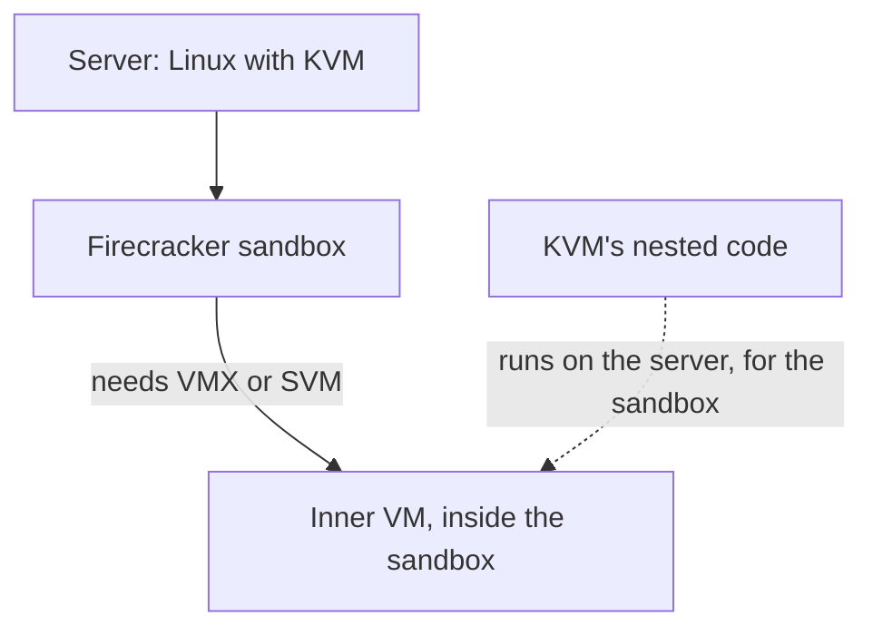

import { Tabs, TabItem } from '@astrojs/starlight/components';

*By [Suman Saurabh](https://www.linkedin.com/in/ssumansaurabh/), maintainer of AerolVM.*

Each Firecracker sandbox is a small virtual machine (VM) with its own Linux kernel. To reach the server, code in a sandbox has to break through **KVM**, the part of the server's Linux kernel that runs VMs, or through Firecracker itself, the program that acts as the VM's disk and network card. Left alone, KVM also lets each VM start a VM of its own, and that puts about 9,700 more lines of KVM code within the sandbox's reach. From v0.7.8, AerolVM turns this off unless the server owner turns it on.

**In short:**

- KVM offers the CPU's virtualization features to every VM by default, and Firecracker passes them on. With them, code in a sandbox can start a VM inside the sandbox. This is called **nested virtualization**.
- To run that inner VM, KVM runs its nested code. That code is large, and Linux keeps fixing security bugs in it. A recent one is CVE-2026-99312, on AMD servers.
- Almost no sandbox needs an inner VM. So AerolVM now hides those features from every VM it boots from scratch, and from every template once that template is saved again. KVM then refuses the feature, so its nested code stops at its first check.
- A server owner who needs nested virtualization turns it back on with one setting, `SB_FIRECRACKER_NESTED_VIRT=true`.
- Sandboxes and templates saved before the upgrade keep the CPU features they were saved with. The server saves its templates again, one at a time, and lets older sandboxes run as they did until you recreate them.

Only Firecracker sandboxes use the server's KVM. Container, gVisor, WebAssembly and V8-isolate sandboxes do not, so nothing changes for them.

## What nested virtualization is

A normal sandbox runs programs. A sandbox with nested virtualization can run a whole VM inside itself, such as an Android emulator, QEMU with KVM, or minikube with its KVM driver.

To start that inner VM, the sandbox asks the CPU for its virtualization feature. Intel calls it **VMX**. AMD calls it **SVM**. The sandbox has no real CPU of its own, so KVM on the server steps in and acts out the feature in software. This part of KVM is its **nested code**: about 9,700 lines in Linux's `arch/x86/kvm/vmx/nested.c` and `arch/x86/kvm/svm/nested.c`. It has to keep track of three layers at once: the server, the sandbox, and the inner VM.



A sandbox that can start an inner VM can make the server run the nested code as often as it likes, with whatever inputs it likes, which is how attackers and automated testing tools find weak spots.

## Why we built it

A sandbox runs code we did not write and cannot check, so it should reach as little server code as possible. The nested code is one of the largest parts of KVM a sandbox can reach, and small slips in it become security bugs.

CVE-2026-99312 is a recent example. On AMD servers, a reset signal sent to one of a VM's CPUs at the wrong moment could make KVM mix up which memory map belonged to that VM and which to its inner VM ([Debian](https://security-tracker.debian.org/tracker/CVE-2026-99312), [SUSE](https://www.suse.com/security/cve/CVE-2026-99312/)). In 2021, Google's Project Zero showed code inside a VM taking over the whole AMD server through a bug in KVM's nested code, CVE-2021-29657 ([An EPYC escape](https://projectzero.google/2021/06/an-epyc-escape-case-study-of-kvm.html)). Updating the kernel fixes each bug as it is found. Hiding nested virtualization keeps the next bug in the same code out of a sandbox's reach too, so we recommend both.

Linux turns nested virtualization on for both Intel and AMD unless someone turns it off, and Firecracker, by default, leaves VMX and SVM in the features it hands a VM. Almost no workload needs them: Docker, browsers, language runtimes, databases and test suites all run without them. Google Cloud, for comparison, has an [organization policy](https://cloud.google.com/compute/docs/instances/nested-virtualization/managing-constraint) that blocks nested virtualization for every VM a company runs.

## How a sandbox learns what its CPU can do

When a VM boots, its kernel asks the CPU what it can do. The instruction for this is called **CPUID**. Think of the answer as a menu: each feature is one item, listed or not.

A VM never reads the real CPU's menu. KVM gives each VM its own copy, and the program that runs the VM, here Firecracker, can edit that copy before the VM boots. Firecracker already edits a few items, such as the ones that describe the CPU's cores and caches, but it leaves VMX and SVM as KVM listed them.

## What AerolVM does

Before a Firecracker VM boots, AerolVM sends Firecracker a **CPU config** that crosses two items off the menu:

| CPU | Feature | Where it is on the menu |
|---|---|---|
| Intel | VMX | CPUID leaf `0x1`, register ECX, bit 5 |
| AMD | SVM | CPUID leaf `0x80000001`, register ECX, bit 2 |

Every other item stays as it was. AerolVM does this for every VM it boots from scratch: each new sandbox that does not start from a template, and the short-lived VMs it boots to save a template or to copy a sandbox's disk. A sandbox started from a template skips this step. It gets the menu the template was saved with.

Code in the sandbox cannot turn the feature on by some other route. KVM checks the sandbox's own menu and blocks the switch, so the nested code stops at its first check.

> **For kernel readers:** a guest turns on VMX by setting a bit in its CR4 register, and SVM by setting a bit in its EFER register. In current Linux, KVM refuses both when the guest's CPUID lacks the feature: `__cr4_reserved_bits` in `arch/x86/kvm/regs.h` makes CR4's VMX bit reserved for such a guest, and `__kvm_valid_efer` in `arch/x86/kvm/msrs.c` rejects EFER's SVM bit. Older kernels keep the same checks in `x86.h` and `x86.c`.

On ARM, Firecracker does not give a VM the CPU mode it needs to run VMs of its own, so AerolVM changes nothing on ARM servers.

## Saved VMs keep their CPU

Firecracker can save a running VM and bring it back later. AerolVM uses this in three places:

- **Templates.** A template is a saved VM that new sandboxes start from, in milliseconds.
- **Stop and Start.** Stop saves the whole sandbox, and Start brings it back.
- **Moves.** In a cluster, a stopped sandbox can move to another server.

A saved VM keeps the CPU menu it booted with. Loading it brings that menu back, and Firecracker takes no CPU config on a load. So AerolVM writes down the setting each VM booted under, and keeps that record with the VM wherever it goes. A VM saved before v0.7.8 has no record. AerolVM cannot tell what it was given, so it treats it as saved with nested virtualization on. The one exception is moves, shown in the table below.

On a server that hides nested virtualization, a VM saved with it on is handled like this:

| Saved VM | What happens | Why |
|---|---|---|
| Template | It keeps working. After the server starts, it saves the template again, one template at a time. Until its new save is done, new sandboxes from it can still start inner VMs, if the server's kernel allows nested virtualization. | Many sandboxes start from one template, so it gets a new save. The template stays in service meanwhile, and sandboxes already started from the old save keep using it. |
| Stopped sandbox | It starts as it was, and the log names it. It can still start inner VMs until you recreate it. | It is one user's own VM, and refusing it would throw away their work. |
| Move | Refused if its record says nested virtualization was on. A sandbox saved before v0.7.8 has no record, so it moves as it is. | Moves have to keep working during the upgrade, and an old save cannot say what it had. |

A server with nested virtualization on works the other way round: it re-saves any template that was saved with it off.

## What changes for you

**If you run code in sandboxes:** nothing, unless that code starts VMs. If it does, it now behaves as on a computer with no virtualization support: an emulator falls back to slow software mode, or stops with an error that hardware acceleration is missing.

**If you run AerolVM servers:**

- Each VM booted from scratch costs one more request from AerolVM to Firecracker before boot. It is a local call, like the half-dozen calls that already set the VM's memory, disk and network. Sandboxes started from a template pay nothing. We have not timed it on hardware yet.
- Each template saved again boots one short-lived VM, as the snapshot step of a template build does. The log says `audit saving template snapshots again for the nested virtualization setting` with the count, then `audit template snapshot saved again` for each template as it is done.
- If you use the warm pool (sandboxes booted ahead of time), it skips a template until its new save is done, so sandboxes from that template start slower until then. We have not measured by how much.
- If a save fails, the log says `template snapshot not saved again`, and the server tries again at its next start. Until then, new sandboxes from that template can still start inner VMs. Only the log shows this.
- Sandboxes that existed at upgrade time, and sandboxes started from a template before it was saved again, keep their CPU until you delete and recreate them. Each time one starts again after a stop, the log names it and `aerolvm_firecracker_nested_virt_kept_starts_total` counts it. AerolVM does not list the ones that never stop; the check in [Check it from your code](#check-it-from-your-code) finds them one at a time.
- We have tested all of this against a stand-in for Firecracker, not yet on Intel and AMD hardware. Run that check on your own servers after the upgrade.

## Turning it back on

If your sandboxes need to run VMs, add this line to the server's environment file (`/etc/sandboxd/sandboxd.env` on a server set up with `install.sh`) and restart `sandboxd`:

```bash
SB_FIRECRACKER_NESTED_VIRT=true
```

On Kubernetes, set it in the Helm chart as `worker.extraEnv.SB_FIRECRACKER_NESTED_VIRT: "true"` and replace the worker pods.

The setting is per server, and no API call or sandbox can change it. In a cluster, give every Firecracker server the same value: a server with it off refuses moves of sandboxes saved with it on. When the value changes, the server saves its templates again.

For servers that run nothing but AerolVM, you can also switch the feature off in the server's own kernel. That blocks it for every VM on the server, whatever program starts the VM. Add these lines to a file in `/etc/modprobe.d/`, then reboot or reload the KVM module:

```bash
options kvm_intel nested=0
options kvm_amd nested=0
```

## Check it from your code

Code in a sandbox can read its own CPU menu in `/proc/cpuinfo`. With nested virtualization hidden, neither `vmx` nor `svm` appears there, so this prints `0`:

<Tabs syncKey="lang">
  <TabItem label="TypeScript">
    ```ts
    import { MicroVM } from "@aerol-ai/aerolvm-sdk";

    const client = new MicroVM(); // reads SB_API_URL and SB_PAT_TOKEN

    const sandbox = await client.create({ image: "ubuntu:22.04", runtime: "firecracker" });
    const result = await sandbox.exec("grep -cwE 'vmx|svm' /proc/cpuinfo || true");
    console.log(result.stdout); // 0: the sandbox cannot start a VM

    await sandbox.destroy();
    ```
  </TabItem>
  <TabItem label="Python">
    ```python
    from microvm import MicroVM

    client = MicroVM()  # reads SB_API_URL and SB_PAT_TOKEN

    sandbox = client.create(image="ubuntu:22.04", runtime="firecracker")
    result = sandbox.exec("grep -cwE 'vmx|svm' /proc/cpuinfo || true")
    print(result["stdout"])  # 0: the sandbox cannot start a VM

    sandbox.destroy()
    ```
  </TabItem>
  <TabItem label="Go">
    ```go
    client, err := microvm.NewClient() // reads SB_API_URL and SB_PAT_TOKEN
    if err != nil {
        log.Fatal(err)
    }

    sandbox, err := client.Create(ctx, sdktypes.CreateSandboxOptions{
        Image:   "ubuntu:22.04",
        Runtime: sdktypes.RuntimeFirecracker,
    })
    if err != nil {
        log.Fatal(err)
    }
    defer sandbox.Destroy(ctx)

    result, err := sandbox.ExecCommand(ctx, "grep -cwE 'vmx|svm' /proc/cpuinfo || true")
    if err != nil {
        log.Fatal(err)
    }
    fmt.Print(result.Stdout) // 0: the sandbox cannot start a VM
    ```
  </TabItem>
  <TabItem label="Rust">
    ```rust
    use aerolvm_sdk::{Client, CreateOptions};

    let client = Client::new(None, None)?; // reads SB_API_URL and SB_PAT_TOKEN

    let sandbox = client.create(CreateOptions {
        image: "ubuntu:22.04".into(),
        runtime: Some("firecracker".into()),
        ..Default::default()
    })?;
    let result = sandbox.exec("grep -cwE 'vmx|svm' /proc/cpuinfo || true")?;
    print!("{}", result.stdout); // 0: the sandbox cannot start a VM

    sandbox.destroy()?;
    ```
  </TabItem>
  <TabItem label="Java">
    ```java
    MicroVMClient client = new MicroVMClient(); // reads SB_API_URL and SB_PAT_TOKEN

    Sandbox sandbox = client.create(
        new CreateOptions().setImage("ubuntu:22.04").setRuntime("firecracker")
    );
    ExecResult result = sandbox.exec("grep -cwE 'vmx|svm' /proc/cpuinfo || true");
    System.out.print(result.stdout); // 0: the sandbox cannot start a VM

    sandbox.destroy();
    ```
  </TabItem>
</Tabs>

On a server with `SB_FIRECRACKER_NESTED_VIRT=true` and a kernel that allows nested virtualization, the same code prints a number above 0. Run it against a sandbox from before the upgrade to see whether it still has the feature.

## Tests that keep it this way

These tests run on every change to AerolVM's Go code. They use a stand-in for Firecracker:

- `TestPutCPUConfigSendsHideNestedVirt` checks, byte for byte, the CPU config AerolVM sends to Firecracker.
- `TestColdBootHidesNestedVirt` checks the order of calls for a new sandbox: the VM's size, then the CPU config, then the boot. `TestSnapshotTemplate_HappyPath` checks the same for the VM that saves a template.
- `TestColdBootFailsWhenTheCPUConfigIsRefused` checks that a VM never boots if Firecracker refuses the CPU config.
- `TestResaveTemplateSnapshotsForNestedVirtAtStart` checks that templates saved under the other setting are saved again one at a time, to new files, and stay in service the whole time.
- `TestStoppedSandboxKeepsItsNestedVirt` stops and starts a sandbox saved before v0.7.8, and checks that it starts and is counted.
- `TestMoveOfANestedVirtVM` checks that a server that hides the feature refuses a move of a sandbox saved with it on, and leaves nothing behind.

## Related

- [Firecracker sandboxes](/firecracker-sandbox/): how to run them, and the setting.
- [How AerolVM isolates sandboxes](/engineering-isolation/): how each runtime keeps sandboxes apart.
- [Firecracker templates](/firecracker-templates/#rebuild-a-template): when templates are saved again.
- [Correct snapshot clones](/engineering-snapshot-correctness/): other ways a saved VM needs care.
