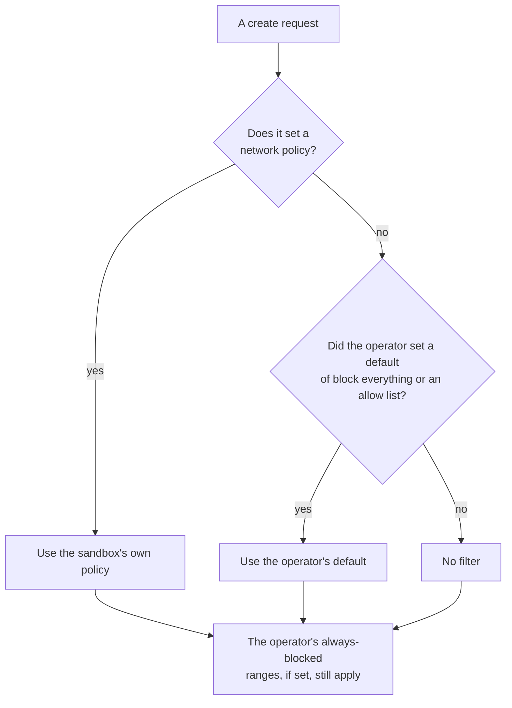
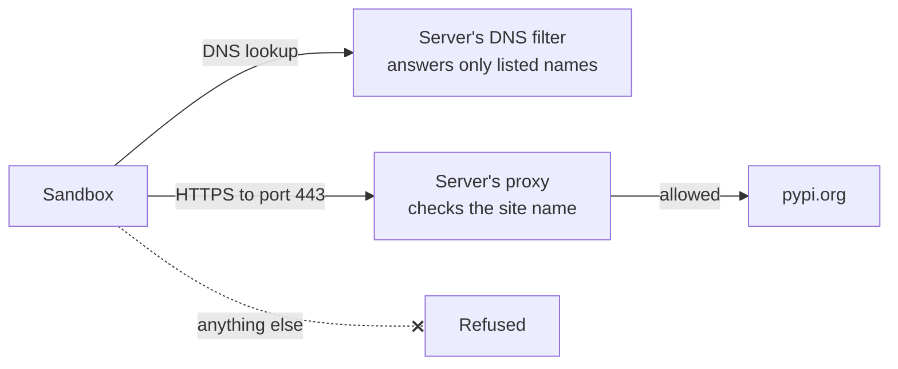
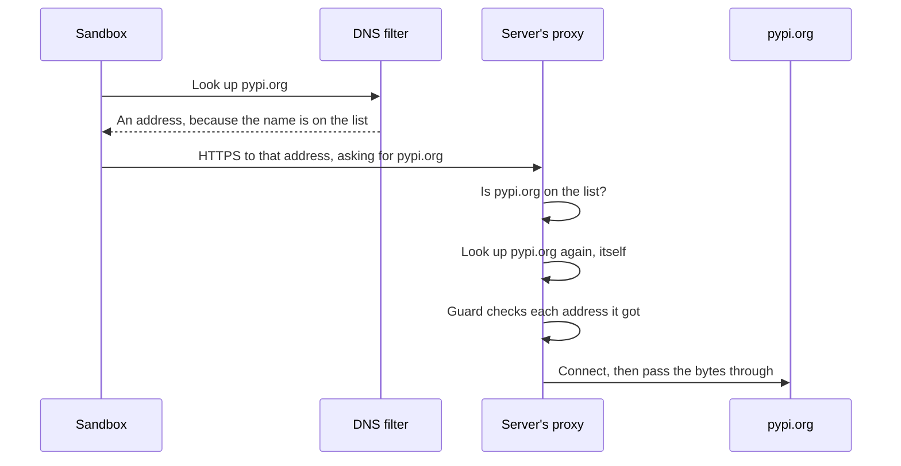
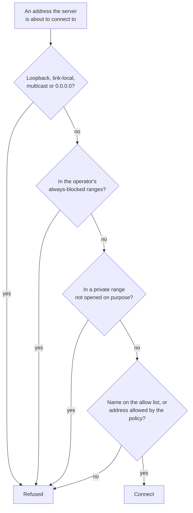
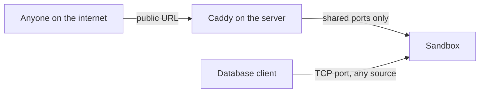

import { Aside, Tabs, TabItem } from '@astrojs/starlight/components';

*By [Suman Saurabh](https://www.linkedin.com/in/ssumansaurabh/), maintainer of AerolVM.*

Untrusted code that can reach your private network can attack it. This post explains what a sandbox can reach out to, how a policy fences that in, which tricks the filter stops, and who can reach in.

## Default posture

**Outbound traffic is not filtered until you set a policy.** This is the most important default to know.

| Runtime | Outbound, with no policy | Inbound |
|---|---|---|
| Containers, gVisor and Firecracker | The internet, plus anything the server can reach: private addresses, the cloud metadata service and other sandboxes | Nothing, until you share a port |
| WebAssembly | No filter until you set a policy | Nothing, until you share a port |
| V8 isolate | The internet over HTTPS only. Private, loopback, link-local and metadata addresses are always blocked. | Nothing, until you share a port |

So for code you do not trust, always set a policy, or have your operator set one for every sandbox on the server. See [For server operators](#for-server-operators).

This is how a new container, gVisor or Firecracker sandbox gets its outbound policy.



- The default is saved with the sandbox when it is created, so reading the sandbox shows the policy it got.

## Turn on a policy

A policy is set when you create the sandbox. There are three kinds:

- **Block everything:** `networkBlockAll: true`. Every outbound connection fails, including name lookups.
- **Allow only some sites:** `networkAllowOut` with site names, wildcards or address ranges. Everything else is refused.
- **Block some sites:** `networkDenyOut`. Everything else is allowed. This is the weakest kind.

This sandbox can install Python packages and reach nothing else:

<Tabs syncKey="lang">
  <TabItem label="TypeScript">
    ```ts
    const sandbox = await client.create({
      image: 'python:3.12',
      networkAllowOut: ['pypi.org', '*.pythonhosted.org', 'github.com:22'],
    })
    ```
  </TabItem>
  <TabItem label="Python">
    ```python
    sandbox = client.create({
        'image': 'python:3.12',
        'networkAllowOut': ['pypi.org', '*.pythonhosted.org', 'github.com:22'],
    })
    ```
  </TabItem>
  <TabItem label="Go">
    ```go
    sandbox, err := client.Create(ctx, sdktypes.CreateSandboxOptions{
        Image:           "python:3.12",
        NetworkAllowOut: []string{"pypi.org", "*.pythonhosted.org", "github.com:22"},
    })
    ```
  </TabItem>
  <TabItem label="Rust">
    ```rust
    let sandbox = client.create(CreateOptions {
        image: "python:3.12".to_string(),
        network_allow_out: Some(vec![
            "pypi.org".to_string(),
            "*.pythonhosted.org".to_string(),
            "github.com:22".to_string(),
        ]),
        ..Default::default()
    })?;
    ```
  </TabItem>
  <TabItem label="Java">
    ```java
    Sandbox sandbox = client.create(
        new CreateOptions()
            .setImage("python:3.12")
            .setNetworkAllowOut(List.of("pypi.org", "*.pythonhosted.org", "github.com:22"))
    );
    ```
  </TabItem>
</Tabs>

The server's firewall does the blocking, and it only runs on Linux. See [Network access](/network-access/) for the full options, and [Advanced network rules](/advanced-network-rules/) for request rules.

## How a name allow list is enforced



1. **Name lookups go to the server's DNS filter.** A name that is not on the list gets "no such name", with a note explaining why. Lookups to outside DNS servers, DNS over TLS and QUIC are refused.
2. **Web traffic goes to the server's proxy.** On ports 80 and 443, the proxy reads the site name the program asked for (the SNI or `Host` header), checks it against the list, and looks the name up again itself. It ignores the address the program tried to use.
3. **Everything else is refused.**

This is the same flow, step by step, for one HTTPS connection to an allowed site.



- The proxy never trusts the address the sandbox chose. It connects to the address it looked up itself.
- It does not decrypt the traffic unless you turned on inspection for that site.

## Private addresses and cloud metadata

When a sandbox has a name allow list (or is in learn mode), a guard checks every address before the server connects:

- **Blocked:** loopback, link-local (`169.254.0.0/16`, which includes the cloud metadata service at `169.254.169.254`) and private ranges (`10.0.0.0/8`, `172.16.0.0/12`, `192.168.0.0/16`).
- **Opened only on purpose:** a private range opens only if your list names it as an address range, or if the operator marks it as an internal zone.

The guard asks these questions in order, for every address.



A sandbox with "block everything", an address-range allow list or a name allow list also cannot reach the server itself. To cover every sandbox, turn on the control-port guard in the server's policy file.

## DNS tricks

| Trick | What stops it |
|---|---|
| **DNS rebinding**: a name first resolves to a public address, then to a private one | The guard checks the address at the moment of connecting, after the lookup, and before any answer is trusted. |
| **Hard-coded addresses**: connecting to an address directly, with no name | With no site name, the connection is refused unless an address range allows it. |
| **A false site name**: sending an allowed name to a different address | The proxy looks the name up itself and connects there, not where the program wanted. |
| **Going around the filter**: outside DNS, DNS over TLS, QUIC | Refused. |
| **IPv6 and encrypted client hello** | IPv6 and HTTPS record lookups get empty answers, so programs use IPv4 and a visible site name. |
| **Domain fronting**: a request for one site, sent inside a connection to another on the same CDN | Stopped on inspected HTTPS, where every request's `Host` must match the site name (`421` otherwise). Not checked without inspection. |

## Ports other than 80 and 443

For an entry with another port, such as `github.com:22`, the proxy cannot read a site name. The server opens the addresses that name looked up to, on that port only. Any other site at the same address and port can then be reached too.

## Between sandboxes

- **Without a policy, sandboxes on the same server can reach each other.** A policy fences that off.
- **Addresses cannot be faked.** Containers cannot forge packets, and the server checks that each packet from a Firecracker sandbox comes from its own address.
- **Each sandbox's rules follow its address,** so one sandbox's policy never changes another's.

## Who can reach the sandbox



- **A new sandbox is private.** It has no public address until you share a port. The Daytona API makes sandboxes public by default, and the E2B API always does.
- **A public URL has no login of its own.** Anyone with the address can open it. Protect the app itself if it needs a login. See [Public URLs](/public-urls/).
- **From outside the server, only shared ports are reachable.** Other sandboxes on the same server are a different matter: see [Between sandboxes](#between-sandboxes).
- **TCP ports are open to the whole internet.** The server passes the bytes through without checking who connects. See [TCP and TLS ports](/tcp-ports/).
- **Blocking outbound traffic does not close shared ports.**

## Usage limits

You can cap how many bytes a sandbox sends or receives in its lifetime. The server reads the counters every 10 seconds, so a sandbox can go a little over before it is cut off. There is no speed limit. See [Limit egress and ingress](/network-usage/).

## In a cluster

- **Servers prove who they are.** The shared record and the internal API use mutual TLS: each server needs a certificate signed by the cluster's own authority, with TLS 1.2 or newer.
- **Membership gossip is encrypted.** The cluster will not start without a gossip key, unless the operator turns that check off on purpose.
- **Forwarded calls need both** mutual TLS and the operator token.

## For server operators

Set these in the private-network policy file (`SB_EGRESS_OPERATOR_FILE`). They apply to every sandbox on the server, whatever its own policy says. See [Private networks](/advanced-network-rules/#private-networks).

- **`default_policy`:** the policy a create gets when it sets none. Use `block_all` or `allowlist` so no sandbox starts open.
- **`deny_cidrs`:** address ranges that are always dropped. Add `169.254.169.254/32` for the cloud metadata service, and your company's private ranges. Do not add the ranges the server gives its own sandboxes.
- **`node_control_port_guard: true`:** sandboxes cannot reach AerolVM's own ports on any server.

<Aside type="caution" title="Privileged sandboxes turn off name filtering">
If the server allows privileged containers, name allow lists are turned off. Keep `SB_CONTAINER_PRIVILEGED` off.
</Aside>

## Where this boundary ends

- **What an allowed site does with your data.** The filter controls where traffic goes, not what the far side does with it.
- **Traffic inside an allowed HTTPS connection** is not read unless you turn on inspection for that site.
- **Name filtering works on IPv4.** IPv6 lookups get empty answers.

## Next steps

- [Network access](/network-access/): block the internet, or allow only some sites.
- [Advanced network rules](/advanced-network-rules/): profiles, learn mode and per-request rules.
- [Secret handling](/engineering-secret-handling/): keep API keys out of the sandbox.
