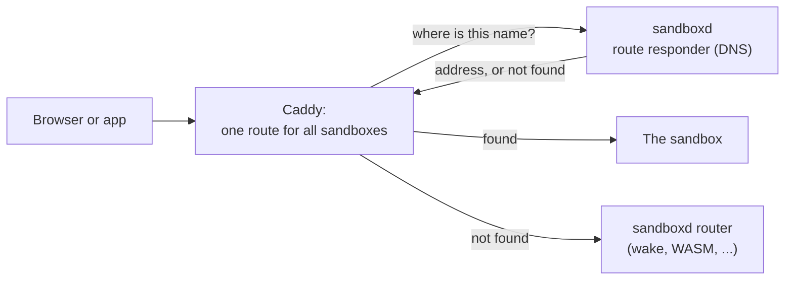
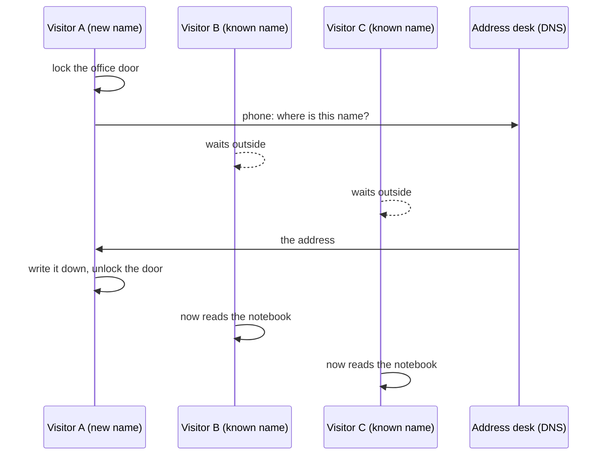

*By [Suman Saurabh](https://www.linkedin.com/in/ssumansaurabh/), maintainer of AerolVM.*

When someone opens a sandbox's public URL, the request first reaches Caddy, the web server on each AerolVM server. Caddy has to find out which sandbox should get the request. This post is about that one small step. We found that once a server had more than 100 busy sandbox names, this step made every request wait in a single line. Here is how we found it, how we measured it, what we built, and how we proved it works.

**In short:**

- To find the sandbox, Caddy asks a question for every request: "Where does this name live?"
- Caddy 2.11.9's built-in way of asking remembers only 100 answers. And while it waits for one new answer, it makes every other request wait too, even requests whose answer it already knows.
- So past 100 busy names, almost every request waited in one line. In our laptop test, Caddy 2.11.9 handled about 4,100 requests per second with 1,000 names, compared with about 35,000 with 100 names.
- We wrote a small add-on for Caddy. It remembers up to 16,384 answers, almost never makes a request wait for another name's answer, and also remembers "not found".
- With it, Caddy 2.11.9 handled about 31,000 requests per second with 1,000 names: about 7.6 times more.
- Caddy's own developers have since stopped one request from making the others wait, in a version not yet released. It still remembers only 100 answers, so the add-on still handled 5.6 times more requests than it.
- A server whose Caddy does not have the add-on still works, the old way.

## Words used in this post

- **Host:** the name part of a web address, like `sb-123-3000.example.com`. A **busy host** gets at least one request every second. In this post, "name" and "host" mean the same thing.
- **Caddy:** the web server in front of every AerolVM server. All sandbox web traffic goes through it.
- **Route:** a rule in Caddy that says where to send a request.
- **sandboxd:** the AerolVM program that runs on each server and manages its sandboxes.
- **DNS:** the internet's address book. You give it a name, and it gives you an address.
- **Cache:** a short-term memory of answers, so you do not have to ask again.
- **Lock:** a rule that lets only one task touch something at a time. Other tasks wait their turn.
- **Plugin:** extra code that you build into Caddy to add a feature.
- **Main branch:** the newest version of Caddy's code, where its developers work before the next release.
- **µs and ms:** a µs is a millionth of a second. A ms is a thousandth of a second.

## How a request finds its sandbox

This section explains the path every sandbox request takes, and why it asks a question at all.

A sandbox name says which sandbox and which port. For example, `sb-123-3000.example.com` means "port 3000 in sandbox `sb-123`".

AerolVM used to give Caddy one route for each sandbox. Each time a sandbox started, stopped or moved, sandboxd changed Caddy's settings. But every change makes Caddy reload, and a reload drops some new connections. When sandboxes came and went quickly, about 2.6% of new connections failed.

So now Caddy has **one fixed route** for all sandboxes. The route knows no addresses. For each request, it asks sandboxd's **route responder**, a tiny DNS server on the same machine that answers from memory: "What is the address of `sb-123-3000.example.com`?" When a sandbox moves, only the answer changes. Starting, stopping or moving a sandbox no longer changes Caddy's settings, so nothing reloads.

Some sandboxes need extra work first. A sleeping sandbox must wake up. A sandbox being moved has no fixed address yet. WASM and isolate sandboxes have no network address of their own. For these, the answer is "not found" on purpose. It tells Caddy: send this request to sandboxd's **router**, which knows how to handle it.



**What this shows:** Caddy asks the route responder where each name lives. A found name goes straight to its sandbox. A name that is not found goes to sandboxd's router.

Every request asks this question, so the way Caddy asks it matters a lot.

## How we found it

This section explains how we went looking, and the four things we found.

No user reported this. We were checking which steps slow a request down. Most steps run only now and then. This one runs on every single request.

Caddy is open source, so we read the code that asks. Caddy calls it the "A" lookup, because DNS calls an address answer an "A record". It lives in `modules/caddyhttp/reverseproxy/upstreams.go`. We read it in Caddy 2.11.9, the version AerolVM shipped, because details like these can change between versions. They did: see "Caddy unlocked the door too" below.

Picture an office. **Visitors** (requests) come in to look up addresses. They all read one shared **notebook** (the cache). When a name is not in the notebook, one visitor **phones the address desk** (sends a DNS question to the route responder) and writes the answer down. Here is how this office runs:

1. **The notebook has room for 100 names, for the whole server.** When it is full and a new name comes in, a random page gets torn out. A server with more than 100 busy names keeps tearing out pages it will need again a moment later.
2. **During every phone call, the office door is locked.** Even visitors who only want to read a name that is already in the notebook must wait outside. In code, a lookup for a name that is not in the notebook takes a "write" lock and holds it until the DNS answer comes back. While a write lock is held, no one can read.
3. **"Not found" is never written down.** Every request to a WASM sandbox, or to any name the router handles, makes a new phone call with the door locked. Each one also writes a line at ERROR level to Caddy's log: `failed getting dynamic upstreams`.
4. **Each call asks two questions.** There are two kinds of internet address: IPv4, the older kind, and IPv6, the newer kind. Caddy asks for both. Our responder only gives IPv4, so the second question is always wasted.

Caddy built this for sites with a few fixed servers behind them. For that job, none of these is a mistake. Our job is different: thousands of sandbox names behind one route.

Put points 1 and 2 together and you get the key idea for Caddy 2.11.9: **one missing name locks out everyone.** With 150 busy names, about two names in three are still in the notebook. But every third visitor makes a phone call with the door locked, and the other two wait outside. So the whole office moves at the speed of the phone calls.



**What this shows:** visitors B and C already have their answers in the notebook. They still wait for visitor A's whole phone call, because the door is locked.

## Measuring it

This section shows how slow it got.

Reading code tells you what can happen. A test tells you how bad it is. So we wrote a benchmark. It calls Caddy 2.11.9's own lookup code, set up exactly like AerolVM's route. 64 callers ask at the same time. Each picks a name at random, spread evenly over all the names. That is the worst case for a notebook, because real traffic mostly goes to a few names. A test DNS server runs on the same machine, as the route responder does on a real server. It ran on an Apple M1 Max laptop. Each number is the middle result of five runs. The benchmark is `BenchmarkLookup` in `caddymod/compare_bench_test.go`, so anyone can run it again.

| Busy names | Lookups per second | Middle wait | Slowest 1 in 100 |
|---|---|---|---|
| 100 | 3,120,143 | 1 µs | 17 µs |
| 150 | 24,790 | 0.2 ms | 13 ms |
| 300 | 7,789 | 8.7 ms | 23 ms |
| 1,000 | 4,816 | 14 ms | 26 ms |
| 5,000 | 4,207 | 14 ms | 31 ms |

From 100 names to 150, the lookup rate fell 126 times. The speed does not drop little by little. It drops all at once. Up to 100, every name stays in the notebook, and each name needs only one phone call per second to stay fresh. That is about 100 short calls a second, so the door is rarely locked. Past 100, every name that is not in the notebook makes everyone wait.

The exact numbers change from run to run, because they depend on how fast DNS answers. But the drop showed up in every run.

"Not found" names make it worse, because they are never written down. With 50 normal names and 50 not-found names, the built-in lookup did 8,463 lookups per second.

We tried the easy fix first: ask for IPv4 only. It is one line in the route's settings, and each phone call then asks one question instead of two. At 1,000 names it took lookups from 4,816 to 7,631 per second, about 1.6 times more. But that is still about 400 times slower than the built-in lookup at 100 names. The drop stayed. We kept this one-line fix anyway, as the fallback described below.

## Fixes we did not choose

This section lists the other ways to fix it, and why each one fell short.

- **Make the notebook bigger.** The limit of 100 is written into Caddy's code. There is no setting for it.
- **Make the address desk answer faster.** The door would still lock for every new name. A faster answer only makes each wait shorter.
- **Go back to one route per sandbox.** Every change would reload Caddy and drop new connections again. That is the problem the single route solved.
- **Wait for Caddy.** A fix inside Caddy helps everyone, and Caddy's developers had in fact started one (see "Caddy unlocked the door too" below). But it was in no release yet, and it keeps the 100-name limit. A plugin let us fix our servers now.

## What we built

This section explains the plugin, one idea at a time.

Caddy lets you build your own code into it as plugins. AerolVM already builds its own Caddy with a few plugins, so adding one more was easy. The new one is a lookup made for this job, called `aerolvm_route`. It lives in `caddymod/routeupstream.go`. In the office picture, here is what changes:

1. **64 desks, each with its own notebook.** Each name always goes to the same desk. Two visitors looking up different names are almost always at different desks, so they do not wait for each other. Together the desks hold up to 16,384 names.
2. **No locked door during calls.** A visitor holds a desk only for the moment it takes to read or write a page, never during a phone call.
3. **One call per name.** If 50 visitors want the same new name, one of them phones. The other 49 wait for that same call. Visitors looking for other names do not wait for this call.
4. **"Not found" is written down too.** The visitor goes straight to sandboxd's router. This is not an error, so nothing is logged.
5. **One question, with a limit.** It asks for IPv4 only. At most 256 calls can be out at once. A 257th new name waits up to a second for a free line. So thousands of fake names cannot make the server open thousands of connections.

Every page has a use-by time, one second after it was written. So a sandbox that moves gets its new address within about a second, as before. When a desk is full, the plugin looks at 8 of its pages. It throws away one past its use-by time, or else the one closest to it. It never throws away a page that visitors are still waiting on.

This part is for engineers; you can skip it. Here is the heart of the plugin, a little shortened. `get` finds a name's address, or makes the one phone call for it:

```go
func (c *routeCache) get(ctx context.Context, key string, lookup func() (string, error)) (string, error) {
	sh := &c.shards[maphash.String(c.seed, key)%cacheShards] // this name's desk
	sh.mu.Lock()
	if e, ok := sh.m[key]; ok {
		if !e.finished() { // someone is already on the phone for this name
			sh.mu.Unlock()
			select {
			case <-e.done: // wait for that same call
				return e.dial, e.err
			case <-ctx.Done(): // or give up, if our own request ends
				return "", ctx.Err()
			}
		}
		if c.now().Before(e.expires) { // a page that is still good
			sh.mu.Unlock()
			return e.dial, nil
		}
	} else {
		sh.makeRoomLocked(c.perShard, c.now()) // a full desk throws one page away
	}
	e := &cacheEntry{done: make(chan struct{})} // "on the phone" note for others
	sh.m[key] = e
	sh.mu.Unlock() // leave the desk before the call

	dial, err := lookup() // the DNS question, with no lock held

	sh.mu.Lock()
	e.dial, e.err, e.expires = dial, err, c.now().Add(c.ttl)
	if err != nil && sh.m[key] == e {
		delete(sh.m, key) // an error (not a "not found") is not written down
	}
	close(e.done) // wake everyone waiting on this call
	sh.mu.Unlock()
	return dial, err
}
```

Two things work differently from before, and both are on purpose:

- **"Not found" is now kept for one second.** So for up to one second after a sandbox starts or wakes up, its requests may still go through the router. They still work. They just take a slightly longer path.
- **Each question now gives up after one second.** Before, a slow DNS answer held everyone up for as long as it took. Now, if the DNS server fails or does not answer within a second, Caddy logs an error and sends the request to the router.

## Two problems on the way

This section covers the two parts that were harder than the notebook.

### How does sandboxd know the plugin is there?

Not every server's Caddy has our plugin. The installer downloads the Caddy from AerolVM's release, or from AerolVM's mirror of it. If both fail, it falls back to Caddy's own build service. That service only adds plugins listed on Caddy's website, and ours is not one of them.

If sandboxd writes a route that names a plugin Caddy does not have, Caddy refuses it. Worse, sandboxd writes the new route and removes the old per-sandbox routes in one batch. One refused piece fails the whole batch. So "try it and see" was not an option.

The fix: the plugin also adds a small read-only page to Caddy's admin API, the private control panel sandboxd uses to change Caddy's settings. The page is at `/aerolvm/route-upstream`. Caddy loads pages like this by itself. Before it writes the route, sandboxd asks for that page:

- **200 (OK):** the plugin is there, so sandboxd writes the route that uses it.
- **Anything else** (404, an error, or no answer): sandboxd writes the route with Caddy's built-in lookup, set to IPv4 only, and logs a warning.

Asking is only a read. It changes nothing and reloads nothing. The page also shows the plugin's counters: names in the notebook, hits (answers found in the notebook), lookups, not found and errors.

### Keeping two programs in step

The plugin is its own small Go module, so building Caddy does not pull in sandboxd's many libraries.

But now two programs must agree. sandboxd writes the plugin's settings, and the plugin reads them. If someone renamed a setting on one side only, routing would break, and only on real servers. So:

- **One shared file,** `caddymod/testdata/static_route_source.json`, holds the exact settings sandboxd writes. sandboxd's test checks that it writes exactly that. The plugin's test loads exactly that, and fails on any setting it does not know.
- **Another sandboxd test reads the plugin's source code** for its name and its admin page path, and checks that they match.
- **The release build checks its finished Caddy for the plugin,** and stops if it is missing. It checks the build for Intel and AMD chips (amd64), the one its build machine runs. The build machine cannot run the builds for other chips, so it does not check them. And a test fails if the plugin is built for a different Caddy version than the one AerolVM ships.

The cost: AerolVM now owns a Caddy plugin. Each Caddy upgrade means building the plugin again and running its tests. The version test makes sure nobody forgets.

## Caddy unlocked the door too

This section explains a change inside Caddy itself, and what it means for the plugin.

While we finished the plugin, we read Caddy's newest code, on its main branch. Caddy's developers had changed this same lookup ([#7949](https://github.com/caddyserver/caddy/pull/7949), merged on 2026-11-03). Their version no longer locks the door during a phone call, and it makes one call per name, like ours. Two teams reached the same fix on their own, which is a good sign that it is the right one. We checked it: when one name's answer took 600 ms, a second name did not wait at all.

Three of the four problems remain in their version. The notebook still has room for only 100 names, for the whole server. "Not found" is still not written down, and is still logged as an error. And it still asks for both IPv4 and IPv6. So once busy names far outnumber 100, most requests wait on a phone call again: at 1,000 names, the middle wait is 10 ms.

Their numbers also show which problem is bigger. Without the locked door, Caddy's main branch got only about 1.25 times faster at 1,000 names. At 1,000 busy names, more than 8 requests in 10 still wait on a phone call, and phone calls are slow. So the small notebook causes the drop, and the locked door makes it worse. The plugin fixes both.

AerolVM's Caddy is now built from that main-branch version, for a separate reason: Caddy 2.11.9 still uses an old library with a known security problem (go-jose v3), and the main branch drops it. When a Caddy release includes that change, AerolVM goes back to building from the release. So the results below compare three lookups: Caddy 2.11.9's, Caddy's main branch's, and the plugin.

## Results

This section compares the three lookups, first alone and then for whole requests, on the same laptop. Each number is the middle result of five runs. The plugin was built on the main-branch Caddy that AerolVM now ships.

First, lookups per second, with the same benchmark as above:

| Busy names | Caddy 2.11.9 | Caddy main branch | `aerolvm_route` plugin |
|---|---|---|---|
| 100 | 3.1 million | 2.6 million | 3.4 million |
| 150 | 24,790 | 38,207 | 3.5 million |
| 300 | 7,789 | 9,546 | 3.4 million |
| 1,000 | 4,816 | 6,043 | 3.4 million |
| 5,000 | 4,207 | 5,903 | 2.5 million |
| 50 normal + 50 not found | 8,463 | 26,223 | 3.2 million |

The main branch is faster than 2.11.9 past 100 names, because names already in the notebook no longer wait. But it keeps the 100-name limit, so it still drops off the same cliff. At 1,000 names:

- **Lookups per second:** the plugin did about 570 times more than the main branch, and about 710 times more than 2.11.9.
- **The slowest 1 in 100 lookups:** 26 ms with 2.11.9, 27 ms with the main branch, 13 µs with the plugin.
- **DNS questions per second:** 8,251 with 2.11.9, 10,117 with the main branch, 909 with the plugin. The plugin's number is about one per name per second, the least the one-second use-by time allows.
- **Error lines for not-found names:** one per request with either Caddy version, none with the plugin.

Second, whole requests. `BenchmarkThroughCaddy` starts a real Caddy, a route like ours (without HTTPS), and one small test app for requests to reach. The client sends real requests, 64 at a time. The client, Caddy, the test app and the DNS server all share one laptop, so compare the columns, not the raw numbers. Requests per second:

| Busy names | Caddy 2.11.9 | Caddy main branch | `aerolvm_route` plugin |
|---|---|---|---|
| 100 | 34,796 | 35,070 | 35,658 |
| 1,000 | 4,079 | 6,009 | 33,631 |

At 100 names all three are about the same, because the notebook holds every name. At 1,000 names, the lookup limits all of Caddy to about 4,100 requests per second with 2.11.9, and about 6,000 with the main branch. With the plugin, Caddy does nearly as well at 1,000 names as at 100: about 5.6 times more requests than with the main branch. Even comparing the plugin's slowest run with the main branch's fastest, it handled 4.4 times more. The slowest 1 in 100 requests took 30 ms with 2.11.9, 21 ms with the main branch, and 4.9 ms with the plugin.

The plugin does about the same on either Caddy version. Built on 2.11.9 instead, it handled 31,104 requests per second at 1,000 names: about 7.6 times more than 2.11.9's own lookup.

## How we checked it

This section lists how we proved the plugin works in a real Caddy, and the tests that keep it working.

First, a real Caddy. We built the release Caddy, Caddy's main-branch version with all of AerolVM's plugins, using xcaddy, the same tool the release uses. Then we started it and used sandboxd's own Caddy client against it:

- The client found the plugin's admin page.
- Caddy accepted the route in one batch.
- A sandbox name reached the sandbox. A WASM-style name reached the router. The main domain reached the API.
- The plugin's counters read: 2 lookups, 1 not found, 4 hits from the notebook, 0 errors.
- Caddy's log had no `failed getting dynamic upstreams` line.

Then we checked the locked door itself, once, by hand. We gave one name a DNS answer that takes 600 ms, and asked for a second name whose answer is instant. With Caddy 2.11.9's built-in lookup, the second name got its answer only when the slow lookup finished, 0.6 seconds later. With Caddy's main-branch lookup, it did not wait. With the plugin, the same test requires the second name to answer in under 300 ms, and it does.

These tests run in CI and fail if the plugin goes back to the old behavior:

- **`TestThroughCaddy`** runs a whole Caddy inside the test with two routes: one with the built-in lookup and one with the plugin. Both send a not-found name to the router. The built-in one logs `failed getting dynamic upstreams`, and the plugin logs no such line. The test also fails if the built-in one stops logging, so it cannot pass by not looking.
- **`TestSlowHostDoesNotHoldUpOthers`** is the slow-name test above, for the plugin.
- **`TestOneLookupPerHostAtATime`** sends 50 requests for one new name at once. The DNS server must see exactly one question.
- **`TestCommitIngressProxyRoutingPicksTheLookup`** checks that sandboxd writes the plugin route when Caddy has the plugin, the built-in IPv4-only route when it does not, and that either way Caddy loads its settings only once.

Two more tests check the use-by time (a moved sandbox gets its new address after one second, not sooner and not later) and the size limit (after 3,000 made-up names, the notebook is within its limit).

## What we have not done yet

- **Numbers from a real cluster.** The numbers above come from a laptop, with requests spread evenly over all names. We have not yet measured a cluster under real traffic.
- **Servers with a Caddy from Caddy's build service** keep the built-in lookup until they get the release Caddy.

## For server operators

Releases with this change carry the plugin in their Caddy. A server gets it when the installer or the upgrader puts that Caddy in place. sandboxd checks for the plugin each time it starts, so restart sandboxd after Caddy changes.

To see which lookup a server uses, look at sandboxd's start-up log:

```bash
journalctl -u sandboxd | grep "ingress proxy routing committed"
```

- `route_lookup=aerolvm_route` means the plugin is in use.
- `route_lookup=a`, with a warning, means the server's Caddy does not have the plugin. Run the installer again so it puts the release Caddy in place, then restart sandboxd.

## Sources

- Caddy 2.11.9's built-in lookup: [`AUpstreams.GetUpstreams`](https://github.com/caddyserver/caddy/blob/v2.11.9/modules/caddyhttp/reverseproxy/upstreams.go#L357-L431) (the lock, the 100-name limit and the random tear-out) and [the error line](https://github.com/caddyserver/caddy/blob/v2.11.9/modules/caddyhttp/reverseproxy/reverseproxy.go#L646-L650).
- Caddy's main-branch lookup, at the commit AerolVM builds: [#7949](https://github.com/caddyserver/caddy/pull/7949) (no lock during the call, one call per name) and [the 100-name limit](https://github.com/caddyserver/caddy/blob/31f9f0cb99491fdd1a27f82793b78d216c5b2a76/modules/internal/network/cache.go#L32).
- The 2.6% of dropped connections: [the plan for the single route](https://github.com/aerol-ai/microvm/blob/main/plans/ingress-proxy-routing.md).
- The pull request that added the plugin: [#1113](https://github.com/aerol-ai/microvm/pull/1113).
- The plugin, its tests and both benchmarks: [`caddymod/`](https://github.com/aerol-ai/microvm/tree/main/caddymod). To run the benchmarks yourself: `cd caddymod && go test -run '^$' -bench 'Lookup$|ThroughCaddy' -benchtime 2s -count 5`. The Caddy 2.11.9 numbers come from the same benchmarks with `caddymod/go.mod` set to Caddy v2.11.9.

## Related

- [Public URLs](/public-urls/): how sandbox URLs work for users.
- [Placement and failover](/engineering-placement-failover/): how a cluster decides which server owns each sandbox.
- [Staying up under overload](/overload-protection-architecture/): another limit we measured and fixed.
