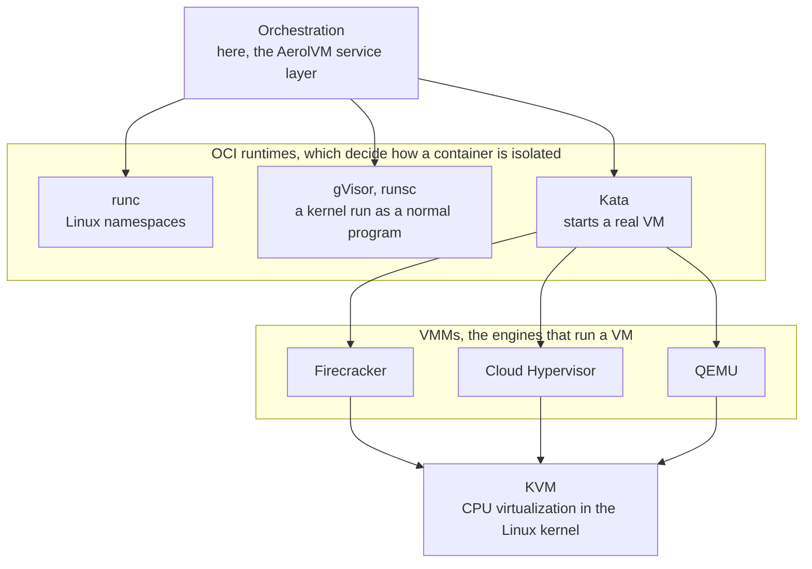
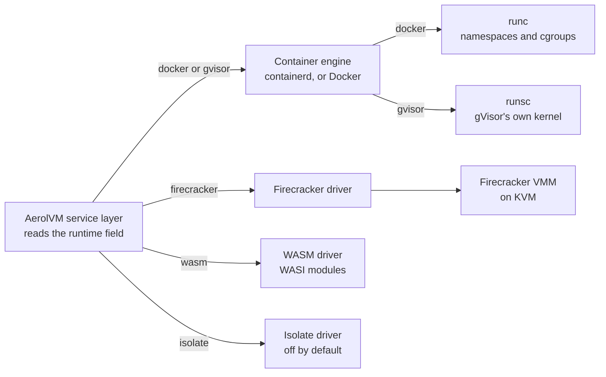
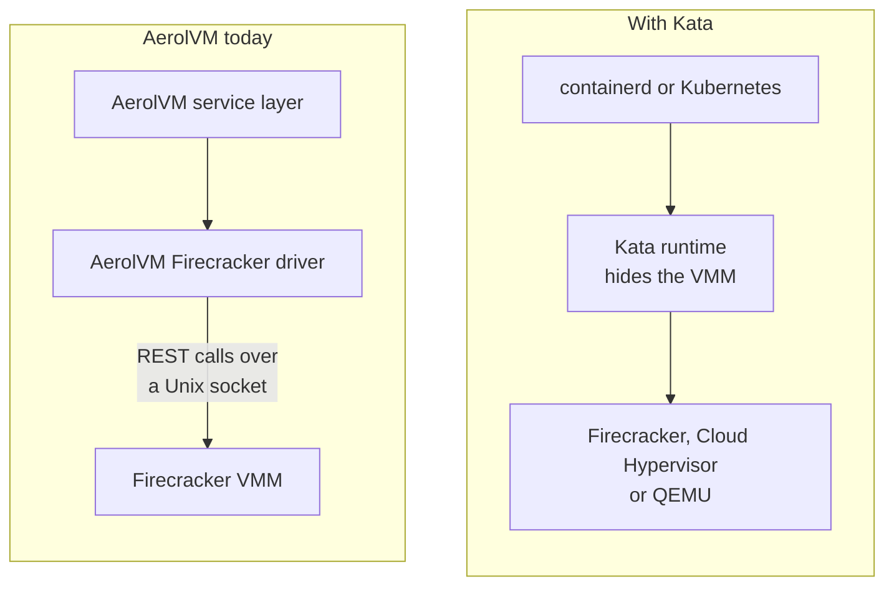
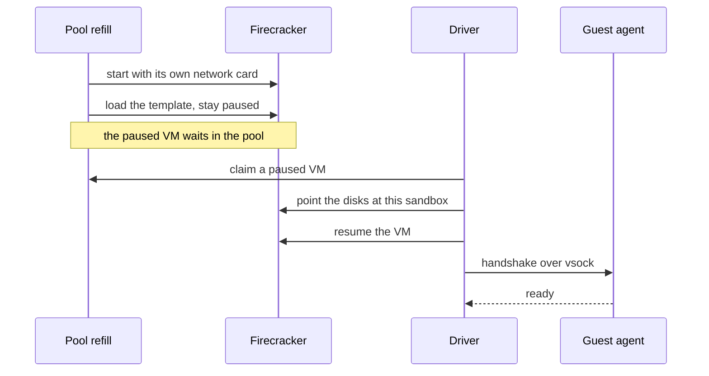
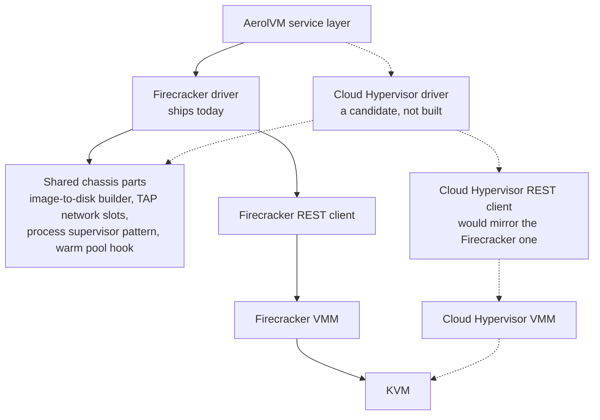
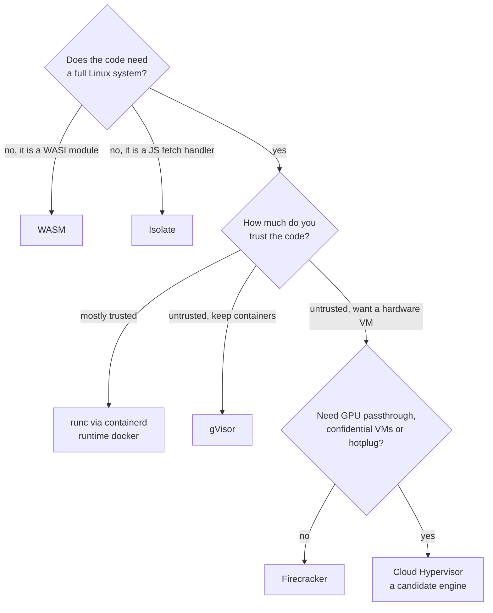

import { Tabs, TabItem } from '@astrojs/starlight/components';

We often hear two questions about the sandbox runtime (the software that runs sandboxes). One is "why Firecracker and not Kata?" The other is "should we switch to Cloud Hypervisor?" Both hide the same assumption: that Firecracker, Cloud Hypervisor and Kata are three swappable options at the same layer, where picking one rules out the others.

They are not at the same layer. **Firecracker and Cloud Hypervisor are engines, and Kata is a chassis you drop an engine into.** Asking "Firecracker or Kata?" is like asking "a V8 engine or a sedan?" The sedan *has* a V8.

This page lays out the layers and shows where AerolVM's five runtimes sit in them. It also explains why AerolVM built its own chassis instead of using one off the shelf.

**In short:**

- Firecracker and Cloud Hypervisor are VMMs: programs that run virtual machines. Kata and gVisor are container runtimes, one layer up.
- Kata can run *on top of* Firecracker, so "Firecracker or Kata?" compares two different layers.
- AerolVM skips Kata and drives Firecracker directly, because its fast start depends on Firecracker's snapshot API (for saving and restoring a running VM).
- That choice makes a second engine, such as Cloud Hypervisor, a contained change instead of a rewrite.
- Choosing isolation is two decisions: first the layer, then (for a virtual machine) the engine.

## The layers

The stack has four layers. The picture reads from the top down, and the list after it goes from the bottom up.



- **KVM** is the Linux kernel's built-in support for running virtual machines on the real CPU. Everything with a real VM sits on it.
- **A VMM (virtual machine monitor)**, often called a hypervisor, is the program that creates the VM, emulates its devices and boots its kernel. It runs as a normal program, outside the kernel. **Firecracker and Cloud Hypervisor live here, and they are peers.**
- **An OCI runtime** answers a different question: *given a container, how do you isolate it?* (OCI is the open standard for container images and the tools that run them.)
- **Orchestration** is whatever drives the OCI runtime: Docker, containerd (the container engine Docker is built on), Kubernetes, or in AerolVM's case the service layer.

Firecracker and Cloud Hypervisor are both small VMMs written in Rust, built on the shared `rust-vmm` libraries. Both are controlled through a REST API over a Unix socket (a local, file-like network connection). Cloud Hypervisor even started from Firecracker's rust-vmm parts.

The three OCI runtimes isolate a container in three different ways:

- `runc` uses Linux namespaces: kernel features that give a process its own view of files, network and other processes.
- **gVisor** (`runsc`) uses a kernel written as a normal program. It catches the container's syscalls (the requests a program makes to the kernel) before they reach the real kernel.
- **Kata** boots the container inside a *real VM*, using a VMM underneath. Kata's VMM is a setting: Firecracker, Cloud Hypervisor or QEMU.

The key point sits between the middle two layers: **Kata does not compete with Firecracker. Kata runs *on top of* Firecracker.** Once you see that, "Firecracker vs Kata" falls apart. The two answer questions one layer apart.

## Where AerolVM's five runtimes sit

AerolVM ships five runtimes today, and they do not line up in one row. They are spread across two different layers:

| Runtime | Layer | Isolation mechanism |
|---|---|---|
| **OCI / Docker API** (`runtime: "docker"`) | OCI runtime (`runc`) on **containerd** (default host engine) | Linux namespaces + cgroups |
| **gVisor** (`runtime: "gvisor"`) | OCI runtime (`runsc`) | Userspace kernel intercepting syscalls |
| **Firecracker** (`runtime: "firecracker"`) | Our own OCI-runtime-equivalent → VMM | Hardware VM (KVM) |
| **WASM** (`runtime: "wasm"`) | Language VM / sandboxed bytecode | Host-mediated WASI workers (optional resident host) |
| **Isolate** (`runtime: "isolate"`) | Language VM (V8 / workerd) | Per-tenant workerd group + host-mediated egress; off by default |

A few terms in that table:

- **cgroups** are kernel limits on how much CPU and memory a group of processes may use.
- **WASI** is the system interface WebAssembly programs use to read files and talk to the outside world.
- **workerd** is Cloudflare's open-source engine for running JavaScript in V8 isolates.
- **Host-mediated** means the host does the work on the sandbox's behalf. **Egress** means outbound network traffic.

The API still says `runtime: "docker"` for OCI sandboxes. On servers, AerolVM runs them with its own **containerd** driver (`SB_CONTAINER_ENGINE=containerd`), which talks to containerd without going through Docker. gVisor plugs in beside that path as another OCI runtime.

WASM and isolate sit off the OCI diagram entirely. They isolate at the language-VM layer, not the container layer. They give up full syscall compatibility in exchange for packing more sandboxes per server and faster creates (see [WASM architecture](/wasm-architecture/) and [V8 isolate](/isolate-sandbox/)).

Here is where each `runtime` value goes once a create call reaches the service layer.



- Two of the five values share one path through a container engine. The other three each have their own driver.
- There is no `kata` path. The value is reserved, and a create that asks for it is turned down.

Firecracker is the interesting row. There is no off-the-shelf OCI runtime in it, because **we wrote it ourselves.**

## We built our own Kata

AerolVM ended up writing its own small Kata for one engine. We did not set out to do that. But `internal/runtime/firecracker` *is* an OCI-runtime equivalent: a custom, minimal Kata built for Firecracker alone. Everything Kata would have given us, we wrote directly against the Firecracker VMM:

| What we built | Where | The job it does |
|---|---|---|
| VMM REST client | `pkg/firecracker/client.go` | One client per VMM socket; one Go method per Firecracker resource (machine config, boot source, drives, network, vsock, actions, snapshot) |
| Runtime driver | `internal/runtime/firecracker/driver.go` | The `runtime.Runtime` interface: Create, Start, Stop, Destroy. **This is our Kata.** |
| Process supervisor | `internal/runtime/firecracker/vmm.go` | Starts the `firecracker` program, waits for its API socket, stops it (SIGTERM, then SIGKILL), and keeps the end of its error log for debugging |
| Jailer wrapper | `internal/runtime/firecracker/jailer.go` | Locks the VMM process into its own folder (chroot), caps its resources (cgroups) and drops its privileges |
| Image to bootable disk | `pkg/oci/builder.go` | Turns `docker://python:3.11` into a `rootfs.ext4` disk image, using skopeo, umoci and mkfs.ext4 |
| Host networking | `internal/network/tap/` | Hands out a TAP device (virtual network card), an IPv4 slot and a vsock CID (host-to-VM socket address), one set per VM |
| Snapshot capture + warm pool | `internal/runtime/firecracker/snapshot.go`, `warmspawn.go`, `internal/pool/vmm/` | Boots VMMs ahead of time from a template snapshot, leaves them paused, and hands one to a create call for a boot under 100 ms |

Side by side, the two ways to reach a Firecracker VM look like this.



- With Kata, the caller never talks to the VMM. Kata makes those calls for it.
- AerolVM's driver sends every VMM call itself, so it can load, pause and resume snapshots when it wants.

Kata provides every row except the last. So why not use Kata and delete most of that table?

## Why we drive the VMM directly

The answer is the last row of that table. AerolVM's fast start comes from loading snapshots. (A snapshot is a saved copy of a VM's memory and device state.)

A warm pool holds VMMs that already booted from a template snapshot and were left **paused**. A create call claims one, sends it the new sandbox's settings with a PATCH request, and resumes it. That skips the kernel boot entirely. The code lives in [`warmspawn.go`](/firecracker-hydration/) and the [warm pool](/firecracker-hydration/), and it only works because AerolVM speaks the Firecracker snapshot API directly.

Here is the warm path in order, and the first two steps happen before any create call arrives.



- The slow steps, starting the process and loading the snapshot, already happened in the pool.
- If the pool is empty, the driver falls back to starting a VMM on the spot.

Kata hides the VMM on purpose; that is its whole value. But that hiding would also bury the pause-and-resume snapshot steps our warm pool is built on. Adopting Kata would trade our main advantage for the containerd and Kubernetes ecosystem.

That would be a strategic turn toward the Kubernetes world, not a capability upgrade. It is also a very different decision from swapping the engine underneath. The rule that keeps snapshot clones safe has its own deep dives: every clone must be unique before its virtual CPUs run guest code. See [The frozen-kernel problem](/engineering-frozen-kernel-problem/) and [Correct snapshot clones](/engineering-snapshot-correctness/).

## Firecracker vs Cloud Hypervisor: swapping the engine

This is the comparison that really is between two things at the same layer. Both are small Rust VMMs on `rust-vmm` and KVM, and both are driven by REST over a Unix socket. They differ in philosophy: Firecracker aims for **the smallest attack surface and the most VMs per server**. Cloud Hypervisor keeps the fast-boot core but **adds back the devices real workloads need.**

| | **Firecracker** | **Cloud Hypervisor** |
|---|---|---|
| Origin | AWS (powers Lambda, Fargate) | Intel-founded, now community |
| Design goal | Smallest surface, max density | More capable, modern workloads |
| Device model | virtio over MMIO, minimal set | Full PCI/PCIe |
| VFIO passthrough | No | **Yes: GPU / NIC passthrough** |
| Hotplug (CPU/mem/PCI) | Essentially none | Yes |
| Confidential compute | No | **AMD SEV-SNP, Intel TDX** |
| Firmware / boot | Direct `vmlinux` boot | UEFI + ACPI (boots more OSes, incl. Windows) |
| Live migration | No | Yes |
| Boot time | ~125 ms | Sub-second (slightly heavier) |
| Memory overhead | ~5 MiB/microVM | Slightly higher, still small |
| Snapshots | First-class (our warm pool) | Supported |

Some of those rows need a word of explanation:

- **Passthrough** (VFIO) hands a real device, such as a GPU, straight to the VM.
- **Hotplug** adds CPUs, memory or devices to a VM while it runs.
- **Confidential computing** (SEV-SNP or TDX) encrypts the VM's memory so even the host operator cannot read it.

Reach for Cloud Hypervisor when you need something Firecracker *cannot* do by design. That means **GPU passthrough** for inference sandboxes, or **confidential VMs** for a tier where the host operator cannot read guest memory. It also covers bigger, longer-lived VMs that need hotplug.

Here is the payoff of building our own chassis: **adding Cloud Hypervisor means swapping the engine, not the car.** A new `pkg/cloudhypervisor/client.go` would mirror `pkg/firecracker/client.go`, since both speak HTTP over a Unix socket. A second driver would reuse everything else we already own: `pkg/oci`, `internal/network/tap`, the process-supervisor pattern, even the warm-pool hook. Cloud Hypervisor also supports snapshots, so the fast-boot trick carries over intact.

In the picture below, solid lines exist today and dotted lines show what a second engine would add.



None of this touches the SDK. You choose the runtime with one string in the create call, the same field that already picks Docker, gVisor, Firecracker, WASM or isolate. A new engine fits in behind that field without changing a line of client code:

<Tabs syncKey="lang">
  <TabItem label="TypeScript">
    ```ts
    import { MicroVM } from '@aerol-ai/aerolvm-sdk'

    const client = new MicroVM({
      apiUrl: process.env.SB_API_URL,
      patToken: process.env.SB_PAT_TOKEN,
    })

    // Runtime is a string. Today it selects docker | gvisor | firecracker | wasm | isolate.
    // A new VMM (e.g. cloud-hypervisor) would slot in behind this same field
    // without any SDK change.
    const sbx = await client.create({
      name: 'gpu-inference',
      image: 'pytorch/pytorch:latest',
      runtime: 'firecracker',
      cpu: 4,
      memoryMB: 8192,
    })
    console.log(`created ${sbx.id} on the firecracker VMM`)
    ```
  </TabItem>
  <TabItem label="Python">
    ```python
    from microvm import MicroVM

    client = MicroVM(
        api_url='https://your-host.example.com',
        pat_token='your-token',
    )

    sbx = client.create({
        'name': 'gpu-inference',
        'image': 'pytorch/pytorch:latest',
        'runtime': 'firecracker',
        'cpu': 4.0,
        'memoryMB': 8192,
    })
    print(f'created {sbx.id} on the firecracker VMM')
    ```
  </TabItem>
  <TabItem label="Go">
    ```go
    import (
        "context"
        "fmt"
        "log"
        "os"

        microvm  "github.com/aerol-ai/microvm/sdk/go/pkg/microvm"
        sdktypes "github.com/aerol-ai/microvm/sdk/go/pkg/types"
    )

    client, err := microvm.NewClientWithConfig(&sdktypes.MicroVMConfig{
        APIUrl:   os.Getenv("SB_API_URL"),
        PATToken: os.Getenv("SB_PAT_TOKEN"),
    })
    if err != nil { log.Fatal(err) }

    sbx, err := client.Create(context.Background(), sdktypes.CreateSandboxOptions{
        Name:     "gpu-inference",
        Image:    "pytorch/pytorch:latest",
        Runtime:  sdktypes.RuntimeFirecracker,
        CPU:      4,
        MemoryMB: 8192,
    })
    if err != nil { log.Fatal(err) }
    fmt.Printf("created %s on the firecracker VMM\n", sbx.ID)
    ```
  </TabItem>
  <TabItem label="Rust">
    ```rust
    use aerolvm_sdk::{Client, CreateOptions};

    let client = Client::new(
        Some("https://your-host.example.com"),
        Some("your-token"),
    )?;

    let sbx = client.create(CreateOptions {
        name:      Some("gpu-inference".to_string()),
        image:     "pytorch/pytorch:latest".to_string(),
        runtime:   Some("firecracker".to_string()),
        cpu:       Some(4),
        memory_mb: Some(8192),
        ..Default::default()
    })?;
    println!("created {} on the firecracker VMM", sbx.data.id);
    ```
  </TabItem>
  <TabItem label="Java">
    ```java
    import ai.aerol.microvm.MicroVMClient;
    import ai.aerol.microvm.MicroVMConfig;
    import ai.aerol.microvm.Sandbox;
    import ai.aerol.microvm.model.CreateOptions;

    MicroVMClient client = new MicroVMClient(
        new MicroVMConfig()
            .setApiUrl(System.getenv("SB_API_URL"))
            .setPatToken(System.getenv("SB_PAT_TOKEN"))
    );

    CreateOptions options = new CreateOptions()
        .setImage("pytorch/pytorch:latest")
        .setRuntime("firecracker")
        .setCpu(4.0)
        .setMemoryMb(8192);
    options.name = "gpu-inference"; // name is a public field; there is no setter

    Sandbox sbx = client.create(options);
    System.out.println("created " + sbx.id + " on the firecracker VMM");
    ```
  </TabItem>
</Tabs>

## Picking a layer, then an engine

The point of the layers is that isolation is *two* decisions, not one. First pick how strongly you want to isolate, which means picking a layer. Then, if that layer is a VM, pick the engine.

Here are the two decisions as a short set of questions.



| You want | Pick this layer | Notes |
|---|---|---|
| Max compatibility, lowest overhead, trusted-ish code | `runc` via containerd (`runtime: "docker"`) | Namespaces. Default OCI engine (~189 ms server-side create on our test servers). |
| Untrusted code, container UX, no VM cost | gVisor (`runsc`) | Userspace kernel. Strong boundary, some syscall-compat gaps. |
| Hardware-VM isolation with ~34 ms warm boot | Firecracker | Our hand-rolled driver + snapshot warm pool. Default microVM. |
| GPU passthrough / confidential VMs / hotplug | Cloud Hypervisor *(candidate engine)* | Same layer as Firecracker; swap the engine, reuse the chassis. |
| Smallest possible footprint, WASI modules | WASM | Language-VM layer; resident host ~22 ms warm create. |
| JS/TS `fetch` handlers, Workers density | Isolate (V8 / workerd) | Language-VM layer; ~4 ms warm server create; off by default. |

The model to take away: **Firecracker and Cloud Hypervisor are engines; Docker, gVisor and Kata are chassis.** AerolVM built its own chassis so it could drive the engine directly and keep the snapshot warm pool. That one design choice makes a second VMM a contained change instead of a rewrite. It is also why "should we use Kata?" and "should we add Cloud Hypervisor?" are not the same question at all.

## Next steps

- [Firecracker](/firecracker-sandbox/): run a sandbox as a microVM (a small, fast virtual machine).
- [gVisor](/gvisor-sandbox/): add a kernel layer between a container and the host.
- [Firecracker snapshot restore](/firecracker-hydration/): how the warm pool restores paused VMs.
- [The frozen-kernel problem](/engineering-frozen-kernel-problem/): why every clone must be made unique before it runs.
