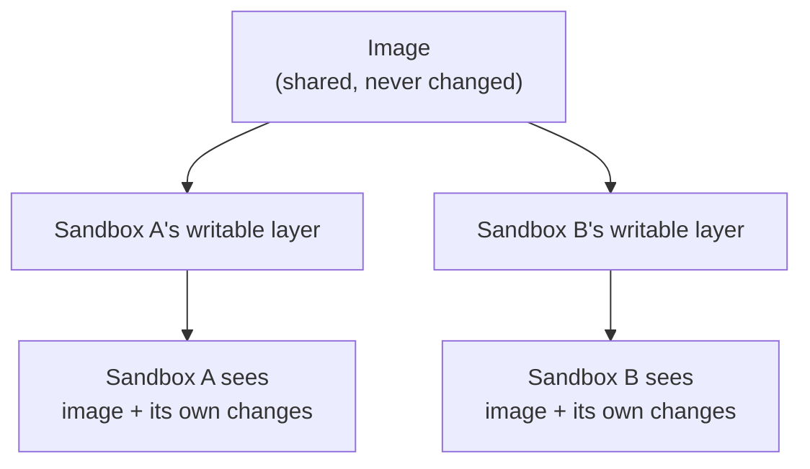
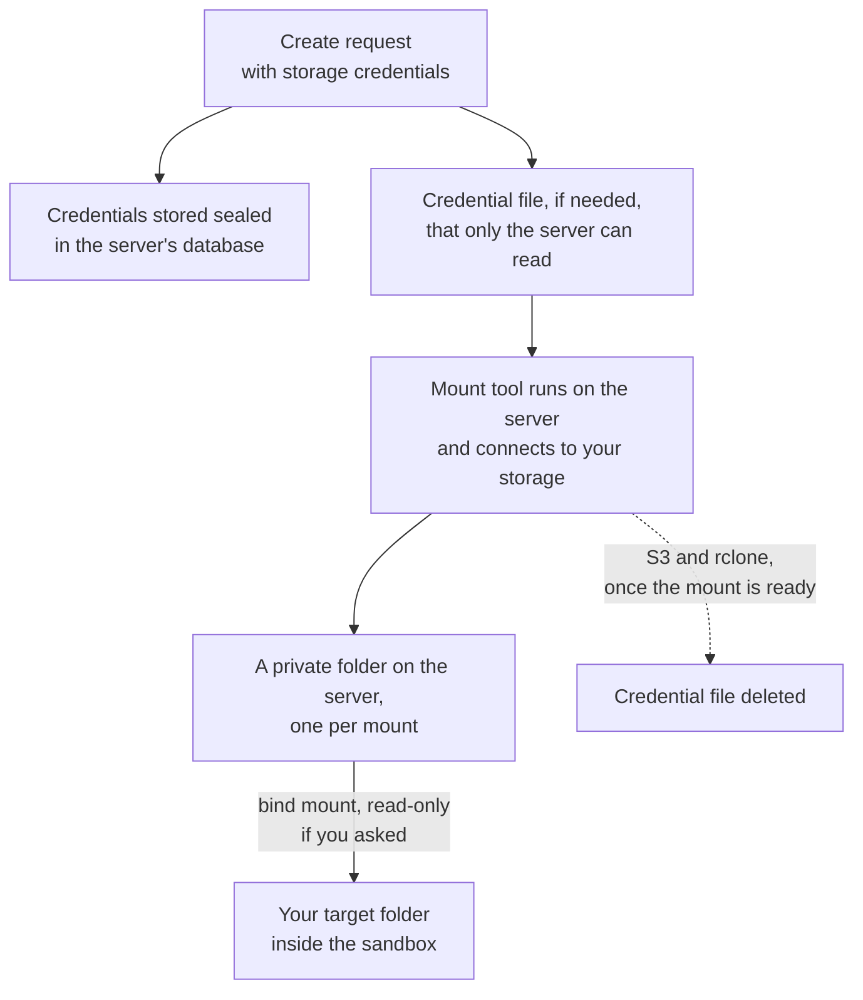
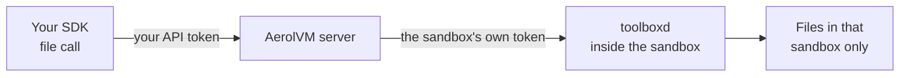
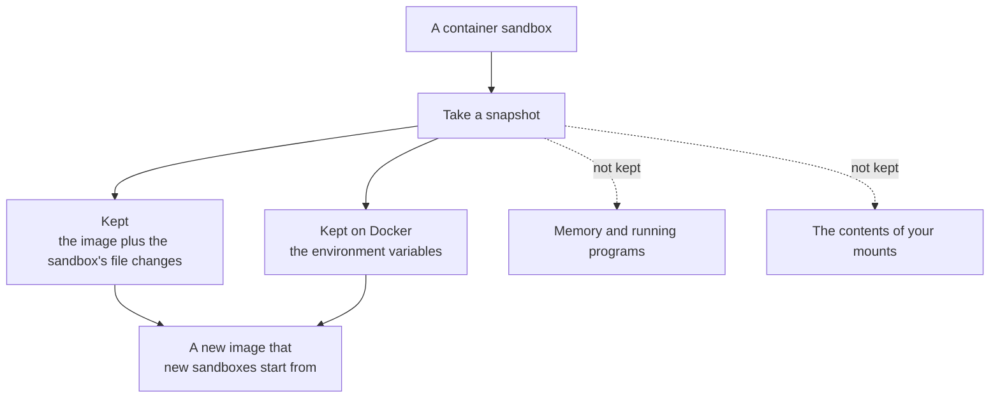

import { Aside, Tabs, TabItem } from '@astrojs/starlight/components';

*By [Suman Saurabh](https://www.linkedin.com/in/ssumansaurabh/), maintainer of AerolVM.*

A sandbox starts from an image and writes to its own disk. This post covers what it can see, what the server adds, how storage you mount reaches it, what a snapshot keeps, and what AerolVM checks, and does not check, about images.

## Private by default

A sandbox sees its image, the folders you mount, and a few files the server adds. It does not see other sandboxes' files.

| Runtime | Its root file system |
|---|---|
| Containers and gVisor | The image, plus a writable layer that belongs to this sandbox only |
| Firecracker | Its own disk file, built from the image |
| WebAssembly | Only its own `/work` folder, plus the folders you mount |
| V8 isolate | None. It has no file system. |

What the server adds to a container sandbox:

| Path | What it is | Can the sandbox change it? |
|---|---|---|
| `/usr/local/bin/toolboxd` | The helper that runs commands and moves files | No, it is read-only |
| `/run/aerol/ready.sock` | A socket the sandbox uses to say it has started | Yes. It belongs to this sandbox only. |
| `/etc/aerolvm/egress-ca.pem` | The server's certificate, only for sandboxes with HTTPS inspect rules | No, it is read-only |
| Your mounts | The folders you asked for | Only if you did not mount them read-only |

## An isolated writable root



Writes go to the sandbox's own layer. They never change the image, and they never reach another sandbox. Deleting the sandbox deletes its layer.

## Mounts and volumes

You can attach outside storage: an S3 bucket, an NFS share, an SSH server or an rclone remote. See [Attach cloud storage](/external-storage/) and [Platform volumes](/platform-volumes/).

On a container sandbox, your storage takes this path.



A bind mount makes one folder appear at a second place. The sandbox gets the folder, not the tool or the credentials.

- **The mount runs on the server.** The mount tool connects with your credentials, outside every sandbox. The sandbox sees a plain folder.
- **Credentials stay out of the sandbox.** They are stored encrypted and written to a file only the server can read. That file is deleted when the sandbox is deleted, and sooner for some storage types.
- **Read-only is enforced twice:** by the mount tool on the server, and again where the folder enters the sandbox.
- **Some folders cannot be mount targets:** `/`, `/proc`, `/sys`, `/dev`, `/etc`, `/usr`, `/bin`, `/sbin`, `/lib`, `/lib32`, `/lib64`, `/boot`, `/run`, `/var/run` and the helper's path. Only these exact paths are blocked, so a folder under one of them, such as `/etc/ssl`, is allowed.
- **Up to 8 mounts per sandbox,** counting platform volumes.
- **Firecracker and V8 isolate sandboxes refuse mounts.** Platform volumes also need Docker or gVisor.

<Aside type="caution" title="Mounts run on the server">
The mount tools run on the server with your settings. Anyone who can create sandboxes can ask the server to mount storage. Give API tokens only to people you would trust with the server.
</Aside>

This sandbox gets a bucket it can read but not change, and an image pinned to one exact version:

<Tabs syncKey="lang">
  <TabItem label="TypeScript">
    ```ts
    const sandbox = await client.create({
      image: "python:3.12@sha256:...", // pinned: the same image every time
      mounts: [
        {
          type: "s3",
          source: "s3://my-bucket/datasets",
          target: "/data",
          readOnly: true,
          credentials: {
            access_key_id: "AKIA...",
            secret_access_key: "your-secret-key",
          },
        },
      ],
    });
    ```
  </TabItem>
  <TabItem label="Python">
    ```python
    sandbox = client.create(
        image="python:3.12@sha256:...",  # pinned: the same image every time
        mounts=[
            {
                "type": "s3",
                "source": "s3://my-bucket/datasets",
                "target": "/data",
                "readOnly": True,
                "credentials": {
                    "access_key_id": "AKIA...",
                    "secret_access_key": "your-secret-key",
                },
            },
        ],
    )
    ```
  </TabItem>
  <TabItem label="Go">
    ```go
    sandbox, err := client.Create(ctx, sdktypes.CreateSandboxOptions{
        Image: "python:3.12@sha256:...", // pinned: the same image every time
        Mounts: []sdktypes.MountSpec{
            {
                Type:     sdktypes.MountTypeS3,
                Source:   "s3://my-bucket/datasets",
                Target:   "/data",
                ReadOnly: true,
                Credentials: map[string]string{
                    "access_key_id":     "AKIA...",
                    "secret_access_key": "your-secret-key",
                },
            },
        },
    })
    if err != nil {
        log.Fatal(err)
    }
    ```
  </TabItem>
  <TabItem label="Rust">
    ```rust
    use aerolvm_sdk::{MountSpec, MountType};
    use std::collections::HashMap;

    let sandbox = client.create(CreateOptions {
        image: "python:3.12@sha256:...".into(), // pinned: the same image every time
        mounts: Some(vec![MountSpec {
            mount_type: MountType::S3,
            source: "s3://my-bucket/datasets".into(),
            target: "/data".into(),
            options: None,
            credentials: Some(HashMap::from([
                ("access_key_id".to_string(), "AKIA...".to_string()),
                ("secret_access_key".to_string(), "your-secret-key".to_string()),
            ])),
            read_only: Some(true),
        }]),
        ..Default::default()
    })?;
    ```
  </TabItem>
  <TabItem label="Java">
    ```java
    Sandbox sandbox = client.create(new CreateOptions()
        .setImage("python:3.12@sha256:...") // pinned: the same image every time
        .setMounts(List.of(new MountSpec()
            .setType("s3")
            .setSource("s3://my-bucket/datasets")
            .setTarget("/data")
            .setReadOnly(true)
            .setCredentials(Map.of(
                "access_key_id", "AKIA...",
                "secret_access_key", "your-secret-key")))));
    ```
  </TabItem>
</Tabs>

Replace `...` with the image's real digest. `docker buildx imagetools inspect python:3.12` prints it.

## The file API

The SDK's file calls (upload, download, list and move) go through the helper inside the sandbox.

This is the path a file call takes to a container sandbox.



- **On container sandboxes, every call needs that sandbox's own token,** which only the server holds.
- **Any path inside the sandbox works,** and links are followed. The sandbox's own wall is the fence, so the file API can only reach that sandbox's files.
- **Uploads are up to 256 MB** by default. Downloads have no size limit.
- **Files are written as the sandbox's user,** usually root.

## Snapshots

A snapshot saves a sandbox so new ones can start from it. See [Images and Snapshots](/images-and-snapshots/).

This is what a container snapshot keeps, and what it leaves behind.



- **A container snapshot saves files, and on Docker also environment variables.** It does not save memory. Since it can keep the variables, do not snapshot a sandbox whose secrets you would not give every user of the snapshot.
- **Stopping a Firecracker sandbox writes its memory to disk** on the server, so it can resume where it left off.
- **Clones of one Firecracker template are made unique.** Each one gets fresh randomness and the right time before your code runs. [Correct snapshot clones](/engineering-snapshot-correctness/) explains how, and lists the gaps that remain.
- **Named snapshots outlive the sandbox.** Deleting a sandbox does not delete them. Delete them yourself.

## Image supply chain

- **The server uses a local copy first.** If an image is already on the server, it is not pulled again.
- **Registry passwords are stored encrypted** with the sandbox. They are sent to the registry only for the pull.
- **AerolVM does not check signatures or attestations.** It uses the engine's normal content checks, which match an image to its digest. The registry you pull from is part of what you trust.
- **Pin by digest** (`image@sha256:...`) to get exactly the image you reviewed, every time. A tag like `python:3.12` can point to a different image tomorrow.
- **WebAssembly modules are checked against a pinned digest.**

## What deleting a sandbox removes

| Removed | Kept |
|---|---|
| Its writable layer or Firecracker disk | Named snapshots |
| Its WebAssembly work folder and checkpoints | Platform volumes and the data in your own storage |
| Its mounts, which are disconnected | The image, until the server cleans it up |
| Its credential files on the server | |

## Where this boundary ends

- **Image contents are yours to trust.** AerolVM runs what the image contains.
- **A sandbox's own files are open to its own code.** Anything you upload into a sandbox, code in that sandbox can read.
- **Snapshots copy secrets.** Treat a snapshot like the sandbox it came from.

## Next steps

- [Network defenses](/engineering-network-defenses/): what a sandbox can reach.
- [Secret handling](/engineering-secret-handling/): how variables and keys are protected.
- [Attach cloud storage](/external-storage/): mount your own bucket.
