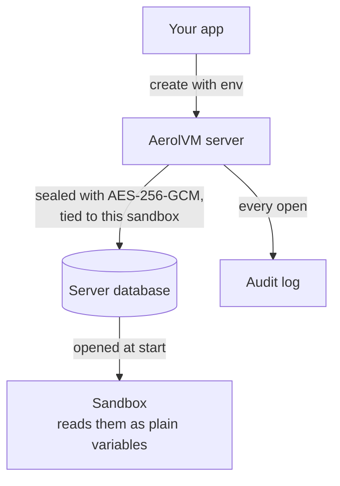
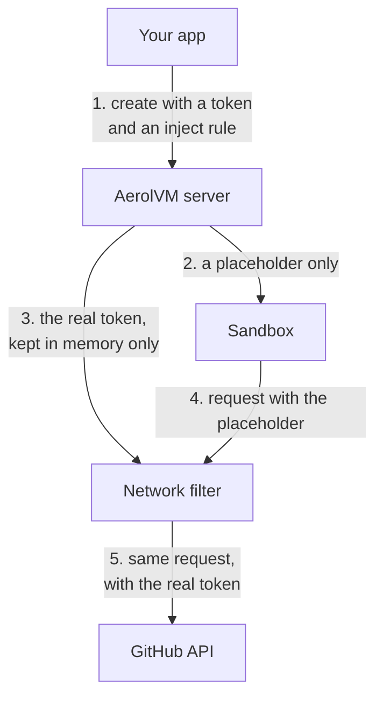
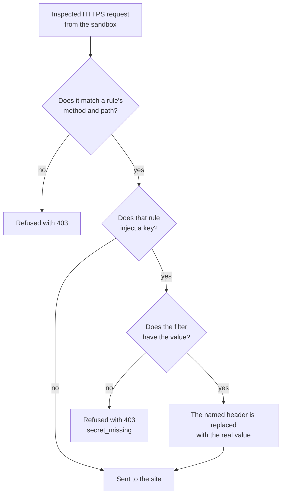
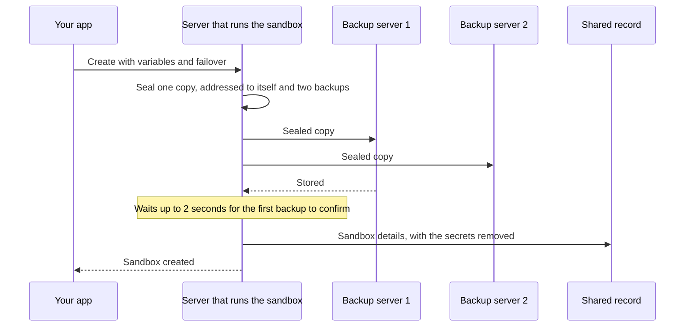
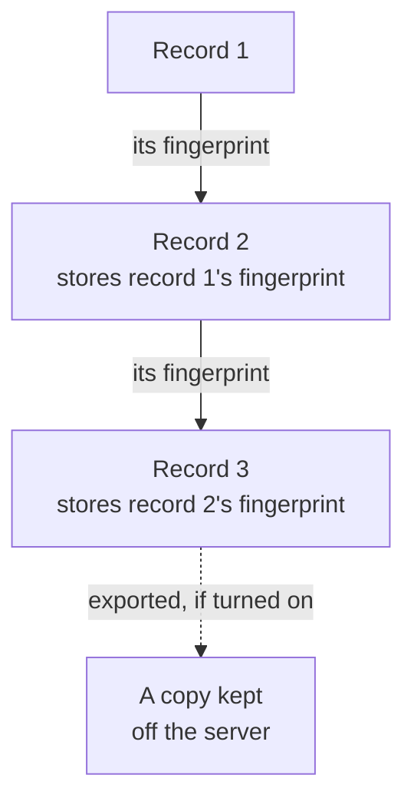

import { Tabs, TabItem } from '@astrojs/starlight/components';

*By [Suman Saurabh](https://www.linkedin.com/in/ssumansaurabh/), maintainer of AerolVM.*

A sandbox often needs a secret, such as an API key or a database password. AerolVM gives you two ways to hand one over, and they protect different things. This post explains both, where the values live, and what is recorded.

## Two ways to give a sandbox a secret

| | Environment variable | Inject rule |
|---|---|---|
| What the sandbox sees | The real value | A placeholder: `aerolvm-placeholder:<KEY>` |
| Can a hijacked agent send it somewhere else? | Yes, it can read the value | No, it never has the value |
| Where the real value is used | Anywhere the code uses it | Only in one header, on requests to the site you name |
| Works on | Every runtime that takes variables | Docker, containerd, gVisor and V8 isolates |

Use an inject rule for keys to outside APIs. Use a plain variable when the code itself needs the value.

## Environment variables



- **Sealed at rest.** The server encrypts the variables with AES-256-GCM. The encryption is tied to the sandbox's ID and to this one life of it, so a copy of the data cannot be opened for any other sandbox.
- **Hidden from normal answers.** Get and list leave the variables out unless you ask for them, and asking is recorded.
- **Fails closed.** If the key is missing or the data is damaged, the read fails. It never falls back to plain text, and missing data is an error, not "no variables".
- **Plain inside the sandbox.** Programs read them like any other environment variable. Any code in the sandbox can read every one.
- **Handed to the container engine.** On Docker and containerd, the values are written into the container's settings on the server. Someone with admin access to that server can read them there.
- **V8 isolates never see them.** The isolate's code gets no variables at all. They are only used by inject rules.

See [Environment variables](/sandbox-env/) for how to set and read them.

## Keep a key out of the sandbox



An inject rule tells the server's network filter to put the real value on matching requests. This sandbox can call the GitHub API with a token it cannot leak:

<Tabs syncKey="lang">
  <TabItem label="TypeScript">
    ```ts
    const sandbox = await client.create({
      image: 'python:3.12',
      env: { GITHUB_TOKEN: 'Bearer ghp_...' },
      networkAllowOut: ['api.github.com'],
      networkEgressRules: [
        {
          host: 'api.github.com',
          inspect: true,
          paths: ['/repos/**'],
          inject: { header: 'Authorization', secretRef: 'env:GITHUB_TOKEN' },
        },
      ],
    })
    ```
  </TabItem>
  <TabItem label="Python">
    ```python
    sandbox = client.create({
        'image': 'python:3.12',
        'env': {'GITHUB_TOKEN': 'Bearer ghp_...'},
        'networkAllowOut': ['api.github.com'],
        'networkEgressRules': [
            {
                'host': 'api.github.com',
                'inspect': True,
                'paths': ['/repos/**'],
                'inject': {'header': 'Authorization', 'secretRef': 'env:GITHUB_TOKEN'},
            },
        ],
    })
    ```
  </TabItem>
  <TabItem label="Go">
    ```go
    sandbox, err := client.Create(ctx, sdktypes.CreateSandboxOptions{
        Image:           "python:3.12",
        Env:             map[string]string{"GITHUB_TOKEN": "Bearer ghp_..."},
        NetworkAllowOut: []string{"api.github.com"},
        NetworkEgressRules: []sdktypes.EgressRule{{
            Host:    "api.github.com",
            Inspect: true,
            Paths:   []string{"/repos/**"},
            Inject:  &sdktypes.EgressInject{Header: "Authorization", SecretRef: "env:GITHUB_TOKEN"},
        }},
    })
    ```
  </TabItem>
  <TabItem label="Rust">
    ```rust
    use std::collections::HashMap;

    let sandbox = client.create(CreateOptions {
        image: "python:3.12".to_string(),
        env: Some(HashMap::from([("GITHUB_TOKEN".to_string(), "Bearer ghp_...".to_string())])),
        network_allow_out: Some(vec!["api.github.com".to_string()]),
        network_egress_rules: Some(vec![EgressRule {
            host: "api.github.com".to_string(),
            inspect: true,
            paths: vec!["/repos/**".to_string()],
            inject: Some(EgressInject {
                header: "Authorization".to_string(),
                secret_ref: "env:GITHUB_TOKEN".to_string(),
            }),
            ..Default::default()
        }]),
        ..Default::default()
    })?;
    ```
  </TabItem>
  <TabItem label="Java">
    ```java
    Sandbox sandbox = client.create(
        new CreateOptions()
            .setImage("python:3.12")
            .setEnv(Map.of("GITHUB_TOKEN", "Bearer ghp_..."))
            .setNetworkAllowOut(List.of("api.github.com"))
            .setNetworkEgressRules(List.of(new EgressRule()
                .setHost("api.github.com")
                .setInspect(true)
                .setPaths(List.of("/repos/**"))
                .setInject(new EgressInject()
                    .setHeader("Authorization")
                    .setSecretRef("env:GITHUB_TOKEN"))))
    );
    ```
  </TabItem>
</Tabs>

On a site that has rules, the filter checks each inspected request like this.



What gates the key:

- **One header only.** The filter replaces the header the rule names. It never writes the value into a body, a URL or any other header.
- **Only matching requests.** The header is set only on requests that match the rule's site, method and path. A request anywhere else carries at most the placeholder.
- **Only inspected HTTPS.** The rule needs `inspect: true`, so the filter can read the request. A rule on plain HTTP is refused.
- **Never sent without the key.** If the filter does not have the value, the request is refused with `403` (`secret_missing`).

What it does not protect:

- **The value is still stored on the server,** sealed like any variable. A caller who asks for the variables gets the real value, and that read is recorded.
- **The site you name gets the key.** The rule controls where the key goes, not what that site does with it.
- **WebAssembly and Firecracker sandboxes do not support inject rules yet.**

See [Keep an API key out of the sandbox](/advanced-network-rules/#keep-an-api-key-out-of-the-sandbox) for every option.

## Where the values live

| Place | What is there | How it is protected |
|---|---|---|
| The server's database | Variables, registry passwords and storage credentials | Encrypted with the server's key |
| The server's key | One 32-byte key | From `SB_CREDENTIAL_ENCRYPTION_KEY`, or a file the server creates on first start, readable only by the server |
| The container engine | The variables of running containers | Admin access to the server |
| The network filter | Values for inject rules | Memory only, never written to its disk |
| Other cluster servers | Sealed copies, only for sandboxes with failover | See [In a cluster](#in-a-cluster) |

Back the key up with the database. Without it, the data cannot be opened.

## Storage credentials

- **Sealed with the mount.** Read APIs show which mount it is, never the credentials.
- **Refused in the wrong place.** A create that puts a secret-like name in a mount's options or source is refused, and the error names the field to use.
- **Kept outside the sandbox.** The mount runs on the server. Its credential file can only be read by the server. For S3 and rclone it is deleted once the mount is ready. For an SSH server it stays until the sandbox is deleted.

## Tokens and SSH keys

- **The operator token** lives in the server's settings file, which only the server can read. The server compares tokens in constant time.
- **SSH keys are made per sandbox.** The server keeps only the public key. The private key is returned to you once and never stored.

## In a cluster

This is what happens when you create a sandbox with failover in a cluster.



- If no backup confirms in time, the create fails and the sealed copy is withdrawn.

- **Variables never enter the shared record.** Variables, registry passwords and storage credentials are removed before a sandbox's details are shared with every server.
- **Sealed copies go only where needed.** By default, the values stay on the server that runs the sandbox. A sandbox with failover also sends a sealed copy to two backup servers, and the create waits up to 2 seconds for one of them to confirm.
- **With the default key, the copy is addressed, not locked.** Every server shares one key, so the server checks the address in software.
- **With AWS KMS, AWS decides.** Each sealed copy gets its own data key, wrapped by AWS KMS. AWS permissions decide which servers can open it, and AWS logs every use. KMS covers these sealed copies; the variables in each server's own database still use that server's key. See [Secrets providers](/cluster-secrets/).

## The audit trail

Every time a server opens a sandbox's secrets, it writes a `secret_open` record: when the sandbox starts, when it is restored or rebuilt, and when someone asks for the variables. Read the records like this:

<Tabs syncKey="lang">
  <TabItem label="TypeScript">
    ```ts
    const page = await sandbox.audit({ kind: "secret_open" });
    for (const event of page.events) {
      console.log(event.time, event.actor, event.ref, event.result);
    }
    ```
  </TabItem>
  <TabItem label="Python">
    ```python
    page = sandbox.audit({"kind": "secret_open"})
    for event in page["events"]:
        print(event["time"], event.get("actor"), event.get("ref"), event["result"])
    ```
  </TabItem>
  <TabItem label="Go">
    ```go
    page, err := sandbox.Audit(ctx, sdktypes.AuditOptions{Kind: "secret_open"})
    if err != nil {
        log.Fatal(err)
    }
    for _, event := range page.Events {
        fmt.Println(event.Time, event.Actor, event.Ref, event.Result)
    }
    ```
  </TabItem>
  <TabItem label="Rust">
    ```rust
    let page = sandbox.audit(AuditOptions {
        kind: Some("secret_open".to_string()),
        ..Default::default()
    })?;
    for event in &page.events {
        println!("{} {:?} {:?} {}", event.time, event.actor, event.r#ref, event.result);
    }
    ```
  </TabItem>
  <TabItem label="Java">
    ```java
    AuditPage page = sandbox.audit(new AuditOptions().setKind("secret_open"));
    for (AuditEvent event : page.events) {
        System.out.println(event.time + " " + event.actor + " " + event.ref + " " + event.result);
    }
    ```
  </TabItem>
</Tabs>

Each record is linked to the one before it, like this.



- **Chained.** Each record includes a fingerprint (hash) of the one before it, so a changed or deleted record breaks the chain. The operator can ask the server to check the whole chain. Someone with root on the server could rebuild the whole chain, so keep a copy off the server.
- **Kept for 30 days** by default, on the server's disk.
- **Sent elsewhere if you want.** The operator can export records to a file, standard output, a webhook (with an HMAC signature) or S3.
- **Network refusals** are recorded too, under the kind `egress`.
- **Records do not name the caller.** In a cluster, a record names the server that opened the secret. No record says which API caller asked.

## What this does not protect

- **Code in the sandbox reads its own variables.** Only pass secrets that code is allowed to see, or use an inject rule.
- **The server is trusted.** Someone with admin access to it can read variables in the container engine and inject values in the filter's memory.
- **Snapshots can copy variables.** A Docker snapshot saves the variables with the files.
- **Logs are not scrubbed.** Commands are logged as you send them, so do not put secrets on a command line. Pass them as variables.

## Next steps

- [Environment variables](/sandbox-env/): set, read and audit variables.
- [Advanced network rules](/advanced-network-rules/): inject rules and inspection.
- [Hardening](/enterprise/hardening/): tighten every setting.
