import { Tabs, TabItem } from '@astrojs/starlight/components';

*By [Suman Saurabh](https://www.linkedin.com/in/ssumansaurabh/), maintainer of AerolVM.*

Most security pages talk about the sandbox, the box that holds code you do not trust. That box matters, and [Security controls](/enterprise/security-controls/) covers it. But the sandbox is only one part. It runs on a server. The server has doors, keeps secrets, talks to other servers, writes a logbook and reports to your monitoring. Each of those is a place where something could go wrong.

This post walks through all of them. It helps to picture an AerolVM server as a building:

- **Doors** are the network ports. Each door has a guard.
- **Rooms** are the sandboxes. Each one has walls and a window to the outside.
- **The safe** holds secrets, sealed in envelopes.
- **Sister buildings** are the other servers in a cluster. They talk over private lines and wear ID badges.
- **The logbook** records who opened the safe, with numbered pages chained together.
- **Cameras and alarms** are the metrics, traces and alerts.
- **The delivery seal** proves the software you installed is the software we built.

Every claim here was checked against the code. Where a protection stops, the post says so.

## In short

- One API token guards the API. It is checked in constant time, so its timing reveals nothing.
- A new sandbox is private. Nobody can reach it until you share a port.
- Secrets are encrypted with AES-256-GCM before they touch the disk. Environment variables are also bound to their own sandbox, so a copy cannot be opened for another one.
- Servers in a cluster prove who they are with certificates signed by the cluster's own authority.
- Every time a secret is opened, a record goes into a hash-chained logbook. The server checks the whole chain each time it starts.
- Metrics need the API token. Traces and request logs leave out request bodies and headers, so the commands and secrets you send stay out of them.
- Each release ships with checksums, a bill of materials and a signed build record.

## The big picture

Here is everything that touches an AerolVM server:

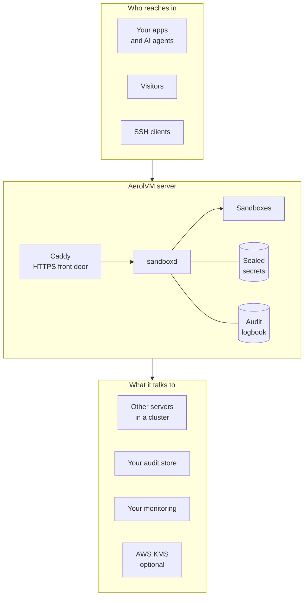

Your apps send API calls. Visitors open the links you chose to share. Inside, `sandboxd` (the AerolVM server program) runs the sandboxes, keeps the secrets sealed and writes the logbook. Outside, it can send audit copies to your own store, metrics to your monitoring, and work with AWS KMS for keys.

## Who trusts whom

Security starts with a simple question: who is trusted with what?

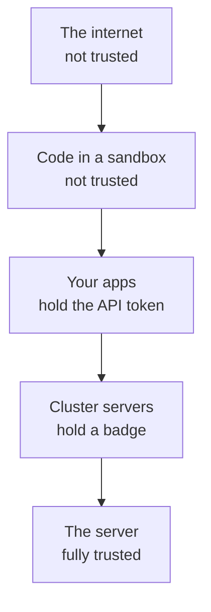

Each step down is trusted with more.

| Who | What they hold | What they can do |
|---|---|---|
| The internet | Nothing | Open the links and ports you shared. Nothing else. |
| Code in a sandbox | Its own files and processes | Whatever you allowed that one sandbox to do |
| Your apps | The API token | Create sandboxes, run commands, read files |
| Other cluster servers | A signed certificate and the gossip key | Join the cluster and pass work along |
| The server and its operators | Everything | Everything. AerolVM protects the server from sandboxes, not sandboxes from their own server. |

That last row matters. Whoever controls the server, or holds its API token, is on the trusted side. Protect both like the keys to the building.

## The doors into a server

A port is a numbered door that network traffic can come through. Here are AerolVM's doors and the guard on each one.

| Door | Port | Who uses it | The guard |
|---|---|---|---|
| HTTPS | `443` | Your apps and visitors | TLS, then the API token for API calls |
| The API | `21212` | Caddy, and your apps on a private network | The API token, compared in constant time |
| Sandbox ports | `22000` to `23000` | Database clients and other TCP tools | Open only for ports you shared |
| SSH | `2220` | People and tools using SSH | That sandbox's own key, and no other |
| Cluster | `7000`, `7001`, `7002` | Other servers in your cluster | A cluster certificate, or the gossip key |
| Helpers | Local only | Processes on the same server | They listen on `127.0.0.1`, so nothing outside can reach them |

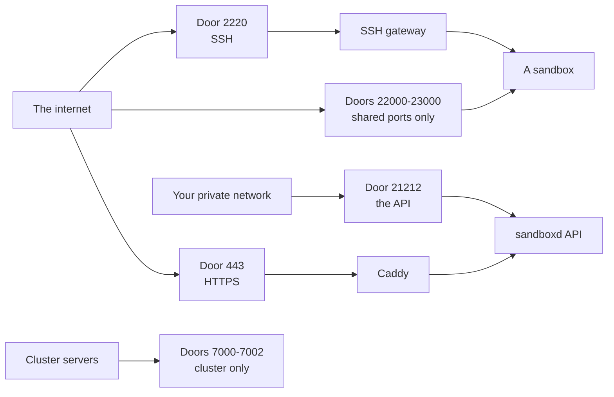

### The front door: the API

The API is how your apps control AerolVM. It answers on port `21212`. The server will not start without an API token (`SB_PAT_TOKEN`), and the installer makes a random one that is 192 bits long. That is far too many possibilities to guess.

Every API call must carry the token. The server compares it in constant time. A normal comparison stops at the first wrong letter, so an attacker could time the answers and guess the token one letter at a time. A constant-time comparison always takes the same time, so the timing gives nothing away.

The API itself speaks plain HTTP. In domain mode, Caddy (the web server in front of AerolVM) adds HTTPS, so the token travels encrypted. Keep port `21212` private, so HTTPS is the only way in. The [Hardening](/enterprise/hardening/) checklist shows how.

A few calls are for the operator only, such as checking the audit chain and changing the cluster. Two pages are open on purpose: a health check for load balancers, and the dashboard's web page. The dashboard page holds no data itself. You type the token into it, and every data call it makes still needs the token.

### The journey of an API call

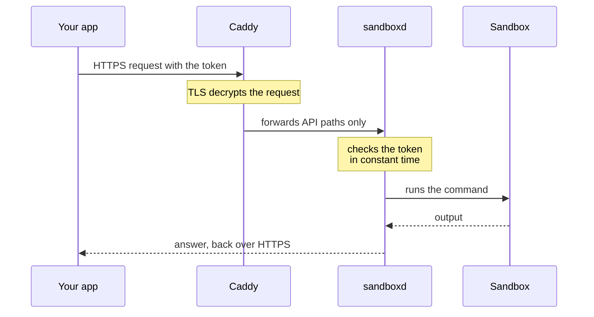

1. Your app sends the request over HTTPS. Anyone watching the network sees only scrambled bytes.
2. Caddy decrypts it and forwards only the API paths to `sandboxd`.
3. `sandboxd` checks the token. A wrong token gets `401 Unauthorized` and goes no further.
4. The command runs inside the one sandbox the call named.

### Public links and shared ports

Sometimes you want visitors to reach a sandbox, for example to see a web app it runs. That is a public link. Visitors do not have your API token, so these doors work differently.

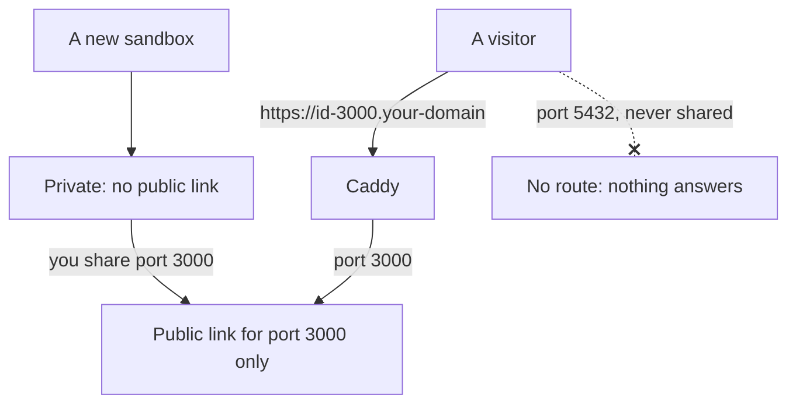

- **A sandbox starts private.** Through the AerolVM API, a new sandbox has no public link. The Daytona API makes sandboxes public by default, and the E2B API always does.
- **Only shared ports open.** Visitors reach only the ports you shared. Every other port has no route.
- **Shared links have no login.** Anyone with the link can open it, so protect the app itself if it needs a login.
- **TLS ports keep the key out of the sandbox.** For a TLS port, Caddy holds the certificate and passes plain bytes to the sandbox. The sandbox never sees the private key.
- **Certificates come from a trusted authority.** In domain mode, Caddy gets HTTPS certificates through a DNS check with your domain provider. IP mode has no HTTPS, so use it only for testing.

### The SSH door

When a sandbox is created, it gets its own key pair. A key pair is two matching keys: the private one opens the lock, and the public one is the lock. The server keeps only the public key. The private key is handed to you once, in the create answer, and never stored.

- **One key, one sandbox.** The SSH door accepts only that sandbox's key, and only while the sandbox is running. There is no master key.
- **Three tries.** After three failed attempts, the connection closes. Every failure gets the same message, so it reveals nothing.
- **No tunnels.** SSH here gives you a shell or a command. Port forwarding is refused, so SSH cannot be used to reach other machines.

### Doors that only open from inside

`sandboxd` runs a few helper services: one wakes a sleeping sandbox when traffic arrives, one approves certificates for custom domains, and one collects audit records from WebAssembly workers. They listen on `127.0.0.1`, which is the server talking to itself, so nothing outside the server can reach them. The audit helper also checks a signed pass that each worker gets for its own sandbox.

### Limits at the door

- **Request size.** A normal API request body can be at most 1 MiB. File uploads use their own streaming path.
- **Busy signals.** When the server is full, a create gets `429` or `503` with a time to try again, instead of piling up.
- **Audit reads.** Reading audit history is rate-limited for each caller, so one caller cannot overload it.
- **The MCP endpoint.** The endpoint AI agents use is off unless the operator turns it on. When on, it checks where the request came from and limits each token to 20 requests a second.

## Inside the rooms: sandboxes

Each sandbox is a room with walls and one window. The walls come from the runtime: containers, gVisor, Firecracker microVMs, WebAssembly or V8 isolates. The window is the network, and a policy decides what it opens onto.

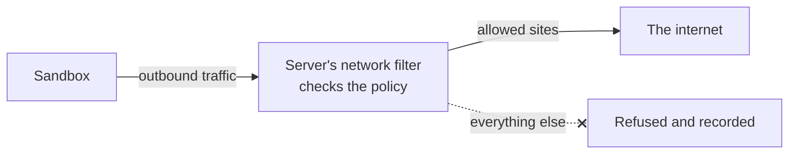

This post does not repeat the details. [Security controls](/enterprise/security-controls/) lists every control for a sandbox, and [How AerolVM isolates sandboxes](/engineering-isolation/) explains each wall.

## The safe: secrets and environments

Sandboxes often need secrets, such as API keys, database passwords and storage keys. AerolVM treats each one like a letter in a sealed envelope.

### Sealing and opening

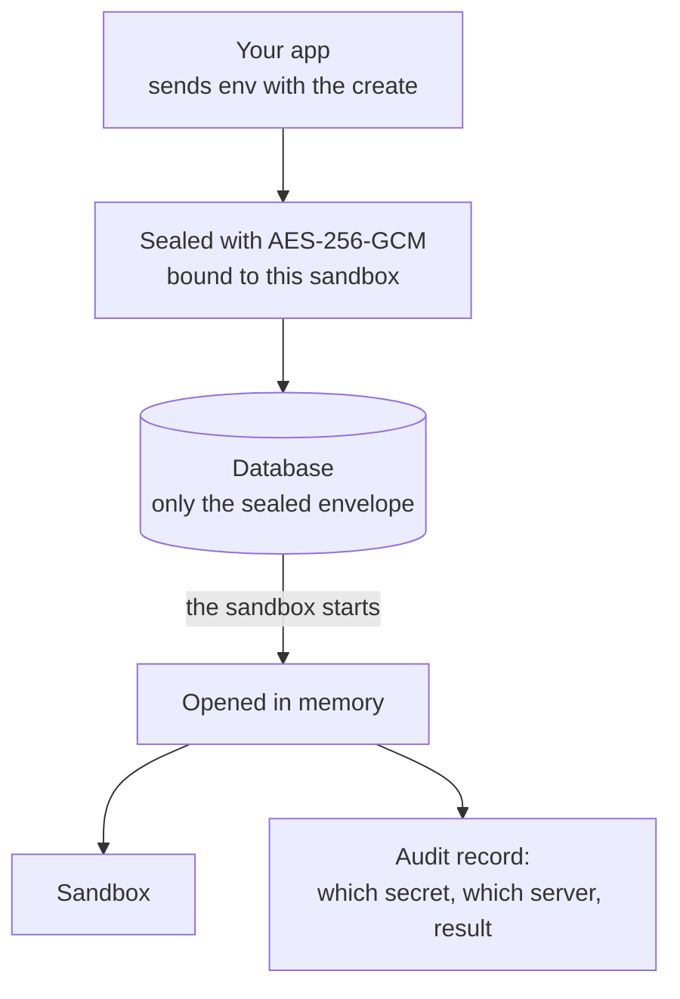

- **AES-256-GCM** is the lock. It is a widely trusted type of encryption. It also notices if anyone changes the sealed bytes, and then it refuses to open them.
- **Bound to one sandbox.** Environment variables are sealed together with the sandbox's ID and its current life. An envelope copied to another sandbox will not open.
- **Never stored in plain text.** Variables sit in their own table, and only the sealed form is ever written.
- **Fails closed.** If the key is wrong or the data is damaged, opening fails with an error. It never falls back to plain text, and it never pretends the sandbox had no variables.
- **Hidden in answers.** Get and list leave the variables out unless you ask for them, and asking is recorded.

### The key to the safe

The key is 32 random bytes. It comes from `SB_CREDENTIAL_ENCRYPTION_KEY`, or from a file the server makes on first start. When the server makes that file, only the server's own user can read it. The database folder and files are locked the same way.

A copied database alone does not reveal secrets, because the key lives outside it. Back up the key whenever you back up the database, and store the two copies apart. It opens everything.

### What else is sealed

| Secret | Sealed? | Notes |
|---|---|---|
| Environment variables | Yes | Bound to their sandbox |
| Registry passwords | Yes | Used to pull private images |
| Storage credentials | Yes | Stored with the mount, shown only as names |
| Each sandbox's toolbox token | Yes | The key `sandboxd` uses to talk to the agent inside the sandbox |
| The network filter's signing key | Yes | Used when you inspect HTTPS traffic |
| SSH private keys | Never stored | Handed to you once |

### Keys that never enter the room

For API keys to outside services, an inject rule is better than a plain variable. The sandbox only holds a placeholder. The real key is added on the way out, only to requests for the site you named.

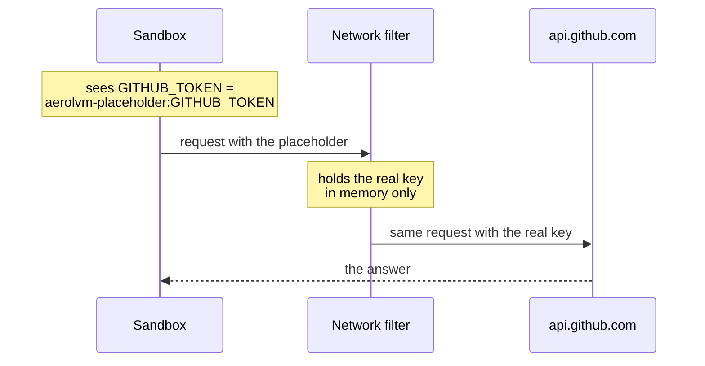

- The filter replaces only the one header the rule names.
- If the filter does not have the real key, it refuses the request rather than send the placeholder on.
- The server still keeps the real key sealed in its database, so it can hand it to the filter again after a restart.

### Storage passwords

Storage such as an S3 bucket is mounted by the server, not by the sandbox, so the sandbox never sees the password. The server writes the credentials to a file only it can read, in a folder only it can open. For S3 and rclone, it deletes that file as soon as the mount is ready. S3 keys go in a credentials file, never on a command line, where other programs could see them.

### Where the seal stops

- **Inside the sandbox, variables are plain.** Code in the sandbox can read every variable you gave it. That is why inject rules exist.
- **The container engine sees them.** On Docker and containerd, plain variables are handed to the engine on the server, and a container snapshot saves them.
- **The server is trusted.** Someone with full control of the server can read what the server can read.

## Sister buildings: the cluster

A cluster is a group of AerolVM servers that work as one. They have to trust each other, but not anyone who just shows up.

### Getting a badge

Each server proves who it is with a certificate. A certificate is like an ID badge, signed by an authority everyone trusts. In a cluster, that authority is the cluster's own, made when the first server is set up.

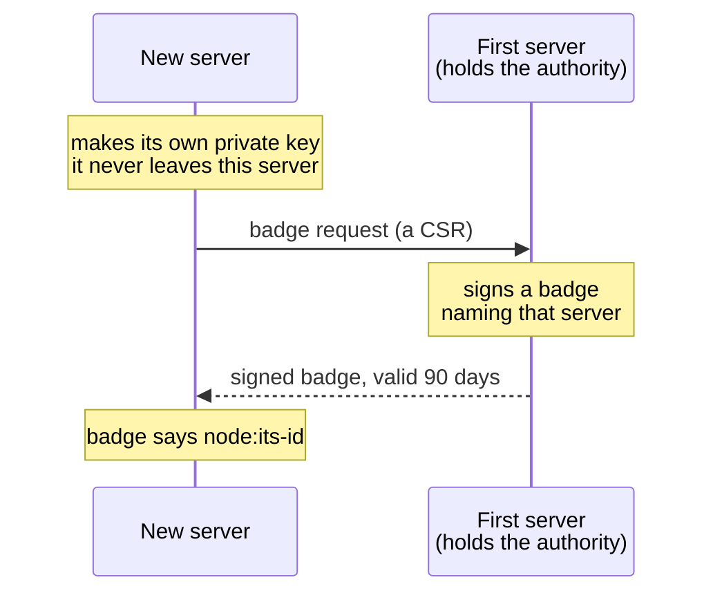

- **The new server's private key never leaves it.** It sends only a request for a badge, called a CSR.
- **The authority's key is not sent to joining servers.** They receive only the authority's public certificate.
- **Badges name their server** (`node:<id>`), and the name must match the server's own ID setting.
- **Badges last 90 days.** A renewed badge is loaded without a restart, and bundled alerts warn before one expires.

### Three private lines

Servers talk over three channels. Each one is protected.

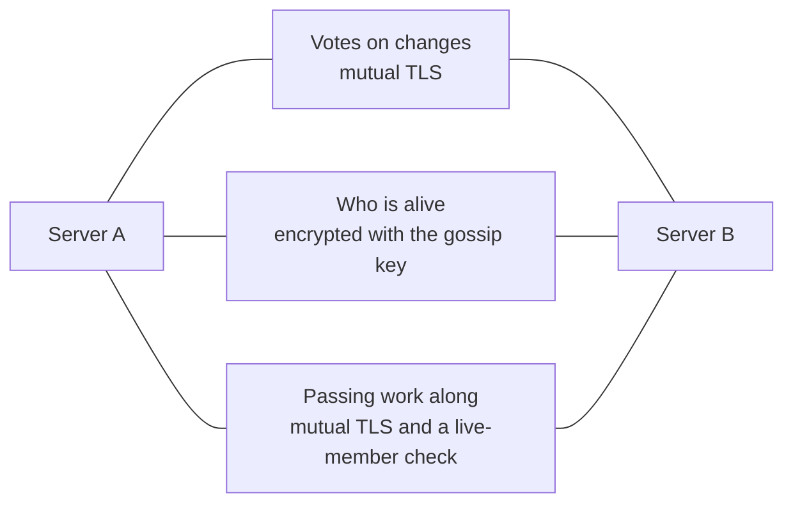

- **Mutual TLS** means both sides show a badge, not just one. A connection with no valid badge is dropped. The oldest TLS allowed is version 1.2.
- **The gossip key** encrypts the "who is alive" messages. The cluster will not start without one, unless the operator turns that check off on purpose.
- **A live-member check** means a valid badge is not enough to pass work along. The sender must also be a current, live member.
- **Internal calls stay internal.** Server-to-server routes are refused on the public door.

### What servers share, and what they never share

The servers keep a shared record of which server runs which sandbox. They agree on every change by majority vote.

- **Secrets are stripped from the shared record.** Variables, registry passwords and storage credentials are removed before it is written. The record has no field that could hold sealed bytes.
- **Sealed copies go only where needed.** A sandbox with failover sends a sealed copy of its secrets to two backup servers. The create waits up to 2 seconds for at least one backup to confirm. With no confirmation, the create is called off.
- **Each copy gets its own key**, bound to that sandbox, that life of it and its list of servers.
- **With the default key, every server shares one key,** so the list of servers is checked in software, not by the encryption. With AWS KMS, AWS wraps each copy's key and logs every use.

## The logbook: audit

A logbook is only useful if it can be trusted. AerolVM's logbook is built so that a changed page shows.

### What goes in, and what never does

| Recorded | Never recorded |
|---|---|
| Every time a secret is opened: when a sandbox starts, is rebuilt, or someone asks for its variables | The secret itself |
| Outbound connections the network filter refuses | The content of any traffic |
| A marker when records had to be skipped, with how many | Commands and file contents |
| A marker when old records were removed by retention | Error messages in free text. Reasons come from a fixed list. |

Each record has a time, the server that acted, which secret or destination it was, and the result.

### Pages chained together

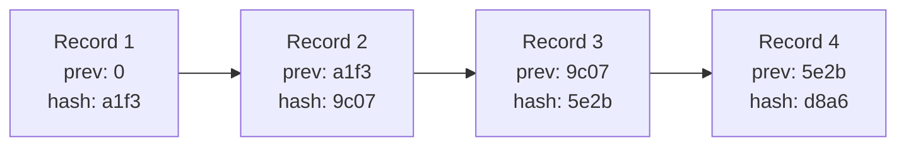

A hash is a fingerprint of some data. Change one letter, and the fingerprint changes completely. Each record stores the fingerprint of the record before it. So if someone edits record 2, its fingerprint no longer matches what record 3 remembers, and the chain breaks.

### Checking the chain

- **At every start.** By default, the server re-reads the whole chain before it opens the logbook. If the chain is broken, the server refuses to start.
- **After a crash.** If the last line was cut off mid-write, the server trims it and adds a marker saying so. Damage anywhere else still stops the start.
- **On demand.** The operator can ask a running server to check the whole chain.
- **With alarms.** Bundled alerts fire when the chain breaks, when a check fails, or when records are skipped.

### Sending a copy out

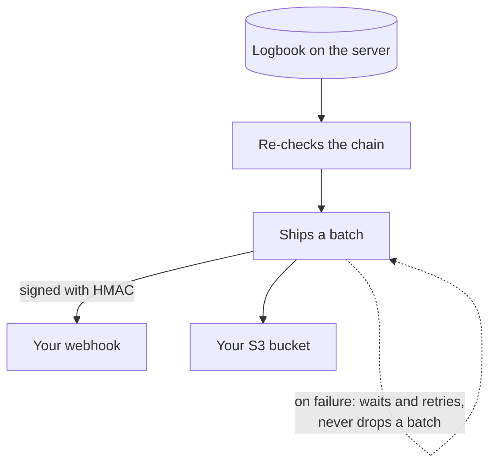

The server can send every record to your own systems: a webhook, an S3 bucket, a file or standard output. Before it ships a batch, it checks the chain again. A webhook batch carries an HMAC signature, a seal made with a shared secret, so your receiver can tell it really came from your server. If your system is down, the server keeps the records and retries. A batch is never dropped, and an alert fires if shipping falls behind.

### What the logbook does not do

- **It does not stop someone with full control of the server.** That person could rebuild the whole chain from scratch. A copy in your own store is what protects against that. An outside witness for the free version is planned.
- **Records name the server, not the API caller.** A [proposal](https://github.com/aerol-ai/microvm/discussions/649) to add the caller is open for discussion.
- **Recording never blocks the work.** If the logbook falls far behind, it skips records and writes a marker with the count, rather than slow your sandboxes down.

### See it for yourself

Every SDK can read one sandbox's records:

<Tabs syncKey="lang">
  <TabItem label="TypeScript">
    ```ts
    const page = await sandbox.audit({ kind: "secret_open" });
    for (const event of page.events) {
      console.log(event.time, event.actor, event.ref, event.result);
    }
    ```
  </TabItem>
  <TabItem label="Python">
    ```python
    page = sandbox.audit({"kind": "secret_open"})
    for event in page["events"]:
        print(event["time"], event.get("actor"), event.get("ref"), event["result"])
    ```
  </TabItem>
  <TabItem label="Go">
    ```go
    page, err := sandbox.Audit(ctx, sdktypes.AuditOptions{Kind: "secret_open"})
    if err != nil {
        log.Fatal(err)
    }
    for _, event := range page.Events {
        fmt.Println(event.Time, event.Actor, event.Ref, event.Result)
    }
    ```
  </TabItem>
  <TabItem label="Rust">
    ```rust
    let page = sandbox.audit(AuditOptions {
        kind: Some("secret_open".to_string()),
        ..Default::default()
    })?;
    for event in &page.events {
        println!("{} {:?} {:?} {}", event.time, event.actor, event.r#ref, event.result);
    }
    ```
  </TabItem>
  <TabItem label="Java">
    ```java
    AuditPage page = sandbox.audit(new AuditOptions().setKind("secret_open"));
    for (AuditEvent event : page.events) {
        System.out.println(event.time + " " + event.actor + " " + event.ref + " " + event.result);
    }
    ```
  </TabItem>
</Tabs>

## Cameras and alarms: monitoring

You cannot protect what you cannot see. AerolVM reports how it is doing, without reporting your data.

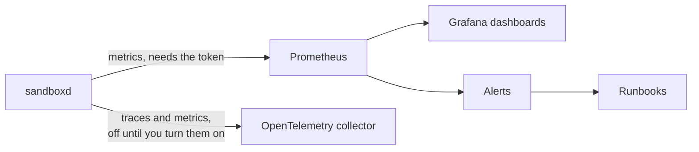

- **Metrics need the API token.** Both the Prometheus page and the raw counters page check it.
- **Traces are off by default.** When you turn them on, they follow each request from your app into AerolVM, so you can see where time went.
- **No secrets in the cameras.** Metrics are counts and timings. Traces and request logs carry the method, the path without its query, the status and the time taken, plus IDs. They never include request bodies or headers, so the commands and variables you send stay out of them.
- **Ready-made alarms.** Alerts cover a broken audit chain, skipped records, audit shipping that falls behind, cluster badges about to expire and a failing KMS check. Each alert links to a step-by-step [runbook](/operational-runbooks/).

## Trusting the software itself

All of this only helps if you are running the real AerolVM. Releases are built so you can check that.

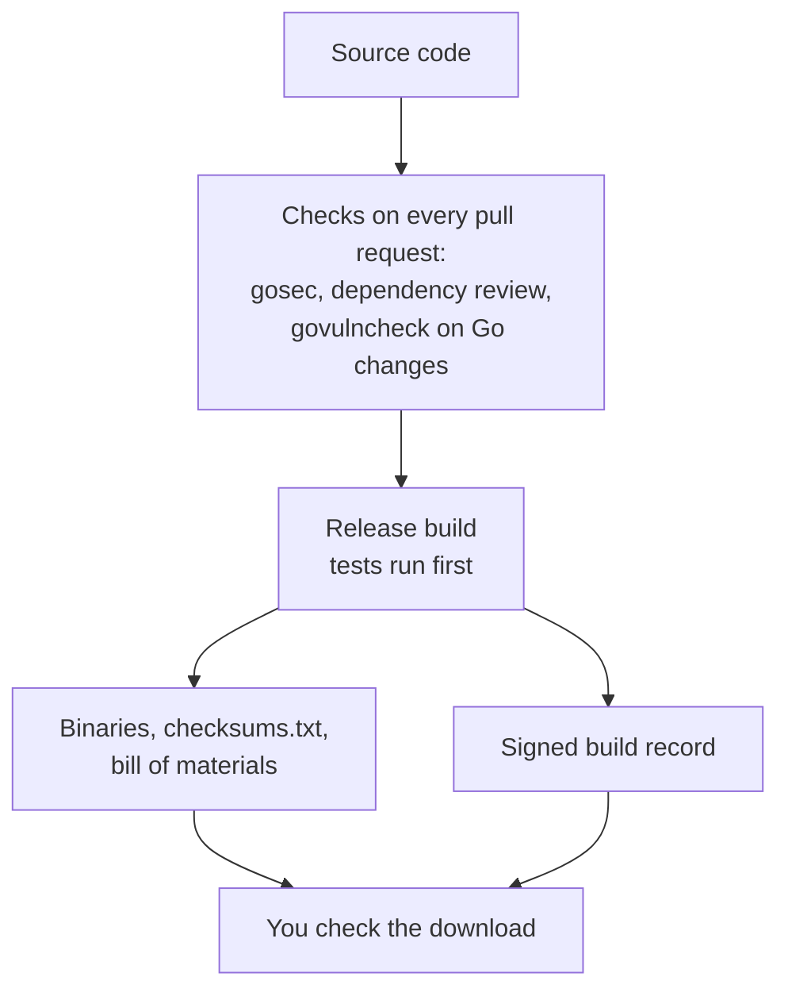

- **Checksums.** `checksums.txt` lists a SHA-256 fingerprint for every file. The installer refuses a download whose fingerprint does not match.
- **A bill of materials.** `sbom.cdx.json` lists every Go module in the release, so you can check them against known problems.
- **A signed build record.** Each release has a SLSA build provenance file made by GitHub's attestation service. It says which code and which workflow built the release.
- **Pinned tools.** Every outside build step is pinned to an exact version, so a changed tool cannot slip in.
- **Scans.** gosec looks for risky Go code. Dependency review blocks new dependencies with known high-severity problems. govulncheck looks for known vulnerabilities the code actually reaches. OpenSSF Scorecard grades the project's practices every week.

[Release verification](https://github.com/aerol-ai/microvm/blob/main/RELEASE-VERIFICATION.md) shows how to check a download yourself.

## Layers: when one guard fails

No single guard is perfect. Security comes from layers, so one failure does not open everything.

| If this happens | What still protects you |
|---|---|
| Code in a sandbox turns hostile | The runtime's walls, the network policy, and inject rules that keep real keys out |
| A visitor tries a port you never shared | Caddy has no route for it, so nothing answers |
| Someone copies the database file | Secrets in it are sealed. Without the key, they cannot be read. |
| A stranger tries to join the cluster | No signed badge and no gossip key, so the cluster refuses it |
| Someone edits the logbook | The chain breaks, and the server refuses to start. If they rebuild the whole chain, your exported copy still has the real records. |
| A download is changed on its way to you | The checksum does not match, so the installer refuses it |
| Something goes wrong at 3 a.m. | Alerts fire, and each one links to a runbook |

## What this does not protect

AerolVM protects your server from sandboxes. It cannot protect against everything:

- **A stolen API token** works anywhere the API can be reached. Keep it in a secret manager and keep the API port private.
- **The server and its operators** are trusted. Whoever controls the server controls AerolVM.
- **The kernel and the hardware** sit below every wall. Pick gVisor or Firecracker for code you do not trust.

[Responsibility and limits](/enterprise/responsibility/) lists every known limit, with what to do about each one.

## Next steps

- [Security controls](/enterprise/security-controls/): every control for a sandbox, with its default.
- [Hardening](/enterprise/hardening/): the checklist to lock it all down.
- [Evidence for your audit](/enterprise/audit-evidence/): what a reviewer can collect.
