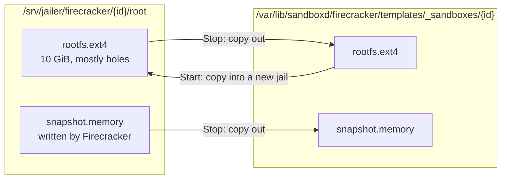
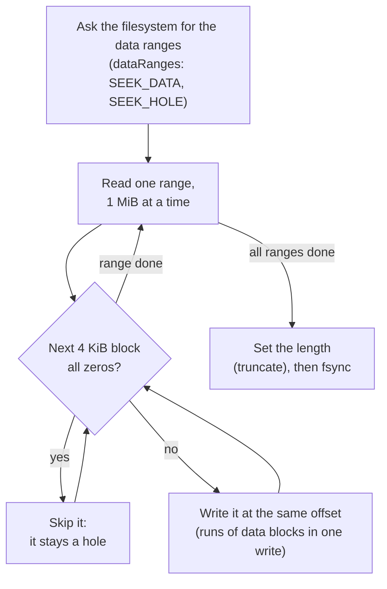

*By [Suman Saurabh](https://www.linkedin.com/in/ssumansaurabh/), maintainer of AerolVM.*

A Firecracker sandbox gets a 10 GiB disk. A new one uses only a few hundred MiB of the server's real disk, because the disk image is a **sparse file**: space the guest never wrote takes no room. Stop saves the whole VM to the server's disk, and Start brings it back. Both steps copy the disk image. This post explains how AerolVM copies it so it stays small, and what goes wrong with an ordinary copy.

**In short:**

- A VM disk image is 10 GiB long, but only the blocks the guest wrote take space on the server. The rest are **holes**: gaps the filesystem stores as nothing.
- Stop copies the disk and the VM's memory out of the VM's locked-down folder. Start copies the disk back in. An ordinary copy reads each hole as zeros and writes the zeros out, so every copy takes the full 10 GiB.
- AerolVM's copy asks the filesystem where the data is, reads only that, and skips every 4 KiB block that is all zeros. The copy holds the same bytes, but its zeros stay holes.
- On one AWS bare-metal server, the saved copy of a sandbox shrank from 11,265 MiB to 597 MiB. A stop went from 108 seconds to 15. A start went from 88 seconds to 3.6.
- Tests check that the copy has the same bytes, and on Linux that it uses no more disk than its data.

## What Stop and Start copy

This section shows where the files go on each step, and why each step copies them.

A running Firecracker sandbox lives in its own folder under `/srv/jailer`. The **jailer** locks the VM's process inside that folder, so the VM can open only the files there. The folder holds the VM's disk image, `rootfs.ext4`.



**What this shows:** Stop copies the disk and memory out of the jail into a saved folder. Start copies the disk back into a fresh jail and loads the memory from the saved folder.

Here is each step, with the reason it copies:

1. **Stop pauses the VM** and asks Firecracker for a snapshot. Firecracker writes the VM's memory to `snapshot.memory` and its CPU and device state to `snapshot.state`, inside the jail.
2. **Stop copies those files and the disk out** to the saved folder. It has to: the next steps shut the VM down and delete its jail folder. The code is `writeSandboxSnapshot` in `internal/runtime/firecracker/sandbox_snapshot.go`.
3. **Start copies the saved disk into a new jail** and loads the snapshot. It copies instead of moving the file, so the saved copy stays untouched. If the start fails partway, the next start begins again from the same saved copy. The code is `startFromSandboxSnapshot`.

The saved copy stays on disk until the next stop replaces it or the sandbox is deleted. So while a restarted sandbox runs, the server holds two copies of its disk: the saved one and the one in the jail.

## Sparse files and holes

This section explains why a 10 GiB disk can use a few hundred MiB.

A file has two sizes. Its **apparent size** is how long it is. Its **disk use** is how many blocks the filesystem stored for it. For most files they match. A sparse file has gaps that were never written. The filesystem records each gap as a hole and stores nothing for it. Reading a hole returns zeros.

A sandbox's disk image starts out sparse. The server builds it with `mkfs.ext4` at the full 10 GiB, but `mkfs.ext4` writes only the filesystem's own records and the image's files. Everything else is a hole, and the guest fills in blocks as programs write files. On the server, `du` shows both sizes. These are real numbers from a sandbox that had written 256 MiB of data. The folder belongs to root, so the commands need `sudo`:

```bash
$ sudo du -h --apparent-size /srv/jailer/firecracker/sb-a4e103fc224d1955/root/rootfs.ext4
10G     /srv/jailer/firecracker/sb-a4e103fc224d1955/root/rootfs.ext4
$ sudo du -h /srv/jailer/firecracker/sb-a4e103fc224d1955/root/rootfs.ext4
343M    /srv/jailer/firecracker/sb-a4e103fc224d1955/root/rootfs.ext4
```

The memory file is the opposite case. Firecracker writes all of the VM's memory, including the pages the guest never used, which are all zeros. So a 1 GiB VM gives a 1 GiB `snapshot.memory` that is real blocks of zeros, not holes.

## Why an ordinary copy fills the disk

This section shows what a plain copy does with holes.

A plain copy reads the source from start to end and writes everything it reads. Reading a hole returns zeros, so the copy writes zeros, and every zero it writes becomes a real block. The copy holds the same bytes as the source, but it uses the full 10 GiB.

In Go, the plain copy is `io.Copy` from one file to another. On Linux it hands the work to the kernel's `copy_file_range`. On ext4, the filesystem most servers use, the kernel copies the bytes, zeros and all.

For a sandbox, that means:

- **Stop** writes a 10 GiB disk copy and a 1 GiB memory copy, even if the guest wrote only a few hundred MiB.
- **Start** writes another 10 GiB into the jail.
- After one stop and start, a sandbox that used about 350 MiB uses more than 21 GiB. A server's disk fills after a handful of them.
- Writing 11 GiB takes time. On a cloud disk that writes about 125 MiB per second, that is a minute and a half for each stop.

## How AerolVM copies a VM file

This section walks through the copy. The code is in `internal/runtime/firecracker/sparse_copy.go`. Every copy of a VM file uses it: the copies in Stop and Start, which go through `copyFile`, and the one a create from a template makes when it cannot link the template's disk into the jail because the templates folder is on another filesystem (`linkOrCopyRootfs`).



**What this shows:** The copy reads only the parts of the file that hold data, writes only the blocks that are not all zeros, and sets the length at the end.

Step by step:

1. **Find the data.** `dataRanges` asks the filesystem where the data is, with the `lseek` options `SEEK_DATA` and `SEEK_HOLE`. ext4, xfs, btrfs and tmpfs on Linux all answer. The copy never reads the holes between the ranges, so a 10 GiB disk with 300 MiB of data costs a 300 MiB read.
2. **Read each range in 1 MiB pieces.**
3. **Skip zero blocks.** `writeDataBlocks` looks at each 4 KiB block. A block of all zeros is not written, so it stays a hole in the copy. That catches zeros the source stored as real blocks too, such as the unused memory in `snapshot.memory`. 4 KiB is the block size of ext4 and xfs, the smallest hole they keep.
4. **Write the rest at the same offset.** Back-to-back data blocks go out in one write.
5. **Set the length.** If the file ends in a hole, nothing was written there. `Truncate` sets the copy to the source's exact length.
6. **Flush.** `copyFile` calls `fsync` before it reports the copy done, as before.

Here is the first step in full. If the filesystem cannot list holes, the rest of the file becomes one range. The copy is still correct and still sparse, because step 3 skips the zeros it reads. It is only slower, because it reads the holes.

```go
func dataRanges(f *os.File, size int64) []byteRange {
	var ranges []byteRange
	for off := int64(0); off < size; {
		data, err := f.Seek(off, unix.SEEK_DATA)
		if errors.Is(err, unix.ENXIO) {
			break // nothing but a hole from off to the end
		}
		if err != nil {
			return append(ranges, byteRange{off, size})
		}
		if data >= size {
			break
		}
		hole, err := f.Seek(data, unix.SEEK_HOLE)
		if err != nil || hole > size {
			hole = size
		}
		ranges = append(ranges, byteRange{data, hole})
		off = hole
	}
	return ranges
}
```

### Same bytes, fewer blocks

This section explains why skipping zeros cannot change what the VM sees.

A hole reads back as zeros. A skipped block was all zeros. So every byte of the copy reads the same as the source, at every offset, and the file has the same length. Nothing that reads the file can tell the difference:

- **The guest's filesystem** inside `rootfs.ext4` sees the same disk. It never knew which of its blocks were holes on the server.
- **Firecracker** maps `snapshot.memory` into the restored VM. A hole maps as a page of zeros, the same as the zeros that were there.
- **The integrity check** still matches. Stop records a SHA-256 of the memory and state files, and Start checks it before it loads them. A hash covers bytes, not blocks.

## Measured

This section gives the numbers from one live run, before and after.

The server was an AWS `m5zn.metal` with an 80 GiB `gp3` disk formatted ext4. That kind of disk writes about 125 MiB per second by default. Each sandbox ran `alpine:3.20` with a 10 GiB disk and 1 GiB of memory, and wrote 256 MiB of random data. Then it was stopped and started twice. The two builds of the server were the same code except for the copy.

| | Plain copy | Sparse copy |
|---|---|---|
| Running sandbox's disk, real use | 343 MiB | 351 MiB |
| Saved disk after Stop | 10,240 MiB | 279 MiB |
| Saved memory after Stop | 1,024 MiB | 317 MiB |
| Whole saved copy | 11,265 MiB | 597 MiB |
| Restored disk after Start | 10,240 MiB | 279 MiB |
| Server disk used while the restarted sandbox runs | 21,507 MiB | 880 MiB |
| Stop | 105 to 108 seconds | 15 seconds |
| Start | 88 seconds | 3.6 seconds |

Both runs read back the 256 MiB file after every start, and its checksum matched each time. The second stop and start gave the same numbers as the first, so the space does not grow with each cycle.

Three things in the table are worth a closer look:

- **The copy is smaller than the running disk.** The running sandbox's disk used 351 MiB, but its copy used 279 MiB. The guest's ext4 had written some blocks of zeros, such as parts of its journal. The copy skips those too.
- **The memory shrank by two thirds.** The VM had 1 GiB of memory but used only part of it. The unused pages were zeros, and the copy left them as holes.
- **Stop still takes 15 seconds.** Most of that is disk writes that remain: Firecracker writes the whole 1 GiB memory file before AerolVM copies it, and this disk writes about 125 MiB per second. A faster disk shortens it.

Random data does not shrink. The 256 MiB the sandbox wrote took its full size in every copy. The copy saves only what was zeros or never written.

## Tests that keep it this way

This section lists the tests that fail if a change brings back the full-size copy. They are in `internal/runtime/firecracker/sparse_copy_test.go` and run on every pull request.

- **`TestCopyFileKeepsTheCopySparse`** builds a 64 MiB file shaped like a disk: mostly holes, a few pieces of data (some not lined up with a block), and 1 MiB of zeros written as real blocks. It copies the file with `copyFile` and checks that the copy has the same bytes, length and permissions. On Linux it also checks that the copy uses no more than 256 KiB of disk, and less than the source. With a plain `io.Copy` in its place, the test fails with "the copy uses 67108864 bytes of disk (source 1064960)".
- **`TestCopySparseWithoutHoleListing`** copies the whole file as one range, the way the copy works on a filesystem that cannot list holes. The copy must still be correct and sparse.
- **`TestDataRanges`** checks that every byte of data falls inside a range, that the ranges are in order, and that a file that is all hole has nothing to read.
- **`TestWriteDataBlocksWritesOnlyDataBlocks`** checks exactly which writes happen for each pattern of zero and data blocks, including a block with a single non-zero byte and a short block at the end.

The disk-use checks run only on Linux, where Firecracker runs. macOS's APFS makes its own choices about holes: it fills gaps under about 16 MiB with real zero blocks, and writing into a hole made by `truncate` stores the whole file. On a Mac the tests still check the bytes.

## Related

- [Firecracker sandboxes](/firecracker-sandbox/): what Stop and Start do for a user.
- [Firecracker architecture](/firecracker-architecture/): the jail, the VM and the boot, step by step.
- [Correct snapshot clones](/engineering-snapshot-correctness/): what keeps a restored or cloned VM safe and unique.
