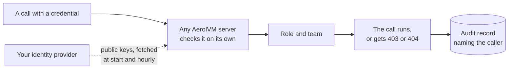

import { Aside, Tabs, TabItem } from '@astrojs/starlight/components';

Out of the box, an AerolVM server has one secret token, `SB_PAT_TOKEN`. Everyone who holds it can do everything, and the audit log records every one of them as the same operator.

Access control fixes that. People sign in with their company account (single sign-on, or SSO). Services and CI jobs get their own tokens. Each caller gets a **role** on one **team**, so a CI job can run sandboxes for the payments team and nothing else. Every call is recorded with the caller's name.

It is part of the free download. It is off until the server operator turns it on, and a server with it off works exactly as before.

## How it works

Every API call carries one credential. The server checks it on its own, with no call to a login service:

| Credential | Who uses it | How you get it |
|---|---|---|
| **API token** (`avm_…`) | Services, CI jobs, scripts | An admin creates it. It has a name, a role, a team and an expiry. |
| **Company sign-in** | People | `aerolvm login` or the dashboard sends you to your company's sign-in page, such as Okta, Entra ID, Google or Keycloak. |
| **Workload token** | CI on GitHub Actions, apps on Kubernetes | The platform issues it. Nothing secret is stored on AerolVM. |
| **Server token** (PAT) | The operator, setup scripts, cluster servers | Chosen at install. It always acts as an admin on every team. Keep it for emergencies. |

Each credential maps to one of four roles:

| Role | Can do | Bound to |
|---|---|---|
| `viewer` | See sandboxes and read their audit records. | One team, or every team (`*`) |
| `runner` | Everything a viewer can, plus create, change, delete and run commands in sandboxes, and read their environment variables. | One team, or every team (`*`) |
| `auditor` | See every team's sandboxes and audit records, list API tokens, and verify the audit chain. Never change anything. | Every team only |
| `admin` | Everything, including creating API tokens and running cluster operations. | Every team only |

A role bound to every team (`*`) can also read the server's metrics at `/v1/metrics`. A `runner` on every team still cannot use host-side features, such as mounting a folder from the server. Those need `admin`.

A **team** is a name, such as `payments`. Sandboxes a team creates belong to that team:

- **Another team's sandbox** answers `404 Not Found`, as if it did not exist.
- **Your own team's sandbox, with a role that is too small,** answers `403 Forbidden`. The message names the role you would need, such as "role viewer on team payments cannot sandbox.exec; ask an admin for role runner on team payments".



In a cluster, the server that owns the sandbox checks the credential again. No server trusts another server's word about who you are.

## Check who you are

Every credential can ask the server who it is. This is the first thing to run when a call is refused.

<Tabs syncKey="lang">
  <TabItem label="TypeScript">
    ```ts
    import { MicroVM } from "@aerol-ai/aerolvm-sdk";

    const client = new MicroVM(); // reads SB_API_URL and SB_API_TOKEN

    const me = await client.whoami();
    console.log(me.principal.name ?? me.principal.id);
    console.log(me.role, me.team ?? "", me.expiresAt ?? "never expires");
    ```
  </TabItem>
  <TabItem label="Python">
    ```python
    from microvm import MicroVM

    client = MicroVM()  # reads SB_API_URL and SB_API_TOKEN

    me = client.whoami()
    print(me["principal"].get("name", me["principal"]["id"]))
    print(me["role"], me.get("team", ""), me.get("expiresAt", "never expires"))
    ```
  </TabItem>
  <TabItem label="Go">
    ```go
    client, err := microvm.NewClient() // reads SB_API_URL and SB_API_TOKEN
    if err != nil {
        log.Fatal(err)
    }

    me, err := client.WhoAmI(ctx)
    if err != nil {
        log.Fatal(err)
    }
    fmt.Println(me.Principal.ID, me.Principal.Name)
    fmt.Println(me.Role, me.Team)
    if me.ExpiresAt != nil {
        fmt.Println("expires", me.ExpiresAt)
    }
    ```
  </TabItem>
  <TabItem label="Rust">
    ```rust
    use aerolvm_sdk::Client;

    let client = Client::new(None, None)?; // reads SB_API_URL and SB_API_TOKEN

    let me = client.whoami()?;
    println!("{} {}", me.principal.id, me.principal.name);
    println!("{} {:?} {:?}", me.role, me.team, me.expires_at);
    ```
  </TabItem>
  <TabItem label="Java">
    ```java
    import ai.aerol.microvm.MicroVMClient;
    import ai.aerol.microvm.model.WhoAmI;

    MicroVMClient client = new MicroVMClient(); // reads SB_API_URL and SB_API_TOKEN

    WhoAmI me = client.whoami();
    System.out.println(me.principal.id + " " + me.principal.name);
    System.out.println(me.role + " " + me.team + " " + me.expiresAt);
    ```
  </TabItem>
</Tabs>

- `principal.id` is stable: `tok_…` for an API token, `oidc:<issuer>:<sub>` for a person, `operator` for the server token. Audit records use it.
- `principal.name` is for people to read, such as `ci-deploy` or `alice@acme.com`.
- `team` is a team name, or `*` for every team.
- `expiresAt` is when the credential stops working. The server token never expires, so it has none.

From a terminal, `aerolvm whoami` prints the same, and `aerolvm whoami --explain` also shows which rule gave you your role. See the [CLI](/cli/#check-who-you-are).

## Give a service its own token

An admin creates API tokens. Each one has a name, a role, a team and an expiry.

<Tabs syncKey="lang">
  <TabItem label="TypeScript">
    ```ts
    const created = await client.tokens.create({
      name: "ci-deploy",
      role: "runner",
      team: "payments",
      expiresIn: "90d",
    });
    console.log(created.id);    // tok_…, for listing and revoking
    console.log(created.token); // avm_…, the secret: store it now
    ```
  </TabItem>
  <TabItem label="Python">
    ```python
    created = client.tokens.create(
        name="ci-deploy",
        role="runner",
        team="payments",
        expires_in="90d",
    )
    print(created["id"])     # tok_…, for listing and revoking
    print(created["token"])  # avm_…, the secret: store it now
    ```
  </TabItem>
  <TabItem label="Go">
    ```go
    created, err := client.Tokens().Create(ctx, sdktypes.CreateAPITokenOptions{
        Name:      "ci-deploy",
        Role:      "runner",
        Team:      "payments",
        ExpiresIn: "90d",
    })
    if err != nil {
        log.Fatal(err)
    }
    fmt.Println(created.ID)    // tok_…, for listing and revoking
    fmt.Println(created.Token) // avm_…, the secret: store it now
    ```
  </TabItem>
  <TabItem label="Rust">
    ```rust
    use aerolvm_sdk::CreateApiTokenOptions;

    let created = client.tokens().create(CreateApiTokenOptions {
        name: "ci-deploy".into(),
        role: "runner".into(),
        team: "payments".into(),
        expires_in: "90d".into(),
    })?;
    println!("{}", created.api_token.id); // tok_…, for listing and revoking
    println!("{}", created.token);        // avm_…, the secret: store it now
    ```
  </TabItem>
  <TabItem label="Java">
    ```java
    import ai.aerol.microvm.model.CreateApiTokenOptions;
    import ai.aerol.microvm.model.CreatedApiToken;

    CreatedApiToken created = client.tokens().create(
        new CreateApiTokenOptions()
            .setName("ci-deploy")
            .setRole("runner")
            .setTeam("payments")
            .setExpiresIn("90d")
    );
    System.out.println(created.id);    // tok_…, for listing and revoking
    System.out.println(created.token); // avm_…, the secret: store it now
    ```
  </TabItem>
</Tabs>

The same from a terminal:

```bash
aerolvm token create --name ci-deploy --role runner --team payments --expires-in 90d
```

- **The secret is shown once.** The server keeps only a hash of it. If you lose it, revoke the token and create a new one.
- **Every token expires.** `expiresIn` takes days (`90d`) or hours (`720h`). The server sets the longest allowed: 365 days by default, 90 days in [enterprise mode](/enterprise/enterprise-mode/).
- **`auditor` and `admin` need `team: "*"`.**
- **Names are unique within a team.** Creating the same name twice fails with `409 Conflict`. A 409 can also mean an earlier try worked but its answer was lost. That secret cannot be recovered, so revoke the token by its ID and create it again.
- **Secret scanners can find leaked tokens.** Every token starts with `avm_` and ends with a checksum. The pattern is `avm_[0-9A-Za-z]{12}_[0-9A-Za-z_-]{43}_[0-9A-Za-z]{6}`.

To use the token, set it where your code reads its credential. `SB_API_TOKEN` and `SB_PAT_TOKEN` both work in every SDK and the CLI. If both are set, `SB_PAT_TOKEN` wins.

```bash
export SB_API_URL=https://api.acme.dev
export SB_API_TOKEN=avm_...
```

### List and revoke tokens

Listing needs an `auditor` or `admin`. Revoking needs an `admin`.

<Tabs syncKey="lang">
  <TabItem label="TypeScript">
    ```ts
    const { tokens } = await client.tokens.list();
    for (const t of tokens) {
      console.log(t.id, t.name, t.role, t.team, t.expiresAt, t.expired);
    }

    await client.tokens.revoke("tok_7Hq2aBcDeFgH");
    ```
  </TabItem>
  <TabItem label="Python">
    ```python
    for t in client.tokens.list()["tokens"]:
        print(t["id"], t["name"], t["role"], t["team"], t["expiresAt"], t["expired"])

    client.tokens.revoke("tok_7Hq2aBcDeFgH")
    ```
  </TabItem>
  <TabItem label="Go">
    ```go
    list, err := client.Tokens().List(ctx)
    if err != nil {
        log.Fatal(err)
    }
    for _, t := range list.Tokens {
        fmt.Println(t.ID, t.Name, t.Role, t.Team, t.ExpiresAt, t.Expired)
    }

    if err := client.Tokens().Revoke(ctx, "tok_7Hq2aBcDeFgH"); err != nil {
        log.Fatal(err)
    }
    ```
  </TabItem>
  <TabItem label="Rust">
    ```rust
    for t in client.tokens().list()?.tokens {
        println!("{} {} {} {} {} {}", t.id, t.name, t.role, t.team, t.expires_at, t.expired);
    }

    client.tokens().revoke("tok_7Hq2aBcDeFgH")?;
    ```
  </TabItem>
  <TabItem label="Java">
    ```java
    import ai.aerol.microvm.model.ApiToken;

    for (ApiToken t : client.tokens().list().tokens) {
        System.out.println(t.id + " " + t.name + " " + t.role + " " + t.team + " " + t.expiresAt + " " + t.expired);
    }

    client.tokens().revoke("tok_7Hq2aBcDeFgH");
    ```
  </TabItem>
</Tabs>

- **The list never shows a secret.** Expired tokens stay listed, marked `expired`, for 30 days. Then the server removes them.
- **A revoke works everywhere within seconds.** Servers that hold the cluster's state stop accepting the token at once. Other servers stop within one sync, about 5 seconds.
- **Revoking twice is safe.** A token that is already gone still returns success.

## Act for one of several teams

A person can be in more than one team. Their sign-in then matches several rules, and the first one is used. To act for another of their teams, name it. The SDKs send it as the `X-AerolVM-Team` header on every call.

<Tabs syncKey="lang">
  <TabItem label="TypeScript">
    ```ts
    const client = new MicroVM({ team: "checkout" }); // or set SB_TEAM
    ```
  </TabItem>
  <TabItem label="Python">
    ```python
    client = MicroVM(team="checkout")  # or set SB_TEAM
    ```
  </TabItem>
  <TabItem label="Go">
    ```go
    client, err := microvm.NewClientWithConfig(&sdktypes.MicroVMConfig{
        Team: "checkout", // or set SB_TEAM
    })
    ```
  </TabItem>
  <TabItem label="Rust">
    ```rust
    use aerolvm_sdk::{ApiVersion, Client, ClientConfig};

    let client = Client::with_config(
        ClientConfig {
            team: Some("checkout".into()), // or set SB_TEAM
            ..Default::default()
        },
        ApiVersion::default(),
    )?;
    ```
  </TabItem>
  <TabItem label="Java">
    ```java
    MicroVMClient client = new MicroVMClient(
        new MicroVMConfig().setTeam("checkout") // or set SB_TEAM
    );
    ```
  </TabItem>
</Tabs>

- **It only chooses.** The team must be one your credential already holds. Any other team gets `403 Forbidden`.
- **It cannot pick "every team".** A team name is 1 to 63 of `a-z`, `0-9` and `-`. To act on every team, send no team, and let the first rule be the fleet one. See [the identity file](#step-2-write-the-identity-file).
- **The server token ignores it.**
- **In the CLI,** use `aerolvm login --team checkout` or `SB_TEAM`.
- **TypeScript only:** live command streams (`execStream`, `attachSession`) cannot send the header, so they use your first team.

## Sign in with your company account

People sign in through your identity provider. AerolVM never sees their password and keeps no session. The provider signs a short-lived token, about an hour, and every AerolVM server checks that signature with the provider's public keys.

- **In a terminal:** `aerolvm login https://api.acme.dev` opens your browser. Over SSH, add `--device` to get a code to type on another device. The login renews itself while your provider allows it. See [Save your login](/cli/#save-your-login).
- **In a browser:** open the [dashboard](/dashboard/) at `https://api.acme.dev/ui` and pick your provider. The dashboard's console is for admins. Other roles see who they are and how to use the CLI.
- **In code:** `aerolvm auth token` prints a fresh token for a script: `SB_API_TOKEN=$(aerolvm auth token) python agent.py`. It lasts about an hour, so get a new one for long jobs.

### Sign in from CI with no stored secret

GitHub Actions and Kubernetes can each give a job a signed token that says who it is. AerolVM checks it the same way, so there is no AerolVM secret to store or rotate.

On **GitHub Actions**, ask for a token with the audience `aerolvm`:

```yaml
permissions:
  id-token: write
  contents: read

jobs:
  test:
    runs-on: ubuntu-latest
    steps:
      - uses: actions/checkout@v4
      - name: Get an AerolVM token
        id: aerolvm
        uses: actions/github-script@v7
        with:
          result-encoding: string
          script: return await core.getIDToken('aerolvm')
      - name: Run the tests in a sandbox
        run: python run_tests.py
        env:
          SB_API_URL: https://api.acme.dev
          SB_API_TOKEN: ${{ steps.aerolvm.outputs.result }}
```

The token lasts a few minutes. For a long job, get a fresh one before each step that calls AerolVM.

On **Kubernetes**, mount a service account token with the audience `aerolvm`. The kubelet renews the file on its own:

```yaml
spec:
  serviceAccountName: ci
  containers:
    - name: agent
      image: your-app
      volumeMounts:
        - name: aerolvm-token
          mountPath: /var/run/secrets/aerolvm
          readOnly: true
  volumes:
    - name: aerolvm-token
      projected:
        sources:
          - serviceAccountToken:
              path: token
              audience: aerolvm
              expirationSeconds: 3600
```

Then read the file each time you build a client:

<Tabs syncKey="lang">
  <TabItem label="TypeScript">
    ```ts
    import { readFileSync } from "node:fs";
    import { MicroVM } from "@aerol-ai/aerolvm-sdk";

    const client = new MicroVM({
      apiUrl: "https://api.acme.dev",
      patToken: readFileSync("/var/run/secrets/aerolvm/token", "utf8").trim(),
    });
    ```
  </TabItem>
  <TabItem label="Python">
    ```python
    from pathlib import Path
    from microvm import MicroVM

    client = MicroVM(
        api_url="https://api.acme.dev",
        pat_token=Path("/var/run/secrets/aerolvm/token").read_text().strip(),
    )
    ```
  </TabItem>
  <TabItem label="Go">
    ```go
    raw, err := os.ReadFile("/var/run/secrets/aerolvm/token")
    if err != nil {
        log.Fatal(err)
    }
    client, err := microvm.NewClientWithConfig(&sdktypes.MicroVMConfig{
        APIUrl:   "https://api.acme.dev",
        PATToken: strings.TrimSpace(string(raw)),
    })
    if err != nil {
        log.Fatal(err)
    }
    ```
  </TabItem>
  <TabItem label="Rust">
    ```rust
    use aerolvm_sdk::Client;

    let token = std::fs::read_to_string("/var/run/secrets/aerolvm/token")
        .expect("read the service account token");
    let client = Client::new(Some("https://api.acme.dev"), Some(token.trim()))?;
    ```
  </TabItem>
  <TabItem label="Java">
    ```java
    import java.nio.file.Files;
    import java.nio.file.Path;

    String token = Files.readString(Path.of("/var/run/secrets/aerolvm/token")).trim();
    MicroVMClient client = new MicroVMClient(
        new MicroVMConfig()
            .setApiUrl("https://api.acme.dev")
            .setPatToken(token)
    );
    ```
  </TabItem>
</Tabs>

The server never calls the Kubernetes API to check the token. It checks the signature with the keys your cluster publishes.

## Set it up

This section is for the server operator.

### Step 1: Turn it on

Add this to every server's environment, then restart:

```bash
SB_IDENTITY_ENABLED=true
```

That is **tokens-only mode**: API tokens work, and nobody signs in with SSO yet. It needs no identity provider, so it works on networks with no internet access. It is a complete setup, and enough for [enterprise mode](/enterprise/enterprise-mode/).

Make the first admin token with the server token, on a server:

```bash
SB_API_URL=http://127.0.0.1:21212 SB_PAT_TOKEN=<server token> \
  aerolvm token create --name first-admin --role admin --team '*' --expires-in 30d
```

Use that admin token from then on, and keep the server token for emergencies.

<Aside type="note">
With `SB_IDENTITY_ENABLED` off, tokens can still be created and listed, but no server accepts them. This lets you prepare tokens before you turn it on.
</Aside>

### Step 2: Write the identity file

The identity file names your identity providers and maps their groups to AerolVM roles. Point `SB_IDENTITY_FILE` at it on every server.

```yaml
version: 1
issuers:
  - name: okta                          # used in audit records; never change it
    display_name: Acme Okta             # the dashboard button: "Sign in with Acme Okta"
    url: https://acme.okta.com/oauth2/default
    audiences: [0oa1cli, 0oa1dash]      # the client IDs of the CLI and dashboard apps
    clients: { cli: 0oa1cli, dashboard: 0oa1dash }
    claims: { username: email, groups: groups }
    max_token_lifetime: 12h
  - name: google
    display_name: Google
    kind: google
    url: https://accounts.google.com
    audiences: [123-cli.apps.googleusercontent.com, 123-dash.apps.googleusercontent.com]
    clients: { cli: 123-cli.apps.googleusercontent.com, dashboard: 123-dash.apps.googleusercontent.com }
    claims: { username: email }
  - name: github-actions                # CI with no stored secret
    url: https://token.actions.githubusercontent.com
    audiences: [aerolvm]
    claims: { username: sub }
  - name: eks-prod                      # Kubernetes service accounts
    url: https://oidc.eks.us-east-1.amazonaws.com/id/EXAMPLE
    audiences: [aerolvm]
    claims: { username: sub }
bindings:                               # fleet rules first, then team rules
  - { issuer: okta, group: platform-admins, role: admin }
  - { issuer: okta, group: secops,          role: auditor }
  - { issuer: okta, group: payments-eng,    role: runner, team: payments }
  - { issuer: github-actions, claim: { repository: acme/payments, ref: refs/heads/main }, role: runner, team: payments }
  - { issuer: eks-prod, claim: { sub: "system:serviceaccount:payments:ci" }, role: runner, team: payments }
deny_subjects: []                       # "<issuer>:<sub>", blocked at once
```

**Put rules for every team (`admin`, `auditor`, or `*`) above rules for one team.** A person who matches several rules gets the first one by default. A team header can pick another of their team rules, but nothing can pick a fleet rule that sits lower. So an admin who is also in `payments-eng` would lose admin if the team rule came first. The dashboard sends no team header at all.

How a rule matches:

- `group` matches the groups claim, and `app_role` matches the roles claim (Entra app roles).
- `claim` matches every listed claim. A list claim matches when it contains the value.
- A rule on `email` also needs the provider to say the email is verified.
- Only the rules for the token's own issuer are tried.

How the file loads:

- Unknown keys, a missing `version`, or an empty file fail the load. For tokens-only mode, unset `SB_IDENTITY_FILE` instead of leaving the file empty.
- Each server re-reads it within 10 seconds of a change, or at once on `SIGHUP`. A bad edit keeps the last good file and counts an error.
- A bad file at start turns off SSO sign-in (it answers `503`) until you fix it. API tokens and the server token keep working.
- Every change writes one `identity_config` audit record on each server, with the old and new file hash and the rules added and removed. The file cannot say who edited it. Keep it in Git or your config tool, so that history names the author.
- Ship the same file to every server, with Terraform or Ansible. The `aerolvm_identity_file_info` metric shows a server whose copy differs.

| Field | What it is |
|---|---|
| `version` | Always `1`. |
| `issuers[].name` | Required. 1 to 63 of `a-z`, `0-9` and `-`. Part of every person's ID (`oidc:<name>:<sub>`), so do not rename it. |
| `issuers[].display_name` | Optional. The dashboard button and CLI menu label, 1 to 40 characters. Defaults to `name`. Never used in IDs or records. |
| `issuers[].kind` | `oidc` (default) or `google`. `google` makes the dashboard use Google's own sign-in button. |
| `issuers[].url` | Required. The provider's issuer URL, over `https`. Must equal the token's `iss` exactly. |
| `issuers[].jwks_file` | Optional. A file with the provider's public keys, for a provider your servers cannot reach. |
| `issuers[].audiences` | Required. The client IDs (or `aerolvm`, for workload tokens) a token may be issued for. |
| `issuers[].clients.cli`, `.dashboard` | Optional. The client IDs of your CLI and dashboard apps. Each must also be in `audiences`. Only issuers with one appear in the CLI menu or as a dashboard button. |
| `issuers[].claims.username`, `.groups`, `.roles` | Which claims hold the display name, the groups and the app roles. Defaults: `sub`, `groups`, `roles`. |
| `issuers[].max_token_lifetime` | Default `24h`. Tokens that last longer are refused. Raise it only for a workload issuer that needs it. |
| `issuers[].mcp`, `.mcp_audiences` | For MCP connectors such as claude.ai. See [MCP server](/mcp/#sign-in-with-oauth). |
| `bindings[]` | `issuer`, exactly one of `group`, `app_role` or `claim`, then `role` and `team`. `team` is a team name or `*`. `auditor` and `admin` are always `*`. |
| `deny_subjects[]` | `"<issuer>:<sub>"`. Refused on every call after the next reload. |
| `mcp.resource`, `mcp.scopes` | For MCP connectors. See [MCP server](/mcp/#sign-in-with-oauth). |

### Step 3: Register the apps at your provider

Register two apps at your identity provider: one for the CLI and one for the dashboard. Put their client IDs in `clients` and `audiences`. Neither needs a client secret on the server.

| | CLI app | Dashboard app |
|---|---|---|
| App type | Native or desktop app, public client | Single-page app, public client |
| Sign-in flow | Authorization code with PKCE. Also the device flow, for `--device`. | Authorization code with PKCE |
| Redirect URI | `http://127.0.0.1/callback`. The CLI listens on a random port, so the provider must accept any port on that address. | `https://<api-domain>/ui` |
| Allowed origin (CORS) | None | `https://<api-domain>` |
| Scopes | `openid email profile`, and `offline_access` so the login can renew itself | `openid email profile` |
| Groups | Put the groups claim in the ID token | Put the groups claim in the ID token |

Notes for each provider:

- **Okta.** Create a Native app for the CLI, with the Refresh Token grant (and Device Authorization, for `--device`). Create a Single-Page app for the dashboard, and add `https://<api-domain>` as a Trusted Origin for CORS. Add a groups claim to the ID token.
- **Entra ID.** The issuer `url` is `https://login.microsoftonline.com/<tenant>/v2.0`. Use the "Mobile and desktop applications" platform for the CLI (turn on public client flows for `--device`), and the "Single-page application" platform for the dashboard. Above 200 groups, Entra leaves the groups out of the token. Bind on app roles instead: `{ issuer: entra, app_role: AerolVM.Runner, role: runner, team: payments }`.
- **Keycloak.** The issuer `url` is `https://<keycloak>/realms/<realm>`. Make both clients public, with the standard flow and PKCE. Turn on the device authorization grant on the CLI client, for `--device`. Set the dashboard client's Web origins to `https://<api-domain>`. Add a Group Membership mapper to the ID token.
- **Google.** Use `kind: google`. The CLI app is a "Desktop app". Google still wants that app's client secret, so hand it to people when they start, and they run `aerolvm login --sso <url> --client-secret-stdin` once. It never goes on the server. Google offers the device flow only to a "TVs and Limited Input devices" client, and the CLI uses one client ID for both flows, so pick the type you need. The dashboard app is a "Web application" with `https://<api-domain>` as an authorized JavaScript origin. Google gets its own button.

The dashboard works only over HTTPS, or from `localhost` through an SSH tunnel. [Dashboard](/dashboard/#set-up-sign-in-for-the-dashboard) has the details.

### Step 4: Check it

1. Open `https://<api-domain>/.well-known/aerolvm-auth` in a browser. It lists every provider with a CLI or dashboard app, and `identity_enabled: true`.
2. Run `aerolvm login https://<api-domain>`, then `aerolvm whoami --explain`. It shows your role and team, the rule that matched, and the groups your sign-in carried.
3. If no rule matches, the CLI and the dashboard both say so and list your groups. Add a rule for one of them.

### Step 5: Limit the server token to the server

With `SB_PAT_SCOPE=host`, the server token works only on the server itself and between cluster servers. Everyone else must use SSO or an API token, so every remote action names a person or a service. [Enterprise mode](/enterprise/enterprise-mode/) requires it.

1. **Upgrade every server first.** Older servers do not mark the server token when they pass a call to another server, and a server with `host` refuses an unmarked one.
2. **Move remote tools off the server token:** the dashboard, remote MCP, SDK scripts, and your Prometheus scrape. For the scrape, a `viewer` token on every team works: `aerolvm token create --name prometheus --role viewer --team '*' --expires-in 90d`. With the project's Terraform, set it as `cluster.metrics_token` in `config/secrets.yml` and apply again.
3. **Re-run the installer on each server with `--pat-scope host`.** Caddy then reaches the server through a private socket, so its traffic no longer looks like it comes from the server itself. Any other proxy on the server must use that socket too. The installer rewrites the settings file, so pass every option again.

Setup scripts on the server keep working with `http://127.0.0.1:21212`. A server token sent from anywhere else gets `401`: "the operator token works only on this host; sign in with `aerolvm login --sso` or use a named token".

The scrape token is **read-only, not metrics-only**. It cannot create, run or delete anything. But a `viewer` on every team can also read every team's sandbox details and audit records.

## Take access away

- **For a person:** remove them at your identity provider. Their login stops renewing, and their last sign-in token dies within its lifetime, about an hour. To block them at once, add `"<issuer>:<sub>"` to `deny_subjects` and ship the file. Each server applies it within 10 seconds, or at once on `SIGHUP`. Their audit records name them as `oidc:<issuer>:<sub>`; the deny entry is that ID without `oidc:`.
- **For an API token:** revoke it. Every server stops accepting it within seconds.
- **For the server token:** rotate it. The [runbook](https://github.com/aerol-ai/microvm/blob/main/setup/runbooks/identity-and-access.md#rotatepat) shows how to do it with no downtime.

## What gets recorded

With access control on or off, every call that changes something writes an audit record that names the caller:

- **Every call except plain reads:** create, delete, start, stop, ports, snapshots, tokens, and every command or file call inside a sandbox (file reads too, since files can hold secrets). With `SB_AUDIT_API_RECORDS=all`, plain reads too.
- **Refused calls.** A `403` is a record with `result: denied`. A refused credential (`401`) is an `auth_denied` record, at most one per address per minute.
- **The server's own work,** such as a lifecycle timer deleting a sandbox, names the part of the server that did it, such as `system:lifecycle`.
- **Commands are not stored by default.** A record holds a fingerprint of the command, which proves what ran without keeping secrets it might hold.

Every mutating action is recorded, except calls in the last sync interval (1 second) before an unclean crash, unless the call is durable. Token create, token revoke and sandbox delete are durable when `SB_AUDIT_API_DURABLE` is on, as it always is in enterprise mode.

[Audit and compliance](/enterprise/audit-evidence/) lists every field, maps the records to SOC 2, and shows how to produce an access review.

## Errors you may see

| What you see | What it means | What to do |
|---|---|---|
| `401` with reason `expired` | The token's time is up. | Sign in again, or ask for a new API token. |
| `401` with reason `not_yet_valid` | Your computer's clock is more than a minute off. | Fix the clock. |
| `401` with reason `wrong_audience`, `unknown_issuer` or `too_long_lived` | The token came from an app or provider this server does not trust. | Check `issuers` in the identity file. |
| `401` with reason `invalid_signature` or `malformed` | The token is damaged or forged. | Sign in again. |
| `401` with reason `unknown_or_revoked` | The API token was revoked, or the person is on the deny list. | Ask an admin. |
| `403` "no role binding for …" | You signed in, but no rule matches you. The message lists your groups. | Ask an admin to add a rule for one of them. |
| `403` "role … cannot …; ask an admin for role …" | Your role is too small for this call. | Ask for the role it names. |
| `403` "is not one of this credential's teams" | You picked a team you do not belong to. | Unset `SB_TEAM`, or pick one of your teams. |
| `404` | The sandbox does not exist, or belongs to another team. | Check the team you act for. |
| `503` "identity data is stale on this node" | This server lost contact with the cluster's token list for over a minute. | Retry. The server token and SSO still work. |
| `503` "sign-in with an identity provider is unavailable" | The identity file failed to load, or the provider's keys could not be fetched. | Retry, or use an API token. Operators: check the server log. |

## For server operators

### Settings

| Setting | Default | What it does |
|---|---|---|
| `SB_IDENTITY_ENABLED` | `false` | Turns on API tokens and SSO. Required by enterprise mode. |
| `SB_IDENTITY_FILE` | Empty | The identity file. Empty means tokens-only mode. |
| `SB_TOKEN_MAX_TTL` | `8760h` (365 days) | The longest an API token may last. 90 days at most in enterprise mode. |
| `SB_IDENTITY_SYNC_INTERVAL` | `5s` | How often servers without the cluster's state fetch token changes. |
| `SB_IDENTITY_MAX_STALE` | `60s` | After this long without a sync, a server refuses API tokens, except to read metrics. |
| `SB_PAT_SCOPE` | `any` | `host` limits the server token to the server and cluster servers. Required by enterprise mode. |
| `SB_PUBLIC_API_SOCKET` | `/run/sandboxd-public/api.sock` | The socket Caddy uses when `SB_PAT_SCOPE=host`. |
| `SB_PAT_TOKEN_PREVIOUS` | Empty | A second server token, accepted only during a rotation. |
| `SB_OPERATOR_VOLUME_SCOPE` | Empty | Pins where the operator's platform volumes live, so a token rotation does not move them. |
| `SB_L4_FALLBACK_PROXY_PROTOCOL` | `false` | Passes callers' real addresses through Caddy. Set by `install.sh --l4-proxy-protocol`. |

Client settings, read by every SDK and the CLI:

| Setting | What it does |
|---|---|
| `SB_API_TOKEN` | The credential to send: an API token, a sign-in token or the server token. The same as `SB_PAT_TOKEN`, which wins if both are set. |
| `SB_TEAM` | The team to act for, sent as `X-AerolVM-Team`. Empty uses your first rule. |

[Config defaults](https://github.com/aerol-ai/microvm/blob/main/setup/config-defaults.md) explains why each default is what it is.

### Monitoring

- **Metrics:** `aerolvm_auth_requests_total` (by credential kind and origin), `aerolvm_auth_failures_total` (by reason), `aerolvm_identity_mirror_age_seconds`, `aerolvm_identity_jwks_fetch_total`, `aerolvm_identity_file_info`, `aerolvm_identity_file_load_errors_total`, `aerolvm_api_tokens` (by role), `aerolvm_pat_scope_drift` and `aerolvm_auth_client_ip_dropped_total`.
- **Alerts:** the server token used from outside, servers with different `SB_PAT_SCOPE` settings, a stale token list, failing key fetches, identity files that differ between servers, and identity file load errors. They are in [`setup/prometheus/sandboxd-alerts.yml`](https://github.com/aerol-ai/microvm/blob/main/setup/prometheus/sandboxd-alerts.yml).
- **Dashboard:** the "Identity and access" row in `setup/grafana/d9-security-isolation.json`.
- **Traces:** each request span carries the caller's kind, ID, team and the permission checked. Display names never go into traces.
- **Runbook:** [`setup/runbooks/identity-and-access.md`](https://github.com/aerol-ai/microvm/blob/main/setup/runbooks/identity-and-access.md) covers every alert, rotating the server token and the scrape token, the first admin token, a provider outage, and turning on `SB_PAT_SCOPE=host`.

### Upgrades and rollback

- **A cluster starts writing callers into audit records only when every server runs this release.** During a rolling upgrade, records look as they did before.
- **Do not roll back below this release once a server has written a caller.** An older server cannot verify those records, so it refuses to start while `SB_SECRET_AUDIT_STRICT_BOOT` is on, which enterprise mode requires. An older `aerolvm audit verify` fails the same way, so upgrade the CLI first.
- **To turn access control off,** set `SB_IDENTITY_ENABLED=false` and restart. Tokens stay stored, and the server token works as before. Enterprise mode refuses this.

## Next steps

- [aerolvm CLI](/cli/#save-your-login): sign in, check who you are, and manage tokens from a terminal.
- [Dashboard](/dashboard/): sign in to the web console.
- [Audit and compliance](/enterprise/audit-evidence/): the records, the SOC 2 mapping and the access review.
- [Enterprise mode](/enterprise/enterprise-mode/): the strict profile that requires named credentials.
