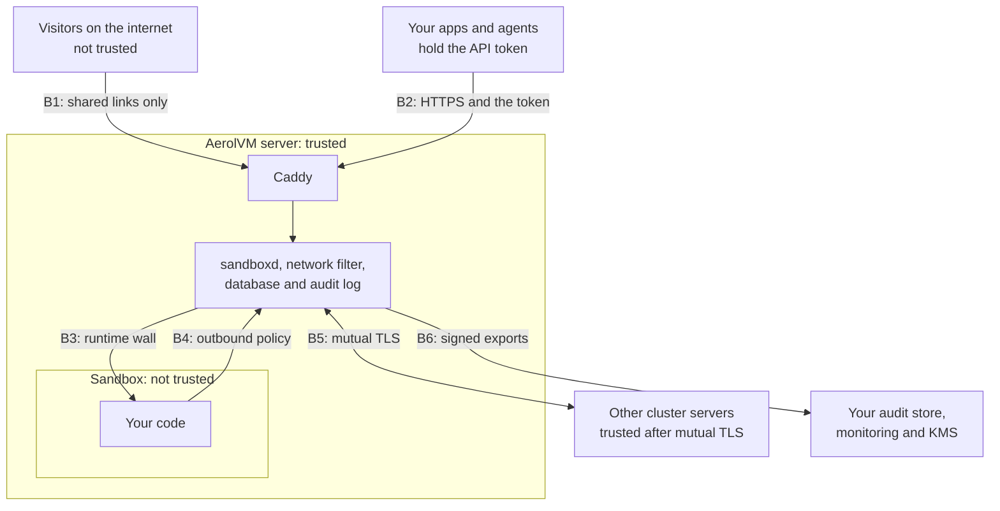
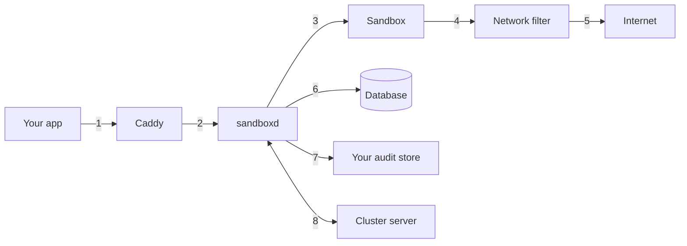
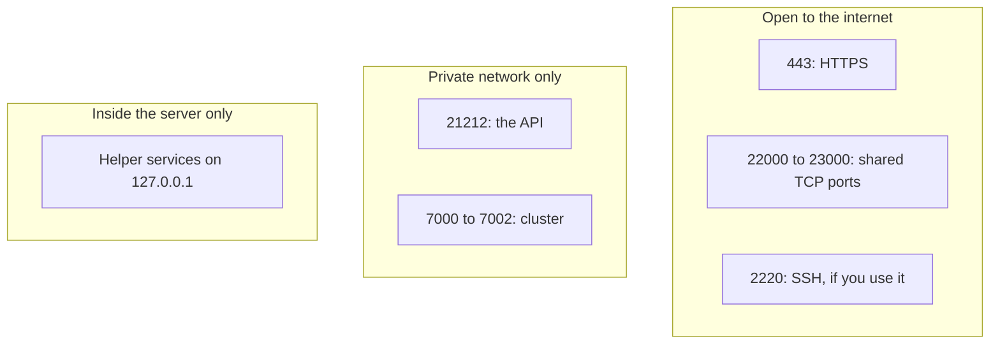
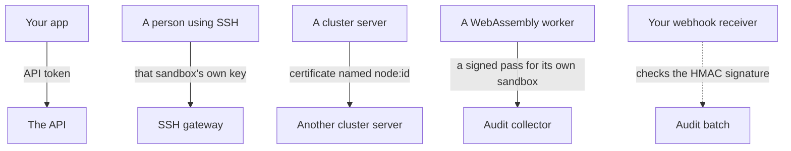
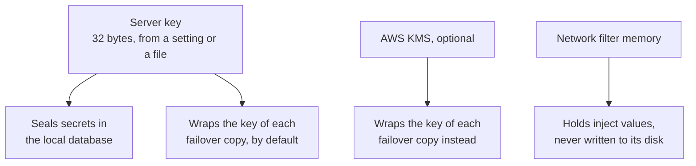

import { Aside, Tabs, TabItem } from '@astrojs/starlight/components';

This page describes how an AerolVM deployment is put together from a security point of view. A security architect can use it to review the design, draw it into a threat model, and plan network rules. For a guided tour in plain words, read [How AerolVM keeps everything safe](/engineering-security-overview/).

## Components

| Component | Runs on | What it does | Trust level |
|---|---|---|---|
| `sandboxd` | The server, as root | The AerolVM server. It serves the API, starts sandboxes, seals secrets and writes the audit log. | Trusted |
| Caddy | The server | The web server in front. It handles HTTPS, public links and shared TCP ports. | Trusted |
| Network filter | The server | Enforces each sandbox's outbound policy: name lookups, site checks and inject rules. | Trusted |
| Database | The server's disk | SQLite. It holds sandbox records and sealed secrets. | Trusted |
| Audit log | The server's disk | A hash-chained file of security records | Trusted |
| Runtime | The server | Containers, gVisor, Firecracker, WebAssembly or V8 isolates. It builds the wall around each sandbox. | Trusted |
| Sandbox | Inside the runtime | Your code and everything it starts, plus a small agent that runs commands and moves files | **Untrusted** |
| Other servers | Your network | Cluster members, only in cluster mode | Trusted after they prove who they are |

## Trust boundaries

A trust boundary is a line where data passes between parts that trust each other differently. Every line in this diagram has a control on it.



| Boundary | Between | Control |
|---|---|---|
| B1 | Visitors and the server | Only ports you shared have a route. New sandboxes are private. |
| B2 | Your apps and the API | HTTPS in domain mode, and an API token checked in constant time |
| B3 | The server and a sandbox | The runtime's wall, resource limits, and no privileged mode |
| B4 | A sandbox and the network | The outbound policy, the name filter and the private-address guard |
| B5 | One server and another | Mutual TLS with certificates from the cluster's own authority, plus an encrypted membership channel |
| B6 | The server and your systems | Audit batches over HTTPS, signed with HMAC for webhooks |

## Data flows



| # | Flow | Data | Protection |
|---|---|---|---|
| 1 | Your app to Caddy | API calls, commands, files | HTTPS in domain mode, and the API token |
| 2 | Caddy to `sandboxd` | The same API calls | Stays inside the server. Caddy forwards only API paths. |
| 3 | `sandboxd` to a sandbox | Commands, files, and environment variables at start | Stays inside the server |
| 4 | Sandbox to the network filter | Outbound traffic | The sandbox's policy decides what passes |
| 5 | Network filter to the internet | Allowed traffic only | Inject rules add real keys only for the site you named |
| 6 | `sandboxd` to the database | Sandbox records and secrets | Secrets are sealed with AES-256-GCM before they are written |
| 7 | `sandboxd` to your audit store | Audit records | HTTPS. Webhook batches carry an HMAC signature. |
| 8 | Server to server | Placement votes, forwarded calls, sealed failover copies | Mutual TLS, TLS 1.2 or newer |

## Network ports



| Port | Protocol | Purpose | Expose to |
|---|---|---|---|
| `443` | HTTPS | API calls and public links, through Caddy | The internet |
| `80` | HTTP | IP mode only, for testing | Nobody in production |
| `21212` | HTTP | The API itself | Caddy and private networks only |
| `22000` to `23000` | TCP | Ports you share from sandboxes | The internet, only if you share TCP ports |
| `2220` | SSH | The SSH gateway | Only if you use SSH |
| `7000` | TCP with mutual TLS | Cluster votes | Cluster servers only |
| `7001` | Encrypted gossip | Cluster membership | Cluster servers only |
| `7002` | HTTPS with mutual TLS | Server-to-server calls | Cluster servers only |

<Aside type="caution">
The API on port `21212` speaks plain HTTP. In production, let only Caddy reach it, so HTTPS is the only way in. See [Hardening](/enterprise/hardening/).
</Aside>

## Encryption

### In transit

| Path | Encryption |
|---|---|
| Your apps and visitors to Caddy | TLS, with certificates Caddy gets through a DNS check (domain mode). IP mode has none. |
| TLS ports you share | Caddy ends TLS with its certificate. The sandbox never holds the private key. |
| Server to server: votes and calls | Mutual TLS, TLS 1.2 or newer, with certificates from the cluster's own authority |
| Server to server: membership | AES encryption with the cluster's gossip key |
| Audit export | HTTPS. Webhook batches also carry an HMAC signature. |

### At rest

| Data | Protection |
|---|---|
| Environment variables | AES-256-GCM, bound to the sandbox's ID and its current life |
| Registry passwords, storage credentials and the agent's token | AES-256-GCM with the server's key |
| Failover copies of secrets | A fresh key for each copy, wrapped by the server's key or by AWS KMS |
| Database files | Readable only by the server's own user |
| Audit log | Readable only by the server's own user, and hash-chained |
| Files inside sandboxes | Not encrypted by AerolVM. Use encrypted disks on the server. |

## Identities



| Who | Proves identity with | Notes |
|---|---|---|
| Your apps and agents | The API token | Required. The server will not start without one. |
| The operator | The same token | Some actions, such as cluster changes and audit checks, are operator-only. |
| SSH users | A key pair made for one sandbox | The server stores only the public half. |
| Cluster servers | A certificate signed by the cluster's authority | Lasts 90 days. Its name must match the server's ID. |
| Your audit receiver | The HMAC signature on each batch | You hold the shared secret |

Single sign-on and roles are not built yet. Both are [proposed](https://github.com/aerol-ai/microvm/discussions/646) and open for discussion.

## Keys



- **The server key** seals every secret in the local database. It comes from `SB_CREDENTIAL_ENCRYPTION_KEY`, or from a file the server makes on first start. Back it up whenever you back up the database, and store the two copies apart.
- **AWS KMS** is optional. It wraps the keys of the copies a cluster sends to backup servers, so AWS permissions and logs apply to them. Secrets in each server's own database still use that server's key.
- **Inject values** live in the network filter's memory only. The server resends them after the filter restarts.

## Connect your apps securely

Use your HTTPS address, and read the token from a secret manager or an environment variable instead of writing it in code:

<Tabs syncKey="lang">
  <TabItem label="TypeScript">
    ```ts
    import { MicroVM } from "@aerol-ai/aerolvm-sdk";

    const client = new MicroVM({
      apiUrl: "https://sandbox.example.com",
      patToken: process.env.SB_PAT_TOKEN,
    });
    ```
  </TabItem>
  <TabItem label="Python">
    ```python
    import os
    from microvm import MicroVM

    client = MicroVM(
        api_url="https://sandbox.example.com",
        pat_token=os.environ["SB_PAT_TOKEN"],
    )
    ```
  </TabItem>
  <TabItem label="Go">
    ```go
    client, err := microvm.NewClientWithConfig(&sdktypes.MicroVMConfig{
        APIUrl:   "https://sandbox.example.com",
        PATToken: os.Getenv("SB_PAT_TOKEN"),
    })
    if err != nil {
        log.Fatal(err)
    }
    ```
  </TabItem>
  <TabItem label="Rust">
    ```rust
    use aerolvm_sdk::Client;

    let token = std::env::var("SB_PAT_TOKEN")?;
    let client = Client::new(Some("https://sandbox.example.com"), Some(token.as_str()))?;
    ```
  </TabItem>
  <TabItem label="Java">
    ```java
    import ai.aerol.microvm.MicroVMClient;
    import ai.aerol.microvm.MicroVMConfig;

    MicroVMClient client = new MicroVMClient(
        new MicroVMConfig()
            .setApiUrl("https://sandbox.example.com")
            .setPatToken(System.getenv("SB_PAT_TOKEN"))
    );
    ```
  </TabItem>
</Tabs>

## Next steps

- [Security baseline](/enterprise/security-controls/): every control, with its default and who owns it.
- [Reference architectures](/enterprise/deployment/): single server and cluster layouts.
- [Shared responsibility](/enterprise/responsibility/): what AerolVM handles and what you handle.
