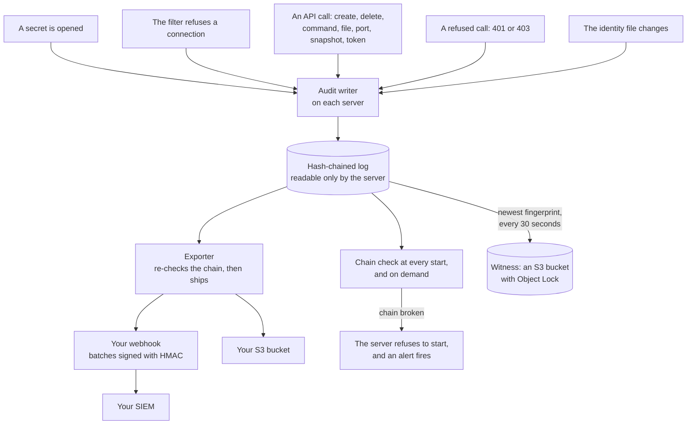
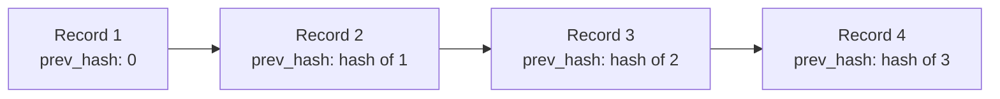
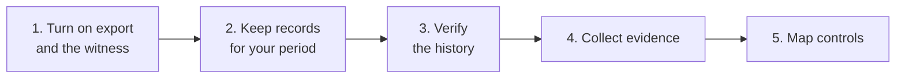

import { Aside, Tabs, TabItem } from '@astrojs/starlight/components';

This page is for security reviewers, auditors and compliance teams. It explains what AerolVM records, who each record names, and how the records are protected and shipped. It also lists the evidence you can collect, and maps AerolVM's controls to SOC 2 and NIST SP 800-53.

<Aside title="Compliance status">
AerolVM has no SOC 2 or ISO 27001 report of its own. It is software you run, so its controls become part of your own compliance scope. This page gives you the evidence and the mapping to do that.
</Aside>

## How audit records flow



A SIEM (security information and event management system) is where many companies collect and search security records.

- **Every secret open is recorded:** when a sandbox starts, when it is rebuilt, and when someone asks for its variables.
- **Every API call that changes something is recorded, with its caller:** create, delete, start, stop, ports, snapshots, tokens, and every command or file call inside a sandbox. Refused calls are recorded too. Only the server that ran the call records it, so a call forwarded across a cluster is recorded once.
- **Every mutating action is recorded, except calls in the last sync interval before an unclean crash, unless the call is durable.** The sync interval is 1 second. Token create, token revoke and sandbox delete are durable when `SB_AUDIT_API_DURABLE` is on, which enterprise mode requires.
- **Every refused credential is counted.** A burst of bad tokens from one address writes one record at once. When that minute ends, one more record counts the rest, even if the address has gone quiet. A graceful shutdown writes the counts it still holds. An unclean crash loses the counts of each address's last minute, but the first refusal of that minute is already recorded.
- **Records are chained.** Each record holds a fingerprint (hash) of the one before, so a changed or deleted record breaks the chain. Someone with root on a server could rebuild that server's chain. The copy you export and the witness are what catch that.
- **The witness keeps fingerprints off the server.** With [enterprise mode](/enterprise/enterprise-mode/), each server stores its newest fingerprint in an S3 bucket with Object Lock. No server can change or delete what is stored there, so a rebuilt chain no longer matches.
- **Shipping never drops a batch.** If your receiver is down, the server keeps the records, retries, and raises an alert when it falls behind.
- **Gaps are visible.** If records ever have to be skipped, the log writes a marker with the number skipped.

## What a record holds

| Kind | When it is written |
|---|---|
| `secret_open` | A sandbox's variables, registry password or storage credentials are opened |
| `egress` | The network filter refuses an outbound connection. It can also record the ones it allows. |
| `api` | An API call: every call that changes something, every command and file call, token listing, audit checks, and every `403`. With `SB_AUDIT_API_RECORDS=all`, plain reads too. Also an SSH session opening, and the server's own deletes and stops. |
| `auth_denied` | A refused credential (`401`), at most one per source address per minute. The first refusal is written at once. The rest of that minute are written as one record when the minute ends, describing the last of them. `dropped` counts the others it stands for. |
| `identity_config` | The identity file changed on this server: the old and new file hash, and the role rules and deny entries added and removed |
| `api_flood_mode` | The server switched how it limits a flood of `api` records |
| `gap` | Records had to be skipped. The marker carries the count. |
| `retention_checkpoint` | Old records were removed after the retention period |

| Field | Meaning |
|---|---|
| `time` | When it happened |
| `node_id` | The server that acted |
| `sandbox_id` and `owner_ref` | The sandbox it was about, and the team that owns it |
| `ref` | Which secret, by name, such as `env:<sandbox-id>`, or which route, such as `POST /v1/sandboxes/{id}/exec`. Never a value. |
| `caller` | Who caused it: `kind` (`operator`, `token`, `oidc`, `node`, `system`, `sandbox_key` or `controlplane`), a stable `id` (such as `tok_…` or `oidc:okta:00u1ab…`), a display `name`, the `team` acted for, and `via`, the server a forwarded call came through |
| `request` | For `api` records: `method`, `route`, `status`, the command's SHA-256 `digest`, a `count` when identical calls were merged, `surface` (`mcp` or `ssh`), the `target` a non-sandbox call acted on (such as a token ID), and the `grant` (role and team) a token create handed out |
| `destination` | For `egress` records, where the connection was going |
| `result` and `reason` | What happened. Reasons come from a fixed list, never free text. |
| `correlation_id` | The request's correlation ID, the same on every server one call touched |
| `prev_hash` and `event_hash` | The links of the chain |

No record holds a secret's value or the content of traffic. Commands are recorded only as a fingerprint (`digest`), because commands can carry secrets. An operator who sets `SB_AUDIT_EXEC_COMMAND=full` also records each command's arguments, never its environment.

An SSH session is recorded on the server that runs the sandbox, so it shows up in the sandbox's audit whichever server took the connection. Its caller is the sandbox's key (`sandbox_key`). On a cluster, `via` names the server whose SSH port took the connection. The calls that server makes to carry the session are recorded with the same caller and surface `ssh`, never as the operator's. During a rolling upgrade, until every server runs the new release, the session record stays on the server that took the connection.

The hash covers `caller` and `request`, so changing who did something breaks the chain too. Records from before the release that added callers have neither field, and still verify.

Each record is linked to the one before it by its fingerprint:



## Personal data in audit records

`caller.name` holds the display name of whoever made the call. For a person who signs in with your identity provider, that is usually an email address. Treat audit records and exports as personal data under GDPR and CCPA.

- **The stable ID is what links records.** A person is `oidc:<issuer>:<sub>`, and their email is only the display name. So a renamed email does not split one person's history.
- **A name cannot be erased from a live record.** The hash covers it, so changing it breaks the chain.
- **Retention bounds it on the server.** After `SB_SECRET_AUDIT_RETENTION_DAYS` (30 days by default), records are removed. A record that cannot be cut out of the chain is reduced to a stub that keeps only its time, ID and link hashes, with no caller.
- **Your export store keeps it as long as you keep the records.** Set a retention period there that fits your policy.
- **The witness holds no names.** Its bucket stores only fingerprints, never records.
- **Names are cleaned.** Display names are cut to 256 characters, with control characters removed, before they reach a record.

## Evidence you can collect

| Evidence | What it shows | Where to get it |
|---|---|---|
| Audit records | Every time a secret is opened, and the outbound connections the filter refuses | `sandbox.audit()` in every SDK. See [below](#read-a-sandboxs-audit-history). |
| API action records | Who created, changed, deleted or ran something, with the caller, the route and the result. Who was refused. | `kind: api` and `kind: auth_denied` records, in the same log and export |
| Search by caller | Everything one person or token did in a window, checked against the chain as it is read | `aerolvm audit search --caller <id-or-email> --since 7d`. See the [CLI](/cli/#search-audit-records). |
| Access review | Every token, its last recorded action, who created and revoked tokens, every admin, and every refused call, in one report | `aerolvm access review`. See [below](#access-review-evidence). |
| Role rule changes | Every change to the identity file's role rules and deny list, with the old and new file hash | `kind: identity_config` records. The file cannot say who edited it, so keep it in Git: that history names the author. |
| A hash chain | Each record holds a hash of the one before, so a changed or deleted record breaks the chain. Someone with root on the server could rebuild the whole chain, so keep a copy off the server and turn on the witness. | The operator can check the whole chain on demand. Bundled alerts fire when it breaks. |
| Witnessed fingerprints | Each server's newest fingerprint, stored every 30 seconds when it changes, in a bucket where no server can change it. A rewritten history no longer links to them. | Your witness bucket, set up with [enterprise mode](/enterprise/enterprise-mode/) |
| A verification report | Every fingerprint in a time window links to the exported records. The result is PASS, FAIL or INCOMPLETE. | `aerolvm audit verify`, run by you or your auditor. See [Check the whole history](/enterprise/enterprise-mode/#check-the-whole-history). |
| Records kept off the server | A copy a server that is taken over cannot rewrite | `SB_AUDIT_EXPORT_BACKEND` set to `webhook` (signed with HMAC) or `s3`. `file` and `stdout` also work, but stay on the server. |
| Release checksums | A download is the official build | `checksums.txt` in each release |
| Build provenance | How and where a release was built | The signed SLSA provenance file in each release (`<version>.intoto.jsonl`) |
| Bill of materials | Every Go module in a release | `sbom.cdx.json` (CycloneDX) in each release |
| Threat model | The trust boundaries, and what each one protects | [THREAT-MODEL.md](https://github.com/aerol-ai/microvm/blob/main/THREAT-MODEL.md) |
| Security assessment | The problems that matter most, and where each one stands | [SECURITY-ASSESSMENT.md](https://github.com/aerol-ai/microvm/blob/main/SECURITY-ASSESSMENT.md) |
| Vulnerability handling | How reports are handled, with response times | [SECURITY.md](https://github.com/aerol-ai/microvm/blob/main/SECURITY.md): a reply within 3 business days, an assessment within 7, and fixes in about 14 days for critical issues and 30 for high |
| Supported versions | Which releases get security fixes | [SUPPORT.md](https://github.com/aerol-ai/microvm/blob/main/SUPPORT.md) |
| How changes land | Who reviews and who releases | [GOVERNANCE.md](https://github.com/aerol-ai/microvm/blob/main/GOVERNANCE.md). CI runs OpenSSF Scorecard, gosec, govulncheck and dependency review. |

To check a download yourself, follow [Release verification](https://github.com/aerol-ai/microvm/blob/main/RELEASE-VERIFICATION.md).

## Control mapping: SOC 2

SOC 2 uses the AICPA Trust Services Criteria. This table covers the logical access criteria and system monitoring, where [access control](/enterprise/sso/) adds the most.

<Aside type="caution">
This mapping is a starting point for your auditor, not an attestation. Each criterion also needs your own process, such as onboarding, offboarding and quarterly reviews.
</Aside>

| Criterion | How AerolVM supports it | Your part |
|---|---|---|
| CC6.1 Logical access security | Every route needs a credential and declares the permission it needs; a test in the project fails if a route declares none. Each server checks every credential itself: company sign-ins against your provider's public keys, API tokens against a hashed list, the server token in constant time. Four roles, each bound to one team or to every team, and another team's sandbox answers `404`. `SB_PAT_SCOPE=host` (required by enterprise mode) limits the shared server token to the server, so remote actions use named credentials. Cluster servers use mutual TLS. | Turn on access control and enterprise mode. Keep the server token in a secret manager. |
| CC6.2 Registering and removing users | People are added and removed in your identity provider; AerolVM keeps no user list. Role rules live in the identity file, and each change writes an `identity_config` record. Only an admin can create an API token, every token must expire (90 days at most in enterprise mode), and the `api` record of a create names who minted it and the role it got. `deny_subjects` blocks a person on each server within 10 seconds of the file reaching it. | Remove leavers at your provider. Keep the identity file in Git. Run `aerolvm access review` each quarter. |
| CC6.3 Role-based access and least privilege | `viewer`, `runner`, `auditor` and `admin`. The `auditor` role reads every team's records but cannot change anything or read secrets. A refused call (`403`) names the role it needed and is recorded. The access review flags every admin, every token minted as admin, tokens with no recorded action, and expired and expiring tokens. | Bind the smallest role that works. Review the flags and act on them. |
| CC7.2 Monitoring for anomalies | `api` records name the caller of every change and every refused call. `auth_denied` records name the source address of refused credentials. Bundled alerts fire when the server token is used from outside, when servers disagree on `SB_PAT_SCOPE` or the identity file, when key fetches fail, and when the token list goes stale. Records are exported to your SIEM, and the witness catches a rewritten log. | Route the alerts to your on-call. Feed the export to your SIEM and watch refused calls. |

## Control mapping: NIST SP 800-53

NIST SP 800-53 Revision 5 is a widely used catalog of security controls. This table shows where AerolVM supports a control, and which [baseline](/enterprise/security-controls/) controls provide it.

<Aside type="caution">
This mapping is a starting point for your assessor, not a certification. Most of these controls also need your own process, such as access reviews and incident response.
</Aside>

| NIST control | How AerolVM supports it | Baseline |
|---|---|---|
| AC‑2 Account Management | People are managed in your identity provider. API tokens are created by admins, expire, and can be revoked. The access review lists them all. | IM‑5, IM‑6 |
| AC‑3 Access Enforcement | Every API call needs a credential, and every route checks the permission it needs. Cluster and fleet actions need the `admin` role. | IM‑1, IM‑2, IM‑6 |
| AC‑4 Information Flow Enforcement | Outbound policies, the name filter and the private-address guard | NS‑2, NS‑3, NS‑4 |
| AC‑6 Least Privilege | Four roles, each bound to one team or every team. Inject rules, secrets left out of reads, privileged mode off. | IM‑6, DP‑2, DP‑3, WI‑6 |
| AU‑2 Event Logging | Every change, command and refused call, secret reads and refused connections are recorded | LT‑1, LT‑2 |
| AU‑3 Content of Audit Records | Time, server, sandbox, the caller and the server it came through, the route or secret or destination, and result | LT‑1 |
| AU‑9 Protection of Audit Information | A hash chain, files only the server can read, and export off the server. Fingerprints sit in a locked bucket no server can change, and `aerolvm audit verify` checks them. | LT‑3, LT‑4, LT‑8 |
| AU‑11 Audit Record Retention | 30 days on the server, and as long as you like in your own store | LT‑5 |
| CM‑7 Least Functionality | Turn off SSH and runtimes you do not use | IM‑3, WI‑1 |
| CP‑9 System Backup | Back up the database and the server key at the same time, and store them apart | BR‑1 |
| CP‑10 System Recovery and Reconstitution | Failover rebuilds sandboxes on a healthy server | BR‑2, BR‑3 |
| IA‑2 Identification and Authentication | Company sign-in through your identity provider, scoped API tokens, the server token, and certificates for cluster servers | IM‑1, IM‑4, IM‑5 |
| IA‑5 Authenticator Management | API tokens are stored hashed, shown once, expire and can be revoked. The server token can be rotated with no downtime. A separate SSH key for each sandbox, with the private key returned once. | IM‑3, IM‑6 |
| RA‑5 Vulnerability Monitoring and Scanning | gosec, govulncheck and dependency review in the project's CI | PV‑2 |
| SC‑7 Boundary Protection | Private by default, shared ports only, and a firewall layout | NS‑1, NS‑6 |
| SC‑8 Transmission Confidentiality and Integrity | HTTPS, and mutual TLS between servers | NS‑6, NS‑7 |
| SC‑12 Cryptographic Key Establishment and Management | The server key, optionally wrapped by your key store; your key store's own log (Vault audit device, CloudTrail, HSM audit log) of every unwrap; `key_custody_changed`, `key_revoked` and `key_rotation_*` audit records | DP‑5 |
| SC‑13 Cryptographic Protection | AES-256-GCM, and TLS 1.2 or newer | DP‑1, NS‑7 |
| SC‑28 Protection of Information at Rest | Secrets sealed in the database | DP‑1 |
| SC‑39 Process Isolation | Runtime walls around each sandbox | WI‑1 |
| SI‑4 System Monitoring | Metrics, traces and bundled alerts | LT‑6, LT‑7 |
| SR‑4 Provenance | A signed build record, a bill of materials and checksums for each release | PV‑1 |

## Prepare for an audit



1. **Turn on export and the witness** on every server. Export goes to a webhook or an S3 bucket you control. The witness needs [enterprise mode](/enterprise/enterprise-mode/) and an S3 bucket with Object Lock.
2. **Keep records** in your own store for as long as your policy needs. The server keeps 30 days.
3. **Verify the history.** Run `aerolvm audit verify` with `--since` set to your retention period, such as `--since 30d`. PASS means every fingerprint in that window links to the exported records. Keep the report with your evidence.
4. **Collect evidence** from the table above: records, the verification report, the access review, release files and the project's security documents.
5. **Map controls** with the table above, and add your own processes around them.

Keep exported records at least as long as the window you verify. If records inside the window are gone, the result is FAIL. The export bucket that this project's Terraform creates deletes objects after 3 days. That suits tests, but is far too short for an audit. Use your own bucket, or give it a longer lifecycle rule.

## Access review evidence

`aerolvm access review` turns the token list and your verified export into one report you can file as SOC 2 CC6.2 and CC6.3 evidence:

```bash
aerolvm access review --export s3://acme-audit/audit --since 90d --identity-file identity.yaml > access-review.md
aerolvm access review --export s3://acme-audit/audit --since 90d --format csv > access-review.csv
```

The full form is:

```text
aerolvm access review --since <when> (--export s3://<bucket>[/<prefix>] | --export-dir <dir>)
                      [--identity-file <path>] [--format md|csv] [--witness s3://<bucket>[/<prefix>]]
                      [--max-lag D] [--fetch-concurrency N] [--region R] [--endpoint URL]
                      [--path-style] [--json]
```

- It needs an `auditor` or `admin` credential for the token list.
- It reads the export the way `aerolvm audit verify` does, so every record it counts is checked against its chain.
- `--identity-file` adds the identity file you hold: its role rules in order, and which servers' newest `identity_config` record names that exact file (by SHA-256). The file is read on your machine and never sent anywhere.
- `--json` prints the same report as JSON.

| Exit code | Meaning |
|---|---|
| `0` | PASS. The report is on stdout. |
| `1` | FAIL, or an error. A tampered batch fails the review: nothing goes to stdout, and the verdict goes to stderr. A refused token list is an error too. |
| `2` | Bad usage, such as a missing `--since`. |
| `3` | INCOMPLETE: the report is printed with a warning, because the export is behind. Also an export with no batches, with no report. |

### What the report holds

The Markdown report opens with a summary: the window, the evidence verdict, what the records can show about reads, the token count, and the report's scope. Then come these sections, in order:

1. **Findings:** one row per flag, with the subject, its name and a detail.
2. **Tokens:** every listed token, with its role, team, creator, dates, last recorded action, calls by kind, and flags.
3. **Token changes in the window:** every token created or revoked, by whom, and on which server.
4. **Identity-file changes in the window:** one block per `identity_config` record, one line per change.
5. **Identity-file bindings:** with `--identity-file`, the file's hash, issuers and deny count, which servers enforce it, then every role rule in order. Without it, a line saying the file was not read.
6. **Principals seen in the window:** everyone else the records name, such as people, the server token, cluster servers, parts of the server, and SSH keys.
7. **Refused credentials:** `401`s by source address, with the reasons.
8. **Evidence:** each server's verdict, its record count and dates, its read-record setting, records it lost, and the identity file it last recorded.

| Flag | Meaning |
|---|---|
| `admin` | A token with the `admin` role, the server token, a cluster server acting on its own behalf, or a role rule that grants `admin` |
| `admin_grant` | A token was created, or a role rule was added, with the `admin` role |
| `every_team` | A role rule grants its role on every team (`*`) |
| `identity_change` | A server's identity file changed |
| `expired` | A listed token has expired but is not yet removed |
| `expiring` | A listed token expires within 30 days |
| `revoked` | A token was revoked in the window |
| `not_listed` | A token acted in the window but is no longer listed: revoked, or removed after it expired |
| `no_recorded_action` | No `api` record names a listed token in the window |
| `denied` | Calls refused with `403` |
| `refused` | Credentials refused with `401`, by source address |
| `rate_limited` | Calls the flood limit summed up: their routes are on record, each call is not |

Each identity-file change is one line of one of these kinds:

| Kind | Line |
|---|---|
| `file` | The old and new file hash. Flagged `identity_change`. |
| `binding_added`, `binding_removed` | One role rule, such as `okta group="platform-admins" -> admin/*`. An added rule can carry `admin`, `admin_grant` (in Findings) and `every_team`. |
| `bindings_reordered` | The rules kept the same lines in a new order, so a person can get a different default role. |
| `deny_added`, `deny_removed` | One `deny_subjects` entry. |
| `issuer_added`, `issuer_removed` | One issuer, with its URL, audiences, kind, claims and lifetime cap. |
| `lines_omitted` | How many lines the record left out because it was too long. The two hashes still name both files. |

**`no_recorded_action` does not mean unused.** Plain reads leave a record only with `SB_AUDIT_API_RECORDS=all`. The server reports that setting nowhere, so the review infers it from the records, per server:

- **`all`** when a server's records include a plain read: an allowed `GET` on a `/v1/` route that is not the token list, not a command or file route, and not a session.
- **`mutations`** when it has `api` records but no plain reads.
- **`none`** when it has no `api` records.

Across servers, the summary says `all` only if every server is `all`, `mixed` if some are, then `mutations`, then `none`. A read-only token, such as a viewer or a metrics scrape, shows no recorded action unless the setting is `all`.

**What it cannot know.** It lists the tokens the server holds and every caller the records name. It cannot list people your identity provider would let in who never called the API. With `--identity-file` it lists the role rules, but the records do not say which rule a person matched.

The CSV has one header row:

```text
row,id,name,kind,role,team,created_by,created_at,expires_at,last_seen,last_action,node,calls,denied,rate_limited,flags,detail
```

The `row` column is one of `review`, `node`, `token`, `token_created`, `token_revoked`, `identity_change`, `identity_file`, `binding`, `principal` or `refused_source`. An `identity_change` row has the change kind in `kind` and the line in `detail`. A `binding` row has the rule's position in `id`, its issuer in `name` and its match in `kind`. Flags in one cell are joined with `;`. A cell that starts with `=`, `+`, `-` or `@` gets a leading `'`, so a spreadsheet does not run it as a formula.

### Reproduce it in your SIEM

For a large fleet, a quarter of export can be very large. Run the same join in your SIEM instead:

- **Tokens:** the token list, from `aerolvm token list --json` or `tokens.list()` in an SDK. Join it to `api` records on `caller.id` equal to the token `id`.
- **Last action and calls:** the newest record and the count of records per caller in the window. A record with `request.count` stands for that many identical calls. A record with `reason: rate_limited` stands for `dropped` calls.
- **Token changes:** `api` records with `request.method` `POST` and `request.route` `/v1/tokens` (created: `request.target` is the new token, and `request.grant` its role and team), or `DELETE` and `/v1/tokens/{id}` (revoked). Count only `result: ok`. `caller` is who did it.
- **Identity-file changes:** `identity_config` records. `identity_config.old_hash` and `new_hash` name the files. `bindings_added`, `bindings_removed`, `reordered`, `deny_added`, `deny_removed`, `issuers_added`, `issuers_removed` and `omitted` hold the lines. Flag a binding line ending in `-> admin/*` as admin, and any ending in `/*` as every team.
- **Denied and refused:** `api` records with `result: denied`, and `auth_denied` records grouped by `request.source`. Each `auth_denied` record stands for `1 + dropped` refusals from that address. Its `request.method`, `request.route` and `reason` are those of the last one.
- **Lost records:** the `dropped` count of `gap` records.

## Read a sandbox's audit history

Every SDK reads one sandbox's records, from whichever server ran it:

<Tabs syncKey="lang">
  <TabItem label="TypeScript">
    ```ts
    const page = await sandbox.audit({ kind: "secret_open" });
    for (const event of page.events) {
      console.log(event.time, event.actor, event.ref, event.result);
    }
    ```
  </TabItem>
  <TabItem label="Python">
    ```python
    page = sandbox.audit({"kind": "secret_open"})
    for event in page["events"]:
        print(event["time"], event.get("actor"), event.get("ref"), event["result"])
    ```
  </TabItem>
  <TabItem label="Go">
    ```go
    page, err := sandbox.Audit(ctx, sdktypes.AuditOptions{Kind: "secret_open"})
    if err != nil {
        log.Fatal(err)
    }
    for _, event := range page.Events {
        fmt.Println(event.Time, event.Actor, event.Ref, event.Result)
    }
    ```
  </TabItem>
  <TabItem label="Rust">
    ```rust
    let page = sandbox.audit(AuditOptions {
        kind: Some("secret_open".to_string()),
        ..Default::default()
    })?;
    for event in &page.events {
        println!("{} {:?} {:?} {}", event.time, event.actor, event.r#ref, event.result);
    }
    ```
  </TabItem>
  <TabItem label="Java">
    ```java
    AuditPage page = sandbox.audit(new AuditOptions().setKind("secret_open"));
    for (AuditEvent event : page.events) {
        System.out.println(event.time + " " + event.actor + " " + event.ref + " " + event.result);
    }
    ```
  </TabItem>
</Tabs>

## Next steps

- [Security baseline](/enterprise/security-controls/): every control behind this mapping.
- [Enterprise mode](/enterprise/enterprise-mode/): set up the witness and run `aerolvm audit verify`.
- [Hardening guide](/enterprise/hardening/): the settings to send records off the server.
- [Shared responsibility](/enterprise/responsibility/): what the evidence does not cover.
