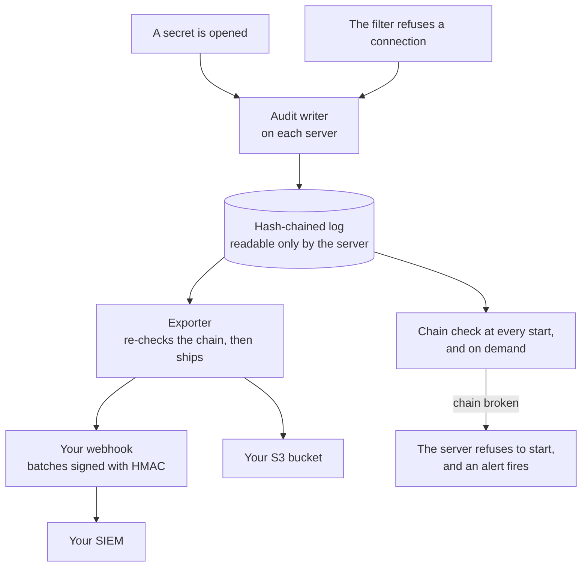
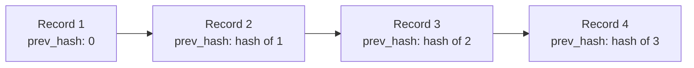
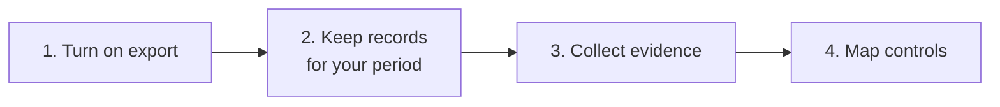

import { Aside, Tabs, TabItem } from '@astrojs/starlight/components';

This page is for security reviewers, auditors and compliance teams. It explains what AerolVM records and how the records are protected and shipped. It also lists the evidence you can collect, and maps AerolVM's controls to a common control framework.

<Aside title="Compliance status">
AerolVM has no SOC 2 or ISO 27001 report of its own. It is software you run, so its controls become part of your own compliance scope. This page gives you the evidence and the mapping to do that.
</Aside>

## How audit records flow



A SIEM (security information and event management system) is where many companies collect and search security records.

- **Every secret open is recorded:** when a sandbox starts, when it is rebuilt, and when someone asks for its variables.
- **Records are chained.** Each record holds a fingerprint (hash) of the one before, so a changed or deleted record breaks the chain. Someone with root on a server could rebuild that server's chain, which is why the copy you export matters.
- **Shipping never drops a batch.** If your receiver is down, the server keeps the records, retries, and raises an alert when it falls behind.
- **Gaps are visible.** If records ever have to be skipped, the log writes a marker with the number skipped.

## What a record holds

| Kind | When it is written |
|---|---|
| `secret_open` | A sandbox's variables, registry password or storage credentials are opened |
| `egress` | The network filter refuses an outbound connection. It can also record the ones it allows. |
| `gap` | Records had to be skipped. The marker carries the count. |
| `retention_checkpoint` | Old records were removed after the retention period |

| Field | Meaning |
|---|---|
| `time` | When it happened |
| `node_id` | The server that acted |
| `sandbox_id` | The sandbox it was about |
| `ref` | Which secret, by name, such as `env:<sandbox-id>`. Never the value. |
| `destination` | For `egress` records, where the connection was going |
| `result` and `reason` | What happened. Reasons come from a fixed list, never free text. |
| `prev_hash` and `event_hash` | The links of the chain |

No record ever holds a secret's value, the content of traffic, or a command.

Each record is linked to the one before it by its fingerprint:



## Evidence you can collect

| Evidence | What it shows | Where to get it |
|---|---|---|
| Audit records | Every time a secret is opened, and the outbound connections the filter refuses | `sandbox.audit()` in every SDK. See [below](#read-a-sandboxs-audit-history). |
| A hash chain | Each record holds a hash of the one before, so a changed or deleted record breaks the chain. Someone with root on the server could rebuild the whole chain, so keep a copy off the server. | The operator can check the whole chain on demand. Bundled alerts fire when it breaks. |
| Records kept off the server | A copy a server that is taken over cannot rewrite | `SB_AUDIT_EXPORT_BACKEND` set to `webhook` (signed with HMAC) or `s3`. `file` and `stdout` also work, but stay on the server. |
| Release checksums | A download is the official build | `checksums.txt` in each release |
| Build provenance | How and where a release was built | The signed SLSA provenance file in each release (`<version>.intoto.jsonl`) |
| Bill of materials | Every Go module in a release | `sbom.cdx.json` (CycloneDX) in each release |
| Threat model | The trust boundaries, and what each one protects | [THREAT-MODEL.md](https://github.com/aerol-ai/microvm/blob/main/THREAT-MODEL.md) |
| Security assessment | The problems that matter most, and where each one stands | [SECURITY-ASSESSMENT.md](https://github.com/aerol-ai/microvm/blob/main/SECURITY-ASSESSMENT.md) |
| Vulnerability handling | How reports are handled, with response times | [SECURITY.md](https://github.com/aerol-ai/microvm/blob/main/SECURITY.md): a reply within 3 business days, an assessment within 7, and fixes in about 14 days for critical issues and 30 for high |
| Supported versions | Which releases get security fixes | [SUPPORT.md](https://github.com/aerol-ai/microvm/blob/main/SUPPORT.md) |
| How changes land | Who reviews and who releases | [GOVERNANCE.md](https://github.com/aerol-ai/microvm/blob/main/GOVERNANCE.md). CI runs OpenSSF Scorecard, gosec, govulncheck and dependency review. |

To check a download yourself, follow [Release verification](https://github.com/aerol-ai/microvm/blob/main/RELEASE-VERIFICATION.md).

## Control mapping: NIST SP 800-53

NIST SP 800-53 Revision 5 is a widely used catalog of security controls. This table shows where AerolVM supports a control, and which [baseline](/enterprise/security-controls/) controls provide it.

<Aside type="caution">
This mapping is a starting point for your assessor, not a certification. Most of these controls also need your own process, such as access reviews and incident response.
</Aside>

| NIST control | How AerolVM supports it | Baseline |
|---|---|---|
| AC‑3 Access Enforcement | Every API call needs the token. Cluster and audit actions are operator-only. | IM‑1, IM‑2 |
| AC‑4 Information Flow Enforcement | Outbound policies, the name filter and the private-address guard | NS‑2, NS‑3, NS‑4 |
| AC‑6 Least Privilege | Inject rules, secrets left out of reads, privileged mode off | DP‑2, DP‑3, WI‑6 |
| AU‑2 Event Logging | Secret reads and refused connections are recorded | LT‑1, LT‑2 |
| AU‑3 Content of Audit Records | Time, server, sandbox, secret or destination, and result | LT‑1 |
| AU‑9 Protection of Audit Information | A hash chain, files only the server can read, and export off the server | LT‑3, LT‑4 |
| AU‑11 Audit Record Retention | 30 days on the server, and as long as you like in your own store | LT‑5 |
| CM‑7 Least Functionality | Turn off SSH and runtimes you do not use | IM‑3, WI‑1 |
| CP‑9 System Backup | Back up the database and the server key at the same time, and store them apart | BR‑1 |
| CP‑10 System Recovery and Reconstitution | Failover rebuilds sandboxes on a healthy server | BR‑2, BR‑3 |
| IA‑2 Identification and Authentication | The API token, and certificates for cluster servers | IM‑1, IM‑4 |
| IA‑5 Authenticator Management | A separate SSH key for each sandbox, with the private key returned once | IM‑3 |
| RA‑5 Vulnerability Monitoring and Scanning | gosec, govulncheck and dependency review in the project's CI | PV‑2 |
| SC‑7 Boundary Protection | Private by default, shared ports only, and a firewall layout | NS‑1, NS‑6 |
| SC‑8 Transmission Confidentiality and Integrity | HTTPS, and mutual TLS between servers | NS‑6, NS‑7 |
| SC‑12 Cryptographic Key Establishment and Management | The server key, and optional AWS KMS | DP‑5 |
| SC‑13 Cryptographic Protection | AES-256-GCM, and TLS 1.2 or newer | DP‑1, NS‑7 |
| SC‑28 Protection of Information at Rest | Secrets sealed in the database | DP‑1 |
| SC‑39 Process Isolation | Runtime walls around each sandbox | WI‑1 |
| SI‑4 System Monitoring | Metrics, traces and bundled alerts | LT‑6, LT‑7 |
| SR‑4 Provenance | A signed build record, a bill of materials and checksums for each release | PV‑1 |

## Prepare for an audit



1. **Turn on export** on every server, to a webhook or an S3 bucket you control.
2. **Keep records** in your own store for as long as your policy needs. The server keeps 30 days.
3. **Collect evidence** from the table above: records, release files and the project's security documents.
4. **Map controls** with the table above, and add your own processes around them.

## Read a sandbox's audit history

Every SDK reads one sandbox's records, from whichever server ran it:

<Tabs syncKey="lang">
  <TabItem label="TypeScript">
    ```ts
    const page = await sandbox.audit({ kind: "secret_open" });
    for (const event of page.events) {
      console.log(event.time, event.actor, event.ref, event.result);
    }
    ```
  </TabItem>
  <TabItem label="Python">
    ```python
    page = sandbox.audit({"kind": "secret_open"})
    for event in page["events"]:
        print(event["time"], event.get("actor"), event.get("ref"), event["result"])
    ```
  </TabItem>
  <TabItem label="Go">
    ```go
    page, err := sandbox.Audit(ctx, sdktypes.AuditOptions{Kind: "secret_open"})
    if err != nil {
        log.Fatal(err)
    }
    for _, event := range page.Events {
        fmt.Println(event.Time, event.Actor, event.Ref, event.Result)
    }
    ```
  </TabItem>
  <TabItem label="Rust">
    ```rust
    let page = sandbox.audit(AuditOptions {
        kind: Some("secret_open".to_string()),
        ..Default::default()
    })?;
    for event in &page.events {
        println!("{} {:?} {:?} {}", event.time, event.actor, event.r#ref, event.result);
    }
    ```
  </TabItem>
  <TabItem label="Java">
    ```java
    AuditPage page = sandbox.audit(new AuditOptions().setKind("secret_open"));
    for (AuditEvent event : page.events) {
        System.out.println(event.time + " " + event.actor + " " + event.ref + " " + event.result);
    }
    ```
  </TabItem>
</Tabs>

## Next steps

- [Security baseline](/enterprise/security-controls/): every control behind this mapping.
- [Hardening guide](/enterprise/hardening/): the settings to send records off the server.
- [Shared responsibility](/enterprise/responsibility/): what the evidence does not cover.
