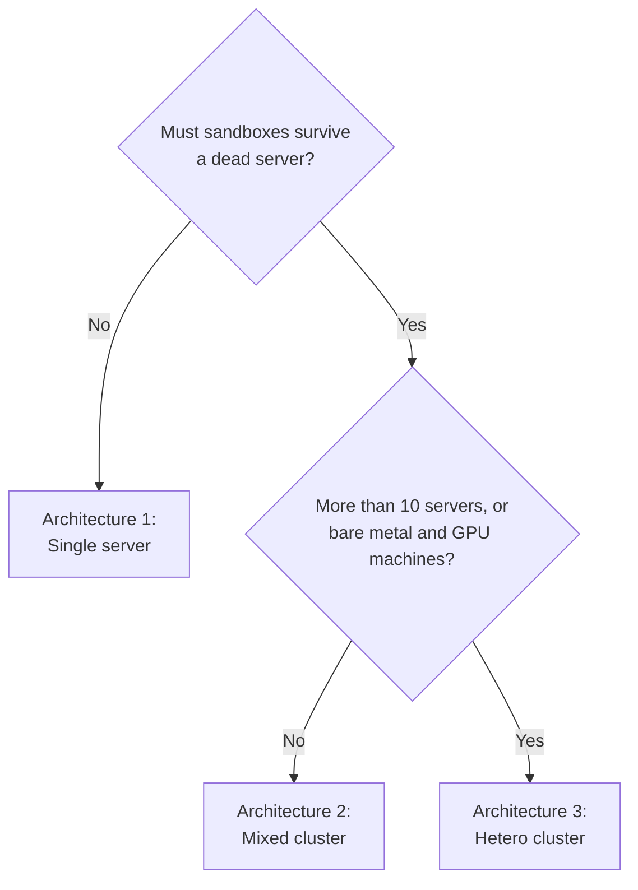
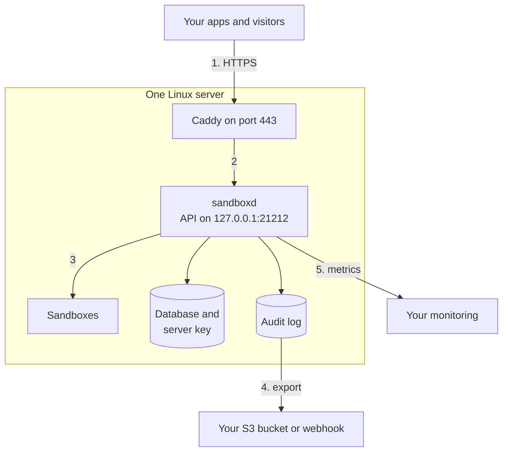
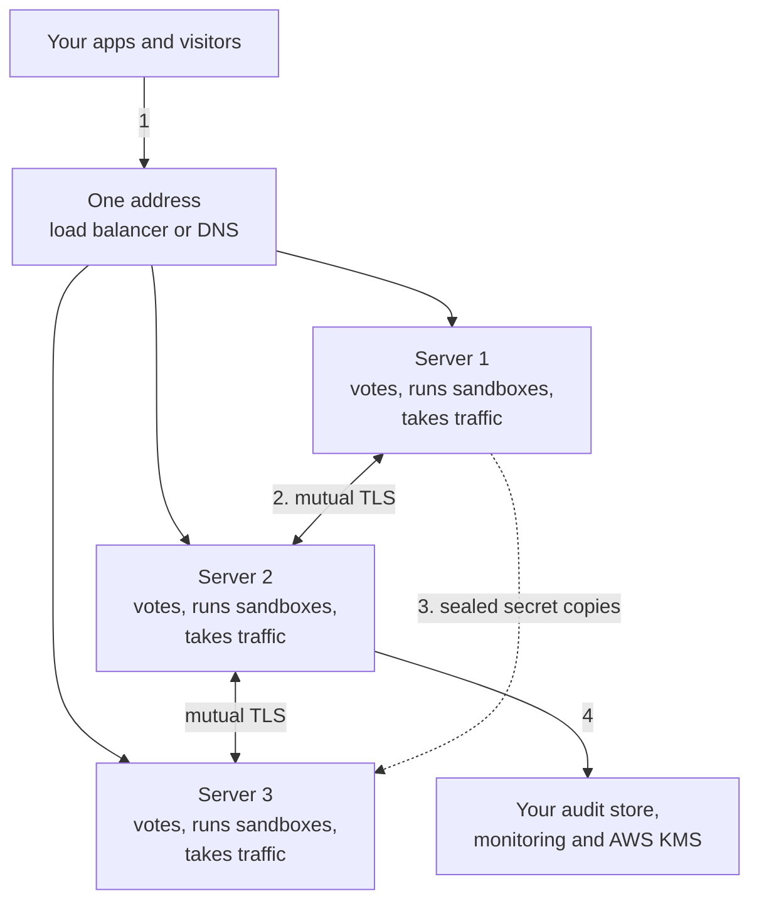
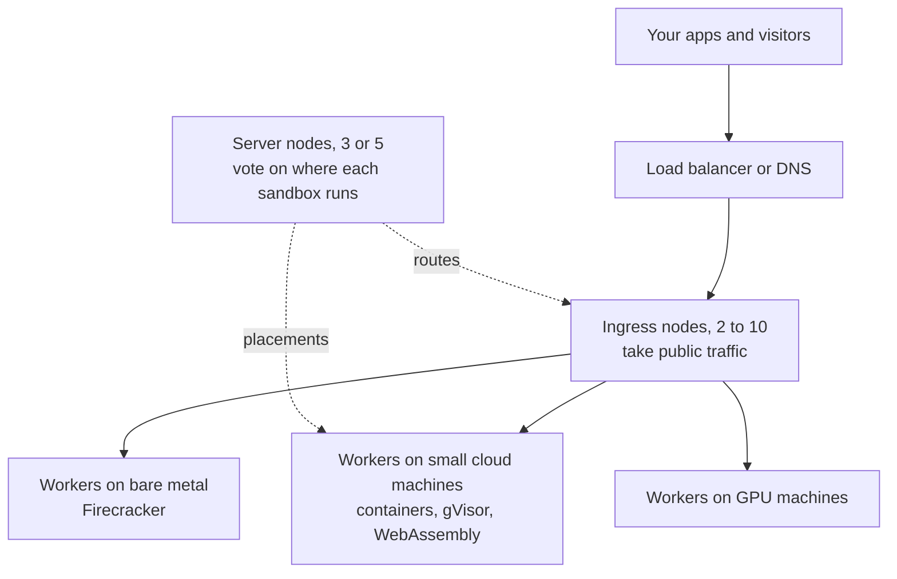
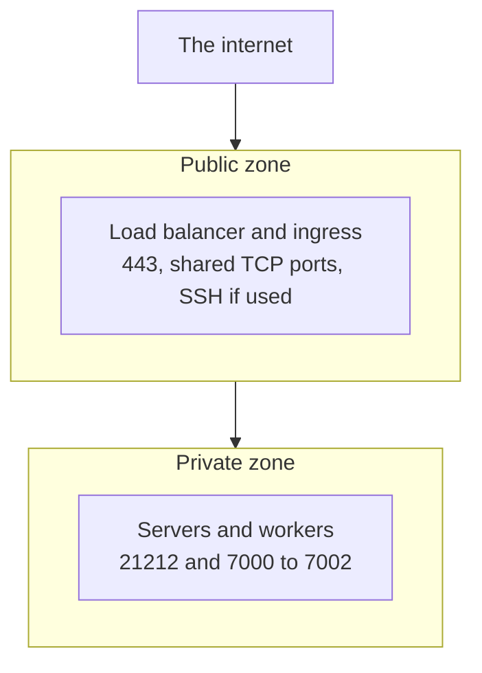

import { Tabs, TabItem } from '@astrojs/starlight/components';

AerolVM runs on your own Linux servers. This page describes three reference architectures. Each one has an architecture diagram, the workflow through it, its components, and what to consider for security, reliability and operations. Your code does not change when you move from one to the next.

## Choose an architecture



| | Single server | Mixed cluster | Hetero cluster |
|---|---|---|---|
| Servers | 1 | 2 to 10, all alike | Any number. Required above 10. |
| What each server does | Everything | Everything: votes, runs sandboxes, takes traffic | One job: vote, run sandboxes or take traffic |
| Survives a dead server | No | Yes, with 3 or more servers | Yes |
| Best for | Starting out, internal tools, one team | More room, and surviving a dead server | Large fleets, bare metal and GPUs |

## Architecture 1: Single server



**Workflow**

1. Your apps and visitors reach your domain over HTTPS. Caddy holds the certificate.
2. Caddy forwards API calls to `sandboxd`. In this architecture, `sandboxd` listens only on the server itself (`SB_API_HOST=127.0.0.1`), so HTTPS is the only way in.
3. `sandboxd` starts each sandbox behind its runtime wall, and seals its secrets in the database.
4. The audit log is shipped to your own S3 bucket or webhook.
5. Your monitoring scrapes metrics with the API token.

**Components**

| Component | Role |
|---|---|
| Linux server | Runs everything. 2 CPUs and 4 GB of memory is enough to start. |
| Domain on Cloudflare | Gives Caddy its HTTPS certificates, and gives sandboxes their links |
| Caddy | HTTPS, public links and shared TCP ports |
| `sandboxd` | The API, the sandboxes, sealed secrets and the audit log |

**Considerations**

- **Security:** keep port `21212` private and the token in a secret manager. Work through the [Hardening guide](/enterprise/hardening/).
- **Reliability:** one server is one point of failure. If it dies, its sandboxes stop. Back up the database and the server key at the same time, and store the key's copy apart from the database's copy.
- **Operations:** room is limited to one machine's CPU, memory and disk. Moving to a cluster later keeps your code the same.

Start with [Install on a server](/getting-started/single-node-setup/), which takes about 20 minutes.

## Architecture 2: Mixed cluster



**Workflow**

1. Your app sends every request to one address. Any server can take a call and pass it to the server that runs the sandbox.
2. Servers vote on every change, such as where a new sandbox runs, over mutual TLS.
3. A sandbox with failover sends sealed copies of its secrets to backup servers. If its server dies, a healthy one rebuilds it with the same ID, ports and link.
4. Each server ships its audit log and metrics to your systems. AWS KMS can hold the keys for sealed copies.

**Components**

| Component | Role |
|---|---|
| 2 to 10 alike servers | Each one does every job. Use 3 or more to survive a dead server. |
| Load balancer or DNS | One address in front of all servers |
| Private network | Carries the cluster ports `7000` to `7002` |
| AWS KMS (optional) | Wraps the keys of sealed secret copies |

**Considerations**

- **Security:** every server needs a certificate from the cluster's own authority, and the gossip key. Keep cluster ports private.
- **Reliability:** with 3 voting servers, the cluster keeps working after losing one. With 5, it survives losing two. Ask for failover on sandboxes that must survive.
- **Operations:** restart and upgrade one server at a time. Past 10 servers, the cluster stops taking new sandboxes until you move to Architecture 3.

We test this architecture on three small AWS machines with 2 CPUs and 4 GB of memory each.

## Architecture 3: Hetero cluster



**Workflow**

1. Traffic reaches the ingress nodes, which hold the public route table and send each request to the right worker.
2. Server nodes vote on where each sandbox runs. They do little work, so small machines are enough.
3. Workers run the sandboxes. Each worker reports which runtimes it can run, so a sandbox only lands where it fits.

**Components**

| Component | Role |
|---|---|
| Server nodes | 3, 5 or at most 7. They vote and keep the record of which worker runs which sandbox. |
| Worker nodes | As many as you need, on the hardware each runtime needs |
| Ingress nodes | 2 to 10. Past 10, they need a router in front that knows which ingress node holds which sandbox. |

**Considerations**

- **Security:** give each tier only the ports it needs. Ingress nodes face the internet; servers and workers do not have to.
- **Reliability:** the number of voters stays at 3 or 5, however many workers join, so adding workers never slows agreement.
- **Operations:** Firecracker needs bare-metal servers, and GPU workers need drivers. Size each tier for its job.

We test this architecture on eight nodes: three servers, one ingress node and four workers, one of them a bare-metal machine for Firecracker.

## Network layout



Keep the API port and the cluster ports in the private zone. [Security architecture](/enterprise/architecture/#network-ports) lists every port.

## Point your apps at it

The SDKs read the server's address from `SB_API_URL` and its token from `SB_PAT_TOKEN`. Both work the same for every architecture. In a cluster, ask for failover when you create a sandbox:

<Tabs syncKey="lang">
  <TabItem label="TypeScript">
    ```ts
    const sandbox = await client.create({
      image: "ubuntu:22.04",
      failover: { policy: "recreate" },
    });
    ```
  </TabItem>
  <TabItem label="Python">
    ```python
    sandbox = client.create(image="ubuntu:22.04", failover={"policy": "recreate"})
    ```
  </TabItem>
  <TabItem label="Go">
    ```go
    sandbox, err := client.Create(ctx, sdktypes.CreateSandboxOptions{
        Image:    "ubuntu:22.04",
        Failover: &sdktypes.Failover{Policy: sdktypes.FailoverPolicyRecreate},
    })
    ```
  </TabItem>
  <TabItem label="Rust">
    ```rust
    use aerolvm_sdk::Failover;

    let sandbox = client.create(CreateOptions {
        image: "ubuntu:22.04".into(),
        failover: Some(Failover { policy: "recreate".into() }),
        ..Default::default()
    })?;
    ```
  </TabItem>
  <TabItem label="Java">
    ```java
    Sandbox sandbox = client.create(new CreateOptions()
        .setImage("ubuntu:22.04")
        .setFailover(new Failover().setPolicy("recreate")));
    ```
  </TabItem>
</Tabs>

## Go-live checklist

| ID | Check | Guide |
|---|---|---|
| GL‑1 | The [Hardening guide](/enterprise/hardening/) checklists are done for your level | Hardening |
| GL‑2 | The audit log is shipped off every server | [Audit and compliance](/enterprise/audit-evidence/) |
| GL‑3 | The database and the server key are backed up together | [Security baseline](/enterprise/security-controls/#backup-and-recovery) |
| GL‑4 | Alerts reach a person, and the runbooks are linked | [Runbooks](/operational-runbooks/) |
| GL‑5 | You know how you will upgrade: newest release line, one server at a time | [Security baseline](/enterprise/security-controls/#posture-and-vulnerability-management) |

## Get help with a rollout

The maintainer can help you pick an architecture, size the servers and take AerolVM to production. See [Work with the maintainer](/enterprise/maintainer/).
