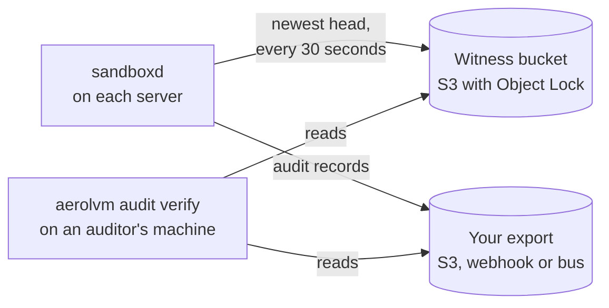

import { Aside, Tabs, TabItem } from '@astrojs/starlight/components';

Enterprise mode is a server setting, `SB_ENTERPRISE_MODE=true`. With it on, the server refuses to start unless every strict security rule is in place. It is part of the free download, and anyone can turn it on.

One of those rules is an **audit witness**. Every audit record holds a fingerprint (hash) of the record before it. So the newest fingerprint, called the **head**, vouches for the whole log. The witness keeps a copy of each head off the server, in an S3 bucket with **Object Lock**. Object Lock means a stored object cannot be changed or deleted until its lock ends. That holds even for the server that wrote it.

Use enterprise mode when you must show an auditor that your audit log was not rewritten. That includes a rewrite by someone who took over a server.

## Read the records it protects

Enterprise mode does not change the API. Your code reads a sandbox's audit records the same way. The witness is what lets you trust the answer.

<Tabs syncKey="lang">
  <TabItem label="TypeScript">
    ```ts
    const page = await sandbox.audit({ kind: "secret_open" });
    if (page.coverage.partial) {
      console.warn("Some servers did not answer:", page.coverage.missing);
    }
    for (const event of page.events) {
      console.log(event.time, event.ref, event.result);
    }
    ```
  </TabItem>
  <TabItem label="Python">
    ```python
    page = sandbox.audit({"kind": "secret_open"})
    if page["coverage"]["partial"]:
        print("Some servers did not answer:", page["coverage"]["missing"])
    for event in page["events"]:
        print(event["time"], event.get("ref"), event["result"])
    ```
  </TabItem>
  <TabItem label="Go">
    ```go
    page, err := sandbox.Audit(ctx, sdktypes.AuditOptions{Kind: "secret_open"})
    if err != nil {
        log.Fatal(err)
    }
    if page.Coverage.Partial {
        log.Println("Some servers did not answer:", page.Coverage.Missing)
    }
    for _, event := range page.Events {
        fmt.Println(event.Time, event.Ref, event.Result)
    }
    ```
  </TabItem>
  <TabItem label="Rust">
    ```rust
    let page = sandbox.audit(AuditOptions {
        kind: Some("secret_open".to_string()),
        ..Default::default()
    })?;
    if page.coverage.partial {
        eprintln!("Some servers did not answer: {:?}", page.coverage.missing);
    }
    for event in &page.events {
        println!("{} {:?} {}", event.time, event.r#ref, event.result);
    }
    ```
  </TabItem>
  <TabItem label="Java">
    ```java
    AuditPage page = sandbox.audit(new AuditOptions().setKind("secret_open"));
    if (page.coverage.partial) {
        System.err.println("Some servers did not answer: " + page.coverage.missing);
    }
    for (AuditEvent event : page.events) {
        System.out.println(event.time + " " + event.ref + " " + event.result);
    }
    ```
  </TabItem>
</Tabs>

- `kind` picks one kind of record, such as `secret_open` or `egress`. Leave it out to get every kind.
- `coverage.partial` is true when some servers in a cluster did not answer. Treat that page as incomplete.
- A page holds up to `limit` records. Pass the page's next cursor back as `cursor` to read the next one.

[Audit and compliance](/enterprise/audit-evidence/) lists every record kind and field.

## What enterprise mode turns on

The server checks these rules when it starts. If one is missing, it refuses to start and names the setting.

| Rule | What the server needs |
|---|---|
| Strong tokens | An `SB_PAT_TOKEN` of at least 32 bytes. `SB_AUDIT_INGEST_TOKEN` and the webhook export token need 32 bytes too, when you set them. |
| Locked-down sandboxes | Privileged mode off (`SB_CONTAINER_PRIVILEGED`). Resource limits on, so `SB_RESOURCE_LIMITS_DISABLED` stays unset. |
| A healthy audit log | The log must open at start (`SB_SECRET_AUDIT_STRICT_BOOT=true`). Audit and delete-record retention must be above zero. So must the per-sandbox audit rate, `SB_AUDIT_EGRESS_SANDBOX_RATE`. |
| Records copied off the server | `SB_AUDIT_EXPORT_BACKEND` set to `webhook`, `s3` or `bus`. A webhook needs `https` plus a bearer token, an HMAC key or a client certificate. An S3 endpoint needs `https`. |
| An audit witness | `SB_AUDIT_WITNESS_BACKEND=s3`, a locked bucket and a unique `SB_NODE_ID`. The rest of this page sets it up. |
| A strict KMS check | With `SB_SECRET_PROVIDER=awskms`, also `SB_SECRET_PROVIDER_STRICT_BOOT=true`. |
| Jailed V8 isolates | When isolates are on: the jail on, seccomp set to `enforce`, and a process limit above zero. |
| A secure cluster | No insecure gossip or key shortcuts, at least two backups, and no CA signing key (`ca.key`) on the server. Above 10 ingress servers, a shard-aware router (`SB_CLUSTER_SHARD_AWARE_INGRESS`). |

Enterprise mode also changes two audit defaults. The in-memory record queue grows to 8,192. When it fills, extra records are written to a spill file on disk instead of being skipped.

## How the witness works



- **Every 30 seconds**, each server sends its newest head to the bucket, if the head changed. An idle server still sends once a day. The lock keeps every version.
- **At every start**, the server reads its newest head from the bucket. That head must be in its local log, or the server refuses to start.
- **Whenever you choose**, an auditor runs `aerolvm audit verify`. It checks every head in a time window against the exported records.

The bucket holds fingerprints only, never audit records. It cannot rebuild a lost log. That is why enterprise mode also needs records copied off the server.

## Turn it on

### Step 1: Create the bucket with Object Lock on

Create a new S3 bucket and turn on Object Lock as you create it. That also turns on versioning, which Object Lock needs. Use this bucket for the witness and nothing else, because its lock applies to every object in it.

Block public access and turn on default encryption, as for any bucket.

On AWS with this project's Terraform, set `audit_witness_enabled = true`. It builds the bucket, the rules and the permissions in Steps 1 to 3.

### Step 2: Set a default retention

The default retention locks every new version for a set number of days. Pick a mode:

| Mode | Who can delete a version before its lock ends | Use it for |
|---|---|---|
| **Compliance** | No one, not even the AWS account root | Production |
| **Governance** | Only someone with `s3:BypassGovernanceRetention` | Trials, so you can delete the bucket afterwards |

Set the days to at least `SB_SECRET_AUDIT_RETENTION_DAYS`, which is 30 by default. A head must stay locked as long as the records it vouches for. With Terraform, set `witness_lock_mode` and `witness_lock_days`. They default to compliance and 30 days.

Add a lifecycle rule that expires **noncurrent** versions after the lock period. Every send adds a version, so without it the bucket grows forever. Never expire current versions. S3 never removes a version that is still locked.

### Step 3: Give the server role its permissions

`<prefix>` is `SB_AUDIT_WITNESS_S3_PREFIX`, which is `witness/` by default.

| Effect | Actions | Resource |
|---|---|---|
| Allow | `s3:PutObject`, `s3:GetObject`, `s3:GetObjectVersion` | `arn:aws:s3:::<bucket>/<prefix>*` |
| Allow | `s3:ListBucketVersions`, `s3:GetBucketVersioning`, `s3:GetBucketObjectLockConfiguration` | `arn:aws:s3:::<bucket>` |
| Allow | `s3:ListBucket`, with no `s3:prefix` condition | `arn:aws:s3:::<bucket>` |
| Deny | `s3:DeleteObject`, `s3:DeleteObjectVersion`, `s3:PutObjectRetention`, `s3:PutObjectLegalHold`, `s3:BypassGovernanceRetention` | `arn:aws:s3:::<bucket>/*` |
| Deny | `s3:PutBucketObjectLockConfiguration`, `s3:PutBucketVersioning`, `s3:PutLifecycleConfiguration`, `s3:PutBucketPolicy` | `arn:aws:s3:::<bucket>` |

`s3:ListBucket` is not optional. Without it, S3 answers a read of a missing object with "access denied" instead of "not found". Then a first start on an empty bucket fails. So does a start after the server was off across UTC midnight. Do not limit it with an `s3:prefix` condition. A read carries no prefix, so S3 would ignore the grant.

The Deny rows stop the server from removing or hiding a head. Never give the server role the governance bypass.

### Step 4: Turn on CloudTrail data events

Turn on CloudTrail S3 data events (write events) for the bucket. An S3 version does not record who wrote it, and CloudTrail does. It is how you find the writer of a head that a server did not send. Terraform does not do this step for you.

### Step 5: Give every server a unique SB_NODE_ID

The witness files heads by server id, so each server sharing the bucket needs its own `SB_NODE_ID`. A single server without one is called `standalone`. The witness refuses that name, because two such servers would write over each other's heads.

Cluster servers already have an id from setup. Changing an id later is a rebuild, not a quick edit. See [Rebuild a server under a new id](#rebuild-a-server-under-a-new-id).

### Step 6: Set the settings and start the server

Add these to each server's environment, then restart it:

```bash
SB_ENTERPRISE_MODE=true
SB_NODE_ID=web-1
SB_AUDIT_WITNESS_BACKEND=s3
SB_AUDIT_WITNESS_S3_BUCKET=my-audit-witness
SB_AUDIT_WITNESS_S3_REGION=us-east-1
SB_AUDIT_EXPORT_BACKEND=s3
SB_AUDIT_EXPORT_S3_BUCKET=my-audit-export
```

AWS credentials come from the usual places: the server's instance role, environment variables or a profile. The Terraform setup sets the witness settings for you. Set `SB_ENTERPRISE_MODE` yourself, through `extra_sandboxd_env`.

At start, the server checks the bucket within 30 seconds:

1. Versioning is on.
2. Object Lock is on, with a default retention of at least `SB_SECRET_AUDIT_RETENTION_DAYS`.
3. A read of a random missing object comes back "not found". That proves the role has `s3:ListBucket`.
4. A test object, called the canary, cannot be deleted. The server writes it, then tries to delete it the way an attacker would. First it tries to delete the version with the governance bypass header. Then it tries a plain delete, which would hide the object behind a delete marker. Both must be refused.

Each start leaves one small canary version under `<prefix>canary/`. It stays locked for the lock period, then the lifecycle rule removes it.

Turning on the witness for a server that never used one is safe. Its first start finds nothing for its id and stores its current head. Moving a server from another witness is not safe. Bring it over under a new id instead.

## If the server refuses to start

A refusal means the server cannot prove its audit log is intact. The error names the check and the fix.

| The error names | What it means | What to do |
|---|---|---|
| Versioning, or Object Lock | The bucket was not created with Object Lock | Create a new bucket with Object Lock on |
| No default retention rule | New heads would not be locked | Add a default retention rule |
| A retention shorter than `SB_SECRET_AUDIT_RETENTION_DAYS` | A head could expire before its records | Raise the bucket's default retention |
| `s3:ListBucket` | S3 said "access denied" for an object that does not exist | Grant `s3:ListBucket` on the bucket, with no `s3:prefix` condition |
| `s3:BypassGovernanceRetention` | The server deleted its own locked canary | Remove the bypass from the server role, and add the Deny rows |
| `s3:DeleteObject` | The server hid its canary behind a delete marker | Deny `s3:DeleteObject` to the server role |
| A canary error other than "access denied" | The server cannot prove deletes are blocked | Fix the cause in the message. An unknown answer is never treated as safe. |
| A check that timed out after 30 seconds | S3 did not answer | Fix the network path, the region or the endpoint |
| `SB_NODE_ID` | The id is missing or `standalone` | Set a unique `SB_NODE_ID` |
| An empty local log, while the witness holds a head | The log was deleted, or the server was rebuilt on an empty disk | [Rebuild under a new id](#rebuild-a-server-under-a-new-id), or treat it as tampering |
| `secret audit witness mismatch` | The newest head in the bucket is not in the local log | Change nothing, copy the audit folder and follow the [runbook](https://github.com/aerol-ai/microvm/blob/main/setup/runbooks/secrets-and-audit.md#witness-mismatch) |
| A delete marker on the newest head | Someone with wider rights tried to hide a head | Treat it as tampering, and find the caller in CloudTrail |

A delete marker is what S3 leaves when someone deletes an object without naming a version. The locked versions stay, but the object looks gone. The server role cannot create one, so a marker means someone else did.

An S3 outage also blocks restarts while the witness is set. That is on purpose: a server that cannot reach its witness cannot prove its log is intact. A server that is already running keeps working. Its sends fail, and `aerolvm_secret_audit_witness_healthy` drops to `0`. Records keep landing in the local log, and the next send catches up. Old records are not removed until the witness holds the current head again.

## Rebuild a server under a new id

Use this when a server's disk was lost or replaced. The server then refuses to start, because the witness still holds a head for its id. Object Lock stops anyone from clearing that head, by design. So the server comes back under a new id. The old id's locked history stays in the bucket as the record of the loss. Write down the old id, the new id, the time and the reason.

On a single server:

1. Stop `sandboxd`. If the disk survived, move `witness_receipts.jsonl` and `witness_tip.json` out of the audit folder, and keep them. They name heads sent under the old id.
2. Pick a new id that no other server sharing the bucket uses, such as `web-1-r2`.
3. Set `SB_NODE_ID` to the new id in `/etc/sandboxd/sandboxd.env`.
4. Start `sandboxd`. The witness holds nothing for the new id, so the first start stores the current head.

In a cluster, the id is also the server's member name and the name in its certificate. So the server leaves the cluster and joins again under the new id. The [secrets and audit runbook](https://github.com/aerol-ai/microvm/blob/main/setup/runbooks/secrets-and-audit.md#rebuild-a-node-under-a-new-sb_node_id) has the exact commands.

## Check the whole history

The start-up check reads only the newest head. `aerolvm audit verify` checks every head in a time window. It follows each head to the next one through the exported records. Run it from a machine outside the cluster, with read-only access to both buckets.

```bash
aerolvm audit verify \
  --witness s3://my-audit-witness/witness/ \
  --export s3://my-audit-export \
  --since 30d
```

- **`--since` is required.** It sets where the window starts. Every head newer than that must link to the records, or the result is FAIL. Older heads are listed, not checked.
- **You pick the window, not the server.** A server that controls its own export could delete its oldest records to shrink the check. A window set by the auditor stops that.
- **Keep exports at least as long as the window.** If records inside the window are gone, the result is FAIL.
- **Keep the window within the witness lock.** Heads older than the lock period have expired from the bucket.

| Result | Exit code | What it means | What to do |
|---|---|---|---|
| PASS | `0` | Every head in the window links to the records | Keep the report as evidence |
| FAIL | `1` | A head is not reached: a rewritten history, a rollback, a head another writer stored, or missing records. Also used when the check cannot run. | Read the report. It names the server and the head. |
| INCOMPLETE | `3` | Nothing contradicts the witness. But some heads are newer than the records and have waited longer than `--max-lag`. | The export is behind. Fix it and run again, or add `--local` for that server. Never read INCOMPLETE as PASS. |

Every flag is in the [CLI reference](/cli/#check-an-audit-log-against-its-witness). With Terraform, `audit_witness_auditor_policy_enabled = true` creates a read-only policy for the auditor.

## The foreign-head alert

Every 30 seconds, before it sends, a server reads its own newest head from the bucket. Sometimes that head is neither its current head nor the last one it sent. Then the server counts a **foreign head**, logs both heads and sends its own head as usual. The `SandboxdAuditWitnessForeignHead` alert fires.

What it proves:

- Someone wrote into this server's place in the bucket. That could be another server using the same cloud role, a second server given the same `SB_NODE_ID`, or anyone with the role's credentials.
- It fires on the server's next send, whether the server is busy or idle.

What it does not prove:

- **Who wrote it.** S3 versions carry no writer. Find the caller in CloudTrail.
- **That every foreign write was seen.** A write can land between the server's read and its own send. It is then buried under the server's own version, and no alert fires. Only `aerolvm audit verify` sees it, as a FAIL.
- **That the server will refuse to restart.** Its next send puts its own head back on top. A restart is refused only while the foreign head is still the newest.

What to do: first look for two servers with the same `SB_NODE_ID`, the common honest cause. If there are none, treat it as a security incident. Then run `aerolvm audit verify` over a window that covers the alert.

A read error is never counted. An S3 hiccup shows in the health metrics instead.

## What the witness proves, and what it does not

**It proves** that stored history cannot be quietly changed. Someone who takes over a server *after* a head was stored cannot rewrite or delete what it covers without being caught. The server refuses to start, and `aerolvm audit verify` reports FAIL.

**It does not prove:**

- **The newest records.** Heads are sent every 30 seconds, so records written since the last send can still be rewritten. A shorter interval narrows that gap.
- **A server that was already taken over when it wrote.** It could store a forged chain from the start.
- **That a newer head is honest, at start-up.** A taken-over server can store a new head that matches a rewritten log. The start-up check reads only the newest head, so it passes. `aerolvm audit verify` catches this, because it checks every head in the window.
- **That only one server writes to each id.** Servers in a cluster share one cloud role. One server can store a version under another server's id. It cannot erase that server's history, because the lock stops that. It can make that server's next start fail, if the stored head is still the newest then. The alert above and `aerolvm audit verify` both show it.
- **That restarts work during an S3 outage.** A server with a witness cannot start until S3 answers.

## For server operators

| Setting | Default | What it does |
|---|---|---|
| `SB_ENTERPRISE_MODE` | `false` | Turns on the rules above. |
| `SB_AUDIT_WITNESS_BACKEND` | Empty | `s3`, or empty for no witness. Empty means no S3 calls at all. |
| `SB_AUDIT_WITNESS_S3_BUCKET` | Empty | The Object Lock bucket. Required with `s3`. |
| `SB_AUDIT_WITNESS_S3_PREFIX` | `witness/` | Where heads go: `<prefix>node=<id>/day=<UTC date>/head.json`. Change it only together with the role's permissions. |
| `SB_AUDIT_WITNESS_S3_REGION` | From the AWS config | The bucket's region. Set it. A missing region can show up as a timeout instead of a clear error. |
| `SB_AUDIT_WITNESS_S3_ENDPOINT` | Empty | For S3-compatible stores. Must use `https` in enterprise mode. Only AWS is tested. A store without Object Lock fails the start-up checks. |
| `SB_AUDIT_WITNESS_S3_PATH_STYLE` | `false` | Path-style addressing, for stores that need it. |
| `SB_NODE_ID` | Empty | Required with a witness, and must not be `standalone`. Unique among servers that share the bucket. |
| `SB_SECRET_AUDIT_WITNESS_INTERVAL` | `30s` | How often heads are sent. Records newer than this can still be rewritten. |
| `SB_SECRET_AUDIT_RETENTION_DAYS` | `30` | How long the server keeps local records. The bucket's lock must be at least this long. |

Watch these metrics on `/v1/metrics`:

- `aerolvm_secret_audit_witness_healthy` is `1` while sends work, and `0` when one fails.
- `aerolvm_secret_audit_witness_failures_total` counts failed sends. The bundled `SandboxdAuditWitnessShipFailing` alert fires when sends keep failing for 15 minutes.
- `aerolvm_secret_audit_witness_foreign_head_total` counts foreign heads. The bundled `SandboxdAuditWitnessForeignHead` alert fires on any increase.

Ansible passes the settings through `sandboxd_audit_witness_*` and `sandboxd_node_id`. The installer lists them, commented out, in `/etc/sandboxd/sandboxd.env`. It never creates a bucket. The [secrets and audit runbook](https://github.com/aerol-ai/microvm/blob/main/setup/runbooks/secrets-and-audit.md#s3-audit-witness) covers every refusal, the mismatch steps and how to retire a bucket.

<Aside type="caution">
A compliance bucket cannot be emptied until every lock ends, so `terraform destroy` fails on it until then. That is the point: the evidence outlives the cluster. Use governance mode with a short lock for trials.
</Aside>

## Next steps

- [Audit and compliance](/enterprise/audit-evidence/): the evidence to collect, and how it maps to NIST SP 800-53.
- [Hardening guide](/enterprise/hardening/): the other settings to lock down a server.
- [aerolvm CLI](/cli/#check-an-audit-log-against-its-witness): every flag of `aerolvm audit verify`.
- [Runbooks](/operational-runbooks/): what to do when an audit alert fires.
