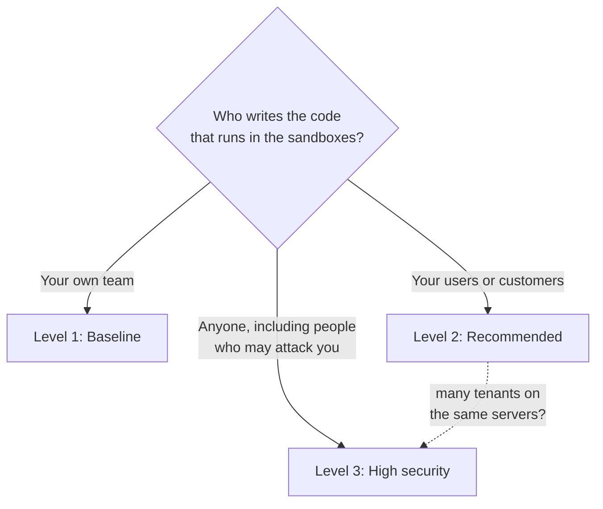
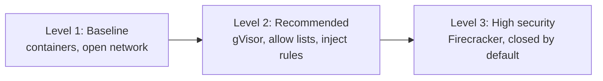
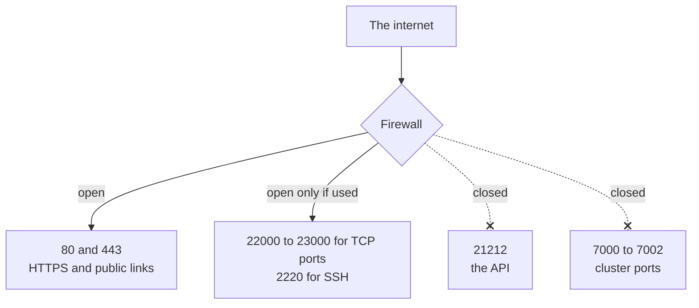

import { Aside, Tabs, TabItem } from '@astrojs/starlight/components';

The defaults are set for getting started, not for hostile code. This guide turns the [security baseline](/enterprise/security-controls/) into three levels and three checklists. Pick the level that matches the code you run, then work through every item marked for that level.

## Pick a level





| | Level 1: Baseline | Level 2: Recommended | Level 3: High security |
|---|---|---|---|
| For | Your own code | Code from your users | Hostile code, many tenants |
| Runtime | Container | gVisor | Firecracker |
| Network | A deny list, or open | An allow list of site names | Block everything, or a short allow list |
| Server default | Open | `default_policy: allowlist` | `default_policy: block_all`, plus `deny_cidrs` and the control-port guard |
| User in the image | Root is fine | Non-root | Non-root |
| Mounts | As needed | Read-only where possible | None |
| API keys | Variables | Inject rules | Inject rules, or none |
| Timers | Optional | Stop when idle | Stop when idle, and a maximum age |
| Audit log | On the server | Exported off the server | Exported off the server, plus the witness |
| Enterprise mode | Off | Optional | On |

## A hardened sandbox

This sandbox runs in gVisor, has no network and firm limits, stops when idle and is deleted after 4 hours. That meets Level 2. For Level 3, switch the runtime to Firecracker.

<Tabs syncKey="lang">
  <TabItem label="TypeScript">
    ```ts
    const sandbox = await client.create({
      image: "ubuntu:22.04",
      runtime: "gvisor",
      networkBlockAll: true,
      cpu: 2,
      memoryMB: 1024,
      lifecycle: {
        stopIfIdleFor: 30 * 60 * 1_000_000_000,     // 30 minutes
        destroyAtAge:  4 * 60 * 60 * 1_000_000_000, // 4 hours
      },
    });
    ```
  </TabItem>
  <TabItem label="Python">
    ```python
    sandbox = client.create(
        image="ubuntu:22.04",
        runtime="gvisor",
        network_block_all=True,
        cpu=2.0,
        memory_mb=1024,
        lifecycle={
            "stopIfIdleFor": 1_800_000_000_000,  # 30 minutes
            "destroyAtAge": 14_400_000_000_000,  # 4 hours
        },
    )
    ```
  </TabItem>
  <TabItem label="Go">
    ```go
    sandbox, err := client.Create(ctx, sdktypes.CreateSandboxOptions{
        Image:           "ubuntu:22.04",
        Runtime:         sdktypes.RuntimeGvisor,
        NetworkBlockAll: true,
        CPU:             2,
        MemoryMB:        1024,
        Lifecycle: &sdktypes.Lifecycle{
            StopIfIdleFor: 30 * time.Minute,
            DestroyAtAge:  4 * time.Hour,
        },
    })
    if err != nil {
        log.Fatal(err)
    }
    ```
  </TabItem>
  <TabItem label="Rust">
    ```rust
    let sandbox = client.create(CreateOptions {
        image: "ubuntu:22.04".into(),
        runtime: Some("gvisor".into()),
        network_block_all: Some(true),
        cpu: Some(2),
        memory_mb: Some(1024),
        lifecycle: Some(aerolvm_sdk::Lifecycle {
            stop_if_idle_for: 1_800_000_000_000, // 30 minutes
            destroy_at_age: 14_400_000_000_000,  // 4 hours
            ..Default::default()
        }),
        ..Default::default()
    })?;
    ```
  </TabItem>
  <TabItem label="Java">
    ```java
    Sandbox sandbox = client.create(
        new CreateOptions()
            .setImage("ubuntu:22.04")
            .setRuntime("gvisor")
            .setNetworkBlockAll(true)
            .setCpu(2.0)
            .setMemoryMb(1024)
            .setLifecycle(new Lifecycle()
                .setStopIfIdleFor(1_800_000_000_000L)   // 30 minutes
                .setDestroyAtAge(14_400_000_000_000L))  // 4 hours
    );
    ```
  </TabItem>
</Tabs>

## Sandbox checklist

| ID | Do this | Levels | Baseline |
|---|---|---|---|
| HS‑1 | Pick the runtime from the level table: `runtime: "gvisor"` or `"firecracker"` | 2, 3 | WI‑1 |
| HS‑2 | Close the network, or allow only named sites, with `networkBlockAll` or `networkAllowOut`. Avoid deny lists for untrusted code. | 2, 3 | NS‑2 |
| HS‑3 | Build images with a non-root `USER`. Setting a user at create time does not change it yet. | 2, 3 | WI‑5 |
| HS‑4 | Mount only what the code needs, with `readOnly: true` where it only reads | 2, 3 | DP‑6 |
| HS‑5 | Check image signatures in your pipeline, then pin images by digest (`image@sha256:...`) | 2, 3 | |
| HS‑6 | Use inject rules for API keys instead of plain variables | 2, 3 | DP‑3 |
| HS‑7 | Set `cpu`, `memoryMB` and `diskGB` for the job | All | WI‑2 |
| HS‑8 | Set `stopIfIdleFor`, and `destroyAtAge` for hostile code | 2, 3 | WI‑4 |
| HS‑9 | Cap traffic with byte limits if the code moves data | 3 | NS‑8 |

A non-root image looks like this:

```dockerfile
FROM python:3.12
RUN useradd --create-home app
USER app
```

## Server checklist

| ID | Do this | Levels | Baseline |
|---|---|---|---|
| HV‑1 | Keep the API token in a secret manager. The installer prints it once. | All | IM‑1 |
| HV‑2 | Install with a domain, so Caddy serves HTTPS | All | NS‑6 |
| HV‑3 | Keep port `21212` private. On a single server, set `SB_API_HOST=127.0.0.1` so only Caddy reaches it. | All | NS‑6 |
| HV‑4 | Firewall the server as shown below | All | NS‑6 |
| HV‑5 | Set the server key (`SB_CREDENTIAL_ENCRYPTION_KEY`) from your secret manager. Back it up when you back up the database, and store the copies apart. | All | DP‑5, BR‑1 |
| HV‑6 | Keep privileged mode (`SB_CONTAINER_PRIVILEGED`) off. Never set `SB_RESOURCE_LIMITS_DISABLED`. | All | WI‑6 |
| HV‑7 | Verify each download, and stay on the newest release line | All | PV‑1, PV‑3 |
| HV‑8 | Start every sandbox closed with a policy file (below) | 3 | NS‑3, NS‑4 |
| HV‑9 | Turn off what you do not use: `SB_ENABLE_SSH_GATEWAY=false`, and leave Firecracker, WebAssembly and V8 isolates off unless needed | 2, 3 | IM‑3 |
| HV‑10 | Send the audit log off the server with `SB_AUDIT_EXPORT_BACKEND` set to `webhook` or `s3` | 2, 3 | LT‑4 |
| HV‑11 | Load the bundled alerts and dashboards | 2, 3 | LT‑7 |
| HV‑12 | Encrypt the server's disks | 3 | DP‑7 |
| HV‑13 | Turn on [enterprise mode](#enterprise-mode) with the audit witness | 3 | LT‑8 |

### Firewall



### Policy file for Level 3

Point `SB_EGRESS_OPERATOR_FILE` at a file like this one:

```yaml
version: 1
default_policy:
  mode: block_all                    # creates that set no policy get no network
deny_cidrs: [169.254.169.254/32]     # the cloud metadata service; add your private ranges
node_control_port_guard: true        # no sandbox can reach AerolVM's own ports
```

<Aside type="caution">
Do not add the ranges the server gives its own sandboxes to `deny_cidrs`, or sandbox networking breaks. Test a sandbox after each change. See [Private networks](/advanced-network-rules/#private-networks).
</Aside>

### Enterprise mode

Enterprise mode is one server setting, `SB_ENTERPRISE_MODE=true`. It turns much of this checklist into rules the server enforces. If a rule is not met, the server refuses to start and names the setting. It is in the free download, and anyone can turn it on.

It needs:

- An `SB_PAT_TOKEN` of at least 32 bytes.
- Privileged mode off and resource limits on (HV‑6).
- The audit log sent off the server, to a webhook, S3 or a message bus (HV‑10). A webhook must use `https`.
- An audit witness: an S3 bucket with Object Lock, plus a unique `SB_NODE_ID` on each server.
- The audit log's strict start, retention and per-sandbox rate left on. They are on by default.
- Strict start for AWS KMS, when you use it (HC‑5).
- In a cluster: the gossip key, at least two backups, and no CA signing key on the servers (HC‑1, HC‑4).
- When V8 isolates are on: their jail, with seccomp in `enforce` mode.

[Enterprise mode](/enterprise/enterprise-mode/) has the full list, and sets up the witness bucket step by step.

## Cluster checklist

| ID | Do this | Levels | Baseline |
|---|---|---|---|
| HC‑1 | Keep the gossip key on. Never set `SB_CLUSTER_INSECURE_GOSSIP`. | All | NS‑7 |
| HC‑2 | Keep the cluster ports on a private network that the internet cannot reach | All | NS‑7 |
| HC‑3 | Run 3 or 5 voting servers | All | BR‑3 |
| HC‑4 | Keep the cluster authority's signing key off the servers. Each new server makes its own key and asks to be signed. | 3 | IM‑4 |
| HC‑5 | Use AWS KMS for secret copies (`SB_SECRET_PROVIDER=awskms`) with `SB_SECRET_PROVIDER_STRICT_BOOT=true`, so a broken KMS setup stops the server from starting | 3 | DP‑5 |
| HC‑6 | Ask for failover on sandboxes that must survive a lost server | As needed | BR‑2 |

## Next steps

- [Shared responsibility](/enterprise/responsibility/): what hardening cannot fix.
- [Reference architectures](/enterprise/deployment/): where each setting fits in your layout.
- [Enterprise mode](/enterprise/enterprise-mode/): have the server enforce these settings, and keep audit fingerprints where no server can change them.
- [Audit and compliance](/enterprise/audit-evidence/): show your auditors what you turned on.
