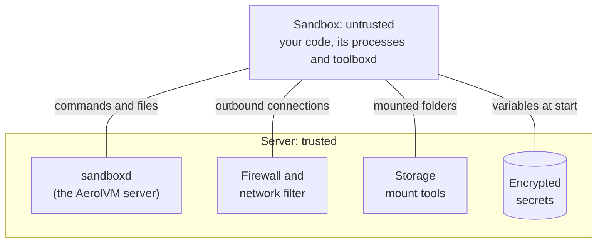

import { Tabs, TabItem } from '@astrojs/starlight/components';
import BookCall from '../../../components/BookCall.astro';
import { BOOKING_URL as bookingUrl } from '../../../utils/links';

AerolVM runs code you do not trust on servers you control. That code might come from AI agents, your users, plugins or build jobs. This page explains the security model from end to end: the line AerolVM draws, what you get without any setup, what you have to turn on, and what is out of scope.

The whole model rests on one idea. **The sandbox is untrusted, and the server is trusted.** Every file, network connection, secret and command that a sandbox uses goes through code on the server side of that line.

## The trust boundary



| Side | What lives there | How AerolVM treats it |
|---|---|---|
| Sandbox | Your code, everything it starts, and `toolboxd`, the small helper that runs commands and moves files | Untrusted. Assume it is hostile. |
| Server | `sandboxd`, the container engine or virtual machine monitor, the network filter, the mount tools and Caddy, the web proxy | Trusted. It enforces the boundary. |

How strong the boundary is depends on the runtime you pick:

| Runtime | What keeps the sandbox off the server | On by default? |
|---|---|---|
| Containers (Docker or containerd) | Linux namespaces (each sandbox gets its own view of processes, files and network), resource limits, a system-call filter (seccomp) and fewer privileges. The sandbox shares the server's kernel. | Yes, this is the default |
| gVisor | A kernel written in Go answers the sandbox's system calls, so the server's kernel sees far fewer of them | The installer must add it |
| Firecracker | A hardware virtual machine (KVM) with its own Linux kernel | The operator turns it on |
| WebAssembly | The code runs inside the wazero runtime. It has no system calls, only what the server hands it. | The operator turns it on |
| V8 isolate | JavaScript runs in workerd, inside a jail with its own root folder, limits and a system-call filter | The operator turns it on |

See [Isolation boundary](/enterprise/isolation-boundary/) for what each runtime does and does not do.

## What you get by default

Before you set anything, a sandbox gets:

- **Its own files.** It sees its image plus the folders you mount, and writes go to its own layer.
- **Its own processes.** It cannot see or signal processes in other sandboxes.
- **No way in.** Nothing outside can reach it until you share a port.
- **Resource limits.** 1 CPU, 1 GB of memory and 10 GB of disk unless you ask for more. How strictly each one is enforced depends on the runtime.
- **Encrypted variables.** Environment variables are stored encrypted on the server, left out of normal API answers, and every read is recorded.
- **Storage keys that stay on the server.** Credentials for a bucket or a network share never enter the sandbox.
- **A token on every API call.** The server refuses calls without its API token.

Two defaults surprise people:

- **Outbound traffic is not filtered.** With no network policy, a sandbox can reach the internet and anything else the server can reach. That includes private addresses, the cloud metadata service and other sandboxes. V8 isolates are the exception: they can never reach private addresses. Set a policy on each sandbox, or have your operator set one for the whole server. See [Network defenses](/enterprise/network-defenses/).
- **Code runs as root inside the sandbox.** A sandbox runs as its image's default user, which is usually root. In a container, that root is fenced in by the container but shares the server's kernel. Build your image with a non-root user. See [Hardening](/enterprise/hardening/).

## Scope: what the boundary covers

It is more useful to be clear about the edges than to list features. Here is where the model protects you, where it does not, and what it expects from you.

### Defended by the model

- **Sandbox to server.** The runtime keeps a sandbox off the server. How well depends on the runtime, as the table above shows.
- **Sandbox to sandbox.** Separate files, processes and writable layers. On the network, sandboxes are kept apart only when they have a policy.
- **Outbound traffic, once you set a policy.** You can block it, or allow only named sites, with checks against common DNS tricks.
- **API keys you inject.** With an inject rule, the sandbox only holds a placeholder. The real key is added only on requests to the site you name.
- **Secrets at rest.** Variables, registry passwords and storage credentials are encrypted on the server.

### Out of scope, by design

- **The server and the operator token.** Whoever controls the server, or holds its operator token, is on the trusted side. AerolVM protects the server from sandboxes. It does not protect sandboxes from their own server.
- **The kernel, the hypervisor and the CPU.** The model trusts them. A bug below the boundary is below the model. Containers share the server's kernel, so a kernel bug matters most there.
- **What an allowed site does with your data.** If you allow a sandbox to reach a site, that site gets whatever the sandbox sends.
- **Where images come from.** AerolVM does not check image signatures or attestations. The registries you pull from are part of what you trust. See [Filesystem and images](/enterprise/filesystem-and-images/).
- **Overloading your own deployment.** A sandbox can use up its own limits. Attacks on a server you run yourself are out of scope.

### Your responsibility

- **Pick a runtime** that matches how much you trust the code.
- **Set a network policy.** For unknown code, start from "block everything" and allow only what it needs.
- **Drop root** inside the sandbox when the code does not need it.
- **Pin your images and mount only what is needed,** read-only where you can.
- **Protect the server,** its operator token and its encryption key. They are the trusted base for everything above.
- **Stay up to date.** Security fixes land on the latest release line only.

## A locked-down sandbox

This sandbox runs in gVisor, can reach only the Python package sites, and is deleted after 4 hours. gVisor must be installed on the server first.

<Tabs syncKey="lang">
  <TabItem label="TypeScript">
    ```ts
    const sandbox = await client.create({
      image: "python:3.12",
      runtime: "gvisor",
      networkAllowOut: ["pypi.org", "*.pythonhosted.org"],
      lifecycle: {
        destroyAtAge: 4 * 60 * 60 * 1_000_000_000, // 4 hours
      },
    });
    ```
  </TabItem>
  <TabItem label="Python">
    ```python
    sandbox = client.create(
        image="python:3.12",
        runtime="gvisor",
        network_allow_out=["pypi.org", "*.pythonhosted.org"],
        lifecycle={"destroyAtAge": 14_400_000_000_000},  # 4 hours
    )
    ```
  </TabItem>
  <TabItem label="Go">
    ```go
    sandbox, err := client.Create(ctx, sdktypes.CreateSandboxOptions{
        Image:           "python:3.12",
        Runtime:         sdktypes.RuntimeGvisor,
        NetworkAllowOut: []string{"pypi.org", "*.pythonhosted.org"},
        Lifecycle:       &sdktypes.Lifecycle{DestroyAtAge: 4 * time.Hour},
    })
    if err != nil {
        log.Fatal(err)
    }
    ```
  </TabItem>
  <TabItem label="Rust">
    ```rust
    let sandbox = client.create(CreateOptions {
        image: "python:3.12".into(),
        runtime: Some("gvisor".into()),
        network_allow_out: Some(vec!["pypi.org".to_string(), "*.pythonhosted.org".to_string()]),
        lifecycle: Some(aerolvm_sdk::Lifecycle {
            destroy_at_age: 14_400_000_000_000, // 4 hours
            ..Default::default()
        }),
        ..Default::default()
    })?;
    ```
  </TabItem>
  <TabItem label="Java">
    ```java
    Sandbox sandbox = client.create(
        new CreateOptions()
            .setImage("python:3.12")
            .setRuntime("gvisor")
            .setNetworkAllowOut(List.of("pypi.org", "*.pythonhosted.org"))
            .setLifecycle(new Lifecycle().setDestroyAtAge(14_400_000_000_000L)) // 4 hours
    );
    ```
  </TabItem>
</Tabs>

## How the model is enforced

Each part of the server carries part of the boundary. These pages go deep on each one, including the limits.

| Page | What it covers |
|---|---|
| [Isolation boundary](/enterprise/isolation-boundary/) | Each runtime's wall, the control channel, root inside the sandbox, and resource limits. |
| [Filesystem and images](/enterprise/filesystem-and-images/) | The private root, mounts, the file API, snapshots and where images come from. |
| [Network defenses](/enterprise/network-defenses/) | The default posture, private addresses and metadata, DNS tricks, and inbound traffic. |
| [Secret handling](/enterprise/secret-handling/) | How variables are sealed, keeping keys out with inject rules, and the audit trail. |
| [Hardening](/enterprise/hardening/) | The settings to tighten, for one sandbox and for the whole server. |

## Report a vulnerability

If you find a way across any of these lines, we want to hear about it. Examples: a sandbox reaching the server, one tenant reaching another, a way around the network filter, or a secret reaching a place it should not. Report it privately. Do not open a public issue.

- **GitHub private advisory (preferred):** [open a report](https://github.com/aerol-ai/microvm/security/advisories/new).
- **Email:** [security@aerol.ai](mailto:security@aerol.ai).

We reply within 3 business days. The full process and scope are in the project's [security policy](https://github.com/aerol-ai/microvm/blob/main/SECURITY.md).

## Run AerolVM for your team

<BookCall href={bookingUrl} title="Planning a rollout?">
  We help teams pick runtimes, set network policies and set up clusters with KMS and audit export. Book a call.
</BookCall>

## Who builds AerolVM

AerolVM's founder is **Suman Saurabh**. Suman has spent 11 years building large distributed systems, most recently the secure infrastructure that AI products run on.

- **Secure fine-tuning infrastructure at Microsoft.** On Azure Machine Learning (2020 to 2025), Suman was a founding team member of AI fine-tuning. Suman led the engineering that scaled secure LLM training across private networks and Kubernetes. Suman also led the design of secure multi-tenant ML infrastructure, including GPU scheduling and isolation for LLM workloads.
- **A secure protocol at large scale.** At Microsoft, Suman co-developed TunDRA, a secure QUIC-based protocol in Rust that runs on more than 1 million compute instances.
- **MicroVM and agent products for 100M+ users.** Suman has led several microVM and agent-based products used by more than 100 million people a month. As Principal Engineer at BlackBox, Suman built a sandbox platform in Go that isolates more than 300,000 code runs a month. That work unblocked SOC 2 compliance for its Copilot product. Suman also led its agentic AI platform, which handles more than 50,000 agent runs a day.
- **Security as part of the work.** Suman has mentored engineers on secure protocol design, added CodeQL and GitHub Advanced Security to build pipelines, and made threat modeling a standard step in design reviews.

Connect with Suman on [LinkedIn](https://www.linkedin.com/in/ssumansaurabh/) or [GitHub](https://github.com/sumansaurabh).
