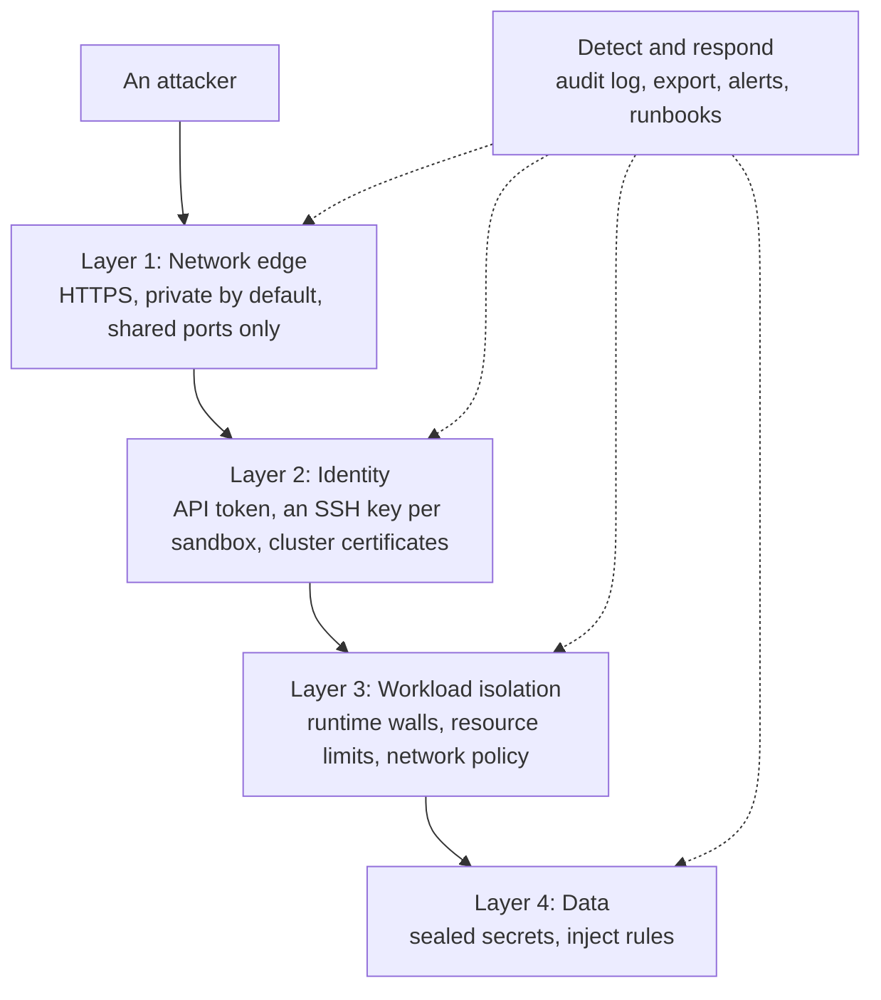
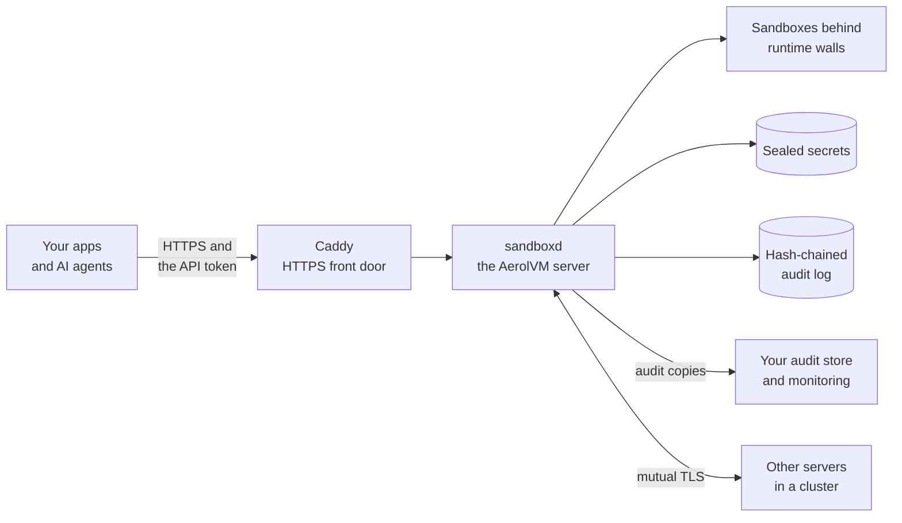
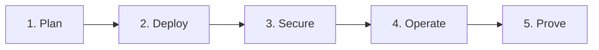

import BookCall from '../../../components/BookCall.astro';

AerolVM runs code you do not trust, such as AI agents, your users' code and build jobs, on servers you control. It is open source under the MIT license, and every feature in this section is in the free download. Your code, your data and your keys stay in your own cloud or data center.

| | |
|---|---|
| **License** | MIT, open source |
| **Hosting** | Self-hosted on Linux, in your cloud or data center |
| **Scale** | One server, a cluster of 2 to 10 alike servers, or a split cluster of any size |
| **Runtimes** | Containers, gVisor, Firecracker microVMs, WebAssembly and V8 isolates |
| **SDKs** | TypeScript, Python, Go, Rust and Java |
| **Help** | The community, and engagements with the maintainer |

## Security principles

AerolVM's design follows four principles, the same ideas behind Zero Trust security.

| Principle | What it means in AerolVM |
|---|---|
| **Isolate by default** | Each sandbox runs behind a runtime wall. A new sandbox is private, and only ports you share can be reached. |
| **Verify explicitly** | Every API call carries a token that is checked in constant time. Cluster servers prove who they are with certificates. |
| **Least privilege** | Inject rules keep real API keys out of sandboxes. Secrets are left out of normal answers, and cluster changes are operator-only. |
| **Assume breach** | Secrets are sealed at rest. Every secret read is recorded in a hash-chained log that you can copy off the server, and alerts fire when something looks wrong. |

## Defense in depth

No single control is perfect, so AerolVM stacks them. To reach your data, an attacker has to get past every layer, and every layer is watched.

## Architecture at a glance

[Security architecture](/enterprise/architecture/) shows every component, trust boundary, data flow and port.

## What is included

Each feature is **Default** (on with no setup), **You turn it on**, or **Proposed** (not built yet, open for discussion).

| Area | Feature | Status | Learn more |
|---|---|---|---|
| Isolation | Five runtimes, from containers to Firecracker microVMs | Containers by default | [Sandboxes](/sandboxes/) |
| Isolation | CPU, memory and disk limits | Default | [Security baseline](/enterprise/security-controls/#workload-isolation) |
| Isolation | Lifetime timers that stop or delete sandboxes | You turn it on | [Lifecycle](/lifecycle/) |
| Network | Private by default: no public route until you share a port | Default | [Public URLs](/public-urls/) |
| Network | Outbound policy: block everything, or allow named sites | You turn it on | [Network access](/network-access/) |
| Data | Secrets sealed with AES-256-GCM | Default | [Security baseline](/enterprise/security-controls/#data-protection) |
| Data | API keys kept out of sandboxes with inject rules | You turn it on | [Advanced network rules](/advanced-network-rules/#keep-an-api-key-out-of-the-sandbox) |
| Data | AWS KMS for the secret copies a cluster keeps | You turn it on | [Secrets providers](/cluster-secrets/) |
| Audit | A hash-chained audit log | Default | [Audit and compliance](/enterprise/audit-evidence/) |
| Audit | Audit export to a webhook or S3 | You turn it on | [Audit and compliance](/enterprise/audit-evidence/) |
| Operations | Clusters with failover and mutual TLS | You turn it on | [Reference architectures](/enterprise/deployment/) |
| Operations | Metrics, traces, dashboards and alerts with runbooks | You turn it on | [Runbooks](/operational-runbooks/) |
| Supply chain | Checksums, a bill of materials and a signed build record with every release | Default | [Release verification](https://github.com/aerol-ai/microvm/blob/main/RELEASE-VERIFICATION.md) |
| Identity | Single sign-on (SSO) | Proposed | [Discuss](https://github.com/aerol-ai/microvm/discussions/647) |
| Identity | Scoped API tokens and roles | Proposed | [Discuss](https://github.com/aerol-ai/microvm/discussions/646) |
| Operations | Quotas per team | Proposed | [Discuss](https://github.com/aerol-ai/microvm/discussions/648) |
| Audit | The API caller's name in audit records | Proposed | [Discuss](https://github.com/aerol-ai/microvm/discussions/649) |
| Supply chain | Image signature checks | Proposed | [Discuss](https://github.com/aerol-ai/microvm/discussions/650) |

Need a proposed feature sooner? A company can [sponsor it](/enterprise/maintainer/). It is built in the open and ships to everyone.

## Roll it out in five steps

| Step | What you do | Guide |
|---|---|---|
| 1. Plan | Choose a deployment architecture and the runtimes you need | [Reference architectures](/enterprise/deployment/) |
| 2. Deploy | Install AerolVM and connect your apps over HTTPS | [Security architecture](/enterprise/architecture/#connect-your-apps-securely) |
| 3. Secure | Apply the security baseline at the level that fits your code | [Security baseline](/enterprise/security-controls/), [Hardening guide](/enterprise/hardening/) |
| 4. Operate | Watch metrics and alerts, and follow the runbooks | [Runbooks](/operational-runbooks/) |
| 5. Prove | Collect evidence and map controls for your auditors | [Audit and compliance](/enterprise/audit-evidence/) |

## Security at a glance

| Question | Short answer | Details |
|---|---|---|
| What keeps a sandbox off the server? | The runtime. Containers share the server's kernel. gVisor and Firecracker put a stronger wall in between. | [Workload isolation](/enterprise/security-controls/#workload-isolation) |
| What can a new sandbox reach? | The internet and your private network, until you set a policy. V8 isolates are the exception. | [Network security](/enterprise/security-controls/#network-security) |
| Who can reach a new sandbox? | No one, until you share a port. | [Network security](/enterprise/security-controls/#network-security) |
| Where do secrets live? | Sealed on the server. Every time one is opened, a record is written. | [Data protection](/enterprise/security-controls/#data-protection) |
| Can an AI agent leak an API key? | Not with an inject rule. The sandbox only ever holds a placeholder. | [Data protection](/enterprise/security-controls/#data-protection) |
| Who can call the API? | Anyone with the server's API token. | [Identity and access](/enterprise/security-controls/#identity-and-access) |
| What gets recorded? | Every secret read, and the outbound connections the filter refuses. You can keep a copy off the server. | [Audit and compliance](/enterprise/audit-evidence/) |
| Who handles what? | AerolVM enforces the controls. You run the servers and choose the settings. | [Shared responsibility](/enterprise/responsibility/) |

## Work with the maintainer

<BookCall href="/enterprise/maintainer/" title="Get help from the person who builds AerolVM" label="Work with the maintainer">
  Suman Saurabh leads AerolVM. Suman built secure fine-tuning infrastructure at Microsoft, and a sandbox platform at BlackBox that isolated more than 300,000 code runs a month. Get help designing your sandbox setup, or sponsor the features you need.
</BookCall>

## Next steps

- [Security architecture](/enterprise/architecture/): components, boundaries, data flows and ports.
- [Security baseline](/enterprise/security-controls/): every control, with its default and owner.
- [How AerolVM keeps everything safe](/engineering-security-overview/): the whole picture, in plain words.
