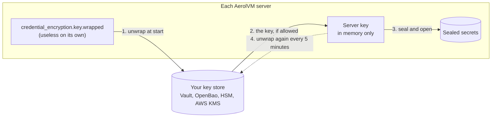

import { Aside, Tabs, TabItem } from '@astrojs/starlight/components';

AerolVM stores secrets for your sandboxes: environment variables, registry passwords, storage credentials, and the token each sandbox's agent trusts. It encrypts all of them. This page is about who holds the key to that encryption.

By default the key is a file on each server. With this feature the key stays in **your** key store: HashiCorp Vault, OpenBao, a hardware security module (HSM), or AWS KMS. The server keeps only a locked copy, and asks your key store to unlock it when it starts. Every unlock is a request your key store can log and refuse. If you disable or delete the key, every server stops using your stored data within about 15 minutes, with no restart.

It is part of the free download and is off until an operator turns it on. Your SDK code does not change.

## Words to know

| Word | What it means |
|---|---|
| **Key store** | The system that holds your master key and never lets it out: Vault or OpenBao Transit, an HSM, or AWS KMS. |
| **Server key** | The key each AerolVM server uses to encrypt the secrets it stores. One per cluster. |
| **Data key** | A fresh key for one sealed secret that is copied between servers for failover. |
| **Wrapped** | Encrypted by your key store. A wrapped key is useless without a call to your key store. |
| **Custody** | Where a key lives: `wrapped` (only a wrapped copy on disk) or `file` (a plain key file, the default). |
| **Revoke** | Disable or delete the key in your key store, so AerolVM can no longer use it. |
| **Rotate** | Replace a key with a new one and move everything onto it. |

## What lives where

| Key | Default | With your key store |
|---|---|---|
| Server key | A file on each server, or an environment variable | Only a wrapped copy on disk, unlocked into memory at start |
| Data keys of failover copies | Encrypted with the server key | Wrapped by your key store |
| Egress inspection CA key | Encrypted with the server key | Follows the server key |
| Node TLS key, gossip key, server token, audit-ingest token | Files or environment variables | Unchanged: these are not covered |

`sandboxd key status` prints this table for a node, so it never claims more than is true.

## How it works



1. **At start** the server sends the wrapped key to your key store and gets the server key back. It keeps the key only in memory.
2. **While running** it seals and opens secrets with that key, as before. Creating a sandbox makes no extra key-store call for the server key.
3. **Every 5 minutes** it asks your key store to unwrap the file again. If the key store says the key is gone three times in a row, the server stops (see [Revoke access](#revoke-access)). An outage or a permission error never counts: only a deleted or disabled key does.

## Choose a key store

| `SB_SECRET_PROVIDER` | Key store | Tested with |
|---|---|---|
| `vault` | HashiCorp Vault or OpenBao, Transit engine | Vault 1.18, OpenBao 2.1 |
| `pkcs11` | Any HSM with a PKCS#11 v2.40 library and AES-GCM | AWS CloudHSM (`hsm2m.medium`, FIPS mode). Other HSMs: not yet tested. SoftHSM2 for tests only. |
| `awskms` | AWS KMS | AWS KMS |

The HSM's library runs in a small helper process, never inside the server, so a crash in vendor code does not take the server down.

## Set up Vault or OpenBao

### 1. Create a Transit key and a policy

Create an `aes256-gcm96` key in the Transit engine, such as `aerolvm-kek`, and give AerolVM a policy like this one:

```hcl
path "transit/encrypt/aerolvm-kek" { capabilities = ["update"] }
path "transit/decrypt/aerolvm-kek" { capabilities = ["update"] }
path "transit/keys/aerolvm-kek"    { capabilities = ["read"] }
```

Keep Vault's `default` policy on the token as well: AerolVM checks its own permissions at start, and Vault Agent looks up its token. Never grant `create` on the encrypt path. With `create`, Transit quietly makes a new key after you delete yours, which would undo a revoke. AerolVM refuses to start with such a token, or with a root token.

### 2. Run Vault Agent or Vault Proxy on each server

AerolVM has no Vault login code. Vault Agent (or Vault Proxy) logs in with any method Vault supports, such as AppRole, Kubernetes, AWS IAM or TLS certificates, and AerolVM uses the result. Pick one of two ways.

**Token file, with Vault Agent.** Agent writes a token to a file and AerolVM reads it:

```hcl
vault {
  address = "https://vault.example.com:8200"
}
auto_auth {
  method "approle" {
    config = {
      role_id_file_path   = "/etc/vault-agent/role-id"
      secret_id_file_path = "/etc/vault-agent/secret-id"
    }
  }
  sink "file" {
    config = { path = "/etc/sandboxd/vault-token", mode = 0600 }
  }
}
```

**No token at all, with Vault Proxy.** Proxy listens on the server's loopback address and adds the token itself, so AerolVM never holds one:

```hcl
vault {
  address = "https://vault.example.com:8200"
}
auto_auth {
  method "approle" {
    config = {
      role_id_file_path   = "/etc/vault-proxy/role-id"
      secret_id_file_path = "/etc/vault-proxy/secret-id"
    }
  }
}
api_proxy {
  use_auto_auth_token = "force"
}
listener "tcp" {
  address     = "127.0.0.1:8100"
  tls_disable = true
}
```

With OpenBao, run `bao agent` or `bao proxy` with the same files.

### 3. Point AerolVM at it

Add the settings to `/etc/sandboxd/sandboxd.env`:

```bash
SB_SECRET_PROVIDER=vault
SB_SECRET_VAULT_ADDR=https://vault.example.com:8200   # or http://127.0.0.1:8100 for Vault Proxy
SB_SECRET_VAULT_KEY_NAME=aerolvm-kek
SB_SECRET_VAULT_TOKEN_FILE=/etc/sandboxd/vault-token  # leave out with Vault Proxy
SB_SECRET_PROVIDER_STRICT_BOOT=true
```

`SB_SECRET_VAULT_TRANSIT_MOUNT`, `SB_SECRET_VAULT_NAMESPACE` and `SB_SECRET_VAULT_CACERT` cover a different mount, a Vault Enterprise namespace and a private CA. AerolVM accepts `http://` only for a loopback address. Calls carry an `X-Aerol-Correlation-ID` header: the API request's correlation id, or `aerolvm-background:<purpose>:<node>` for start-up and background checks. Turn on header auditing for it in Vault to match its audit log to AerolVM's own audit records.

## Set up an HSM

1. On the HSM, create an AES-256 key that can encrypt and decrypt, with a label such as `aerolvm-kek`.
2. Put the user PIN in a file that only root can read (mode `0400` or `0600`).
3. Add the settings to `/etc/sandboxd/sandboxd.env`:

```bash
SB_SECRET_PROVIDER=pkcs11
SB_SECRET_PKCS11_MODULE=/opt/hsm/lib/libvendor-pkcs11.so
SB_SECRET_PKCS11_TOKEN_LABEL=aerolvm
SB_SECRET_PKCS11_PIN_FILE=/etc/sandboxd/hsm-pin
SB_SECRET_PKCS11_KEY_LABEL=aerolvm-kek
SB_SECRET_PROVIDER_STRICT_BOOT=true
```

`SB_SECRET_PKCS11_GCM_IV` is `auto` by default: AerolVM checks at start whether the HSM picks the encryption nonce itself. In enterprise mode a token that is not real hardware is refused.

**AWS CloudHSM.** Install the CloudHSM client (Client SDK 5) PKCS#11 library and point it at your cluster with `configure-pkcs11`. Then:

- `SB_SECRET_PKCS11_MODULE` is `/opt/cloudhsm/lib/libcloudhsm_pkcs11.so` and `SB_SECRET_PKCS11_TOKEN_LABEL` is `hsm1`.
- The PIN file holds `<crypto user>:<password>`.
- Create the key as that crypto user, for example with `cloudhsm-cli key generate-symmetric aes --label aerolvm-kek --key-length-bytes 32 --attributes encrypt=true decrypt=true`.
- CloudHSM in FIPS mode writes its own encryption nonce; `auto` detects that.
- A cluster with one HSM refuses key operations unless the client runs with `--disable-key-availability-check`. Use two HSMs in production.

## Set up AWS KMS

Give the server's IAM role `kms:Encrypt`, `kms:Decrypt` and `kms:DescribeKey` on one key, then:

```bash
SB_SECRET_PROVIDER=awskms
SB_SECRET_AWS_KMS_KEY_ID=alias/aerolvm
SB_SECRET_PROVIDER_STRICT_BOOT=true
```

## Wrap the server key

Pointing AerolVM at a key store protects the failover copies. To keep the **server key** in your key store too, wrap it.

- **A new server:** `install.sh --key-custody wrapped --secret-provider-env /path/to/key-store.env`. The first start makes a key and writes only the wrapped copy.
- **A new cluster:** `cluster-init.sh --key-custody wrapped` on the first server. It puts only the wrapped key in the bundle other servers join with.
- **An existing server or cluster:**
  1. On one server: `sandboxd key wrap`. It writes `credential_encryption.key.wrapped` and reads it back through your key store.
  2. Copy that file to every server. It is safe to copy: it is encrypted.
  3. On every server set `SB_CREDENTIAL_KEY_CUSTODY=wrapped` and remove `SB_CREDENTIAL_ENCRYPTION_KEY` from the env files.
  4. Run `sandboxd key verify`, then delete the old key file. AerolVM refuses to start with wrapped custody while a plain key is still around.
  5. Restart one server at a time.

<Aside type="caution" title="Old copies of the key">
Wrapping an existing server key wraps the **same** key. Backups, cred bundles and old files made before the wrap still hold it in plain form. Until you destroy them, or [rotate the server key](#the-server-key), `sandboxd key status` says "migrated from plaintext". After cleaning up, run `sandboxd key ack-migration`.
</Aside>

To go back to a plain key file, run `sandboxd key unwrap --to-file --i-understand-plaintext` and set `SB_CREDENTIAL_KEY_CUSTODY=file`. The change is recorded in the audit log.

## Check where your keys live

```bash
sandboxd key status --check
```

```text
KEY                       WHERE IT LIVES
server key                customer key store (wrapped)
cluster-secret DEKs       vault
egress-inspection CA key  customer key store (wrapped)
node TLS key              plaintext file                (out of scope for key custody)
...

wrapped server-key file: /var/lib/sandboxd/credential_encryption.key.wrapped
  provider: vault
  key: transit/aerolvm-kek
  wrapped under: vault:v1
  server keys: 0=current
  check: every server key unwraps and matches
```

The same answers are on the `aerolvm_key_custody` metric. In enterprise mode the `SandboxdServerKeyPlaintext` alert fires for any server whose server key is not wrapped.

## Revoke access

Disable or delete the key in your key store:

| Key store | Revoke | Undo |
|---|---|---|
| Vault or OpenBao | Allow deletion on the key, then delete it | Restore the key from a Transit backup |
| HSM | Delete the key with the HSM's own tool | Restore it from the HSM's backup |
| AWS KMS | Disable the key, or schedule it for deletion | Enable it again (and cancel the deletion) |

Within about 15 minutes (`SB_SECRET_PROVIDER_RECHECK_INTERVAL` × `SB_SECRET_PROVIDER_REVOKE_AFTER`, 5 minutes × 3 by default), every server that can reach your key store:

- drops the server key from memory;
- refuses to create, start or restore sandboxes, run commands, read files or open SSH, with `503 key_revoked`;
- closes open SSH sessions, terminals and command streams;
- removes the egress inspection CA and injected secrets from the egress gateway;
- reports `"key_custody": "revoked"` on `/health`, fires `SandboxdKeyRevoked`, and writes a `key_revoked` audit record.

Running sandboxes are not killed, but nobody can manage them through AerolVM. When you restore the key, each server resumes on its own within one check, with no restart, and writes `key_recovered`.

<Aside type="note" title="What a revoke does not reach">
A running sandbox's own public address (`{id}.your-domain`) goes straight to the agent inside it. Whoever already holds that sandbox's token, such as an E2B SDK client, can keep using it until the sandbox stops. Nothing on that path uses your key. A server that cannot reach your key store at all keeps its key until it restarts, and then cannot start. It keeps trying, and comes up by itself within about 30 seconds of your key store answering again.
</Aside>

A **deleted** key makes everything sealed with it unreadable for good. That is how you shut AerolVM out permanently. A **disabled** key makes it unreadable only until you enable it again.

## Rotate keys

### The key in your key store

- **Vault or OpenBao:** rotate the Transit key. Each server moves its stored keys onto the new version in the background, once an hour. When `aerolvm_key_rows_stale` is 0 on every server, you can raise `min_decryption_version` to retire the old version. Retiring too early fires `SandboxdKeyVersionRetiredInUse`.
- **AWS KMS:** rotates in place. Nothing to do.
- **HSM:** labels are settings on each server, so rotation takes four steps: add the new label to `SB_SECRET_PKCS11_DECRYPT_KEY_LABELS` everywhere; switch `SB_SECRET_PKCS11_KEY_LABEL` to it once every server lists it as decryptable; wait for `aerolvm_key_rows_stale` to reach 0; then remove the old label and destroy the old key. The [runbook](https://github.com/aerol-ai/microvm/blob/main/setup/runbooks/secrets-and-audit.md#rotate-the-key-store-key) has the details.

### The server key

A new server key makes old copies of the server key useless for anything in the current database. It works with wrapped custody and with a plain key file.

1. `sandboxd key rotate --stage` on one server. Copy the file it names to every server. Wait until `aerolvm_server_key_ring{key="1",key2="decrypt"}` shows on every server.
2. `sandboxd key rotate --promote`, and copy the file again. Each server starts sealing with the new key and moves its stored secrets onto it. Wait until `aerolvm_server_key_rows{key="0"}` is gone on every server.
3. `sandboxd key rotate --retire 0`, and copy the file again.

Every server must run a release that supports rotation before step 1; `--stage` checks this and refuses otherwise. Each server records `key_rotation_staged`, `key_rotation_promoted` and `key_rotation_retired` in its audit log. After step 2 a server cannot go back to an older release.

## Enterprise mode

With `SB_ENTERPRISE_MODE=true`:

- `SB_SECRET_PROVIDER_STRICT_BOOT` must be `true` for every key store, so a server that cannot reach yours does not start.
- A PKCS#11 token that is not real hardware is refused.
- A server key in a plain file next to a key store logs a warning at start and fires `SandboxdServerKeyPlaintext`. The next release refuses it.

## Good to know

- **A running server holds the key in memory.** Someone with root on a running server can read it. This is true of every scheme like this one, AWS KMS included.
- **The server still holds a way in.** It has a Vault token, reaches a local Vault Proxy, or has an HSM PIN file. Someone who steals that can unlock keys only while they can reach your key store, and every call shows in its log.
- **Software tokens are for tests.** SoftHSM2 keeps its keys and PIN on the same disk, so a stolen disk does unlock them. Enterprise mode refuses one. Elsewhere the server logs a warning, `sandboxd key status --check` says `software token`, and the `aerolvm_key_custody` metric reads `pkcs11 (software token)`.
- **Secrets inside a sandbox** are the sandbox's once they are injected. Revoking does not take them back.
- **Where the evidence is.** Your key store's own log (Vault audit devices, CloudTrail, the HSM's audit log) records every call. AerolVM's audit log records custody changes, revokes, recoveries and rotations.

Every setting is listed in [`setup/config-defaults.md`](https://github.com/aerol-ai/microvm/blob/main/setup/config-defaults.md), and the operator steps are in the [secrets runbook](https://github.com/aerol-ai/microvm/blob/main/setup/runbooks/secrets-and-audit.md#key-custody).

## Same thing from the SDK

Nothing changes for code that uses AerolVM. A sandbox with secrets is created the same way, and the server takes care of the keys:

<Tabs syncKey="lang">
  <TabItem label="TypeScript">
    ```ts
    const sandbox = await client.create({
      image: "python:3.12",
      env: { DATABASE_URL: "postgres://..." },
    });
    ```
  </TabItem>
  <TabItem label="Python">
    ```python
    sandbox = client.create(
        image="python:3.12",
        env={"DATABASE_URL": "postgres://..."},
    )
    ```
  </TabItem>
  <TabItem label="Go">
    ```go
    sandbox, err := client.Create(ctx, sdktypes.CreateSandboxOptions{
        Image: "python:3.12",
        Env:   map[string]string{"DATABASE_URL": "postgres://..."},
    })
    if err != nil {
        log.Fatal(err)
    }
    ```
  </TabItem>
  <TabItem label="Rust">
    ```rust
    use std::collections::HashMap;

    let sandbox = client.create(CreateOptions {
        image: "python:3.12".into(),
        env: Some(HashMap::from([("DATABASE_URL".to_string(), "postgres://...".to_string())])),
        ..Default::default()
    })?;
    ```
  </TabItem>
  <TabItem label="Java">
    ```java
    Sandbox sandbox = client.create(new CreateOptions()
        .setImage("python:3.12")
        .setEnv(Map.of("DATABASE_URL", "postgres://...")));
    ```
  </TabItem>
</Tabs>

After a revoke, the same call fails with `503` and the error code `key_revoked`, and works again once you restore the key.
