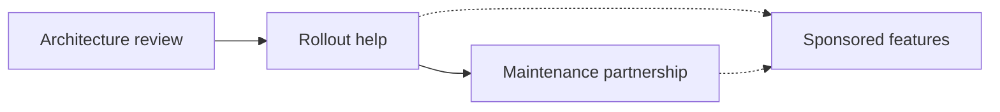
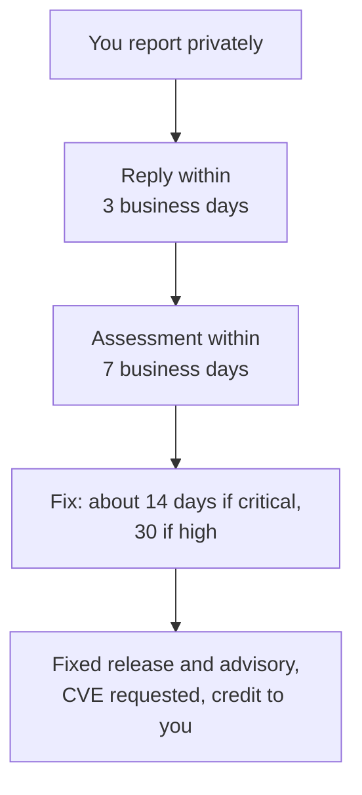

import BookCall from '../../../components/BookCall.astro';
import { BOOKING_URL as bookingUrl } from '../../../utils/links';

AerolVM is open source, and you can run it without talking to anyone. If your company depends on it, you can also work with its maintainer directly. Bring your problem, and get help designing your sandbox setup and choosing the features you need.

## Ways to work together

Most companies move through these stages. You can start at any of them.

| | What you get | Good for |
|---|---|---|
| **Architecture review** | A call about your workload. You leave with a runtime choice, a network policy and a cluster layout. | Teams deciding whether AerolVM fits |
| **Rollout help** | Hands-on help taking AerolVM to production: install, hardening, clusters, AWS KMS and audit export. | Teams with a launch date |
| **Sponsored features** | Fund a feature you need, such as SSO or roles. It is designed in the open and ships in the open-source release, for everyone. | Companies that need a feature sooner |
| **Maintenance partnership** | A direct line to the maintainer, your issues looked at first, and help with upgrades and security questions. | Companies that run AerolVM in production |

None of these means running your servers for you. AerolVM stays open source, and your sandboxes and data stay on your servers.

Today one maintainer leads the project, as [GOVERNANCE.md](https://github.com/aerol-ai/microvm/blob/main/GOVERNANCE.md) says. A partnership is how a company that depends on AerolVM keeps it moving.

<BookCall href={bookingUrl} title="Talk to the maintainer" label="Book a call">
  Tell Suman what you are building, and what is in the way.
</BookCall>

## Who maintains AerolVM

**Suman Saurabh** leads AerolVM. Suman has spent 11 years building large distributed systems, and has led teams whose systems served more than 200 million users.

- **Secure fine-tuning infrastructure at Microsoft.** On Azure Machine Learning (2020 to 2025), Suman was a founding team member of AI fine-tuning. Suman led the engineering that scaled secure LLM training across private networks and Kubernetes. Suman also led the design of secure multi-tenant ML infrastructure, including GPU scheduling and isolation for LLM workloads.
- **A secure protocol at large scale.** Suman co-developed TunDRA, a secure QUIC-based protocol in Rust that runs on more than 1 million compute instances.
- **Sandbox and agent platforms.** As Principal Engineer at BlackBox, Suman built a sandbox platform in Go that isolated more than 300,000 code runs a month. That work unblocked SOC 2 compliance for its Copilot product. Suman also led its agentic AI platform, which handled more than 50,000 agent runs a day.
- **Security in the process.** Suman has mentored engineers on secure protocol design and added CodeQL and GitHub Advanced Security to build pipelines. Suman also made threat modeling a standard step in design reviews.

Connect on [LinkedIn](https://www.linkedin.com/in/ssumansaurabh/) or [GitHub](https://github.com/sumansaurabh).

## How security reports are handled

AerolVM follows coordinated disclosure: a report stays private until a fix is released.

Report through a [private advisory](https://github.com/aerol-ai/microvm/security/advisories/new) or [security@aerol.ai](mailto:security@aerol.ai). Never post details in a public issue or chat. The full process is in the [security policy](https://github.com/aerol-ai/microvm/blob/main/SECURITY.md).

## Join the community

| To | Go to |
|---|---|
| Ask a question | [Q&A](https://github.com/aerol-ai/microvm/discussions/categories/q-a), or chat on [Discord](https://discord.gg/QWQpymQgYJ) |
| Propose a feature | [Ideas](https://github.com/aerol-ai/microvm/discussions/categories/ideas). An accepted idea becomes a change to [ROADMAP.md](https://github.com/aerol-ai/microvm/blob/main/ROADMAP.md). |
| Join the community call | The first Saturday of every month, 8 pm Pacific Time. The join link is posted in [the call's announcement](https://github.com/aerol-ai/microvm/discussions/652) before each call. |
| Report a vulnerability | A [private advisory](https://github.com/aerol-ai/microvm/security/advisories/new) or [security@aerol.ai](mailto:security@aerol.ai). You get a reply within 3 business days. See the [security policy](https://github.com/aerol-ai/microvm/blob/main/SECURITY.md). |
| Contribute code | [CONTRIBUTING.md](https://github.com/aerol-ai/microvm/blob/main/CONTRIBUTING.md) |
| Tell others you use AerolVM | Add your company to [ADOPTERS.md](https://github.com/aerol-ai/microvm/blob/main/ADOPTERS.md). |
