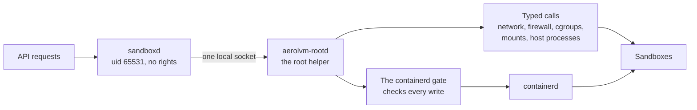

import { Aside, Tabs, TabItem } from '@astrojs/starlight/components';

The AerolVM server, `sandboxd`, reads every API request. It also sets up each sandbox: its network, its firewall rules, its CPU and memory limits, and its mounts. That setup needs root, so by default `sandboxd` runs as root.

**Privilege mode split** cuts that work in two. `sandboxd` runs as a normal user with no rights, user ID (uid) 65531. A small root helper, `aerolvm-rootd`, does the root work. `sandboxd` asks it over one local socket, and the helper checks every request against fixed rules before it acts. The code that reads requests from the network then holds no root rights at all.

Use split when you run code from people you do not trust. Use it too when your security team asks that no internet-facing code runs as root. It is new in v0.7.8. The default is still `single`, the mode every earlier release used.

## Before you start

- **AerolVM v0.7.8 or later, with a signed helper.** Split runs only a helper signed with an AerolVM release key. The one exception is an install with `--build-from-source`: it runs the helper built from that checkout, which has no signature. See [Limits](#limits).
- **The containerd engine.** Docker, and so every local install (`--local`), runs in `single` only. Split also needs containerd's pool of network namespaces turned on. The installer turns both on with `--with-containerd-engine`, and refuses split without that flag. The Helm chart turns both on. Terraform and Ansible refuse a config without them.
- **The runtimes' fences left on.** Firecracker runs through its jailer, and V8 isolates in their jail. WebAssembly runs on the default engine, wazero, with each worker dropped to its own user. All three are the defaults.
- **On Kubernetes, Firecracker off.** The chart does not run Firecracker in a split worker pod yet.
- **On Terraform, the module's one-line join.** See [A Terraform cluster](#a-terraform-cluster). The plan lists anything else split cannot run with.
- **For image builds on a server, a kernel with ACLs on `/run`** (tmpfs ACLs, as Ubuntu and Amazon Linux have). Without them, sandboxes still work but builds fail.
- **S3 mounts with their own keys.** See [What changes for your code](#what-changes-for-your-code).

Words used on this page:

- **Typed call:** a request with fixed fields, such as a sandbox ID or a network policy, instead of free text such as a command to run.
- **Warm pool:** sandboxes started ahead of time and kept waiting, so a create can claim one instead of starting from nothing.
- **Move:** on Kubernetes, taking a running sandbox to another worker when its machine is replaced. A gVisor move keeps the sandbox's memory.
- **Toolbox token:** the secret `sandboxd` uses to reach `toolboxd`, the small agent inside each sandbox that runs its commands and moves its files.

## How it works



- **The helper lets in one caller.** It checks the user of every process that connects to its socket. It refuses all but `sandboxd`'s. On a VM it also checks that the caller runs inside `sandboxd`'s own service.
- **Its calls are typed.** `sandboxd` asks for things like "a network for this sandbox" or "these firewall rules for this policy". It never sends a command to run or the text of a firewall rule. The helper builds those itself, from its own settings. When a call carries a path or a tool option, such as a mount option or a volume's folder, the helper checks it against fixed rules first.
- **containerd sits behind a gate.** containerd is the program that runs containers. Whoever can write to its socket can start a container with full root rights. In split, `sandboxd` reaches containerd only through the helper. The gate passes a fixed list of 41 calls and refuses the rest. When `sandboxd` creates or changes a container, the gate checks its settings:
  - no extra rights, and the system call filter in place;
  - no folders from the machine, except AerolVM's own;
  - no host namespaces, except the sandbox's own network;
  - no hooks and no devices;
  - only known runtime programs.
- **The helper is signed.** It ships with each release, signed with an AerolVM release key. The root side copies it to a folder only root can write, checks the copy's signature, and runs that exact copy. A helper with a bad signature, or older than the one running, is refused, and the running one stays. This holds after a restart of the root side too: on Kubernetes the `runtime` container keeps the last helper it ran, and its signature, on a volume of its own for the life of the pod, and starts that helper again after a restart once it checks out against the release keys.
- **A refusal raises an alarm.** `sandboxd` only sends requests its own code built, and those always pass. So a refusal means one of two things. Either `sandboxd` and the helper are out of step, for example after an upgrade that did not finish. Or `sandboxd` is no longer running AerolVM's own code. Each refusal:
  - fails the request with `500`;
  - writes a `rootd_refusal` record to the audit log;
  - counts in the `aerolvm_rootd_refusals_total` metric, which the `SandboxdRootHelperRefusal` alert reads.

  The alert is in the bundled rules, `setup/prometheus/sandboxd-alerts.yml`. On Kubernetes the Helm chart's alert rules carry the same alert when you set `monitoring.enabled=true`. If you loaded the rule into your Prometheus yourself before, remove your copy, so the alert is not loaded twice.

A restart of the helper stops no sandbox. Neither does a restart of `sandboxd`.

## What each option protects against

Two settings decide how sandboxes are walled off. They guard different things, so you pick one of each.

- The **runtime** is the wall around each sandbox. It keeps code inside a sandbox away from the machine. You pick it for each sandbox: see [Choose a runtime](/choose-isolation/).
- The **privilege mode** is the wall around AerolVM's own server. It decides how far a bug in the server's own code could reach. You pick it for each server.

| Option | Picked for | The wall | What it does not cover |
|---|---|---|---|
| Container (`docker`) | Each sandbox | Linux namespaces, cgroups, a system call filter (seccomp) and a short list of rights | A bug in the machine's kernel: the sandbox shares it |
| gVisor (`gvisor`) | Each sandbox | A container, plus gVisor's own kernel in user space, so few system calls reach the machine's kernel | A bug in gVisor, or in the few calls it passes on |
| Firecracker (`firecracker`) | Each sandbox | A virtual machine with its own kernel, kept apart by the CPU (KVM). Firecracker runs under the jailer, a launcher that locks it in its own folder as an ordinary user. | A bug in KVM or Firecracker. A breakout lands in the jailed Firecracker process. |
| WebAssembly (`wasm`) | Each sandbox | The WebAssembly runtime: the module makes no system calls of its own. Its worker runs as its own user, with a system call filter. | A bug in the runtime. There is no virtual machine or container around the worker. |
| V8 isolate (`isolate`) | Each sandbox | A V8 isolate in a jailed `workerd` process, one process per tenant | A bug in V8 or `workerd`. The jail is what is left around them. |
| Privilege mode `single` | Each server | None. `sandboxd` runs as root. | A bug in `sandboxd` is a bug with root rights. |
| Privilege mode `split` | Each server | `sandboxd` has no rights. Root work goes through the helper, which checks each request. containerd is behind the gate. | A bug in the helper, containerd, runc, gVisor or the jailer: they still run as root. See [Limits](#limits). |

[How AerolVM isolates sandboxes](/engineering-isolation/) explains each runtime's wall in full.

## What changes for your code

The API is the same in both modes, and sandboxes look and act the same. One thing differs. In split, an S3 mount must carry its own access keys. A mount with no keys would use the server's own cloud login, so split refuses it. Give it keys, as here:

<Tabs syncKey="lang">
  <TabItem label="TypeScript">
    ```ts
    const sandbox = await client.create({
      image: "ubuntu:22.04",
      mounts: [
        {
          type: "s3",
          source: "s3://my-bucket/prefix",
          target: "/workspace",
          credentials: {
            access_key_id: "AKIA...",
            secret_access_key: "your-secret-key",
          },
        },
      ],
    });
    ```
  </TabItem>
  <TabItem label="Python">
    ```python
    sandbox = client.create(
        image="ubuntu:22.04",
        mounts=[
            {
                "type": "s3",
                "source": "s3://my-bucket/prefix",
                "target": "/workspace",
                "credentials": {
                    "access_key_id": "AKIA...",
                    "secret_access_key": "your-secret-key",
                },
            },
        ],
    )
    ```
  </TabItem>
  <TabItem label="Go">
    ```go
    sandbox, err := client.Create(ctx, sdktypes.CreateSandboxOptions{
        Image: "ubuntu:22.04",
        Mounts: []sdktypes.MountSpec{
            {
                Type:   sdktypes.MountTypeS3,
                Source: "s3://my-bucket/prefix",
                Target: "/workspace",
                Credentials: map[string]string{
                    "access_key_id":     "AKIA...",
                    "secret_access_key": "your-secret-key",
                },
            },
        },
    })
    if err != nil {
        log.Fatal(err)
    }
    ```
  </TabItem>
  <TabItem label="Rust">
    ```rust
    use aerolvm_sdk::{MountSpec, MountType};
    use std::collections::HashMap;

    let sandbox = client.create(CreateOptions {
        image: "ubuntu:22.04".into(),
        mounts: Some(vec![MountSpec {
            mount_type: MountType::S3,
            source: "s3://my-bucket/prefix".into(),
            target: "/workspace".into(),
            options: None,
            credentials: Some(HashMap::from([
                ("access_key_id".to_string(), "AKIA...".to_string()),
                ("secret_access_key".to_string(), "your-secret-key".to_string()),
            ])),
            read_only: None,
        }]),
        ..Default::default()
    })?;
    ```
  </TabItem>
  <TabItem label="Java">
    ```java
    Sandbox sandbox = client.create(new CreateOptions()
        .setImage("ubuntu:22.04")
        .setMounts(List.of(new MountSpec()
            .setType("s3")
            .setSource("s3://my-bucket/prefix")
            .setTarget("/workspace")
            .setCredentials(Map.of(
                "access_key_id", "AKIA...",
                "secret_access_key", "your-secret-key")))));
    ```
  </TabItem>
</Tabs>

For a public bucket, add `--no-sign-request` to the mount's `extra_args` instead. [Attach cloud storage](/external-storage/) has the other mount rules.

## Turn it on

Split needs the containerd engine. A server on the Docker engine, which includes every local install (`--local`), runs in `single` only. Docker's socket is as good as root, and nothing can check what is sent to it.

### One server

Add `--with-containerd-engine --privilege-mode split` to the [install command](/getting-started/installer-options/). The installer makes:

- the `sandboxd` user (uid 65531), which the server runs as;
- `aerolvm-rootd.service`, which runs the helper as root;
- a locked-down `sandboxd.service`, with no capabilities, `NoNewPrivileges=yes`, `ProtectSystem=strict`, and write access only to its own data, run and certificate folders. With `--with-firecracker`, it can also write under `/srv/jailer`. There the helper makes one stage folder for each VM that `sandboxd` owns. `sandboxd` cannot write in the jails themselves.

Split also runs image builds in rootless BuildKit: the image builder runs as a normal user too. It works with `--with-isolate` and `--with-firecracker`. [Run the server without root](/getting-started/installer-options/#run-the-server-without-root) on the installer page lists every file and user it makes.

### A Terraform cluster

Set `privilege_mode` in `config/cluster.yml`:

```yaml title="config/cluster.yml"
container_engine: "containerd"
privilege_mode: "split"
```

The module passes `--privilege-mode split` to the installer on every node. It needs the module's default join (`one_line_join = true`). A cluster built from a copy of the code (`Terraform/root`, through `scripts/terraform.sh`) has `one_line_join = false` by default, so split's plan fails there. Setting it to `true` on such a running cluster replaces every node. If you set something split cannot run with, `terraform plan` fails and lists each problem. The [Terraform README](https://github.com/aerol-ai/microvm/blob/main/Terraform/README.md#privilege-mode-split) has the full list.

<Aside type="caution" title="Choose it before your first apply">
This setting changes every node's setup. On a running cluster, Terraform then replaces every node, and the sandboxes on them are lost.
</Aside>

### An Ansible fleet

Ansible never switches a node. Install each node with `--privilege-mode split` first. Then set `privilege_mode: split` in `config/cluster.yml`. `configure-ops.yml` checks that each node runs the mode the file names. It also refuses settings split cannot run with, before it changes anything. See the [Ansible README](https://github.com/aerol-ai/microvm/blob/main/Ansible/README.md#privilege-mode-split).

### Kubernetes

Set the chart value `privilegeMode`:

```yaml title="values.yaml"
privilegeMode: split
```

| Value | What it does |
|---|---|
| `single` | The default. The worker's `agent` container is privileged and does the root work itself. |
| `split` | The `agent` container runs as uid 65531 with no capabilities and a read-only root. The helper runs in the `runtime` container, which is privileged in both modes. |
| `auto` | `split` for a new install, unless you turned on something split cannot run yet, such as Firecracker. An upgrade keeps the mode the workers have now. |

`helm template` cannot see the cluster, so it renders `auto` as a new install. That is `split`, or `single` when you turned on something split cannot run yet, such as Firecracker. Every worker made after that would come up in that mode. So if a GitOps tool such as Argo CD or Flux renders the chart, set `single` or `split` yourself. [Security](/kubernetes/security/#privilege-mode) shows every container and folder in a split worker pod.

## What runs in split

| | One server, Terraform, Ansible | Kubernetes |
|---|---|---|
| Containers (runc) and gVisor | Yes | Yes |
| Firecracker, with snapshots and its warm pool | Yes, always through the jailer | Not yet. The chart refuses `worker.firecracker.enabled`. |
| WebAssembly | Yes | Yes |
| V8 isolates | Yes, always in their jail | Yes |
| The container warm pool | Yes | Yes, and the kubectl API's warm pools |
| gVisor moves with memory | Not used off Kubernetes | Yes, between workers of the same mode. Off by default in split. |
| External storage | Yes. The FUSE mount tools (for S3, SSH and rclone) run as their own user, `aerolvm-mounts`. | Yes, on by default |

## Switch a running install

- **One server.** Run the installer again with `--privilege-mode split` and your other flags. Running sandboxes keep running. To go back, run it with `--privilege-mode single`. If you think the server was broken into, rebuild the machine instead of switching back.
- **Terraform.** Changing `privilege_mode` replaces every node, as the caution above says.
- **Ansible.** Switch each node with the installer, then change `privilege_mode` to match.
- **Kubernetes.** A worker gets its mode when its pod is made. Change the value with `helm upgrade`, then replace the workers one at a time. In cluster mode, replacing a worker moves or stops its sandboxes, as each one's failover policy says. In single mode the worker is one pod, and deleting it ends every sandbox on it. Workers of both modes run side by side while you switch. [Switch the privilege mode](/kubernetes/operations/#switch-the-privilege-mode) has the steps.

## What it costs

### Speed

We timed creates in both modes on EKS, on 24 November 2026. The cluster had three `m7i.xlarge` workers running Amazon Linux 2023 (Linux 6.18) and the containerd engine. Each number is the time the worker reported for a create, and p50 is the median.

| Create | `single` p50 | `split` p50 | Gap | Our budget |
|---|---|---|---|---|
| Cold, no warm pool | 152.0 ms | 143.3 ms | -8.7 ms | +3 ms |
| Warm, from the container warm pool | 16.7 ms | 18.0 ms | **+1.3 ms** | +1 ms |

- **Cold creates** show no cost. The gap is smaller than the run's own noise.
- **Warm creates** came in 0.3 ms over our budget. A waiting warm sandbox has no network until a create claims it. In split, the claim makes two trips through the helper. One goes through the containerd gate, to label the container with its new sandbox. The other puts the sandbox's network rules in place. A change merged after this run makes both trips at the same time. On test machines it closed part of the gap in one run and none in another. A new EKS run will settle it.
- **WebAssembly and V8 isolates** were timed on one VM (`m7i.xlarge`, Ubuntu 24.04). Each pair of runs timed single and split back to back. Split added a median of 0.05 ms to a warm WebAssembly create and 0.15 ms to a busy mix. A warm V8 isolate was 0.10 ms faster. All three are inside a +1 ms budget.

### Other differences

- **Docker engine.** Split runs on containerd only, so local installs stay in `single`.
- **WebAssembly engine.** Split runs WebAssembly on wazero, the default engine. `SB_WASM_ENGINE=wasmtime` is `single` only.
- **Image builds.** On a server, split builds images with rootless BuildKit. It cannot see the images already on the machine, so every `FROM` image comes from its registry.
- **S3 mounts** need their own keys, as shown [above](#what-changes-for-your-code). An operator can allow the server's own cloud login with `SB_MOUNTS_ALLOW_NODE_CREDENTIALS=true`. In split, the helper must see it too. On a server, the helper reads `/etc/sandboxd/sandboxd.env`, so put it there. On Kubernetes, `worker.extraEnv` reaches both containers.
- **Upgrades over the API** (`aerolvm upgrade apply`) are off on a split server, because the upgrader needs root. Run the installer again, or `sudo sandboxd upgrade node`.
- **gVisor moves** stay inside one mode. While a Kubernetes install switches, a move to a worker of the other mode is refused before anything is saved. The sandbox keeps running where it is.

## Limits

- **The default stays `single`.** The chart's default will change to `auto` once release signing is in place and a new speed check passes.
- **Split needs a signed helper.** A release built without AerolVM's release key ships its helper unsigned, and split will not start with it. The installer stops. An install with `--build-from-source` is the exception: you trust the checkout you build, so the installer runs its unsigned helper, as it runs its `sandboxd`. On Kubernetes, the `agent` container stops and says `privilege mode split needs a signed root helper`.
- **Some parts still run as root.** The helper, containerd, runc, gVisor (`runsc`) and the Firecracker jailer still run as root. On Kubernetes, the `runtime` container stays privileged in both modes.
- **`sandboxd` still holds its sandboxes' secrets.** On its machine, it holds three things:
  - each sandbox's toolbox token, which lets it run commands there;
  - the key that opens the sandboxes' environment variables;
  - the machine's cluster certificate.

  So a bug in `sandboxd` still matters for the sandboxes on that machine. Split stops it from going further: it does not get root on the machine. On Kubernetes, the `agent` container also gets no Kubernetes API credential. The only folder it sees from the machine is a read-only view of the cgroups.
- **Escapes from a sandbox are the runtime's job.** Split does not make a runtime's wall stronger. Pick gVisor or Firecracker for code you do not trust.
- **A switch back to `single` trusts what split wrote.** On a server, `single` runs `sandboxd` as root again and uses its data folder as `split` left it: the database, Firecracker templates and saved VM snapshots. The installer removes links and gives the files back to root, and it replaces the Firecracker guest kernel, but it does not check the rest. If in doubt, [rebuild your templates](/firecracker-templates/#rebuild-a-template) after the switch back. If you think the server was broken into, rebuild the machine instead.

## Check it

On a server:

```bash title="On the server"
systemctl show -p User --value sandboxd
systemctl is-active aerolvm-rootd
```

The first line prints `sandboxd`, the second `active`. Run them on each node of a Terraform or Ansible cluster. On Ansible, `configure-ops.yml` also checks that each node runs the mode `config/cluster.yml` names.

Each time `sandboxd` connects, the helper logs both versions, as `agent_version` and `helper_version`. Two different releases there mean an upgrade did not finish:

```bash title="On the server"
sudo journalctl -u aerolvm-rootd | grep 'agent handshake'
```

On Kubernetes, run [`aerolvm k8s verify`](/kubernetes/security/#check-a-live-install). It checks that no container but `runtime` and `agent` is privileged. It also checks that a split `agent` mounts nothing from the machine but a read-only `/sys/fs/cgroup`. It also prints how many workers in each pool run `split` and how many `single`.

## If something goes wrong

- **`sandboxd` will not start, and its log names a setting.** Split cannot run with that setting. Change it, or run the server in `single`. For example: `SB_PRIVILEGE_MODE=split needs SB_CONTAINER_ENGINE=containerd`.
- **Creates fail with `503`** and the message `the node's root helper is unavailable; retry shortly`. The helper is down or restarting. systemd, or the `runtime` container on Kubernetes, starts it again, so retry after a few seconds. Read its log: `journalctl -u aerolvm-rootd`, or `kubectl logs <worker pod> -c runtime`.
- **The `agent` container restarts right after the `runtime` container restarted.** This is expected on Kubernetes. The `runtime` container gets a new cgroup each time it starts, and sandboxes go under it. `sandboxd` reads where they go once, when it starts. So when the helper says they now go somewhere else, `sandboxd` stops and the kubelet starts it again with the new place. Until then, creates fail with `503`. Its log says `the root helper holds sandboxes to a new cgroup parent`. A restart of the `runtime` container ends every sandbox on that worker.
- **Creates fail with `500`, and the `SandboxdRootHelperRefusal` alert fires.** The helper refused a request. Treat it as a security event until you rule out a version mismatch. The [root helper refusal runbook](https://github.com/aerol-ai/microvm/blob/main/setup/runbooks/secrets-and-audit.md#root-helper-refusal-sandboxdroothelperrefusal) says what to check first.

## How it is tested

- **Every refusal has a test.** Tests send the helper and the gate requests that `sandboxd`'s own code never builds. Each must be refused. The other side is tested too: every container `sandboxd` builds must pass the gate.
- **On kind and on EKS.** Split worker pods passed the same checks as `single` on kind. On EKS, each worker switched from `single` to `split` in turn, and `aerolvm k8s verify` passed at every stage. Sandboxes kept running across an upgrade of `sandboxd` and a restart of the helper. A worker pod deleted with sandboxes running left nothing behind on its machine.

The chart's [evidence pack](https://github.com/aerol-ai/microvm/blob/main/charts/aerolvm/EVIDENCE.md#privilege-mode-split-an-agent-with-no-rights) names each test and lists what the live runs proved.

## Next steps

- [Kubernetes security](/kubernetes/security/#privilege-mode): every container and folder of a split worker pod.
- [Installer options](/getting-started/installer-options/#run-the-server-without-root): what the installer sets up on one server.
- [Choose a runtime](/choose-isolation/): pick the wall around each sandbox.
- [Hardening guide](/enterprise/hardening/): the rest of the server checklist.
