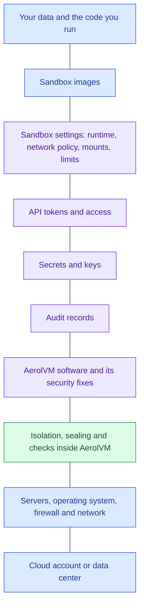
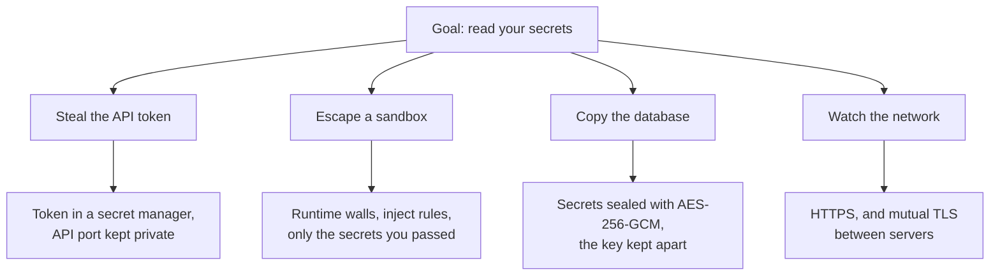

Security in a self-hosted product is shared. The AerolVM project provides the software and the controls inside it. You run the servers, choose the settings and decide what code to trust. Because you host it, more sits on your side than with a hosted service, and you keep full control of your data in return.

## The model

Blue is yours. Purple is shared. Green is handled by AerolVM.

| Area | The AerolVM project | You |
|---|---|---|
| Your data and code | | Decide what runs, and what data it can see |
| Sandbox images | | Choose where images come from, check them and pin them |
| Sandbox settings | Enforces the runtime wall, the network policy and the limits you set | Choose the runtime, the policy, the mounts and the limits |
| API tokens and access | Requires a token and checks it in constant time | Keep the token secret, rotate it, and keep the API port private |
| Secrets and keys | Seals secrets with AES-256-GCM and keeps inject values out of sandboxes | Protect and back up the server key. Set up AWS KMS if you use it. |
| Audit records | Records every secret read and refused connection, and checks the chain | Ship the records off the server and keep them as long as you need |
| Software and fixes | Ships signed releases, and fixes security issues on the newest release line | Verify downloads and upgrade |
| Isolation and checks | Builds the walls, seals the data and runs the checks | |
| Servers and network | | Patch the operating system, run the firewall, and keep cluster ports private |
| Cloud or data center | | Physical security, accounts and permissions |

## Threat model

This table uses STRIDE, a common way to sort threats into six kinds.

| Threat | Example | How AerolVM helps | What you add |
|---|---|---|---|
| **Spoofing:** pretending to be someone else | A caller without the token, or a fake cluster server | The API token, checked in constant time. Cluster certificates that name each server. An SSH key for each sandbox. | Keep the token and the cluster authority's key safe |
| **Tampering:** changing data | Editing secrets, audit records or a download | Sealed data that refuses to open if changed. A hash-chained audit log. Checksums and a signed build record. | Keep an audit copy off the server, and verify downloads |
| **Repudiation:** denying an action | "I never read that secret" | A record of every secret read, with the time, the server and the result | Log API callers at your own gateway. Records name the server, not the caller. |
| **Information disclosure:** leaking data | Code in a sandbox reading secrets or reaching private systems | Sealed secrets, inject rules, private-by-default sandboxes, and outbound policies | Close the network, and pass only the secrets the code needs |
| **Denial of service:** using up resources | One sandbox eating all the CPU, or a flood of creates | Limits for each sandbox, busy signals when the server is full, and rate limits on audit reads | Size your servers. Quotas per team are [proposed](https://github.com/aerol-ai/microvm/discussions/648). |
| **Elevation of privilege:** breaking out | Code escaping its sandbox onto the server | Runtime walls, privileged mode off, and fewer privileges for containers | Use gVisor or Firecracker for hostile code, and keep the server patched |

### Example: an attacker who wants your secrets

Here are the four paths an attacker could try, and the controls on each one.

The controls on paths 1 and 3 are partly yours: keep the token and the server key in a secret manager, and store the key's backup apart from the database's backup.

## Known limits

Each limit has a workaround you can use today. Where a fix is planned, the last column links to its discussion.

| Limit | What to do | Proposal |
|---|---|---|
| **Outbound traffic is open by default.** A sandbox with no policy can reach your private network, the cloud metadata service and other sandboxes. V8 isolates are the exception. | Set a policy on each sandbox. Better, have the operator set `default_policy: block_all` and block the metadata address for the whole server. See [Hardening](/enterprise/hardening/). | [Closed by default](https://github.com/aerol-ai/microvm/discussions/651) |
| **Containers share the server's kernel.** A kernel bug can let code out of a container. | Run code you do not trust in gVisor or Firecracker. | |
| **Code runs as the image's default user**, which is usually root. Setting a user at create time does not change this yet. | Build your image with a non-root `USER`. | |
| **Some limits are not enforced on every runtime.** Disk is not limited on containerd and gVisor. The number of processes is not limited in containers. | Use Firecracker for hostile code. It has its own disk and its own kernel. | |
| **Images are not checked for signatures.** | Check signatures in your build pipeline, then pin the image by digest (`image@sha256:...`). | [Image signature checks](https://github.com/aerol-ai/microvm/discussions/650) |
| **One API token per server.** Anyone with it can run commands in any sandbox. | Keep it in a secret manager, and keep the API port private. | [Scoped tokens and roles](https://github.com/aerol-ai/microvm/discussions/646), [SSO](https://github.com/aerol-ai/microvm/discussions/647) |
| **Limits are per sandbox, not per team.** | Enforce team limits in the service that calls AerolVM. | [Quotas per team](https://github.com/aerol-ai/microvm/discussions/648) |
| **The audit log on a server can be rewritten by someone with root on it.** The hash chain catches a changed record, not a rebuilt chain. | Send the records off the server to a webhook or an S3 bucket you control. | |
| **Audit records name the server, not the API caller.** | Put your own gateway in front of the API and log callers there. | [Caller identity](https://github.com/aerol-ai/microvm/discussions/649) |
| **Code in a sandbox can read its own variables**, and container snapshots save them. | Use an inject rule for API keys, so the sandbox only holds a placeholder. | |
| **Inject rules are not supported on WebAssembly or Firecracker yet.** | Use a container, gVisor or a V8 isolate for code that needs a protected key. | |
| **Public URLs have no login,** and shared TCP ports are open to the whole internet. | Protect the app itself, or share only what must be public. | |

## Out of scope by design

- **The server.** `sandboxd` runs as root, because it manages containers, virtual machines, firewall rules and mounts. Whoever controls the server, or holds its API token, is on the trusted side.
- **The kernel, the hypervisor and the CPU.** A bug below the boundary is below the model.
- **What an allowed site does with your data.** The filter controls where traffic goes, not what the far side does with it.
- **Overloading your own deployment.** A sandbox can use up its own limits. Protect a public deployment the way you would any service.

Found a way across one of these lines? Report it privately, as the [security policy](https://github.com/aerol-ai/microvm/blob/main/SECURITY.md) explains. Do not open a public issue.

## Next steps

- [Hardening guide](/enterprise/hardening/): close the open defaults.
- [Security baseline](/enterprise/security-controls/): every control and who owns it.
- [Work with the maintainer](/enterprise/maintainer/): sponsor a fix on this list.
