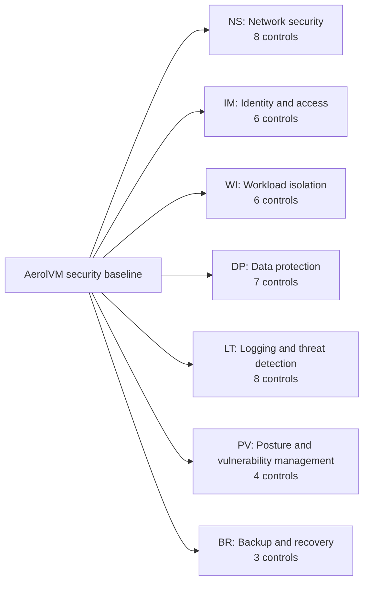
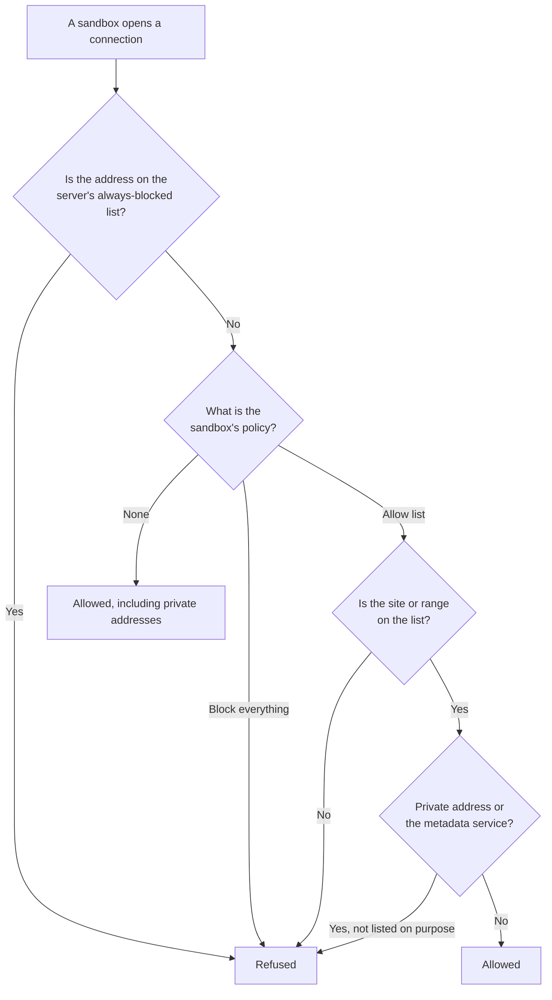
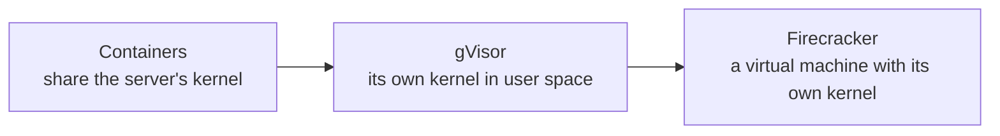
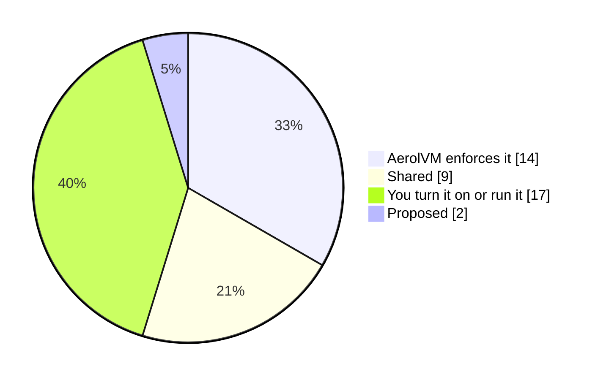

import { Tabs, TabItem } from '@astrojs/starlight/components';

This baseline lists every security control in AerolVM, grouped into seven domains. It follows the shape of cloud security benchmarks such as the Microsoft cloud security benchmark. Your security team can review it the way they review other platforms.

Each control has an ID, such as **NS-2**. Use the IDs in your own reviews, tickets and risk registers.

## How to read this baseline

| Column | Meaning |
|---|---|
| **On by default** | Whether it works with no setup. *Not supported yet* means the control is proposed but not built. |
| **Owner** | **AerolVM** enforces it for you. **You** must turn it on or run it. **Shared** means AerolVM enforces it and you configure or protect part of it. |
| **How to configure** | The setting or page to use |



## Security profile

These facts shape how AerolVM should be secured.

| Behavior | Value |
|---|---|
| Runs code you do not trust | Yes, by design |
| Holds your secrets | Yes: environment variables, registry passwords and storage credentials, sealed at rest |
| Stores data at rest | Sandbox files on the server's disk. Records and sealed secrets in a SQLite database. |
| Exposed to the network | The HTTPS API and public links, shared TCP ports, SSH if on, and cluster ports in a cluster |
| Runs as root on the server | Yes. `sandboxd` manages containers, virtual machines, firewall rules and mounts. |
| Identity model | One API token per server, and certificates between cluster servers |
| Hosting | Self-hosted only. You run the servers. |

## Network security

| ID | Control | On by default | Owner | How to configure |
|---|---|---|---|---|
| NS‑1 | Private by default | Yes, through the AerolVM API. The Daytona and E2B APIs make sandboxes public. | AerolVM | Share only the ports you need. See [Public URLs](/public-urls/). |
| NS‑2 | Outbound policy for each sandbox | No. Outbound traffic is open. | You | `networkBlockAll: true`, or `networkAllowOut` with site names. See [Network access](/network-access/). |
| NS‑3 | A server-wide default policy | No | You | `default_policy` in the file at `SB_EGRESS_OPERATOR_FILE`. See [Private networks](/advanced-network-rules/#private-networks). |
| NS‑4 | Private-address and cloud-metadata guard | With a name allow list | Shared | Add ranges to `deny_cidrs` in the same file, so they apply to every sandbox |
| NS‑5 | Protection from DNS tricks | With a name allow list | AerolVM | Nothing to set. See [Fencing the network](/engineering-network-defenses/). |
| NS‑6 | HTTPS for the API and public links | In domain mode | Shared | Install with a domain, and keep port `21212` private |
| NS‑7 | Protected traffic between cluster servers | Required in cluster mode | AerolVM | Never set `SB_CLUSTER_INSECURE_GOSSIP` |
| NS‑8 | Byte limits on traffic | No | You | See [Limit egress and ingress](/network-usage/) |

This is how the server decides whether a sandbox may open a connection:



## Identity and access

| ID | Control | On by default | Owner | How to configure |
|---|---|---|---|---|
| IM‑1 | API authentication | Required. The server will not start without a token. | AerolVM | Keep `SB_PAT_TOKEN` in a secret manager. The token is checked in constant time. |
| IM‑2 | Operator-only actions | Yes | AerolVM | Cluster changes, templates and audit checks need the operator token |
| IM‑3 | A separate SSH key for each sandbox | Yes, when SSH is on | AerolVM | The private key is returned once and never stored. Set `SB_ENABLE_SSH_GATEWAY=false` if you do not use SSH. |
| IM‑4 | Cluster server identity | Required in cluster mode | Shared | Keep the cluster authority's key safe, and renew certificates before their 90 days end |
| IM‑5 | Single sign-on | Not supported yet |  | [Proposed](https://github.com/aerol-ai/microvm/discussions/647) |
| IM‑6 | Scoped tokens and roles | Not supported yet |  | [Proposed](https://github.com/aerol-ai/microvm/discussions/646) |

## Workload isolation

| ID | Control | On by default | Owner | How to configure |
|---|---|---|---|---|
| WI‑1 | Runtime isolation | Containers | You | Choose `runtime: "gvisor"` or `"firecracker"` for code you do not trust. See [Sandboxes](/sandboxes/). |
| WI‑2 | CPU, memory and disk limits | 1 CPU, 1 GB of memory, 10 GB of disk | Shared | `cpu`, `memoryMB` and `diskGB`. Disk is not limited on containerd and gVisor. |
| WI‑3 | Process-count limit | Partial. Not in containers | Shared | Use Firecracker for hostile code |
| WI‑4 | Lifetime timers | No | You | `stopIfIdleFor` and `destroyAtAge`, up to 30 days. See [Lifecycle](/lifecycle/). |
| WI‑5 | Non-root code | Partial. Code runs as the image's default user. | You | Build images with a non-root `USER` |
| WI‑6 | Privileged mode off | Yes | AerolVM | Leave `SB_CONTAINER_PRIVILEGED` off |

How strong the wall is depends on the runtime:



Each step to the right puts more between the code and the server's kernel. WebAssembly and V8 isolates work differently: the code makes no system calls of its own, and the runtime, which runs in a server process, is the wall. [How AerolVM isolates sandboxes](/engineering-isolation/) explains each one.

## Data protection

| ID | Control | On by default | Owner | How to configure |
|---|---|---|---|---|
| DP‑1 | Secrets encrypted at rest | Yes | AerolVM | AES-256-GCM. Environment variables are also bound to their sandbox. |
| DP‑2 | Secrets left out of normal reads | Yes | AerolVM | Reads that ask for variables are recorded |
| DP‑3 | API keys kept out of sandboxes (on containers, gVisor and V8 isolates) | No | You | Inject rules with `inspect: true`. See [Keep an API key out of the sandbox](/advanced-network-rules/#keep-an-api-key-out-of-the-sandbox). |
| DP‑4 | Storage credentials kept on the server | Yes | AerolVM | Nothing to set. Mounts run on the server. |
| DP‑5 | Key management | A server key | Shared | Set `SB_CREDENTIAL_ENCRYPTION_KEY` from your secret manager. In a cluster, consider `SB_SECRET_PROVIDER=awskms`. |
| DP‑6 | Read-only mounts | No | You | `readOnly: true` on each mount that only reads |
| DP‑7 | Sandbox files encrypted at rest | Not supported yet | You | Use encrypted disks on the server |

## Logging and threat detection

| ID | Control | On by default | Owner | How to configure |
|---|---|---|---|---|
| LT‑1 | Record every secret read | Yes | AerolVM | Read records with `sandbox.audit()` in every SDK |
| LT‑2 | Record refused connections | Yes, for sandboxes with a policy | AerolVM | Up to 25 records a second for each sandbox |
| LT‑3 | Chain check at start | Yes | Shared | The server refuses to start on a broken chain. Someone with root could rebuild the chain, so keep a copy off the server and turn on LT‑8. |
| LT‑4 | Export off the server | No | You | `SB_AUDIT_EXPORT_BACKEND` set to `webhook` or `s3` |
| LT‑5 | Retention | 30 days on the server | You | `SB_SECRET_AUDIT_RETENTION_DAYS`. Keep longer in your own store. |
| LT‑6 | Metrics and traces | Metrics yes, with the token. Traces off. | You | Scrape `/v1/metrics`. Turn on OpenTelemetry with its settings. |
| LT‑7 | Alerts and runbooks | Shipped as files | You | Load the bundled Prometheus alerts. Each links to a [runbook](/operational-runbooks/). |
| LT‑8 | Tamper evidence off the server | No | You | `SB_AUDIT_WITNESS_BACKEND=s3` with an S3 bucket that has Object Lock. The server stores its log's fingerprints there, where it cannot change them. Required by enterprise mode. See [Enterprise mode](/enterprise/enterprise-mode/). |

## Posture and vulnerability management

| ID | Control | On by default | Owner | How to configure |
|---|---|---|---|---|
| PV‑1 | Release integrity | Yes | Shared | Check each download against `checksums.txt` and its signed build record. See [Release verification](https://github.com/aerol-ai/microvm/blob/main/RELEASE-VERIFICATION.md). |
| PV‑2 | Code and dependency scanning | In the project's CI | AerolVM | gosec, govulncheck, dependency review and OpenSSF Scorecard |
| PV‑3 | Security updates | On the newest minor release line | You | Upgrade to the newest release. See [SUPPORT.md](https://github.com/aerol-ai/microvm/blob/main/SUPPORT.md). |
| PV‑4 | Vulnerability disclosure | Yes | AerolVM | Private reports get a reply within 3 business days. See [SECURITY.md](https://github.com/aerol-ai/microvm/blob/main/SECURITY.md). |

## Backup and recovery

| ID | Control | On by default | Owner | How to configure |
|---|---|---|---|---|
| BR‑1 | Database and key backup | No | You | Back up the database and the server key at the same time, and store the key's copy apart from the database's copy. Without the key, sealed secrets cannot be opened. |
| BR‑2 | Sandbox failover (in a cluster) | No. Ask for it on each sandbox. | Shared | `failover: { policy: "recreate" }`. See [Durability and failover](/durability/). |
| BR‑3 | Surviving a lost server (in a cluster) | With 3 or more voting servers | You | Run 3 or 5 voting servers |

## Who owns the controls



Most controls you own are settings to turn on, not systems to build. [Shared responsibility](/enterprise/responsibility/) splits the work in full, and the [Hardening guide](/enterprise/hardening/) turns this baseline into checklists.

## Apply the baseline to a sandbox

This sandbox follows WI-1, NS-2 and WI-4. It runs in gVisor, reaches only the Python package sites, and is deleted after 4 hours. The server must have gVisor installed.

<Tabs syncKey="lang">
  <TabItem label="TypeScript">
    ```ts
    const sandbox = await client.create({
      image: "python:3.12",
      runtime: "gvisor",
      networkAllowOut: ["pypi.org", "*.pythonhosted.org"],
      lifecycle: {
        destroyAtAge: 4 * 60 * 60 * 1_000_000_000, // 4 hours
      },
    });
    ```
  </TabItem>
  <TabItem label="Python">
    ```python
    sandbox = client.create(
        image="python:3.12",
        runtime="gvisor",
        network_allow_out=["pypi.org", "*.pythonhosted.org"],
        lifecycle={"destroyAtAge": 14_400_000_000_000},  # 4 hours
    )
    ```
  </TabItem>
  <TabItem label="Go">
    ```go
    sandbox, err := client.Create(ctx, sdktypes.CreateSandboxOptions{
        Image:           "python:3.12",
        Runtime:         sdktypes.RuntimeGvisor,
        NetworkAllowOut: []string{"pypi.org", "*.pythonhosted.org"},
        Lifecycle:       &sdktypes.Lifecycle{DestroyAtAge: 4 * time.Hour},
    })
    if err != nil {
        log.Fatal(err)
    }
    ```
  </TabItem>
  <TabItem label="Rust">
    ```rust
    let sandbox = client.create(CreateOptions {
        image: "python:3.12".into(),
        runtime: Some("gvisor".into()),
        network_allow_out: Some(vec!["pypi.org".to_string(), "*.pythonhosted.org".to_string()]),
        lifecycle: Some(aerolvm_sdk::Lifecycle {
            destroy_at_age: 14_400_000_000_000, // 4 hours
            ..Default::default()
        }),
        ..Default::default()
    })?;
    ```
  </TabItem>
  <TabItem label="Java">
    ```java
    Sandbox sandbox = client.create(
        new CreateOptions()
            .setImage("python:3.12")
            .setRuntime("gvisor")
            .setNetworkAllowOut(List.of("pypi.org", "*.pythonhosted.org"))
            .setLifecycle(new Lifecycle().setDestroyAtAge(14_400_000_000_000L)) // 4 hours
    );
    ```
  </TabItem>
</Tabs>

## Next steps

- [Hardening guide](/enterprise/hardening/): the baseline as checklists, at three levels.
- [Security architecture](/enterprise/architecture/): where each control sits.
- [Audit and compliance](/enterprise/audit-evidence/): map these controls to NIST SP 800-53.
