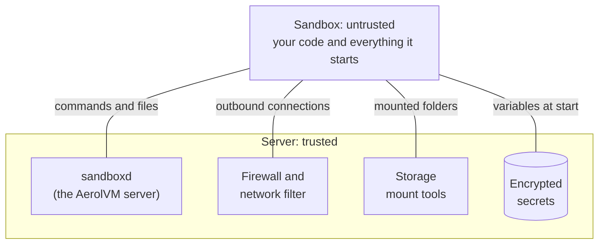

import { Tabs, TabItem } from '@astrojs/starlight/components';

This page lists each security control once, by area. Each row gives the default and the setting that tightens it. What the controls do not cover is on [Responsibility and limits](/enterprise/responsibility/).

## Where the boundary is

The code in a sandbox is untrusted. The server is trusted. Every file, connection, secret and command a sandbox uses passes through code on the server's side.



## Controls by area

### Isolation

| Control | Default | To tighten |
|---|---|---|
| The wall between sandbox and server | A container: its own view of files, processes and network, a system-call filter and fewer privileges. It shares the server's kernel. | Use `runtime: "gvisor"` (a kernel written in Go answers the sandbox's system calls) or `"firecracker"` (a virtual machine with its own kernel). The operator installs them first. See [Sandboxes](/sandboxes/). |
| CPU, memory and disk | 1 CPU, 1 GB of memory and 10 GB of disk | Set `cpu`, `memoryMB` and `diskGB` for the job |
| How long a sandbox lives | Until you delete it | Timers that stop or delete it when idle or at an age, up to 30 days. See [Lifecycle](/lifecycle/). |
| The user inside the sandbox | The image's default user, usually root | Build the image with a non-root `USER` |

### Network

| Control | Default | To tighten |
|---|---|---|
| Outbound traffic | Open: the internet, private addresses, the cloud metadata service and other sandboxes. V8 isolates always block private addresses. | `networkBlockAll: true`, or `networkAllowOut` with site names. See [Network access](/network-access/). |
| Private addresses and cloud metadata | Blocked once a sandbox has a name allow list | The operator can block address ranges for every sandbox. See [Private networks](/advanced-network-rules/#private-networks). |
| DNS tricks (rebinding, fake site names, outside DNS) | Stopped once a sandbox has a name allow list | Nothing to set |
| A default for creates that set no policy | None | The operator sets `default_policy: block_all` in the server's policy file |
| Inbound traffic | Private: no one can reach a sandbox until you share a port | Public URLs have no login of their own, so protect the app. See [Public URLs](/public-urls/). |
| Bytes sent and received | No cap | A byte limit for the sandbox's lifetime. See [Limit egress and ingress](/network-usage/). |

### Secrets

| Control | Default | To tighten |
|---|---|---|
| Environment variables | Encrypted on the server with AES-256-GCM and tied to one sandbox. Left out of get and list answers. Every read is recorded. | Nothing to set. Back up the server's key with its database. |
| API keys for outside services | A plain variable, which code in the sandbox can read | An inject rule: the sandbox gets a placeholder, and the server adds the real key only on requests to the site you name. Docker, containerd, gVisor and V8 isolates only. See [Keep an API key out of the sandbox](/advanced-network-rules/#keep-an-api-key-out-of-the-sandbox). |
| The server's encryption key | Created on first start, in a file only the server can read | Set `SB_CREDENTIAL_ENCRYPTION_KEY` from your secret manager |

### Storage

| Control | Default | To tighten |
|---|---|---|
| Storage credentials | Kept on the server. The mount runs there, so the sandbox never sees them. | Nothing to set |
| Mounted folders | Read and write. System folders such as `/etc` and `/proc` cannot be mount targets. | `readOnly: true` on each mount that only needs reads. See [External storage](/external-storage/). |

### API access

| Control | Default | To tighten |
|---|---|---|
| Calling the API | Every call needs the server's API token, which is checked in constant time | Keep the token in a secret manager. Keep the API port private. |
| SSH into sandboxes | On, with a separate key for each sandbox | `SB_ENABLE_SSH_GATEWAY=false` turns it off |
| Roles and SSO | Not built yet | Proposed: [roles](https://github.com/aerol-ai/microvm/discussions/646) and [SSO](https://github.com/aerol-ai/microvm/discussions/647) |

### Cluster

| Control | Default | To tighten |
|---|---|---|
| Servers proving who they are | Mutual TLS (TLS 1.2 or newer), with a certificate for each server signed by the cluster's own authority | Nothing to set. Certificates last 90 days, and bundled alerts warn before one expires. |
| Membership traffic | Encrypted with a shared key. The cluster will not start without one. | Never set `SB_CLUSTER_INSECURE_GOSSIP` |
| Secret copies for failover | Sealed with the server's key | `SB_SECRET_PROVIDER=awskms`, so AWS permissions decide who opens them and AWS logs each use. See [Secrets providers](/cluster-secrets/). |

### Audit

| Control | Default | To tighten |
|---|---|---|
| What is recorded | Every time a secret is opened. Outbound connections the filter refuses, up to 25 records a second for each sandbox, so one sandbox cannot flood the log. | Nothing to set |
| Tamper evidence | Each record holds a hash of the one before, so a changed or deleted record breaks the chain | Bundled alerts fire when the chain breaks |
| Where records go | Kept for 30 days on the server's disk | `SB_AUDIT_EXPORT_BACKEND` set to `file`, `stdout`, `webhook` (signed with HMAC) or `s3` |
| Reading a sandbox's history | `sandbox.audit()` in every SDK, from any server in a cluster | Nothing to set |

## A locked-down sandbox

This sandbox runs in gVisor, reaches only the Python package sites, and is deleted after 4 hours. The server must have gVisor installed.

<Tabs syncKey="lang">
  <TabItem label="TypeScript">
    ```ts
    const sandbox = await client.create({
      image: "python:3.12",
      runtime: "gvisor",
      networkAllowOut: ["pypi.org", "*.pythonhosted.org"],
      lifecycle: {
        destroyAtAge: 4 * 60 * 60 * 1_000_000_000, // 4 hours
      },
    });
    ```
  </TabItem>
  <TabItem label="Python">
    ```python
    sandbox = client.create(
        image="python:3.12",
        runtime="gvisor",
        network_allow_out=["pypi.org", "*.pythonhosted.org"],
        lifecycle={"destroyAtAge": 14_400_000_000_000},  # 4 hours
    )
    ```
  </TabItem>
  <TabItem label="Go">
    ```go
    sandbox, err := client.Create(ctx, sdktypes.CreateSandboxOptions{
        Image:           "python:3.12",
        Runtime:         sdktypes.RuntimeGvisor,
        NetworkAllowOut: []string{"pypi.org", "*.pythonhosted.org"},
        Lifecycle:       &sdktypes.Lifecycle{DestroyAtAge: 4 * time.Hour},
    })
    if err != nil {
        log.Fatal(err)
    }
    ```
  </TabItem>
  <TabItem label="Rust">
    ```rust
    let sandbox = client.create(CreateOptions {
        image: "python:3.12".into(),
        runtime: Some("gvisor".into()),
        network_allow_out: Some(vec!["pypi.org".to_string(), "*.pythonhosted.org".to_string()]),
        lifecycle: Some(aerolvm_sdk::Lifecycle {
            destroy_at_age: 14_400_000_000_000, // 4 hours
            ..Default::default()
        }),
        ..Default::default()
    })?;
    ```
  </TabItem>
  <TabItem label="Java">
    ```java
    Sandbox sandbox = client.create(
        new CreateOptions()
            .setImage("python:3.12")
            .setRuntime("gvisor")
            .setNetworkAllowOut(List.of("pypi.org", "*.pythonhosted.org"))
            .setLifecycle(new Lifecycle().setDestroyAtAge(14_400_000_000_000L)) // 4 hours
    );
    ```
  </TabItem>
</Tabs>

## Next steps

- [Responsibility and limits](/enterprise/responsibility/): what these controls do not cover.
- [Hardening](/enterprise/hardening/): a checklist for each sandbox and for the whole server.
- [Advanced network rules](/advanced-network-rules/): request rules, learn mode and inject rules.
