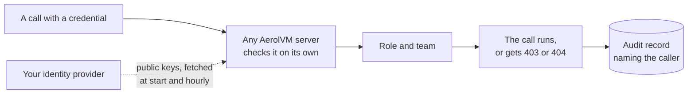

import { Aside, Tabs, TabItem } from '@astrojs/starlight/components';

A new AerolVM server has one secret token, `SB_PAT_TOKEN`. We call it the server token. Anyone who holds it can do everything. The audit log records all of them as the same person: the operator.

SSO fixes that. SSO stands for single sign-on. It means people sign in to AerolVM with the company account they already use for email and other work tools. Services and CI jobs get tokens of their own. Each caller gets a **role** on one **team**. For example, a CI job can run sandboxes for the payments team and do nothing else. Every call is recorded with the caller's name.

SSO is part of the free download. It is off until the server operator turns it on. A server with it off works exactly as before.

## Words to know

| Word | What it means |
|---|---|
| **Single sign-on (SSO)** | Signing in with your company account instead of a separate AerolVM password. |
| **Identity provider** | The service that holds your company accounts and checks passwords, such as Okta, Entra ID, Google, Keycloak, Authentik or Zitadel. |
| **Issuer** | One identity provider, as AerolVM sees it. Each issuer has a web address. |
| **Token** | A long string of characters that proves who is calling. Code sends it with every API call. |
| **Role** | What a caller may do, such as only look, or also run commands. |
| **Team** | A group of sandboxes that belong together, such as `payments`. |
| **Binding** | A rule that gives a role on a team. For example: "people in the `payments-eng` group are runners on the `payments` team". |
| **Server token (PAT)** | The one secret token every server is installed with. It always acts as an admin. |

## How it works

Every API call carries one credential. The server checks it by itself. It never calls a login service to do so.

| Credential | Who uses it | How you get it |
|---|---|---|
| **API token** (`avm_…`) | Services, CI jobs, scripts | An admin creates it. It has a name, a role, a team and an end date. |
| **Company sign-in** | People | `aerolvm login` or the dashboard sends you to your company's sign-in page, such as Okta, Entra ID, Google, Keycloak, Authentik or Zitadel. |
| **Workload token** | CI on GitHub Actions, apps on Kubernetes | The platform gives it to the job. AerolVM stores no secret for it. |
| **Server token** (PAT) | The operator, setup scripts, cluster servers | Chosen at install. It always acts as an admin on every team. Keep it for emergencies. |

Each credential gets one of four roles:

| Role | Can do | Bound to |
|---|---|---|
| `viewer` | See sandboxes and read their audit records. | One team, or every team (`*`) |
| `runner` | Everything a viewer can. It can also create, change and delete sandboxes, run commands in them, and read their environment variables. | One team, or every team (`*`) |
| `auditor` | See every team's sandboxes and audit records, list API tokens, and check the audit chain. It can never change anything. | Every team only |
| `admin` | Everything. That includes creating API tokens and running cluster tasks. | Every team only |

A role bound to every team (`*`) can also read the server's metrics at `/v1/metrics`. A `runner` on every team still cannot use features that reach into the server itself, such as mounting a folder from the server. Those need `admin`.

A **team** is a name, such as `payments`. Sandboxes that a team creates belong to that team:

- **Another team's sandbox** answers `404 Not Found`. It looks as if it does not exist.
- **Your own team's sandbox, when your role is too small,** answers `403 Forbidden`. The message names the role you would need. For example: "role viewer on team payments cannot sandbox.exec; ask an admin for role runner on team payments".



In a cluster, the call may reach one server and then move to the server that owns the sandbox. That second server checks the credential again. No server trusts another server's word about who you are.

## Check who you are

Any credential can ask the server who it is. Run this first when a call is refused.

<Tabs syncKey="lang">
  <TabItem label="TypeScript">
    ```ts
    import { MicroVM } from "@aerol-ai/aerolvm-sdk";

    const client = new MicroVM(); // reads SB_API_URL and SB_API_TOKEN

    const me = await client.whoami();
    console.log(me.principal.name ?? me.principal.id);
    console.log(me.role, me.team ?? "", me.expiresAt ?? "never expires");
    ```
  </TabItem>
  <TabItem label="Python">
    ```python
    from microvm import MicroVM

    client = MicroVM()  # reads SB_API_URL and SB_API_TOKEN

    me = client.whoami()
    print(me["principal"].get("name", me["principal"]["id"]))
    print(me["role"], me.get("team", ""), me.get("expiresAt", "never expires"))
    ```
  </TabItem>
  <TabItem label="Go">
    ```go
    client, err := microvm.NewClient() // reads SB_API_URL and SB_API_TOKEN
    if err != nil {
        log.Fatal(err)
    }

    me, err := client.WhoAmI(ctx)
    if err != nil {
        log.Fatal(err)
    }
    fmt.Println(me.Principal.ID, me.Principal.Name)
    fmt.Println(me.Role, me.Team)
    if me.ExpiresAt != nil {
        fmt.Println("expires", me.ExpiresAt)
    }
    ```
  </TabItem>
  <TabItem label="Rust">
    ```rust
    use aerolvm_sdk::Client;

    let client = Client::new(None, None)?; // reads SB_API_URL and SB_API_TOKEN

    let me = client.whoami()?;
    println!("{} {}", me.principal.id, me.principal.name);
    println!("{} {:?} {:?}", me.role, me.team, me.expires_at);
    ```
  </TabItem>
  <TabItem label="Java">
    ```java
    import ai.aerol.microvm.MicroVMClient;
    import ai.aerol.microvm.model.WhoAmI;

    MicroVMClient client = new MicroVMClient(); // reads SB_API_URL and SB_API_TOKEN

    WhoAmI me = client.whoami();
    System.out.println(me.principal.id + " " + me.principal.name);
    System.out.println(me.role + " " + me.team + " " + me.expiresAt);
    ```
  </TabItem>
</Tabs>

- `principal.id` never changes. It is `tok_…` for an API token, `oidc:<issuer>:<sub>` for a person, and `operator` for the server token. Audit records use it.
- `principal.name` is for people to read, such as `ci-deploy` or `alice@acme.com`.
- `team` is a team name, or `*` for every team.
- `expiresAt` is when the credential stops working. The server token never expires, so it has none.

From a terminal, `aerolvm whoami` prints the same thing. `aerolvm whoami --explain` also shows which rule gave you your role. See the [CLI](/cli/#check-who-you-are).

## Give a service its own token

An admin creates API tokens. Each one has a name, a role, a team and an end date.

<Tabs syncKey="lang">
  <TabItem label="TypeScript">
    ```ts
    const created = await client.tokens.create({
      name: "ci-deploy",
      role: "runner",
      team: "payments",
      expiresIn: "90d",
    });
    console.log(created.id);    // tok_…, for listing and revoking
    console.log(created.token); // avm_…, the secret: store it now
    ```
  </TabItem>
  <TabItem label="Python">
    ```python
    created = client.tokens.create(
        name="ci-deploy",
        role="runner",
        team="payments",
        expires_in="90d",
    )
    print(created["id"])     # tok_…, for listing and revoking
    print(created["token"])  # avm_…, the secret: store it now
    ```
  </TabItem>
  <TabItem label="Go">
    ```go
    created, err := client.Tokens().Create(ctx, sdktypes.CreateAPITokenOptions{
        Name:      "ci-deploy",
        Role:      "runner",
        Team:      "payments",
        ExpiresIn: "90d",
    })
    if err != nil {
        log.Fatal(err)
    }
    fmt.Println(created.ID)    // tok_…, for listing and revoking
    fmt.Println(created.Token) // avm_…, the secret: store it now
    ```
  </TabItem>
  <TabItem label="Rust">
    ```rust
    use aerolvm_sdk::CreateApiTokenOptions;

    let created = client.tokens().create(CreateApiTokenOptions {
        name: "ci-deploy".into(),
        role: "runner".into(),
        team: "payments".into(),
        expires_in: "90d".into(),
    })?;
    println!("{}", created.api_token.id); // tok_…, for listing and revoking
    println!("{}", created.token);        // avm_…, the secret: store it now
    ```
  </TabItem>
  <TabItem label="Java">
    ```java
    import ai.aerol.microvm.model.CreateApiTokenOptions;
    import ai.aerol.microvm.model.CreatedApiToken;

    CreatedApiToken created = client.tokens().create(
        new CreateApiTokenOptions()
            .setName("ci-deploy")
            .setRole("runner")
            .setTeam("payments")
            .setExpiresIn("90d")
    );
    System.out.println(created.id);    // tok_…, for listing and revoking
    System.out.println(created.token); // avm_…, the secret: store it now
    ```
  </TabItem>
</Tabs>

The same from a terminal:

```bash
aerolvm token create --name ci-deploy --role runner --team payments --expires-in 90d
```

- **You see the secret once.** The server keeps only a hash of it, a fingerprint that cannot be turned back into the secret. If you lose it, revoke the token and create a new one.
- **Every token expires.** `expiresIn` takes days (`90d`) or hours (`720h`). The server sets the longest allowed time: 365 days by default, and 90 days in [enterprise mode](/enterprise/enterprise-mode/).
- **`auditor` and `admin` need `team: "*"`.**
- **Names are unique within a team.** Creating the same name twice fails with `409 Conflict`. A 409 can also mean an earlier try worked, but its answer was lost. That secret cannot be shown again. Revoke the token by its ID and create it again.
- **Secret scanners can find leaked tokens.** Every token starts with `avm_` and ends with a checksum. The pattern is `avm_[0-9A-Za-z]{12}_[0-9A-Za-z_-]{43}_[0-9A-Za-z]{6}`.

To use the token, put it where your code reads its credential. `SB_API_TOKEN` and `SB_PAT_TOKEN` both work in every SDK and in the CLI. If both are set, `SB_PAT_TOKEN` wins.

```bash
export SB_API_URL=https://api.acme.dev
export SB_API_TOKEN=avm_...
```

### List and revoke tokens

Listing needs an `auditor` or an `admin`. Revoking needs an `admin`.

<Tabs syncKey="lang">
  <TabItem label="TypeScript">
    ```ts
    const { tokens } = await client.tokens.list();
    for (const t of tokens) {
      console.log(t.id, t.name, t.role, t.team, t.expiresAt, t.expired);
    }

    await client.tokens.revoke("tok_7Hq2aBcDeFgH");
    ```
  </TabItem>
  <TabItem label="Python">
    ```python
    for t in client.tokens.list()["tokens"]:
        print(t["id"], t["name"], t["role"], t["team"], t["expiresAt"], t["expired"])

    client.tokens.revoke("tok_7Hq2aBcDeFgH")
    ```
  </TabItem>
  <TabItem label="Go">
    ```go
    list, err := client.Tokens().List(ctx)
    if err != nil {
        log.Fatal(err)
    }
    for _, t := range list.Tokens {
        fmt.Println(t.ID, t.Name, t.Role, t.Team, t.ExpiresAt, t.Expired)
    }

    if err := client.Tokens().Revoke(ctx, "tok_7Hq2aBcDeFgH"); err != nil {
        log.Fatal(err)
    }
    ```
  </TabItem>
  <TabItem label="Rust">
    ```rust
    for t in client.tokens().list()?.tokens {
        println!("{} {} {} {} {} {}", t.id, t.name, t.role, t.team, t.expires_at, t.expired);
    }

    client.tokens().revoke("tok_7Hq2aBcDeFgH")?;
    ```
  </TabItem>
  <TabItem label="Java">
    ```java
    import ai.aerol.microvm.model.ApiToken;

    for (ApiToken t : client.tokens().list().tokens) {
        System.out.println(t.id + " " + t.name + " " + t.role + " " + t.team + " " + t.expiresAt + " " + t.expired);
    }

    client.tokens().revoke("tok_7Hq2aBcDeFgH");
    ```
  </TabItem>
</Tabs>

- **The list never shows a secret.** Expired tokens stay on the list for 30 days, marked `expired`. Then the server removes them.
- **A revoke works everywhere within seconds.** Servers that hold the cluster's shared state stop accepting the token at once. Other servers stop within one sync: within about 6 seconds, because each one polls every 5 seconds, with up to a second of random delay.
- **Revoking twice is safe.** A token that is already gone still returns success.

## Act for one of several teams

A person can be in more than one team. Their sign-in then matches several rules, and the server uses the first one. To act for another of their teams, name that team. The SDKs send it as the `X-AerolVM-Team` header on every call.

<Tabs syncKey="lang">
  <TabItem label="TypeScript">
    ```ts
    const client = new MicroVM({ team: "checkout" }); // or set SB_TEAM
    ```
  </TabItem>
  <TabItem label="Python">
    ```python
    client = MicroVM(team="checkout")  # or set SB_TEAM
    ```
  </TabItem>
  <TabItem label="Go">
    ```go
    client, err := microvm.NewClientWithConfig(&sdktypes.MicroVMConfig{
        Team: "checkout", // or set SB_TEAM
    })
    ```
  </TabItem>
  <TabItem label="Rust">
    ```rust
    use aerolvm_sdk::{ApiVersion, Client, ClientConfig};

    let client = Client::with_config(
        ClientConfig {
            team: Some("checkout".into()), // or set SB_TEAM
            ..Default::default()
        },
        ApiVersion::default(),
    )?;
    ```
  </TabItem>
  <TabItem label="Java">
    ```java
    MicroVMClient client = new MicroVMClient(
        new MicroVMConfig().setTeam("checkout") // or set SB_TEAM
    );
    ```
  </TabItem>
</Tabs>

- **It only chooses.** The team must be one your credential already has. Any other team gets `403 Forbidden`.
- **It cannot pick "every team".** A team name is 1 to 63 characters of `a-z`, `0-9` and `-`. To act on every team, send no team. The first rule then has to be the one for every team. See [the identity file](#step-2-write-the-identity-file).
- **The server token ignores it.**
- **In the CLI,** use `aerolvm login --team checkout` or `SB_TEAM`.
- **TypeScript only:** live command streams (`execStream`, `attachSession`) cannot send the header. They use your first team.

## Sign in with your company account

People sign in through your identity provider. AerolVM never sees their password. It keeps no login session either. Instead, the provider signs a short-lived token, which lasts about an hour. Every AerolVM server checks that signature with the provider's public keys.

<div style="max-width: 440px; margin: 0 auto 24px;">
  
</div>

*The dashboard shows one button for each provider. The token box stays closed until you need it.*

- **In a terminal:** `aerolvm login https://api.acme.dev` opens your browser. Over SSH, add `--device`. You get a code to type on another device. The login renews itself while your provider allows it. See [Save your login](/cli/#save-your-login).
- **In a browser:** open the [dashboard](/dashboard/) at `https://api.acme.dev/ui` and pick your provider. The dashboard's console is for admins. People with other roles see who they are and how to use the CLI.
- **In code:** `aerolvm auth token` prints a fresh token for a script: `SB_API_TOKEN=$(aerolvm auth token) python agent.py`. It lasts about an hour, so get a new one for long jobs.

### Sign in from CI with no stored secret

GitHub Actions and Kubernetes can each give a job a signed token that says who the job is. AerolVM checks it the same way it checks a person's sign-in. So there is no AerolVM secret to store or change.

On **GitHub Actions**, ask for a token with the audience `aerolvm`. The audience names who the token is for.

```yaml
permissions:
  id-token: write
  contents: read

jobs:
  test:
    runs-on: ubuntu-latest
    steps:
      - uses: actions/checkout@v4
      - name: Get an AerolVM token
        id: aerolvm
        uses: actions/github-script@v7
        with:
          result-encoding: string
          script: return await core.getIDToken('aerolvm')
      - name: Run the tests in a sandbox
        run: python run_tests.py
        env:
          SB_API_URL: https://api.acme.dev
          SB_API_TOKEN: ${{ steps.aerolvm.outputs.result }}
```

The token lasts a few minutes. For a long job, get a fresh one before each step that calls AerolVM.

On **Kubernetes**, mount a service account token with the audience `aerolvm`. The kubelet, the agent on each Kubernetes machine, renews the file by itself:

```yaml
spec:
  serviceAccountName: ci
  containers:
    - name: agent
      image: your-app
      volumeMounts:
        - name: aerolvm-token
          mountPath: /var/run/secrets/aerolvm
          readOnly: true
  volumes:
    - name: aerolvm-token
      projected:
        sources:
          - serviceAccountToken:
              path: token
              audience: aerolvm
              expirationSeconds: 3600
```

Then read the file each time you build a client:

<Tabs syncKey="lang">
  <TabItem label="TypeScript">
    ```ts
    import { readFileSync } from "node:fs";
    import { MicroVM } from "@aerol-ai/aerolvm-sdk";

    const client = new MicroVM({
      apiUrl: "https://api.acme.dev",
      patToken: readFileSync("/var/run/secrets/aerolvm/token", "utf8").trim(),
    });
    ```
  </TabItem>
  <TabItem label="Python">
    ```python
    from pathlib import Path
    from microvm import MicroVM

    client = MicroVM(
        api_url="https://api.acme.dev",
        pat_token=Path("/var/run/secrets/aerolvm/token").read_text().strip(),
    )
    ```
  </TabItem>
  <TabItem label="Go">
    ```go
    raw, err := os.ReadFile("/var/run/secrets/aerolvm/token")
    if err != nil {
        log.Fatal(err)
    }
    client, err := microvm.NewClientWithConfig(&sdktypes.MicroVMConfig{
        APIUrl:   "https://api.acme.dev",
        PATToken: strings.TrimSpace(string(raw)),
    })
    if err != nil {
        log.Fatal(err)
    }
    ```
  </TabItem>
  <TabItem label="Rust">
    ```rust
    use aerolvm_sdk::Client;

    let token = std::fs::read_to_string("/var/run/secrets/aerolvm/token")
        .expect("read the service account token");
    let client = Client::new(Some("https://api.acme.dev"), Some(token.trim()))?;
    ```
  </TabItem>
  <TabItem label="Java">
    ```java
    import java.nio.file.Files;
    import java.nio.file.Path;

    String token = Files.readString(Path.of("/var/run/secrets/aerolvm/token")).trim();
    MicroVMClient client = new MicroVMClient(
        new MicroVMConfig()
            .setApiUrl("https://api.acme.dev")
            .setPatToken(token)
    );
    ```
  </TabItem>
</Tabs>

The server never calls the Kubernetes API to check the token. It checks the signature with the public keys your cluster publishes.

## Set it up

This section is for the server operator.

### Step 1: Turn it on

Add this setting to every server's environment, then restart:

```bash
SB_IDENTITY_ENABLED=true
```

This is **tokens-only mode**. API tokens work, but nobody signs in with SSO yet. It needs no identity provider, so it works on networks with no internet access. It is a complete setup. It is also enough for [enterprise mode](/enterprise/enterprise-mode/).

Make the first admin token with the server token, on a server:

```bash
SB_API_URL=http://127.0.0.1:21212 SB_PAT_TOKEN=<server token> \
  aerolvm token create --name first-admin --role admin --team '*' --expires-in 30d
```

Use that admin token from then on. Keep the server token for emergencies.

<Aside type="note">
With `SB_IDENTITY_ENABLED` off, you can still create and list tokens, but no server accepts them. This lets you prepare tokens before you turn it on.
</Aside>

### Step 2: Write the identity file

The identity file lists your identity providers. It also maps their groups to AerolVM roles. Point `SB_IDENTITY_FILE` at it on every server.

```yaml
version: 1
issuers:
  - name: okta                          # used in audit records; never change it
    display_name: Acme Okta             # the dashboard button: "Sign in with Acme Okta"
    url: https://acme.okta.com/oauth2/default
    audiences: [0oa1cli, 0oa1dash]      # the client IDs of the CLI and dashboard apps
    clients: { cli: 0oa1cli, dashboard: 0oa1dash }
    claims: { username: email, groups: groups }
    max_token_lifetime: 12h
  - name: google
    display_name: Google
    kind: google
    url: https://accounts.google.com
    audiences: [123-cli.apps.googleusercontent.com, 123-dash.apps.googleusercontent.com]
    clients: { cli: 123-cli.apps.googleusercontent.com, dashboard: 123-dash.apps.googleusercontent.com }
    claims: { username: email }
  - name: github-actions                # CI with no stored secret
    url: https://token.actions.githubusercontent.com
    audiences: [aerolvm]
    claims: { username: sub }
  - name: eks-prod                      # Kubernetes service accounts
    url: https://oidc.eks.us-east-1.amazonaws.com/id/EXAMPLE
    audiences: [aerolvm]
    claims: { username: sub }
bindings:                               # fleet rules first, then team rules
  - { issuer: okta, group: platform-admins, role: admin }
  - { issuer: okta, group: secops,          role: auditor }
  - { issuer: okta, group: payments-eng,    role: runner, team: payments }
  - { issuer: github-actions, claim: { repository: acme/payments, ref: refs/heads/main }, role: runner, team: payments }
  - { issuer: eks-prod, claim: { sub: "system:serviceaccount:payments:ci" }, role: runner, team: payments }
deny_subjects: []                       # "<issuer>:<sub>", blocked at once
```

**Put rules for every team above rules for one team.** A rule for every team is an `admin`, an `auditor`, or any rule with `team: '*'`. When a person matches several rules, they get the first one by default. A team header can pick another of their team rules. But nothing can pick a rule for every team that sits lower down. So if a team rule came first, an admin who is also in `payments-eng` would lose admin. The dashboard sends no team header at all.

How a rule matches:

- `group` matches the groups claim. `app_role` matches the roles claim (Entra app roles). A claim is one named fact inside a sign-in token, such as an email address or a list of groups.
- The groups and roles claims must hold a string or a list of strings. A claim that holds an object never matches, such as Zitadel's project roles.
- `claim` matches only when every listed claim matches. A list claim matches when it contains the value.
- A rule on `email` also needs the provider to say the email is verified.
- Only the rules for the token's own issuer are tried.

How the file loads:

- Unknown keys fail the load. So do a missing `version` and an empty file. For tokens-only mode, unset `SB_IDENTITY_FILE` instead of leaving the file empty.
- Each server reads the file again within 10 seconds of a change, or at once on `SIGHUP`. A bad edit keeps the last good file and counts an error.
- A bad file at start turns off SSO sign-in until you fix it. SSO sign-ins then get `503`. API tokens and the server token keep working.
- Every change writes one `identity_config` audit record on each server. It holds the old and new file hash, plus the rules added and removed. The file cannot say who edited it. Keep it in Git or your config tool, so that history names the author.
- Send the same file to every server, with Terraform or Ansible. The `aerolvm_identity_file_info` metric shows a server whose copy differs.

| Field | What it is |
|---|---|
| `version` | Always `1`. |
| `issuers[].name` | Required. 1 to 63 characters of `a-z`, `0-9` and `-`. It is part of every person's ID (`oidc:<name>:<sub>`), so do not rename it. |
| `issuers[].display_name` | Optional. The dashboard button and CLI menu label, 1 to 40 characters. Defaults to `name`. It is never used in IDs or records. |
| `issuers[].kind` | `oidc` (the default) or `google`. `google` makes the dashboard use Google's own sign-in button. |
| `issuers[].url` | Required. The provider's issuer URL, over `https`. It must equal the token's `iss` exactly. |
| `issuers[].jwks_file` | Optional. A file with the provider's public keys, for a provider your servers cannot reach. |
| `issuers[].audiences` | Required. The client IDs (or `aerolvm`, for workload tokens) that a token may be made for. |
| `issuers[].clients.cli`, `.dashboard` | Optional. The client IDs of your CLI and dashboard apps. Each must also be in `audiences`. Only issuers with one appear in the CLI menu or as a dashboard button. |
| `issuers[].claims.username`, `.groups`, `.roles` | Which claims hold the display name, the groups and the app roles. Defaults: `sub`, `groups`, `roles`. |
| `issuers[].max_token_lifetime` | Default `24h`. Tokens that last longer are refused. Raise it only for a workload issuer that needs it. |
| `issuers[].mcp`, `.mcp_audiences` | For MCP connectors such as claude.ai. See [MCP server](/mcp/#sign-in-with-oauth). |
| `bindings[]` | `issuer`, then exactly one of `group`, `app_role` or `claim`, then `role` and `team`. `team` is a team name or `*`. `auditor` and `admin` are always `*`. |
| `deny_subjects[]` | `"<issuer>:<sub>"`. Refused on every call after the next reload. |
| `mcp.resource`, `mcp.scopes` | For MCP connectors. See [MCP server](/mcp/#sign-in-with-oauth). |

### Step 3: Register the apps at your provider

Register two apps at your identity provider: one for the CLI and one for the dashboard. Put their client IDs in `clients` and `audiences`. Neither one needs a client secret on the server.

| | CLI app | Dashboard app |
|---|---|---|
| App type | Native or desktop app, public client | Single-page app, public client |
| Sign-in flow | Authorization code with PKCE. Also the device flow, for `--device`. | Authorization code with PKCE |
| Redirect URI | `http://127.0.0.1/callback`. The CLI listens on a random port, so the provider must accept any port on that address. | `https://<api-domain>/ui` |
| Allowed origin (CORS) | None | `https://<api-domain>` |
| Scopes | `openid email profile`, plus `offline_access` so the login can renew itself | `openid email profile` |
| Scopes it adds on its own | `groups`, when the provider lists that scope | `groups`, when the provider lists that scope |
| Groups | Put the groups claim in the ID token | Put the groups claim in the ID token |

PKCE is a standard way for an app with no secret to sign in safely. A redirect URI is the address the provider sends you back to after you sign in.

The dashboard works only over HTTPS, or from `localhost` through an SSH tunnel. [Dashboard](/dashboard/#set-up-sign-in-for-the-dashboard) has the details.

Each provider has its own notes below.

#### Okta

- Create a Native app for the CLI, with the Refresh Token grant. Add Device Authorization too, for `--device`.
- Create a Single-Page app for the dashboard. Add `https://<api-domain>` as a Trusted Origin for CORS.
- Add a groups claim to the ID token.

#### Entra ID

- The issuer `url` is `https://login.microsoftonline.com/<tenant>/v2.0`.
- Use the "Mobile and desktop applications" platform for the CLI. Turn on public client flows for `--device`.
- Use the "Single-page application" platform for the dashboard.
- Above 200 groups, Entra leaves the groups out of the token. Bind on app roles instead: `{ issuer: entra, app_role: AerolVM.Runner, role: runner, team: payments }`.

#### Keycloak

- The issuer `url` is `https://<keycloak>/realms/<realm>`. Set Keycloak's `hostname` option (`KC_HOSTNAME`) to that public address. Without it, Keycloak writes whatever host a request used into the token's issuer. Then a server that reaches Keycloak by another address sees an issuer that does not match, and sign-in fails. Every server must reach that address.
- Make both clients public, with the standard flow. Set **Proof Key for Code Exchange Code Challenge Method** to `S256` on both. Turn on **OAuth 2.0 Device Authorization Grant** on the CLI client, for `--device`. The CLI sends PKCE on the device flow too when Keycloak asks for it.
- On `--device`, Keycloak shows a page that asks you to grant access, even with **Consent required** off. Approve it to finish signing in.
- Set the dashboard client's **Web origins** to `https://<api-domain>`. For an SSH tunnel, add `http://localhost:21212` too. Without it, the dashboard says "Keycloak didn't sign you in (network_error)".
- Add a **Group Membership** mapper with the claim name `groups` and **Add to ID token** on. Put it in a client scope that both clients get, such as a default client scope.
- Turn **Full group path** off. It is on by default. Then Keycloak sends `/platform-admins` instead of `platform-admins`, and no `group: platform-admins` rule matches. If you keep it on, write the rules with the slash: `group: /platform-admins`.

#### Google

- Use `kind: google`. Google gets its own button.
- The CLI app is a "Desktop app". Google still wants that app's client secret. Hand it to people when they start. They run `aerolvm login --sso <url> --client-secret-stdin` once. It never goes on the server.
- Google offers the device flow only to a "TVs and Limited Input devices" client. The CLI uses one client ID for both flows, so pick the type you need.
- The dashboard app is a "Web application" with `https://<api-domain>` as an authorized JavaScript origin.

#### Authentik

Authentik has not been tested against a live account yet. These steps follow Authentik's own documentation.

Each Authentik application has its own issuer URL. So use **one** application for both the CLI and the dashboard:

- The issuer `url` is `https://<authentik>/application/o/<slug>/`, with the slash at the end. Keep the provider's issuer mode at its default, one issuer per provider. Don't rename the slug later. Both changes change the issuer.
- Make its OAuth2/OpenID provider a **Public** client. Put its client ID in `audiences`, and as both `clients.cli` and `clients.dashboard`.
- Add the redirect URI `https://<api-domain>/ui` as **Strict**. Add `http://127\.0\.0\.1:\d+/callback` as **Regex**, so the CLI's random port matches. Authentik allows cross-origin calls from the address of each Strict redirect URI, so the dashboard needs nothing more.
- Pick an RSA **Signing Key**, such as the built-in "authentik Self-signed Certificate". With no signing key, Authentik signs with HS256, which the server refuses. Leave **Encryption Key** empty.
- Add the `offline_access` scope to the provider, so the CLI login can renew itself. For `--device`, give your brand a device code flow.
- The default `profile` scope puts a `groups` list in the ID token, so group rules work as they are. Authentik's default `email` scope says the email is not verified, so a rule on `email` never matches.
- Keep **Subject mode** at its default, a hashed user ID. Each person's ID is built from it, and a change gives everyone a new ID.

Its issuer in the identity file looks like this:

```yaml
issuers:
  - name: authentik
    display_name: Acme Authentik
    url: https://auth.acme.dev/application/o/aerolvm/      # keep the trailing slash
    audiences: [Kq7wP2mXv9]                                # the provider's client ID
    clients: { cli: Kq7wP2mXv9, dashboard: Kq7wP2mXv9 }    # one app serves both
    claims: { username: email, groups: groups }
bindings:
  - { issuer: authentik, group: platform-admins, role: admin }
```

#### Zitadel

Zitadel has not been tested against a live account yet. These steps follow Zitadel's own documentation.

The issuer `url` is your instance's domain, such as `https://acme-abc123.zitadel.cloud`, with no slash at the end.

- Put the CLI and dashboard apps in a project of their own. Zitadel puts the client ID of every app in a project into every token that project issues. So a sign-in token for any other app in that project would also work here.
- For the CLI, create a **Native** app with PKCE. Turn on the Refresh Token and Device Code grant types. Register `http://127.0.0.1/callback`. Zitadel accepts any port on it for a native app.
- For the dashboard, create a **User Agent** app with PKCE. Zitadel allows cross-origin calls from the redirect URI's address, so it needs no extra origin. To sign in through an SSH tunnel too, add `http://localhost:21212/ui` and turn on **Development Mode**. Zitadel allows an `http` redirect URI on a non-native app only in that mode.
- Zitadel's roles claim is an object, which the server can't match. Add a flat `groups` claim with a Zitadel Action, as [Zitadel roles as groups](#zitadel-roles-as-groups) shows.
- The ID token always has `preferred_username`, the person's login name. It has the email only when **User Info inside ID Token** is on. Set `username: preferred_username`, or turn that setting on to show or bind on `email`.
- Zitadel's ID tokens last 12 hours by default, not one hour. To cut off a removed person sooner, shorten the ID token lifetime in your instance's OIDC settings.

Its issuer in the identity file looks like this:

```yaml
issuers:
  - name: zitadel
    display_name: Acme Zitadel
    url: https://acme-abc123.zitadel.cloud                 # no trailing slash
    audiences: ["290101", "290102"]                        # the CLI and dashboard client IDs
    clients: { cli: "290101", dashboard: "290102" }
    claims: { username: preferred_username, groups: groups }   # groups comes from the Action below
bindings:
  - { issuer: zitadel, group: payments-eng, role: runner, team: payments }   # a Zitadel role key
```

#### Zitadel roles as groups

Zitadel puts a person's roles in an object (`urn:zitadel:iam:org:project:roles`). A Zitadel Action is a small script that runs at sign-in. It can copy the role keys into a flat `groups` list, which group rules can match.

1. In the project of your CLI and dashboard apps, turn on **Assert Roles on Authentication**. Without it, the Action sees no roles.
2. Open **Actions** in the organization your people belong to. Zitadel runs the Actions of each person's own organization. Create an Action named `groupsClaim`. Turn on **Allowed To Fail**, so a broken script can't block sign-in. If it does break, the person carries no groups and gets no role. Use this script:

   ```js
   function groupsClaim(ctx, api) {
     if (ctx.v1.user.grants === undefined || ctx.v1.user.grants.count == 0) {
       return;
     }
     let groups = [];
     ctx.v1.user.grants.grants.forEach(grant => {
       grant.roles.forEach(role => groups.push(role));
     });
     api.v1.claims.setClaim('groups', groups);
   }
   ```

3. Under **Flows**, pick **Complement Token**. Add the Action to the **Pre Userinfo creation** trigger. That puts `groups` in ID tokens. For [MCP connectors](/mcp/#sign-in-with-oauth), also add it to **Pre access token creation**.

Each role key becomes one group name. A person granted the `payments-eng` role in the project matches `{ issuer: zitadel, group: payments-eng, ... }`. Only roles from the app's own project are included.

#### Dex

Dex has not been tested against a live account yet. These steps follow Dex's own documentation and source code, for Dex v2.46.

Dex signs people in through another system, such as LDAP, GitHub or a SAML provider. Dex calls each of these a connector. So Dex is also how a company that uses only SAML signs in to AerolVM.

- The issuer `url` is the `issuer` in Dex's config file, such as `https://dex.acme.dev`. It must use `https`, and every server must reach it.
- Add both apps under `staticClients`, each with `public: true`. Give the CLI client **no** `redirectURIs`. Dex then accepts `http://127.0.0.1` on any port, and the device flow for `--device`. Give the dashboard client the redirect URI `https://<api-domain>/ui`. For an SSH tunnel, add `http://localhost:21212/ui` too.
- Set `web.allowedOrigins` to `https://<api-domain>`. For an SSH tunnel, add `http://localhost:21212` too. Without it, Dex allows no cross-origin calls, and the dashboard says "didn't sign you in (network_error)".
- Set `oauth2.skipApprovalScreen: true`. Otherwise Dex asks people to grant access every time they sign in.
- Dex puts `groups` in the ID token only when an app asks for the `groups` scope. The CLI and the dashboard both ask for it, because Dex lists that scope. The groups come from your connector, and not every connector sends them. Check your connector's page in Dex's documentation.
- Each person's ID is built from their user ID and the connector's `id`. Don't rename a connector's `id` later. That gives everyone a new ID.
- Dex's ID tokens last 24 hours by default. The server accepts that. To cut off a removed person sooner, set `expiry.idTokens` to `1h`.
- The dashboard renews a sign-in quietly before its ID token expires. Dex allows that only with its sessions feature, which is new and experimental in v2.46. Set `DEX_SESSIONS_ENABLED=true` and add a `sessions` block to Dex's config. Without it, the dashboard says "Your sign-in expired" when the token runs out, and people sign in again. The CLI renews with a refresh token instead, if your connector supports refresh.

The parts of Dex's config file that matter here look like this:

```yaml
issuer: https://dex.acme.dev
web:
  allowedOrigins: ["https://api.acme.dev"]
oauth2:
  skipApprovalScreen: true
expiry:
  idTokens: "1h"
staticClients:
  - id: aerolvm-cli
    name: AerolVM CLI
    public: true                                      # no redirectURIs: any 127.0.0.1 port, plus --device
  - id: aerolvm-dashboard
    name: AerolVM dashboard
    public: true
    redirectURIs: ["https://api.acme.dev/ui"]
```

Its issuer in the identity file looks like this:

```yaml
issuers:
  - name: dex
    display_name: Acme Dex
    url: https://dex.acme.dev                         # Dex's issuer, exactly
    audiences: [aerolvm-cli, aerolvm-dashboard]       # the CLI and dashboard client IDs
    clients: { cli: aerolvm-cli, dashboard: aerolvm-dashboard }
    claims: { username: email, groups: groups }
bindings:
  - { issuer: dex, group: platform-admins, role: admin }
```

### Step 4: Check it

1. Open `https://<api-domain>/.well-known/aerolvm-auth` in a browser. It lists every provider that has a CLI or dashboard app. It also shows `identity_enabled: true`.
2. Run `aerolvm login https://<api-domain>`, then `aerolvm whoami --explain`. It shows your role and team, the rule that matched, and the groups your sign-in carried.
3. If no rule matches, the CLI and the dashboard both say so and list your groups. Add a rule for one of them.

<div style="max-width: 440px; margin: 0 auto 24px;">
  
</div>

*A person whose sign-in matches no rule sees this screen. It lists the groups they carried, so they can tell an admin what to add.*

### Step 5: Limit the server token to the server

With `SB_PAT_SCOPE=host`, the server token works only on the server itself and between cluster servers. Everyone else must use SSO or an API token. So every action from outside names a person or a service. [Enterprise mode](/enterprise/enterprise-mode/) requires it.

1. **Upgrade every server first.** When older servers pass a call to another server, they do not mark the server token. A server with `host` refuses an unmarked one.
2. **Move remote tools off the server token.** That means the dashboard, remote MCP, SDK scripts, and your Prometheus scrape. For the scrape, a `viewer` token on every team works: `aerolvm token create --name prometheus --role viewer --team '*' --expires-in 90d`. With the project's Terraform, set it as `cluster.metrics_token` in `config/secrets.yml` and apply again.
3. **Move your own settings out of the installer's file.** The installer writes the settings file (`/etc/sandboxd/sandboxd.env`) from scratch. So after it runs, every setting you added by hand is gone. That includes `SB_IDENTITY_ENABLED`, `SB_IDENTITY_FILE` and `SB_ENTERPRISE_MODE`. Put them in a file the installer never touches, as [Installer options](/getting-started/installer-options/#keep-your-own-settings) shows.
4. **Run the installer again on each server with `--pat-scope host`.** Pass every install option again, with the current `--pat-token`. Without it, the installer makes a new server token. Caddy then reaches the server through a private socket, so its traffic no longer looks like it comes from the server itself. Any other proxy on the server must use that socket too. The installer restarts the server and waits for the socket before it starts Caddy.

Setup scripts on the server keep working with `http://127.0.0.1:21212`. A server token sent from anywhere else gets `401`: "the operator token works only on this host; sign in with `aerolvm login --sso` or use a named token".

The scrape token is **read-only, not metrics-only**. It cannot create, run or delete anything. But a `viewer` on every team can also read every team's sandbox details and audit records.

## Take access away

- **For a person:** remove them at your identity provider. Their login stops renewing. Their last sign-in token stops working when it expires. That is about an hour for most providers, and 12 hours by default for Zitadel. To block them at once, add `"<issuer>:<sub>"` to `deny_subjects` and send out the file. Each server applies it within 10 seconds, or at once on `SIGHUP`. Their audit records name them as `oidc:<issuer>:<sub>`. The deny entry is that ID without `oidc:`.
- **For an API token:** revoke it. Every server stops accepting it within seconds.
- **For the server token:** change it (rotate it). The [runbook](https://github.com/aerol-ai/microvm/blob/main/setup/runbooks/identity-and-access.md#rotatepat) shows how to do it with no downtime.

## What gets recorded

With SSO on or off, every call that changes something writes an audit record. The record names the caller.

- **Every call except plain reads.** That covers create, delete, start, stop, ports, snapshots, tokens, and every command or file call inside a sandbox. File reads count too, since files can hold secrets. With `SB_AUDIT_API_RECORDS=all`, plain reads are recorded too.
- **Refused calls.** A `403` is a record with `result: denied`. A refused credential (`401`) is an `auth_denied` record, at most one per address per minute. Together, those records count every refused call.
- **The server's own work.** For example, a lifecycle timer may delete a sandbox. The record names the part of the server that did it, such as `system:lifecycle`.
- **Commands are not stored by default.** A record holds a fingerprint of the command. The fingerprint proves what ran without keeping any secrets the command held.

Every action that changes something is recorded, with one exception. Calls in the last second before an unclean crash can be lost, because records are saved to disk once a second. Durable calls are never lost. Token create, token revoke and sandbox delete are durable when `SB_AUDIT_API_DURABLE` is on, as it always is in enterprise mode.

[Audit and compliance](/enterprise/audit-evidence/) lists every field and maps the records to SOC 2. It also shows how to produce an access review.

## Errors you may see

| What you see | What it means | What to do |
|---|---|---|
| `401` with reason `expired` | The token's time is up. | Sign in again, or ask for a new API token. |
| `401` with reason `not_yet_valid` | Your computer's clock is more than a minute off. | Fix the clock. |
| `401` with reason `wrong_audience`, `unknown_issuer` or `too_long_lived` | The token came from an app or provider this server does not trust. | Check `issuers` in the identity file. |
| `401` with reason `invalid_signature` or `malformed` | The token is damaged or fake. | Sign in again. |
| `401` with reason `unknown_or_revoked` | The API token was revoked, or the person is on the deny list. | Ask an admin. |
| `403` "no role binding for …" | You signed in, but no rule matches you. The message lists your groups. | Ask an admin to add a rule for one of them. |
| `403` "role … cannot …; ask an admin for role …" | Your role is too small for this call. | Ask for the role it names. |
| `403` "is not one of this credential's teams" | You picked a team you do not belong to. | Unset `SB_TEAM`, or pick one of your teams. |
| `404` | The sandbox does not exist, or it belongs to another team. | Check the team you act for. |
| `503` "identity data is stale on this node" | This server lost contact with the cluster's token list for over a minute. | Retry. The server token and SSO still work. |
| `503` "sign-in with an identity provider is unavailable" | The identity file failed to load, or the provider's keys could not be fetched. | Retry, or use an API token. Operators: check the server log. |

## For server operators

### Settings

| Setting | Default | What it does |
|---|---|---|
| `SB_IDENTITY_ENABLED` | `false` | Turns on API tokens and SSO. Enterprise mode requires it. |
| `SB_IDENTITY_FILE` | Empty | The identity file. Empty means tokens-only mode. |
| `SB_TOKEN_MAX_TTL` | `8760h` (365 days) | The longest an API token may last. 90 days at most in enterprise mode. |
| `SB_IDENTITY_SYNC_INTERVAL` | `5s` | How often servers without the cluster's shared state fetch token changes. |
| `SB_IDENTITY_MAX_STALE` | `60s` | After this long without a sync, a server refuses API tokens, except to read metrics. |
| `SB_PAT_SCOPE` | `any` | `host` limits the server token to the server and cluster servers. Enterprise mode requires it. |
| `SB_PUBLIC_API_SOCKET` | `/run/sandboxd-public/api.sock` | The socket Caddy uses when `SB_PAT_SCOPE=host`. |
| `SB_PAT_TOKEN_PREVIOUS` | Empty | A second server token, accepted only while you rotate the main one. |
| `SB_OPERATOR_VOLUME_SCOPE` | Empty | Pins where the operator's platform volumes live, so a token rotation does not move them. |
| `SB_L4_FALLBACK_PROXY_PROTOCOL` | `false` | Passes callers' real addresses through Caddy. Set by `install.sh --l4-proxy-protocol`. |

Client settings, read by every SDK and the CLI:

| Setting | What it does |
|---|---|
| `SB_API_TOKEN` | The credential to send: an API token, a sign-in token or the server token. It is the same as `SB_PAT_TOKEN`, which wins if both are set. |
| `SB_TEAM` | The team to act for, sent as `X-AerolVM-Team`. Empty uses your first rule. |

[Config defaults](https://github.com/aerol-ai/microvm/blob/main/setup/config-defaults.md) explains why each default is what it is.

### Monitoring

- **Metrics:** `aerolvm_auth_requests_total` (by credential kind and origin), `aerolvm_auth_failures_total` (by reason), `aerolvm_identity_mirror_age_seconds`, `aerolvm_identity_jwks_fetch_total`, `aerolvm_identity_file_info`, `aerolvm_identity_file_load_errors_total`, `aerolvm_api_tokens` (by role), `aerolvm_pat_scope_drift` and `aerolvm_auth_client_ip_dropped_total`.
- **Alerts:** they are in [`setup/prometheus/sandboxd-alerts.yml`](https://github.com/aerol-ai/microvm/blob/main/setup/prometheus/sandboxd-alerts.yml). They fire when:
  - the server token is used from outside;
  - servers have different `SB_PAT_SCOPE` settings;
  - the token list goes stale;
  - key fetches fail;
  - identity files differ between servers;
  - an identity file fails to load.
- **Dashboard:** the "Identity and access" row in `setup/grafana/d9-security-isolation.json`.
- **Traces:** each request span carries the caller's kind, ID and team, and the permission checked. Display names never go into traces.
- **Runbook:** [`setup/runbooks/identity-and-access.md`](https://github.com/aerol-ai/microvm/blob/main/setup/runbooks/identity-and-access.md) covers every alert. It also covers rotating the server token and the scrape token, the first admin token, a provider outage, and turning on `SB_PAT_SCOPE=host`.

### Upgrades and rollback

- **A cluster starts writing callers into audit records only when every server runs this release.** During a rolling upgrade, records look as they did before.
- **Once a server has written a caller, do not roll back below this release.** An older server cannot check those records. So it refuses to start while `SB_SECRET_AUDIT_STRICT_BOOT` is on, which enterprise mode requires. An older `aerolvm audit verify` fails the same way, so upgrade the CLI first.
- **To turn SSO and tokens off,** set `SB_IDENTITY_ENABLED=false` and restart. Tokens stay stored, and the server token works as before. Enterprise mode refuses this.

## Next steps

- [How AerolVM checks who you are](/engineering-identity-and-access/): the design behind this page, with diagrams.
- [aerolvm CLI](/cli/#save-your-login): sign in, check who you are, and manage tokens from a terminal.
- [Dashboard](/dashboard/): sign in to the web console.
- [Audit and compliance](/enterprise/audit-evidence/): the records, the SOC 2 mapping and the access review.
- [Enterprise mode](/enterprise/enterprise-mode/): the strict profile that requires named credentials.
