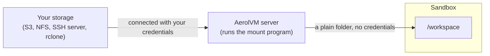
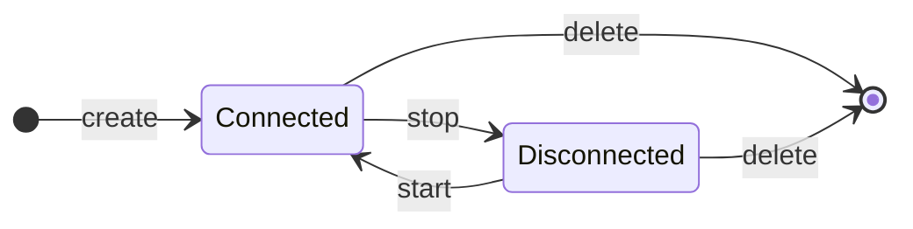

import { Aside, Tabs, TabItem } from '@astrojs/starlight/components';

A sandbox's own disk is deleted with the sandbox. To keep data longer, or to work on data that already lives somewhere else, attach your own storage. It shows up as a normal folder inside the sandbox.

## How it works



1. **You list the storage when you create the sandbox,** with its credentials.
2. **The server connects to it** on its own machine. This is called mounting.
3. **The server passes the folder into the sandbox.** Your code reads and writes it like any folder. Your image needs no extra tools, and your credentials never enter the sandbox.

## Attach an S3 bucket

This puts the `prefix` folder of `my-bucket` at `/workspace` inside the sandbox.

<Tabs syncKey="lang">
  <TabItem label="TypeScript">
    ```ts
    const sandbox = await client.create({
      image: "ubuntu:22.04",
      mounts: [
        {
          type: "s3",
          source: "s3://my-bucket/prefix",
          target: "/workspace",
          credentials: {
            access_key_id: "AKIA...",
            secret_access_key: "your-secret-key",
          },
        },
      ],
    });
    ```
  </TabItem>
  <TabItem label="Python">
    ```python
    sandbox = client.create(
        image="ubuntu:22.04",
        mounts=[
            {
                "type": "s3",
                "source": "s3://my-bucket/prefix",
                "target": "/workspace",
                "credentials": {
                    "access_key_id": "AKIA...",
                    "secret_access_key": "your-secret-key",
                },
            },
        ],
    )
    ```
  </TabItem>
  <TabItem label="Go">
    ```go
    sandbox, err := client.Create(ctx, sdktypes.CreateSandboxOptions{
        Image: "ubuntu:22.04",
        Mounts: []sdktypes.MountSpec{
            {
                Type:   sdktypes.MountTypeS3,
                Source: "s3://my-bucket/prefix",
                Target: "/workspace",
                Credentials: map[string]string{
                    "access_key_id":     "AKIA...",
                    "secret_access_key": "your-secret-key",
                },
            },
        },
    })
    if err != nil {
        log.Fatal(err)
    }
    ```
  </TabItem>
  <TabItem label="Rust">
    ```rust
    use aerolvm_sdk::{MountSpec, MountType};
    use std::collections::HashMap;

    let sandbox = client.create(CreateOptions {
        image: "ubuntu:22.04".into(),
        mounts: Some(vec![MountSpec {
            mount_type: MountType::S3,
            source: "s3://my-bucket/prefix".into(),
            target: "/workspace".into(),
            options: None,
            credentials: Some(HashMap::from([
                ("access_key_id".to_string(), "AKIA...".to_string()),
                ("secret_access_key".to_string(), "your-secret-key".to_string()),
            ])),
            read_only: None,
        }]),
        ..Default::default()
    })?;
    ```
  </TabItem>
  <TabItem label="Java">
    ```java
    Sandbox sandbox = client.create(new CreateOptions()
        .setImage("ubuntu:22.04")
        .setMounts(List.of(new MountSpec()
            .setType("s3")
            .setSource("s3://my-bucket/prefix")
            .setTarget("/workspace")
            .setCredentials(Map.of(
                "access_key_id", "AKIA...",
                "secret_access_key", "your-secret-key")))));
    ```
  </TabItem>
</Tabs>

Files your code writes to `/workspace` go straight to the bucket, and stay there after the sandbox is deleted. If the mount fails, the create call fails, so you never get a sandbox with a missing folder.

## Kinds of storage you can attach

| Type | What it is | `source` looks like | Credentials |
|---|---|---|---|
| `s3` | An Amazon S3 bucket, or any S3-compatible store | `s3://bucket/prefix` or just `bucket` | `access_key_id`, `secret_access_key`, `session_token` (all optional) |
| `nfs` | A shared folder on your network (NFS) | `host:/exports/path` | None |
| `sshfs` | A folder on any server you can reach with SSH | `user@host:/path` | `private_key_pem` (required) |
| `rclone` | Any storage that rclone supports, such as Google Drive or Azure | `remote:path` | `rclone_conf` (the text of an `rclone.conf` file) |

With no S3 credentials, the server uses its own AWS access, such as a cloud machine role, if it has one.

## Mount options

| Field | What it does | Default |
|---|---|---|
| `type` | One of `s3`, `nfs`, `sshfs` or `rclone`. | Required |
| `source` | Where the storage is. See the table above. | Required |
| `target` | The folder inside the sandbox, as a full path such as `/data`. | Required |
| `credentials` | Secrets for the storage. They are encrypted and never shown again. | None |
| `options` | Extra settings for each type (below). | None |
| `readOnly` | Let the sandbox read the storage but not change it. | `false` |

Go spells these `Type`, `Source`, `Target`, `Credentials`, `Options` and `ReadOnly`. Rust uses `mount_type` (with `MountType::S3` and so on) and `read_only`. Java has a setter for each.

For example, an NFS share that code can read but not change is `{ type: "nfs", source: "10.0.0.1:/exports/data", target: "/data", readOnly: true }`, with no credentials.

| Type | Option | What it does |
|---|---|---|
| `s3` | `region` | The bucket's region, such as `us-east-1`. |
| `s3` | `endpoint` | The address of an S3-compatible store, such as MinIO or Cloudflare R2. |
| `s3` | `extra_args` | More `mount-s3` flags, separated by spaces. |
| `nfs` | `opts` | NFS mount options, separated by commas. The default is `rw`. |
| `rclone` | `vfs_cache_mode` | rclone's file cache mode. The default is `writes`. |

## What happens when the sandbox stops



- **Stop** disconnects the storage, and **start** connects it again. After a server restart, it connects again the next time the sandbox starts.
- **Delete** disconnects the storage. Your data stays in the bucket or share.
- **If the mount program crashes,** the server restarts it once. If it crashes twice within 30 seconds, the server gives up and removes the mount.

## Keeping credentials safe

- **Credentials never enter the sandbox.** Only the server's mount program sees them, and they are stored encrypted (AES-256-GCM).
- **Reading the mounts back shows no secrets.** `client.mounts(id)` (Go: `client.Mounts(ctx, id)`) returns `hasCredentials: true`, never the values. Rust calls the field `has_credentials`.
- **`source` and `options` are not secret.** Reading the mounts back shows them. In a cluster they are copied as plain text to other servers, so another one can mount the storage if this one fails.
- **So every secret belongs in `credentials`.** The server refuses a create that puts a secret-like name in `options` or `source`. Examples are an `extra_args` flag like `--s3-secret-access-key`, or an rclone source like `:s3,secret_access_key=...:bucket`. The error names the field to use instead.

<Aside type="caution" title="Anyone with an API token is trusted with the server">
The mount programs (`mount-s3`, `mount`, `sshfs`, `rclone`) run on the server itself, outside every sandbox, as the server's own user. They receive your `source` and `options` as given. The server refuses a `source` that a mount program could mistake for one of its own options. Still, give API tokens only to people you would trust to run the server.
</Aside>

## Good to know

- **Up to 8 mounts per sandbox.** [Platform volumes](/platform-volumes/) count toward the same 8.
- **Credentials can have up to 32 keys and 4 KB in total** for each mount.
- **Some folders are off limits** as a `target`: `/`, `/proc`, `/sys`, `/dev`, `/etc`, `/usr`, `/bin`, `/sbin`, `/lib`, `/lib32`, `/lib64`, `/boot`, `/run` and `/var/run`. So is the folder where the server puts its own helper program inside the sandbox.
- **Outbound network rules do not cover mounts.** [Network access](/network-access/) controls traffic from inside the sandbox. The mount runs on the server, so it can still reach the storage.
- **Which sandboxes support mounts:** Docker, gVisor and WebAssembly sandboxes. Firecracker and V8 isolate sandboxes refuse them.
- **An SSH server's host key is trusted on first use.** The server accepts the storage server's key the first time it connects.
- **The server needs the mount program installed.** The [server installer](/getting-started/installer-options/) adds them. A server without the program for a mount, such as a [local install](/getting-started/local-setup/), refuses the sandbox with `501` and the code `mount_tool_unavailable`. The error names the missing program. Retrying does not help: the operator installs the program, or you create the sandbox without the mount.

## Next steps

- [Platform volumes](/platform-volumes/): named storage your operator sets up, so you pass only a name.
- [Files](/file-system/): copy single files in and out.
- [Durability and failover](/durability/): what survives restarts and failures, and why attached storage is the safe place for data.
- [Network access](/network-access/): limit what code in the sandbox can reach.
