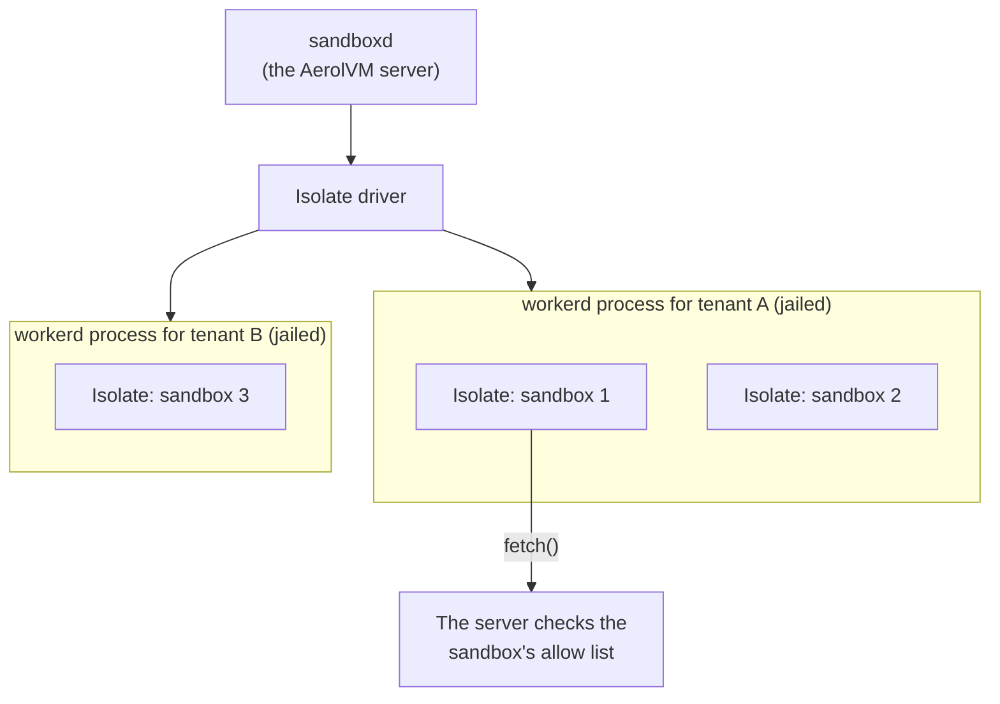

import { Aside, Tabs, TabItem } from '@astrojs/starlight/components';

A V8 isolate sandbox runs a small piece of JavaScript or TypeScript that answers web requests. V8 is the JavaScript engine inside Chrome and Node.js. An isolate is a walled-off space inside V8 with its own memory, so many isolates can share one process safely. AerolVM runs them with workerd, Cloudflare's open-source engine for Cloudflare Workers.

Your code is a fetch handler: a function that gets a web request and returns a response. There is no Dockerfile, no container image, no shell and no file system. You upload the code, then create sandboxes from it.

Choose an isolate for small tools that answer HTTP requests, such as AI-written helpers or webhook transforms. They start in a few milliseconds and you control exactly which websites they can call. For code that needs a shell, files or other programs, use a [container](/sandboxes/) or [WebAssembly](/wasm-sandbox/) sandbox instead.

## How fast it starts

These numbers are for a warm create: the code is already uploaded and its workerd process is already running. We measured them on our test server (an AWS `t3.medium`, jail off, 10 creates, no failures).

| Measured where | Median | 90th percentile | 99th percentile |
|---|---|---|---|
| **On the server** | **4 ms** | 6 ms | 19 ms |
| From a laptop, round trip | 266 ms | 269 ms | 289 ms |

The laptop numbers include network travel time to the cloud region, so use the server numbers for the cost of a create. The first create for a tenant (one customer or account) also starts that tenant's workerd process. Later creates for the same tenant reuse it.

## How it works



1. **Your code is a fetch handler.** There is no image, no container and no file system.
2. **One workerd process per tenant.** Each sandbox is an isolate inside it: a walled-off space in V8 with its own memory. Different tenants never share a process.
3. **Each workerd process is jailed by default:** a private file tree, resource limits, a filtered list of system calls and no root rights.
4. **Outbound requests leave through the server.** It checks each one against that sandbox's allow list, and can tell which sandbox made it.

## What the server needs

Isolates are off by default. The server operator installs workerd with the `--with-isolate` installer flag, which also sets `SB_ENABLE_ISOLATE=true`. On a cluster, set `with_isolate = true` on a worker in Terraform, or `default_with_isolate = true` for all of them. Until isolates are on, a create fails with `runtime "isolate" requires SB_ENABLE_ISOLATE=true`.

## Step 1: Write a fetch handler

A handler is an ES module whose default export has a `fetch` function:

```js
// main.js
export default {
  async fetch(request) {
    return new Response("Hello from an isolate");
  },
};
```

## Step 2: Upload it as a bundle

A bundle is your handler code plus its settings. Upload it once to the server's bundle catalogue with the `POST /v1/js-bundles` API. The SDKs do not have a method for this yet, and the API is experimental.

| Field | What it holds | Default |
|---|---|---|
| `source` | The code of a one-file bundle. | None |
| `main_module` | The name of the file that holds the handler. | `main.js` |
| `modules` | For a bundle with several files: a map from file name to code. | None |
| `name` | A short name you can use on create instead of the digest. It belongs to your account. | None |
| `compatibility_date` | Which workerd behavior to use. | The server's pinned date |

Set exactly one of `source` or `modules`. Uploading the same code again returns the same bundle, and reusing a `name` points it at the new code.

The response's `module_ref` field is what you pass when you create a sandbox. Use it exactly as returned. On one server it looks like `sha256:<digest>`, where the digest is a hash that names the exact code. In a cluster it also names the worker that holds the bundle. There, a bare digest or a bundle name is refused (see [In a cluster](#in-a-cluster)).

On a single server, the bundle `name` also works. An operator token can also point at a `.js`, `.mjs` or `.ts` file on the server with a `file://` path.

## Step 3: Create a sandbox and call it

Set `runtime: "isolate"` and pass the bundle's `module_ref` as `moduleRef`. Then `exec` calls your handler: the command is the URL path, and `stdout` is the response body.

<Tabs syncKey="lang">
  <TabItem label="TypeScript">
    ```ts
    import { MicroVM } from "@aerol-ai/aerolvm-sdk";

    const client = new MicroVM(); // reads SB_API_URL and SB_PAT_TOKEN
    const bundleRef = "sha256:..."; // the module_ref from your upload

    const sandbox = await client.create({
      image: bundleRef, // the TypeScript SDK requires image: use the bundle reference
      moduleRef: bundleRef,
      runtime: "isolate",
    });
    const result = await sandbox.exec("/"); // sends GET / to your handler
    console.log(result.stdout); // Hello from an isolate

    await sandbox.destroy();
    ```
  </TabItem>
  <TabItem label="Python">
    ```python
    from microvm import MicroVM

    client = MicroVM()  # reads SB_API_URL and SB_PAT_TOKEN
    bundle_ref = "sha256:..."  # the module_ref from your upload

    sandbox = client.create(
        image=bundle_ref,  # the Python SDK requires image: use the bundle reference
        module_ref=bundle_ref,
        runtime="isolate",
    )
    result = sandbox.exec("/")  # sends GET / to your handler
    print(result["stdout"])  # Hello from an isolate

    sandbox.destroy()
    ```
  </TabItem>
  <TabItem label="Go">
    ```go
    client, err := microvm.NewClient() // reads SB_API_URL and SB_PAT_TOKEN
    if err != nil {
        log.Fatal(err)
    }
    bundleRef := "sha256:..." // the module_ref from your upload

    sandbox, err := client.Create(ctx, sdktypes.CreateSandboxOptions{
        ModuleRef: bundleRef,
        Runtime:   sdktypes.RuntimeIsolate,
    })
    if err != nil {
        log.Fatal(err)
    }
    defer sandbox.Destroy(ctx)

    result, err := sandbox.ExecCommand(ctx, "/") // sends GET / to your handler
    if err != nil {
        log.Fatal(err)
    }
    fmt.Print(result.Stdout) // Hello from an isolate
    ```
  </TabItem>
  <TabItem label="Rust">
    ```rust
    use aerolvm_sdk::{Client, CreateOptions};

    let client = Client::new(None, None)?; // reads SB_API_URL and SB_PAT_TOKEN
    let bundle_ref = "sha256:..."; // the module_ref from your upload

    let sandbox = client.create(CreateOptions {
        module_ref: Some(bundle_ref.into()),
        runtime: Some("isolate".into()),
        ..Default::default()
    })?;
    let result = sandbox.exec("/")?; // sends GET / to your handler
    print!("{}", result.stdout); // Hello from an isolate

    sandbox.destroy()?;
    ```
  </TabItem>
  <TabItem label="Java">
    ```java
    MicroVMClient client = new MicroVMClient(); // reads SB_API_URL and SB_PAT_TOKEN
    String bundleRef = "sha256:..."; // the module_ref from your upload

    Sandbox sandbox = client.create(
        new CreateOptions().setModuleRef(bundleRef).setRuntime("isolate")
    );
    ExecResult result = sandbox.exec("/"); // sends GET / to your handler
    System.out.print(result.stdout); // Hello from an isolate

    sandbox.destroy();
    ```
  </TabItem>
</Tabs>

`exec` sends a `GET` request by default. To use another method, set the `METHOD` environment variable on the exec request, for example `METHOD=POST`. If the handler answers with status 400 or higher, the exit code is 1.

To give the handler a public URL, call `exposePort`. Isolates support HTTP only, not raw TCP or TLS (encrypted TCP) ports. See [Public URLs](/public-urls/).

## Control outbound requests

When your handler calls `fetch()` to reach another website, the AerolVM server makes that request for it. You choose what it may reach when you create the sandbox:

| Option | What the handler can reach |
|---|---|
| `networkAllowOut: ["api.example.com"]` | Only the hosts you list. |
| `networkBlockAll: true` | Nothing. Every outbound request fails. |
| Neither | Any public host. The server still blocks link-local addresses, the cloud metadata service (such as AWS EC2's) and loopback (the server itself). |

<Tabs syncKey="lang">
  <TabItem label="TypeScript">
    ```ts
    const sandbox = await client.create({
      image: bundleRef,
      moduleRef: bundleRef,
      runtime: "isolate",
      memoryMB: 128,
      networkAllowOut: ["api.example.com"],
    });
    ```
  </TabItem>
  <TabItem label="Python">
    ```python
    sandbox = client.create(
        image=bundle_ref,
        module_ref=bundle_ref,
        runtime="isolate",
        memory_mb=128,
        network_allow_out=["api.example.com"],
    )
    ```
  </TabItem>
  <TabItem label="Go">
    ```go
    sandbox, err := client.Create(ctx, sdktypes.CreateSandboxOptions{
        ModuleRef:       bundleRef,
        Runtime:         sdktypes.RuntimeIsolate,
        MemoryMB:        128,
        NetworkAllowOut: []string{"api.example.com"},
    })
    ```
  </TabItem>
  <TabItem label="Rust">
    ```rust
    let sandbox = client.create(CreateOptions {
        module_ref: Some(bundle_ref.into()),
        runtime: Some("isolate".into()),
        memory_mb: Some(128),
        network_allow_out: Some(vec!["api.example.com".into()]),
        ..Default::default()
    })?;
    ```
  </TabItem>
  <TabItem label="Java">
    ```java
    Sandbox sandbox = client.create(
        new CreateOptions()
            .setModuleRef(bundleRef)
            .setRuntime("isolate")
            .setMemoryMb(128)
            .setNetworkAllowOut(List.of("api.example.com"))
    );
    ```
  </TabItem>
</Tabs>

Sandboxes of one tenant can each use different rules, even though they share one workerd process. Each sandbox gets its own outbound channel in that process. The server knows which sandbox made a request by the channel it came through, not by a header the code could fake.

Each workerd process has a fixed number of these channels (64 by default). If they are all in use, a new sandbox gets a channel that blocks everything, and the server logs it. Outbound access is never silently opened.

## Share a process with your tenant

Sandboxes with the same tenant share one workerd process. Different tenants never share one. The server decides which tenant a sandbox belongs to. The `tenantId` create option (`tenant_id` in Python and Rust, `TenantID` in Go, `setTenantId` in Java) is checked against what your token may use. If you leave it out, the server uses your token's identity. You cannot pick a value that puts your code in another tenant's process.

## In a cluster

A bundle is stored on **one** worker: the one AerolVM picked when you uploaded it. Its `module_ref` carries that worker's name (`node:<worker>:sha256:...`). A create that uses it goes straight to that worker, with no search across the cluster and no copying.

- **Listing shows every bundle.** Listing bundles from any server returns your bundles from every isolate worker, with no duplicates. The cluster leader (the server the cluster elected to coordinate) builds the list and caches it for two seconds. If a worker that may hold bundles did not answer, the response says so with the headers `X-Aerol-Partial: true` and `X-Aerol-Missing-JSBundle-Peers: <n>`. It does not quietly leave those bundles out.
- **A bundle has one copy.** If its worker leaves the cluster, any create, get or delete that uses its `module_ref` fails with `503` and `"code": "artifact_node_unavailable"`. Waiting does not help. Upload the bundle again and use the new `module_ref`.

Bundles stored in a registry, so that any worker can fetch them, are planned.

## Good to know

- **No shell, no files, no programs.** `exec` only calls your fetch handler. The other toolbox calls (the toolbox is the helper the SDK talks to for files, sessions and processes) return `501 Not Implemented`. SSH is not available.
- **No images or storage.** Container images, mounts and platform volumes are rejected.
- **Lost on restart.** Isolates use `durability: "ephemeral"` by default. `passivatable` is rejected because there is nothing to save: the bundle is the whole sandbox. `durable` is not available yet.
- **No GPU, no templates.** `gpus` and `template_id` are rejected.

## Next steps

- [WebAssembly (WASM)](/wasm-sandbox/): run compiled programs that need files or arguments.
- [Allow only some websites](/network-access/#allow-only-some-websites): more about outbound allow lists.
- [Public URLs](/public-urls/): give a handler a public URL.
- [Cluster setup](/cluster-setup/): add isolate workers to a cluster.
