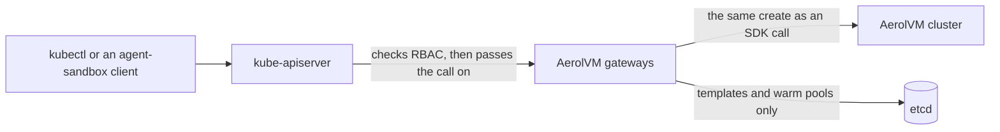

import { Tabs, TabItem, Aside } from '@astrojs/starlight/components';

[agent-sandbox](https://github.com/kubernetes-sigs/agent-sandbox) is a Kubernetes project that defines four kinds of object for AI sandboxes: `Sandbox`, `SandboxTemplate`, `SandboxWarmPool` and `SandboxClaim`. Many agent frameworks make these objects to get a sandbox.

On a [Kubernetes cluster install](/kubernetes-cluster/), AerolVM can serve those four kinds itself. Then `kubectl get sandboxes` works, tools built for agent-sandbox work, and Kubernetes RBAC decides who may see and change which sandboxes. You do not install the agent-sandbox controller.

`kubectl` and the SDKs work side by side. A sandbox made with `kubectl` is an ordinary AerolVM sandbox, so the SDKs see it, and `kubectl` sees the sandboxes the SDKs make.

| Kind | apiVersion | What it is |
|---|---|---|
| `Sandbox` | `agents.x-k8s.io/v1beta1` | One sandbox. |
| `SandboxTemplate` | `extensions.agents.x-k8s.io/v1beta1` | What a claim runs: image, size, runtime, env. |
| `SandboxWarmPool` | `extensions.agents.x-k8s.io/v1beta1` | A named pool that points at a template. |
| `SandboxClaim` | `extensions.agents.x-k8s.io/v1beta1` | "Give me a sandbox from this pool." |

## How it works



- **The gateways answer.** Gateways are the AerolVM pods that take every request. With this feature on, they also answer the two API groups above. An `APIService` object tells the kube-apiserver to pass every call for a group to them.
- **Sandboxes and claims are not stored in etcd.** When you list them, the gateways read AerolVM's own records. So 100,000 sandboxes add nothing to etcd.
- **Templates and warm pools are stored in etcd**, as two AerolVM CRDs (`sandboxtemplates.k8s.aerolvm.io` and `sandboxwarmpools.k8s.aerolvm.io`). They change rarely. You never edit these CRDs directly: you use the agent-sandbox kinds, and the gateways write the CRDs for you.
- **A create from `kubectl` is checked like an SDK create**: [create policy](/enterprise/create-policy/), quotas, and the audit log. The audit record names the Kubernetes user.

<Aside type="caution">
Do not install the agent-sandbox controller in the same cluster. AerolVM answers its kinds itself, and the two would fight over them.
</Aside>

## Turn it on

You need [cert-manager](https://cert-manager.io/) in the cluster. The chart uses it to make the certificate the kube-apiserver trusts.

Add this to your cluster values:

```yaml
# aerolvm-cluster.yaml
mode: cluster
cluster:
  agentSandboxAPI:
    enabled: true
```

Then upgrade:

```bash
helm upgrade aerolvm charts/aerolvm --namespace aerolvm-system -f aerolvm-cluster.yaml
```

Check that Kubernetes can reach the gateways. Both lines should say `True`:

```bash
kubectl get apiservice v1beta1.agents.x-k8s.io v1beta1.extensions.agents.x-k8s.io
```

Turning it on gives the gateways three Kubernetes rights they did not have:

- Ask Kubernetes "may this user do this?" (`SubjectAccessReview`).
- Read the certificate the kube-apiserver signs its calls with (the front-proxy CA).
- Read and write the two template and warm-pool CRDs, and nothing else.

With the chart's network policy on, it also opens the gateways' port 9443, which the kube-apiserver calls.

## Your first sandbox

Save this as `web.yaml`:

```yaml
apiVersion: agents.x-k8s.io/v1beta1
kind: Sandbox
metadata:
  name: web
  namespace: payments
  labels: { app: demo }
spec:
  podTemplate:
    spec:
      runtimeClassName: gvisor   # an AerolVM runtime, not a RuntimeClass in your cluster
      containers:
        - name: main
          image: python:3.12
          command: ["sleep", "infinity"]
          resources:
            limits: { cpu: "1", memory: 1Gi }
```

`runtimeClassName` picks the AerolVM runtime: `gvisor`, `firecracker` or `docker`. You do not need a RuntimeClass object in your cluster, because a sandbox is not a pod.

Create it and wait until it runs:

```bash
kubectl create namespace payments
kubectl apply -f web.yaml
kubectl -n payments wait --for=condition=Ready sandbox/web
kubectl -n payments get sandboxes
```

Delete it:

```bash
kubectl -n payments delete sandbox web
```

## Namespaces are teams

In AerolVM, a **team** is the group that owns sandboxes, quotas and tokens. With [SSO](/enterprise/sso/), your identity provider's groups map to teams.

A namespace's sandboxes belong to the team of the same name. The `payments` namespace holds the sandboxes of the team `payments`. So `kubectl -n payments get sandboxes` lists all of that team's sandboxes, also the ones made with an SDK.

<Aside type="caution" title="Deleting a namespace deletes its team's sandboxes">
When you delete a namespace, Kubernetes deletes every object in it, and that includes sandboxes. Deleting `payments` deletes **every sandbox of the team `payments`**, also the ones made with an SDK. Its templates and warm pools go too.
</Aside>

To give a team a namespace with another name, list it under `namespaces`:

```yaml
cluster:
  agentSandboxAPI:
    enabled: true
    namespaces:
      ml-research: "team:research"
```

Each team has exactly one namespace. After this change, `ml-research` shows the `research` team's sandboxes, and the namespace `research` shows none. So RBAC on `ml-research` is the only way in.

## Who may do what

Kubernetes RBAC decides, the same way it does for pods. This gives a service account read-only access to the sandboxes in `payments`:

```bash
kubectl -n payments create role sandbox-viewer \
  --verb=get,list,watch --resource=sandboxes.agents.x-k8s.io
kubectl -n payments create rolebinding viewer \
  --role=sandbox-viewer --serviceaccount=payments:viewer
```

That account can now list and watch, but a delete is refused with `Forbidden`.

To let someone make claims, grant `create` on `sandboxclaims` in the `extensions.agents.x-k8s.io` group. They do not need rights on templates or warm pools: the gateway reads those itself. Grant `sandboxtemplates` and `sandboxwarmpools` only to the people who set up pools.

## Stop and start a sandbox

To change a sandbox, use `kubectl patch`. Set `spec.operatingMode`: `Suspended` stops the sandbox and keeps its files, and `Running` starts it again.

```bash
kubectl -n payments patch sandbox web --type merge -p '{"spec":{"operatingMode":"Suspended"}}'
kubectl -n payments wait --for=condition=Suspended sandbox/web

kubectl -n payments patch sandbox web --type merge -p '{"spec":{"operatingMode":"Running"}}'
kubectl -n payments wait --for=condition=Ready sandbox/web
```

`operatingMode` is the only field you can change after a create. To change anything else, delete the sandbox and create it again.

<Aside>
You can run `kubectl apply` again on the same file. It passes when nothing that AerolVM shows has changed: the image, the command, the runtime class, CPU, memory and labels. A change to one of them is refused with the field's name; delete the sandbox and create it again instead. A changed `spec.operatingMode` stops or starts the sandbox.

AerolVM does not show a sandbox's env, disk size or shutdown time, so a second apply does not compare or change them. kubectl prints a warning that says so. The same goes for a claim: its warm pool and labels are compared, and its env and lifecycle are not.
</Aside>

## Shut down at a set time

`spec.shutdownTime` stops or deletes the sandbox at that time. `shutdownPolicy: Delete` deletes it. `Retain` (the default) stops it and keeps it.

```yaml
spec:
  shutdownTime: "2026-12-01T18:00:00Z"
  shutdownPolicy: Delete
```

## Templates, warm pools and claims

A claim asks for a sandbox from a warm pool. The pool names a template, and the template says what to run.

<Aside>
A warm pool keeps sandboxes started ahead of time, so a claim takes one that is ready instead of starting a new one. Two things differ from upstream agent-sandbox:

- **`replicas` is per worker.** Each worker that runs the template's runtime keeps that many ready, as AerolVM's own [warm pools](/warm-pools/) do. Upstream counts the whole cluster. Start with `replicas: 1`.
- **Only templates that run the image's own entrypoint are kept ready.** A ready sandbox has already started its image, so it cannot run another command. A template that sets `command` or `args` still works, but each claim on it starts a new sandbox. A claim's `env` is fine: it is handed to the ready sandbox when the claim takes it.

A new or changed pool takes effect within about half a minute.
</Aside>

Save this as `claim.yaml`:

```yaml
apiVersion: extensions.agents.x-k8s.io/v1beta1
kind: SandboxTemplate
metadata: { name: python, namespace: payments }
spec:
  envVarsInjectionPolicy: Allowed
  podTemplate:
    spec:
      runtimeClassName: gvisor
      containers:
        - name: main
          image: python:3.12
          command: ["sleep", "infinity"]
---
apiVersion: extensions.agents.x-k8s.io/v1beta1
kind: SandboxWarmPool
metadata: { name: python-pool, namespace: payments }
spec:
  replicas: 3
  sandboxTemplateRef: { name: python }
---
apiVersion: extensions.agents.x-k8s.io/v1beta1
kind: SandboxClaim
metadata: { name: job-42, namespace: payments }
spec:
  warmPoolRef: { name: python-pool }
  env:
    - { name: TASK, value: "42" }
```

Apply it and wait for the claim:

```bash
kubectl apply -f claim.yaml
kubectl -n payments wait --for=condition=Ready sandboxclaim/job-42
```

The claim makes a sandbox with the claim's name, here `job-42`. Deleting the claim deletes its sandbox.

- **A claim and its sandbox are the same thing.** AerolVM stores no separate claim object. It marks the sandbox with two labels, `agents.x-k8s.io/claim` and `agents.x-k8s.io/warm-pool`, and a claim list shows the sandboxes that carry them.
- **Env from a claim** follows the template's `envVarsInjectionPolicy`: `Disallowed` (the default, when the template does not say) refuses it, `Allowed` adds new names only, and `Overrides` may also replace the template's values.
- **What is checked when.** Saving a template checks every field and value, so a field AerolVM cannot honor is refused then, not later. The image itself is not pulled until a claim uses it. A warm pool may name a template that does not exist yet; the claim is what fails, with an error that names the missing pool or template.

## What AerolVM supports

A sandbox is not a pod. AerolVM refuses a field it cannot honor, and names the field in the error, instead of quietly ignoring it. Anything not listed here is refused. The list follows agent-sandbox v1.0.11; a field's upstream default is always accepted when written out.

Of the 133 objects in agent-sandbox v1.0.11's own examples, 52 work as written, `hello-world` among them. The rest use a refused field, most often volumes, probes or a security context.

| Kind | Field | Supported |
|---|---|---|
| Sandbox, Template | `metadata.name`, `generateName`, `labels`, `annotations` | Yes. Labels become the sandbox's [tags](/sandbox-tags/). Annotations are accepted and not kept. |
| Sandbox, Template | `podTemplate.spec.containers` | Exactly one container: `name`, `image`, `command`, `args`, `env` (name and value), and `resources`: `cpu`, `memory`, and `ephemeral-storage` (the sandbox's disk, rounded up to whole GiB), from limits or requests, as strings or plain numbers. |
| Sandbox, Template | `containers[].ports` | `name`, `containerPort`, `protocol`. They are information, as in Kubernetes. A `hostPort` is refused. |
| Sandbox, Template | `containers[].imagePullPolicy` | Unset or `IfNotPresent`: AerolVM pulls an image the machine does not have. |
| Sandbox, Template | `podTemplate.spec.restartPolicy` | Unset or `Never`. AerolVM runs the command once and never restarts it; the sandbox stays up after the command exits. |
| Sandbox, Template | `podTemplate.spec.automountServiceAccountToken` | Unset or `false`. A sandbox never gets a Kubernetes token. |
| Sandbox, Template | `podTemplate.spec.runtimeClassName` | `gvisor` (or `runsc`), `firecracker`, `docker` (or `runc`). |
| Sandbox, Template | `podTemplate.metadata` | `labels` become tags too; the sandbox's own labels win a clash. `annotations` are accepted and not kept. |
| Sandbox | `spec.operatingMode` | `Running` or `Suspended`. A sandbox is created `Running`. |
| Sandbox | `spec.shutdownTime`, `spec.shutdownPolicy` | Yes. |
| Sandbox, Template | `service` | Unset or `false`. AerolVM makes no Kubernetes Service; use the sandbox's [links](/public-urls/). |
| Sandbox, Template | `failedPodPolicy` | Unset or `Retain`. A failed sandbox stays failed until you delete it. |
| Template | `envVarsInjectionPolicy` | `Disallowed` (the default), `Allowed` or `Overrides`. |
| Template | `networkPolicyManagement` | `Managed` (the default) or `Unmanaged`. AerolVM's own walls already give the secure default: the public internet out, no private ranges, only AerolVM's gateways in. Custom `networkPolicy` rules are refused; use AerolVM's [network rules](/network-access/). |
| Template | `volumeClaimTemplatesPolicy` | Unset or `Disallowed`. |
| Warm pool | `replicas`, `sandboxTemplateRef.name`, `updateStrategy.type` | `replicas` from 0 to 128; `updateStrategy` `Recreate` or `OnReplenish`. |
| Claim | `warmPoolRef.name`, `env`, `lifecycle.shutdownTime`, `lifecycle.shutdownPolicy`, `additionalPodMetadata` | Yes. `additionalPodMetadata.labels` become tags. `DeleteForeground` works as `Delete`. |
| Claim | `volumeClaimTemplates`, `lifecycle.ttlSecondsAfterFinished` | No. |
| Any | Service accounts, IRSA, volumes, GPUs, node placement, security contexts, init or sidecar containers | No. For cloud access, use AerolVM's own [cloud identity](/sandbox-cloud-identity/). |
| — | The `sandbox-router` API | No. Reach sandbox ports through AerolVM's normal [links](/public-urls/). |

## Good to know

- **If the gateways cannot answer the Kubernetes API**, Kubernetes marks the `APIService` unavailable. `kubectl get sandboxes` fails, and deleting any namespace waits until the gateways answer again. Run at least three gateways across zones.
- **Turning the API off** removes the two `APIService` objects and the gateways' rights. The template and warm-pool CRDs stay, so turning it on again finds them.
- **Delete, then create again with the same name** gives a new sandbox with a new `uid`, as Kubernetes expects.
- **`kubectl get` shows only `NAME` and `AGE`.** To see more, ask for the columns: `kubectl -n payments get sandboxes -o custom-columns=NAME:.metadata.name,MODE:.spec.operatingMode`.
- **Selectors:** label selectors work as `key=value` and `key!=value`; set-based ones (`in`, `notin`) are refused. The field selector `metadata.name` works too. These apply to sandboxes and claims.
- **Long lists and watches:** a sandbox list comes in pages when the client asks for them, as `kubectl` does, up to 500 sandboxes a page; a claim list comes in one page. A watch can resume on any gateway. If it waited too long, it gets `410 Gone`, and `kubectl` simply lists again.

## Same thing from the SDK

A sandbox made with `kubectl` is an ordinary sandbox of its team, named after the Kubernetes object. With a token for the team `payments`, an SDK finds `web` by its name, stops it and starts it:

<Tabs syncKey="lang">
  <TabItem label="TypeScript">
    ```ts
    import { MicroVM } from "@aerol-ai/aerolvm-sdk";

    const client = new MicroVM(); // reads SB_API_URL and SB_PAT_TOKEN or SB_API_TOKEN

    const sandbox = await client.getByName("web");
    if (sandbox !== null) {
      await sandbox.stop();
      await sandbox.start();
    }
    ```
  </TabItem>
  <TabItem label="Python">
    ```python
    from microvm import MicroVM

    client = MicroVM()  # reads SB_API_URL and SB_PAT_TOKEN or SB_API_TOKEN

    sandbox = client.get_by_name("web")
    if sandbox is not None:
        sandbox.stop()
        sandbox.start()
    ```
  </TabItem>
  <TabItem label="Go">
    ```go
    client, err := microvm.NewClient() // reads SB_API_URL and SB_PAT_TOKEN or SB_API_TOKEN
    if err != nil {
        log.Fatal(err)
    }

    sandbox, err := client.GetByName(ctx, "web")
    if err != nil {
        log.Fatal(err)
    }
    if err := sandbox.Stop(ctx); err != nil {
        log.Fatal(err)
    }
    if err := sandbox.Start(ctx); err != nil {
        log.Fatal(err)
    }
    ```
  </TabItem>
  <TabItem label="Rust">
    ```rust
    use aerolvm_sdk::Client;

    let client = Client::new(None, None)?; // reads SB_API_URL and SB_PAT_TOKEN or SB_API_TOKEN

    if let Some(mut sandbox) = client.get_by_name("web")? {
        sandbox.stop()?;
        sandbox.start()?;
    }
    ```
  </TabItem>
  <TabItem label="Java">
    ```java
    import ai.aerol.microvm.MicroVMClient;
    import ai.aerol.microvm.Sandbox;
    import java.util.Optional;

    MicroVMClient client = new MicroVMClient(); // reads SB_API_URL and SB_PAT_TOKEN or SB_API_TOKEN

    Optional<Sandbox> sandbox = client.getByName("web");
    if (sandbox.isPresent()) {
        sandbox.get().stop();
        sandbox.get().start();
    }
    ```
  </TabItem>
</Tabs>

Kubernetes sees the change too. This watch shows `web` go to `Suspended` and back:

```bash
kubectl -n payments get sandboxes -w -o custom-columns=NAME:.metadata.name,MODE:.spec.operatingMode
```

## Next steps

- [Kubernetes cluster mode](/kubernetes-cluster/): install the cluster this API runs on.
- [Move from agent-sandbox](/moving-from-agent-sandbox/): call AerolVM from code instead, call by call.
- [Create and manage sandboxes](/sandboxes/): everything else a sandbox can do, from the SDK.
- [SSO](/enterprise/sso/): the teams that namespaces map to.
