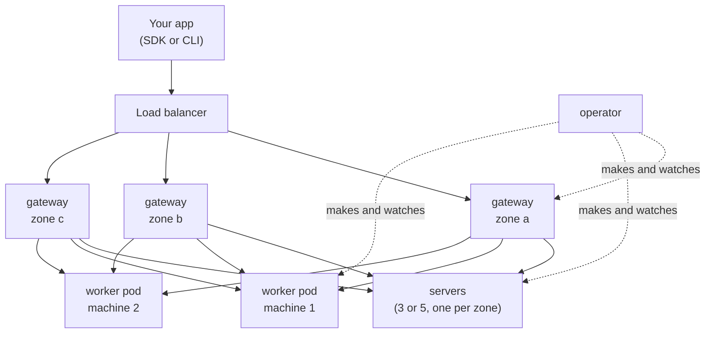

import { Tabs, TabItem, Aside } from '@astrojs/starlight/components';

Cluster mode runs AerolVM across a whole Kubernetes cluster. An **operator** builds it from one object you write, an `AerolCluster`, and keeps it the way that object says. It is the setup for a bank or a large team: three or five servers that agree on where every sandbox lives, gateways in every zone, and worker machines that come and go with load.

For a laptop or a small install, [single mode](/kubernetes/) is simpler: one pod, no operator.

Your code does not change. You talk to the same API with the same SDKs.

## How it works



There are four kinds of pod:

- **Servers** keep the list of every sandbox and which worker runs it. There are three or five, one per zone, each with its own disk. They agree using Raft, so the cluster keeps working when one zone is down.
- **Gateways** take every request: the API, sandbox links, SSH. They are stateless, so a load balancer can send a request to any of them. A gateway passes each request to the worker that runs the sandbox.
- **Workers** run the sandboxes, one worker pod per machine. The pod asks for nearly the whole machine, so Kubernetes and your cost tools see the machine as full.
- **The operator** builds and watches all of the above. It is the only AerolVM pod that talks to the Kubernetes API, unless you turn on the [Kubernetes API for sandboxes](/kubernetes-api/): then the gateways may also ask Kubernetes who may do what, and store templates and warm pools.

Servers, gateways and the operator run under the `restricted` pod security level, as a normal user with no special rights. Worker pods are privileged, because they build sandboxes, so they run in a namespace of their own, the only one that allows it.

## What you need

- A Kubernetes cluster with Linux nodes (amd64 or arm64) that use cgroup v2 and kernel 5.10 or later, spread over two or more zones. Amazon Linux 2023, Bottlerocket, Azure Linux and Ubuntu 22.04 all qualify.
- The `br_netfilter` kernel module loaded on the worker machines. Stock Amazon Linux 2023 does not load it: add `modprobe br_netfilter` to the node image or its user data, and list it in `/etc/modules-load.d`.
- [cert-manager](https://cert-manager.io). The operator's webhook gets its certificate from it, and so do [sandbox links over HTTPS](/kubernetes/#sandbox-links-over-https).
- A storage class that binds a disk when a pod first uses it (`volumeBindingMode: WaitForFirstConsumer`), so each server's disk lands in its own zone. EKS's `gp3` and AKS's `managed-csi` do.
- In each zone, a machine for AerolVM's own pods with room for one server and one gateway: by default they ask for 1.5 CPU and 2.5 GiB, plus 0.1 CPU for an operator replica, next to the cluster's own pods (DNS, the network and storage drivers). Use machines with 4 or more CPUs there: a 2-CPU machine, such as `m7i.large`, has about 1.9 CPUs to give out, so a server may not fit beside the rest and stays Pending. `kubectl get aerolnodes` then shows the scheduler's reason, such as "Insufficient cpu".
- Helm 3.8 or later, and `kubectl`.
- For worker machines that come and go with load: Karpenter on EKS, or Node Auto Provisioning on AKS. Without them, add machines to the worker pool yourself.

## Install

Write your settings in a file. This one spreads over three zones and has one worker pool:

```yaml
# aerolvm-cluster.yaml
mode: cluster
cluster:
  zones: [eu-west-1a, eu-west-1b, eu-west-1c]
  servers:
    count: 3
    storage: { size: 50Gi, storageClassName: gp3 }
  gateways:
    minReplicas: 3
  workerPools:
    - name: gvisor-general
      runtimes: [gvisor]
      nodeSelector: { aerolvm.io/pool: gvisor-general }
      tolerations: [{ key: aerolvm.io/pool, operator: Exists, effect: NoSchedule }]
      machine: { cpu: 32, memoryGiB: 128 }
      minWorkers: 3
      maxWorkers: 100
      headroomPercent: 15
      provisioner: karpenter
      maxMachineAge: 720h
```

For a bank, start from the preset in the chart, `charts/aerolvm/values-bank-eks.yaml`. It turns on gVisor only, NetworkPolicies, HTTPS, monitoring and machine replacement, and lists what you set outside the chart.

Make the namespace and install:

```bash
kubectl create namespace aerolvm-system
kubectl label namespace aerolvm-system pod-security.kubernetes.io/enforce=restricted
helm install aerolvm charts/aerolvm --namespace aerolvm-system -f aerolvm-cluster.yaml
```

The chart makes the worker namespace, `aerolvm-workers`, and labels it to allow privileged pods. Then the operator builds the cluster in order:

1. The first server starts the cluster.
2. The other servers join it, one per zone.
3. The gateways and the first workers join. Each new pod gets a one-time join token that only it can read, and the token is deleted once the pod joins. (With [your own certificate authority](#use-your-own-certificate-authority), each pod joins with its certificate instead.)

Watch it:

```bash
kubectl -n aerolvm-system get aerolcluster,aerolnodes
```

`aerolnodes` lists every server, gateway and worker with its zone, state, version and sandbox count. The cluster is ready when the `AerolCluster` says `Ready`.

### When a machine fails its checks

Every worker pod first checks the machine it landed on: cgroup v2, the kernel version and `br_netfilter`. This covers machines added later too. A machine that fails stays out of service, and its `AerolNode` says why:

```bash
kubectl -n aerolvm-system get aerolnodes
# NAME                    ROLE     ZONE         STATE    ...
# aerolvm-general-x7k2p   worker   eu-west-1a   Failed   ...

kubectl -n aerolvm-system get aerolnode aerolvm-general-x7k2p -o jsonpath='{.status.reason}'
# preflight failed: br_netfilter: the br_netfilter kernel module is not loaded (fix: load it in the node image ...)
```

The operator starts another worker on another machine. The pod keeps the bad machine, so nothing else lands on it. Fix the machine and the check passes on its next try, or delete the machine.

## Connect

Clients reach the cluster through the gateways' Service, `aerolvm-gateway`. Read the admin token the operator made:

```bash
export SB_PAT_TOKEN="$(kubectl -n aerolvm-system get secret aerolvm-admin -o jsonpath='{.data.token}' | base64 -d)"
```

With [the edge](/kubernetes/#sandbox-links-over-https) on, the API is your domain over HTTPS:

```bash
export SB_API_URL="https://sandboxes.example.com"
```

Without it, the gateways serve the API on port 21212 inside the cluster. From your laptop, forward it:

```bash
kubectl -n aerolvm-system port-forward svc/aerolvm-gateway 21212:21212
export SB_API_URL="http://127.0.0.1:21212"
```

Then create a sandbox as usual. This one uses gVisor and asks to come back on another machine if its machine fails:

<Tabs syncKey="lang">
  <TabItem label="TypeScript">
    ```ts
    import { MicroVM } from "@aerol-ai/aerolvm-sdk";

    const client = new MicroVM(); // reads SB_API_URL and SB_PAT_TOKEN

    const sandbox = await client.create({
      image: "ubuntu:22.04",
      runtime: "gvisor",
      failover: { policy: "recreate" },
    });
    const result = await sandbox.exec("echo hello from the cluster");
    console.log(result.stdout);

    await sandbox.destroy();
    ```
  </TabItem>
  <TabItem label="Python">
    ```python
    from microvm import MicroVM

    client = MicroVM()  # reads SB_API_URL and SB_PAT_TOKEN

    sandbox = client.create(
        image="ubuntu:22.04",
        runtime="gvisor",
        failover={"policy": "recreate"},
    )
    result = sandbox.exec("echo hello from the cluster")
    print(result["stdout"])

    sandbox.destroy()
    ```
  </TabItem>
  <TabItem label="Go">
    ```go
    client, err := microvm.NewClient() // reads SB_API_URL and SB_PAT_TOKEN
    if err != nil {
        log.Fatal(err)
    }

    sandbox, err := client.Create(ctx, sdktypes.CreateSandboxOptions{
        Image:    "ubuntu:22.04",
        Runtime:  sdktypes.RuntimeGvisor,
        Failover: &sdktypes.Failover{Policy: sdktypes.FailoverPolicyRecreate},
    })
    if err != nil {
        log.Fatal(err)
    }
    defer sandbox.Destroy(ctx)

    result, err := sandbox.ExecCommand(ctx, "echo hello from the cluster")
    if err != nil {
        log.Fatal(err)
    }
    fmt.Print(result.Stdout)
    ```
  </TabItem>
  <TabItem label="Rust">
    ```rust
    use aerolvm_sdk::{Client, CreateOptions, Failover};

    let client = Client::new(None, None)?; // reads SB_API_URL and SB_PAT_TOKEN

    let sandbox = client.create(CreateOptions {
        image: "ubuntu:22.04".into(),
        runtime: Some("gvisor".into()),
        failover: Some(Failover { policy: "recreate".into() }),
        ..Default::default()
    })?;
    let result = sandbox.exec("echo hello from the cluster")?;
    print!("{}", result.stdout);

    sandbox.destroy()?;
    ```
  </TabItem>
  <TabItem label="Java">
    ```java
    MicroVMClient client = new MicroVMClient(); // reads SB_API_URL and SB_PAT_TOKEN

    Sandbox sandbox = client.create(
        new CreateOptions()
            .setImage("ubuntu:22.04")
            .setRuntime("gvisor")
            .setFailover(new Failover().setPolicy("recreate"))
    );
    ExecResult result = sandbox.exec("echo hello from the cluster");
    System.out.print(result.stdout);

    sandbox.destroy();
    ```
  </TabItem>
</Tabs>

## Workers come and go with load

The operator reads AerolVM's own numbers: how much CPU and memory is free on each worker, per zone. It keeps `headroomPercent` free in every zone:

- **A zone runs short:** the operator adds one worker pod there. It fits on no machine yet, so Karpenter or Node Auto Provisioning starts one. That takes a minute or two; the headroom covers it.
- **A zone has twice the room it needs:** the operator picks the emptiest worker there and [decommissions](#a-machine-goes-away) it. Then the machine is empty, and Karpenter takes it back.

There are no dummy pods. The worker itself is the unit Kubernetes sees.

### Karpenter

Give the worker pool a NodePool of its own. Three settings matter:

- **`expireAfter: Never`.** Karpenter's own expiry would take a machine without moving its sandboxes first. The operator replaces machines by age instead: set `maxMachineAge` on the pool, and each worker whose machine is older is [decommissioned](#a-machine-goes-away), one per zone at a time.
- **No `terminationGracePeriod`.** With one, Karpenter takes a machine after that time even while a worker still holds sandboxes.
- **The pool's label and taint,** the same ones the worker pool's `nodeSelector` and `tolerations` name, so only worker pods land there.

```yaml
apiVersion: karpenter.sh/v1
kind: NodePool
metadata:
  name: aerolvm-gvisor-general
spec:
  template:
    metadata:
      labels: { aerolvm.io/pool: gvisor-general }
    spec:
      nodeClassRef: { group: karpenter.k8s.aws, kind: EC2NodeClass, name: aerolvm-workers }
      taints: [{ key: aerolvm.io/pool, value: gvisor-general, effect: NoSchedule }]
      expireAfter: Never
      requirements:
        # One size, the size the worker pool's `machine` names.
        - { key: node.kubernetes.io/instance-type, operator: In, values: [m7i.8xlarge] }
        - { key: karpenter.sh/capacity-type, operator: In, values: [on-demand] }
  disruption:
    consolidationPolicy: WhenEmpty
    consolidateAfter: 5m
```

Every worker pod carries `karpenter.sh/do-not-disrupt`, so Karpenter never takes a machine that runs a worker. When a machine drifts (a new machine image, a changed NodePool), the operator sees it, moves the sandboxes off and lets the pod go; then Karpenter replaces the empty machine.

In the `EC2NodeClass`, keep Karpenter's instance metadata defaults, `httpTokens: required` and `httpPutResponseHopLimit: 1`. A pod then cannot reach the machine's instance metadata, so no sandbox can use the machine's IAM role.

## A machine goes away

Machines go away on purpose all the time: a new machine image, a Kubernetes upgrade, a smaller pool. The rule is: **the operator moves sandboxes off a machine before the machine goes.** It starts when the machine is cordoned, when Karpenter marks it drifted, when the pool shrinks, when the machine is older than `maxMachineAge`, or when its pool is removed from `cluster.workerPools`. A removed pool's workers leave one per zone at a time, so their sandboxes move to the pools that remain.

1. **Drain.** The worker takes no new sandboxes. For `drainWindow` (15 minutes by default), sandboxes may finish by themselves.
2. **Move.** Each sandbox created with `failover.policy: recreate` moves to a worker in another zone: the new worker pulls the image first, then the old copy stops and the new one starts with the same ID and the same link. Your sandbox is down for a stop and a start, a few seconds.
   A Firecracker or gVisor sandbox without that policy moves **with its memory**: it is saved, copied to another worker over the cluster's own encrypted link, and started there from where it was. Its programs keep running and its files stay; open network connections drop. It keeps its ID, its link, its SSH key and its tokens, and takes the new worker's address. A gVisor move gets 60 seconds before the switch, and `worker.gvisor.checkpointMoves: false` turns gVisor moves off. If a move fails, the sandbox starts again where it was (a Firecracker one from the same saved state, a gVisor one from its image), and the next pass tries again. A sandbox with external storage mounted does not move this way.
3. **Tell.** Every other sandbox's owner finds a notice in the sandbox's audit log, with the time it stops.
4. **Finish.** At the deadline (45 minutes by default), what could not move stops. The worker leaves the cluster, its pod goes, and the machine goes back. On an EKS managed node group (`provisioner: eks-managed`) the whole decommission takes at most 14 minutes, drain window included: the node group gives up after 15.

Each step is saved on the worker's `AerolNode`, so an operator restart picks up where it stopped. `kubectl describe aerolnode <name>` shows the progress as events.

A worker pod cannot be deleted by mistake: the operator refuses `kubectl delete pod` on a live worker. To delete one anyway, set `aerolvm.io/force-delete=true` on the pod first; the delete is logged.

<Aside>
A machine that dies without warning is different: no move is possible. Sandboxes with `failover.policy: recreate` start again on another worker in another zone, after about 30 seconds, or 16 seconds once the operator sees the machine is gone. Other sandboxes on it are lost.
</Aside>

## Upgrade

Change `cluster.version` and run `helm upgrade` (or edit the `AerolCluster` object, for example from Argo CD). The operator upgrades the cluster in AerolVM's own order: servers one at a time with the leader last, then gateways, then workers in batches. On each worker it swaps the AerolVM server in place; **sandboxes keep running**.

Watch it with `aerolvm upgrade status`, or `kubectl get aerolcluster`. To roll back, set the version back. `aerolvm upgrade apply` and `aerolvm upgrade rollback` refuse here, so the version has one owner; `status`, `stop`, `resume` and `finalize` work as usual.

### Argo CD

Argo CD does not know the health of an `AerolCluster` or an `AerolNode` by itself. Add these checks to its `argocd-cm` ConfigMap, and an app shows Progressing while the cluster builds or upgrades, Healthy when it is Ready, and Degraded when a server is missing or a worker's machine failed its checks:

```yaml
data:
  resource.customizations.health.aerolvm.io_AerolCluster: |
    hs = { status = "Progressing", message = "waiting for the operator" }
    if obj.status ~= nil and obj.status.phase ~= nil then
      local p = obj.status.phase
      hs.message = p
      if p == "Ready" then hs.status = "Healthy"
      elseif p == "Degraded" or p == "Refused" then hs.status = "Degraded"
      end
      if obj.status.observedGeneration ~= nil and obj.status.observedGeneration < obj.metadata.generation then
        hs.status = "Progressing"
        hs.message = "the operator has not seen the latest change yet"
      end
    end
    return hs
  resource.customizations.health.aerolvm.io_AerolNode: |
    hs = { status = "Progressing", message = "starting" }
    if obj.status ~= nil and obj.status.state ~= nil then
      local st = obj.status.state
      hs.message = st
      if obj.status.reason ~= nil and obj.status.reason ~= "" then
        hs.message = st .. ": " .. obj.status.reason
      end
      if st == "Serving" or st == "Maintenance" then hs.status = "Healthy"
      elseif st == "Failed" or st == "Dead" or st == "Suspect" then hs.status = "Degraded"
      end
    end
    return hs
```

A worker that is draining or decommissioning shows Progressing: it is on its way out, on purpose.

## Back up and recover the servers

The `sandboxd backup`, `restore` and `recover-quorum` commands run inside a server pod in **maintenance mode**. Put a server in it:

```bash
kubectl -n aerolvm-system annotate aerolnode aerolvm-server-0 aerolvm.io/maintenance=true
```

The operator makes the server's pod again, with its disk and without the AerolVM server, so you can run the command in it:

```bash
kubectl -n aerolvm-system exec -it aerolvm-server-0 -- sandboxd backup --output /var/lib/sandboxd/backup.tgz
```

Remove the annotation to bring the server back. To recover from losing most servers, put **every** surviving server in maintenance mode first: `recover-quorum` refuses while the AerolVM server runs on any of them, and the operator replaces no lost server while one is in maintenance. See the [operational runbooks](/operational-runbooks/).

## Use your own certificate authority

By default, the servers hold the cluster's certificate authority (CA) key. Each new pod joins with a one-time token, and the servers sign its certificate.

A bank may need the CA key to stay outside the cluster. **External-CA mode** does that. Your own issuer signs every node's certificate through cert-manager, and the cluster never holds a CA key.

Set it in your values **before you install**:

```yaml
cluster:
  externalCA:
    issuerRef: { kind: ClusterIssuer, name: bank-ca }
```

Your issuer must put its CA certificate in the Secret it writes, as `ca.crt`. cert-manager's CA issuer and Vault issuer both do. Every node trusts that CA, and no other.

What changes:

- **One certificate per node.** The operator makes a cert-manager `Certificate` named `<node>-cert` in the node's namespace. It names the node (`node:<id>`) and its one role (`aerolvm-role:server`, `ingress` or `worker`).
- **No pod until the certificate is ready.** Until then, the node's `AerolNode` is `Pending`, and its condition `CertificatePending` says what it waits for. If a certificate waits more than 10 minutes, the `AerolVMNodeCertificateFailing` alert fires. Nodes that already run keep working.
- **No join tokens.** The pod joins with its certificate.
- **One key per node, for life.** The cluster remembers the key each node joined with and refuses any other key for that node. So when cert-manager renews a certificate, it keeps the key (`rotationPolicy: Never`). Do not delete a node's certificate Secret: cert-manager would make a new key, and the cluster would refuse that node from then on.
- **The mode is fixed.** The `AerolCluster` records the mode when its first server starts, and refuses to turn it on or off after that.
- **A new issuer affects new nodes only.** If you change `issuerRef` later, it must sign with the same CA.

### Limit who can get a node certificate

With your CA as the trust, a certificate from your issuer that names a node and a role is a pass into the cluster. Limit who can get one in two places:

1. **Kubernetes RBAC.** Only the operator may create `Certificate` objects in `aerolvm-system` and `aerolvm-workers`. The chart grants this right only to the operator, and only in external-CA mode. Give it to no one else.
2. **Your issuer.** Sign these names only for those two namespaces. With cert-manager's [approver-policy](https://cert-manager.io/docs/policy/approval/approver-policy/), `charts/aerolvm/examples/approver-policy-external-ca.yaml` does this. Turn off cert-manager's own approval first (`disableAutoApproval: true` in cert-manager's Helm values), or it approves every request before the policy is read. A request from another namespace matches no policy, so it is never signed.

## Security and the bank evidence pack

The chart ships a security evidence pack, `charts/aerolvm/EVIDENCE.md`, for a bank's security team. It lists each pod's exact rights and why, the network walls, the data flows, the threat model, how to check the image signatures, and the one exception to Pod Security: the worker pods' `runtime` and `agent` containers are privileged, in the worker namespace only.

Check a live install against it with one command. It exits 1 on any miss:

```bash
aerolvm k8s verify --namespace aerolvm-system --worker-namespace aerolvm-workers --cluster aerolvm
```

To have Kubernetes refuse any AerolVM pod whose image AerolVM's release did not sign, apply `charts/aerolvm/examples/kyverno-signed-images.yaml` (Kyverno 1.15 or later).

## Settings

The `cluster` block of the chart's values, with the `worker` block's container settings for every worker:

| Setting | What it does | Default |
|---|---|---|
| `mode` | `cluster` turns all of this on. | `single` |
| `cluster.name` | The `AerolCluster`'s name; every pod and Service is named after it. | `aerolvm` |
| `cluster.workerNamespace` | Where worker pods run. | `aerolvm-workers` |
| `cluster.version` | The AerolVM version to run. Change it to upgrade. | the chart's version |
| `cluster.cell` | This cluster's number, 1 to 255, in every new sandbox ID. | `1` |
| `cluster.federation` | This cell as one of several: `idKeySecret` (a Secret whose key `key` holds the shared ID key) and `cells` (the other cells' addresses by number). See [Many cells](/cells/). | none |
| `cluster.zones` | The zones to spread over. | none (required) |
| `cluster.servers.count` | 3 or 5. | `3` |
| `cluster.servers.storage` | Each server's disk: `size` and `storageClassName`. For a busy cell (about 1,000 creates a second), use a fast class: on EKS, gp3 with 16,000 IOPS and 1,000 MB/s. On gp3's default 3,000 IOPS, the servers pause for 1 to 5 seconds every 2 minutes at that rate. | `20Gi` |
| `cluster.servers.logStorage` | A second disk for each server that holds only its Raft log: `size` and `storageClassName`. Every change waits for a log write on the leader and then on a follower, so a busy cell needs this disk quick to write. On EKS, use io2 (a class with `type: io2` and `iopsPerGB`): with the log on io2 at 6,000 IOPS, a cell committed 99.2% of changes within 25 ms at 1,354 creates a second. gp3 is too slow for this, even on a disk of its own (98.3% at 996). Set it before the servers are made: each server keeps the layout it was made with. | off |
| `cluster.gateways.minReplicas` | Gateways to keep, at least one per zone. Lower it and the operator retires the extra gateways: each one's pod stops, then it leaves the cluster. | `3` |
| `cluster.gateways.maxReplicas` | The most gateways there may be. The operator refuses a value below `minReplicas` or below one per zone. It does not add gateways past `minReplicas` by itself. | `30` |
| `cluster.gateways.service` | The gateways' load balancer: `type` and `annotations`. | `LoadBalancer` |
| `cluster.gateways.gatewayRef` | Sit behind your own Gateway API Gateway instead, as `name` and `namespace`. | none |
| `cluster.workerPools` | One entry per kind of worker machine: `machine` size, `minWorkers`, `maxWorkers`, `headroomPercent`, `zoneLossReservePercent`, `runtimes` (the only runtimes its workers run), `nodeSelector`, `tolerations`, `provisioner`, `decommission` (`drainWindow`, `deadline`) and `maxMachineAge`. | none (required) |
| `cluster.createPolicy` | What any sandbox may be: images, runtimes, size, root, GPU. Every node checks it. Turning it on, changing it or turning it off reaches every running node within a minute. See [Limit what users can create](/enterprise/create-policy/). | none |
| `cluster.externalCA` | `issuerRef` (`kind`, `name`): every node's certificate comes from your issuer through cert-manager, with no CA key in the cluster and no join tokens. Set it before you install. See [Use your own certificate authority](#use-your-own-certificate-authority). | none: join tokens |
| `cluster.agentSandboxAPI` | `enabled` serves `kubectl get sandboxes` and the agent-sandbox kinds from the gateways (needs cert-manager); `namespaces` maps a namespace to an owner other than the team of the same name. See [The Kubernetes API](/kubernetes-api/). | off |
| `cluster.operator.replicas` | Operator pods; one leads at a time. | `2` |
| `networkPolicy.extraIngressFrom` | Who else may reach a worker pod, as NetworkPolicy peers. | none |
| `monitoring.prometheusNamespace` | The namespace Prometheus runs in; only it may read the workers' metrics. | `monitoring` |

## Good to know

- **Each server's disk stays in its zone.** EBS and Azure disks cannot move between zones, so a server never moves zone either.
- **Deleting the AerolCluster keeps the server disks.** Delete them yourself, with `kubectl delete pvc`, when you are sure.
- **Node certificates come from join tokens by default.** To keep the CA key out of the cluster, [use your own certificate authority](#use-your-own-certificate-authority).
