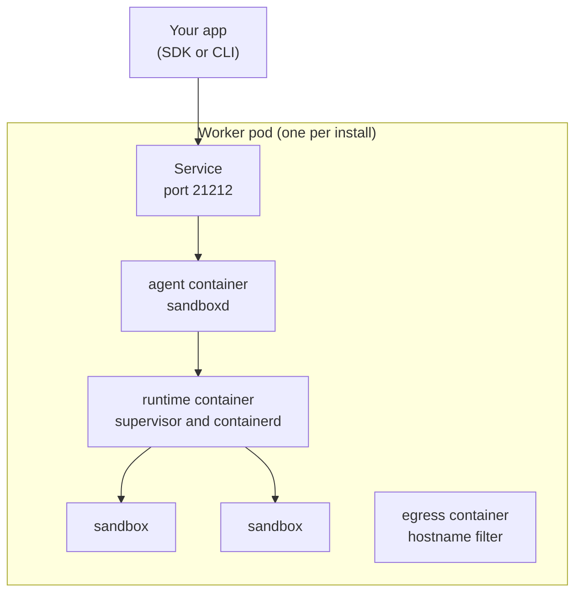

import { Tabs, TabItem, Aside } from '@astrojs/starlight/components';

AerolVM runs on Kubernetes from a Helm chart. Today the chart has one mode, **single**: one worker pod that holds the AerolVM server and every sandbox. It suits a laptop with kind, a test cluster or a small install. Cluster mode, with separate gateway, server and worker pods and an operator, comes later.

Your code does not change. You talk to the same API with the same SDKs.

## How it works



The worker pod has three containers:

- **runtime** runs containerd and every sandbox. Each sandbox gets its own CPU and memory limits inside the pod's own limit, so Kubernetes sees what sandboxes really use.
- **agent** is the AerolVM server, `sandboxd`. You can upgrade it in place; the sandboxes keep running.
- **egress** filters sandbox traffic by hostname when a sandbox has an allow list. It runs as a normal user with two network rights.

## What you need

- A Kubernetes cluster with Linux nodes (amd64 or arm64) that use cgroup v2. Recent EKS, AKS, GKE and kind nodes do.
- Helm 3.8 or later, and `kubectl`.
- A namespace that allows privileged pods. The worker pod builds sandboxes, which needs full rights on its node.

<Aside type="caution">
The worker pod runs privileged. Give it a namespace of its own, and keep other workloads off its node if you can.
</Aside>

## Try it on your laptop

From a checkout of the repository, with Docker and kind installed:

```bash
make k8s-dev
```

It builds the images from your checkout, starts a kind cluster named `aerolvm`, and installs the chart. Delete the cluster with `make k8s-dev-down`.

## Install

Make a namespace that allows privileged pods, then install the chart:

```bash
kubectl create namespace aerolvm
kubectl label namespace aerolvm pod-security.kubernetes.io/enforce=privileged
helm install aerolvm charts/aerolvm --namespace aerolvm
```

Wait until the pod is ready. The first start pulls the images:

```bash
kubectl -n aerolvm wait --for=condition=Ready pod/aerolvm-0 --timeout=5m
```

## Connect

Forward the API to your machine and read the token the chart made:

```bash
kubectl -n aerolvm port-forward svc/aerolvm 21212:21212 &
export SB_API_URL=http://127.0.0.1:21212
export SB_PAT_TOKEN="$(kubectl -n aerolvm get secret aerolvm-api-token -o jsonpath='{.data.SB_PAT_TOKEN}' | base64 -d)"
```

Then create a sandbox. This one uses gVisor, which adds a second kernel between your code and the node:

<Tabs syncKey="lang">
  <TabItem label="TypeScript">
    ```ts
    import { MicroVM } from "@aerol-ai/aerolvm-sdk";

    const client = new MicroVM(); // reads SB_API_URL and SB_PAT_TOKEN

    const sandbox = await client.create({ image: "ubuntu:22.04", runtime: "gvisor" });
    const result = await sandbox.exec("echo hello from gVisor");
    console.log(result.stdout);

    await sandbox.destroy();
    ```
  </TabItem>
  <TabItem label="Python">
    ```python
    from microvm import MicroVM

    client = MicroVM()  # reads SB_API_URL and SB_PAT_TOKEN

    sandbox = client.create(image="ubuntu:22.04", runtime="gvisor")
    result = sandbox.exec("echo hello from gVisor")
    print(result["stdout"])

    sandbox.destroy()
    ```
  </TabItem>
  <TabItem label="Go">
    ```go
    client, err := microvm.NewClient() // reads SB_API_URL and SB_PAT_TOKEN
    if err != nil {
        log.Fatal(err)
    }

    sandbox, err := client.Create(ctx, sdktypes.CreateSandboxOptions{
        Image:   "ubuntu:22.04",
        Runtime: sdktypes.RuntimeGvisor,
    })
    if err != nil {
        log.Fatal(err)
    }
    defer sandbox.Destroy(ctx)

    result, err := sandbox.ExecCommand(ctx, "echo hello from gVisor")
    if err != nil {
        log.Fatal(err)
    }
    fmt.Print(result.Stdout)
    ```
  </TabItem>
  <TabItem label="Rust">
    ```rust
    use aerolvm_sdk::{Client, CreateOptions};

    let client = Client::new(None, None)?; // reads SB_API_URL and SB_PAT_TOKEN

    let sandbox = client.create(CreateOptions {
        image: "ubuntu:22.04".into(),
        runtime: Some("gvisor".into()),
        ..Default::default()
    })?;
    let result = sandbox.exec("echo hello from gVisor")?;
    print!("{}", result.stdout);

    sandbox.destroy()?;
    ```
  </TabItem>
  <TabItem label="Java">
    ```java
    MicroVMClient client = new MicroVMClient(); // reads SB_API_URL and SB_PAT_TOKEN

    Sandbox sandbox = client.create(
        new CreateOptions().setImage("ubuntu:22.04").setRuntime("gvisor")
    );
    ExecResult result = sandbox.exec("echo hello from gVisor");
    System.out.print(result.stdout);

    sandbox.destroy();
    ```
  </TabItem>
</Tabs>

## Upgrade

A chart upgrade never restarts the worker pod, because that would end every sandbox. To move the server to a new version, change the agent container's image in place. Only that container restarts, and the sandboxes keep running:

```bash
kubectl -n aerolvm set image pod/aerolvm-0 agent=ghcr.io/aerol-ai/aerolvm:<version>
```

## Settings

Set these with `--set` or a values file.

| Setting | What it does | Default |
|---|---|---|
| `worker.runtime.resources` | The sandboxes' budget. Every sandbox runs inside it, and a reserve is kept for containerd. Keep requests equal to limits. | 2 CPUs, 4 GiB |
| `worker.defaultRuntime` | The isolation a create gets when it names none: `docker` (runc) or `gvisor`. | runc |
| `worker.diskFloorRatio` | New sandboxes are turned away while less than this share of the sandbox disk is free. `"0"` turns it off. | `"0.10"` |
| `worker.blockPrivateByDefault` | Sandboxes cannot reach private addresses unless a create allows them. | `true` |
| `worker.containerdVolume` | Where images and sandbox files live. Use a local disk for real work. | an `emptyDir` |
| `worker.extraEnv` | Any other server setting, as `SB_NAME: value`. | none |
| `apiToken.existingSecret` | Use your own token Secret (key `SB_PAT_TOKEN`) instead of the one the chart makes. | none |
| `image.tag` | The AerolVM version to run. | the chart's version |

## Good to know

- **The images are signed.** See how to check them in the repository's `RELEASE-VERIFICATION.md`.
- **Sandboxes stay inside the pod's limits.** If they use up the pod's memory, the kernel stops one whole sandbox, never the server.
- **Data in an `emptyDir` is lost with the pod.** For real work, put `worker.containerdVolume` and `worker.stateVolume` on a local disk.

## Next steps

- [Create and manage](/sandboxes/): every create option, plus stop, start and delete.
- [gVisor](/gvisor-sandbox/): the extra kernel layer.
- [Limit egress and ingress](/network-usage/): let a sandbox reach only the sites you name.
