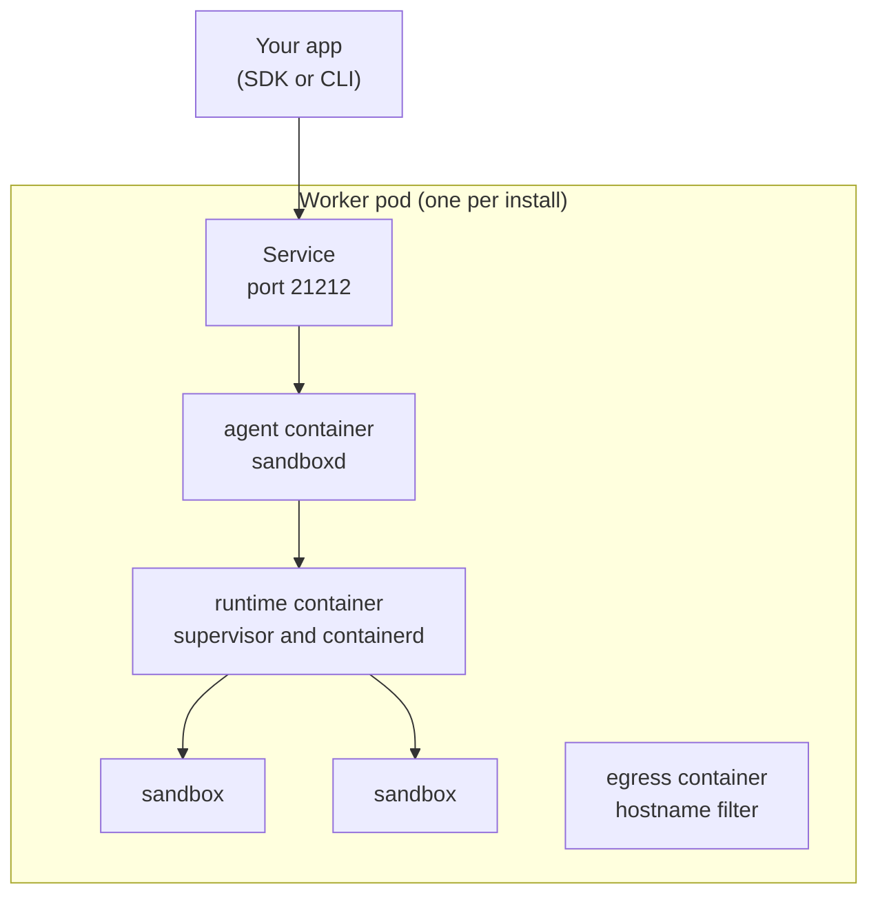

import { Tabs, TabItem, Aside } from '@astrojs/starlight/components';

AerolVM runs on Kubernetes from a Helm chart. Today the chart has one mode, **single**: one worker pod that holds the AerolVM server and every sandbox. It suits a laptop with kind, a test cluster or a small install. Cluster mode, with separate gateway, server and worker pods and an operator, comes later.

Your code does not change. You talk to the same API with the same SDKs.

## How it works



The worker pod has three containers:

- **runtime** runs containerd and every sandbox. Each sandbox gets its own CPU and memory limits inside the pod's own limit, so Kubernetes sees what sandboxes really use.
- **agent** is the AerolVM server, `sandboxd`. You can upgrade it in place; the sandboxes keep running.
- **egress** filters sandbox traffic by hostname when a sandbox has an allow list. It runs as a normal user with two network rights.

## What you need

- A Kubernetes cluster with Linux nodes (amd64 or arm64) that use cgroup v2. Recent EKS, AKS, GKE and kind nodes do.
- The `br_netfilter` kernel module loaded on the nodes that run the worker pod (`sudo modprobe br_netfilter`). The server refuses to start without it, because sandboxes on the same node could then reach each other. Stock EKS nodes and Linux machines running kind often lack it; Docker Desktop has it.
- Helm 3.8 or later, and `kubectl`.
- A namespace that allows privileged pods. The worker pod builds sandboxes, which needs full rights on its node.

<Aside type="caution">
The worker pod runs privileged. Give it a namespace of its own, and keep other workloads off its node if you can.
</Aside>

## Try it on your laptop

From a checkout of the repository, with Docker and kind installed:

```bash
make k8s-dev
```

It builds the images from your checkout, starts a kind cluster named `aerolvm`, and installs the chart. Delete the cluster with `make k8s-dev-down`.

To try [HTTPS sandbox links](#sandbox-links-over-https) too, run `AEROL_K8S_EDGE=1 make k8s-dev`. It also installs cert-manager with a self-signed issuer and uses the domain `aerolvm.test`.

## Install

Make a namespace that allows privileged pods, then install the chart:

```bash
kubectl create namespace aerolvm
kubectl label namespace aerolvm pod-security.kubernetes.io/enforce=privileged
helm install aerolvm charts/aerolvm --namespace aerolvm
```

Wait until the pod is ready. The first start pulls the images:

```bash
kubectl -n aerolvm wait --for=condition=Ready pod/aerolvm-0 --timeout=5m
```

## Connect

Forward the API to your machine and read the token the chart made:

```bash
kubectl -n aerolvm port-forward svc/aerolvm 21212:21212 &
export SB_API_URL=http://127.0.0.1:21212
export SB_PAT_TOKEN="$(kubectl -n aerolvm get secret aerolvm-api-token -o jsonpath='{.data.SB_PAT_TOKEN}' | base64 -d)"
```

Then create a sandbox. This one uses gVisor, which adds a second kernel between your code and the node:

<Tabs syncKey="lang">
  <TabItem label="TypeScript">
    ```ts
    import { MicroVM } from "@aerol-ai/aerolvm-sdk";

    const client = new MicroVM(); // reads SB_API_URL and SB_PAT_TOKEN

    const sandbox = await client.create({ image: "ubuntu:22.04", runtime: "gvisor" });
    const result = await sandbox.exec("echo hello from gVisor");
    console.log(result.stdout);

    await sandbox.destroy();
    ```
  </TabItem>
  <TabItem label="Python">
    ```python
    from microvm import MicroVM

    client = MicroVM()  # reads SB_API_URL and SB_PAT_TOKEN

    sandbox = client.create(image="ubuntu:22.04", runtime="gvisor")
    result = sandbox.exec("echo hello from gVisor")
    print(result["stdout"])

    sandbox.destroy()
    ```
  </TabItem>
  <TabItem label="Go">
    ```go
    client, err := microvm.NewClient() // reads SB_API_URL and SB_PAT_TOKEN
    if err != nil {
        log.Fatal(err)
    }

    sandbox, err := client.Create(ctx, sdktypes.CreateSandboxOptions{
        Image:   "ubuntu:22.04",
        Runtime: sdktypes.RuntimeGvisor,
    })
    if err != nil {
        log.Fatal(err)
    }
    defer sandbox.Destroy(ctx)

    result, err := sandbox.ExecCommand(ctx, "echo hello from gVisor")
    if err != nil {
        log.Fatal(err)
    }
    fmt.Print(result.Stdout)
    ```
  </TabItem>
  <TabItem label="Rust">
    ```rust
    use aerolvm_sdk::{Client, CreateOptions};

    let client = Client::new(None, None)?; // reads SB_API_URL and SB_PAT_TOKEN

    let sandbox = client.create(CreateOptions {
        image: "ubuntu:22.04".into(),
        runtime: Some("gvisor".into()),
        ..Default::default()
    })?;
    let result = sandbox.exec("echo hello from gVisor")?;
    print!("{}", result.stdout);

    sandbox.destroy()?;
    ```
  </TabItem>
  <TabItem label="Java">
    ```java
    MicroVMClient client = new MicroVMClient(); // reads SB_API_URL and SB_PAT_TOKEN

    Sandbox sandbox = client.create(
        new CreateOptions().setImage("ubuntu:22.04").setRuntime("gvisor")
    );
    ExecResult result = sandbox.exec("echo hello from gVisor");
    System.out.print(result.stdout);

    sandbox.destroy();
    ```
  </TabItem>
</Tabs>

## Sandbox links over HTTPS

Turn on the **edge** to give the API and every sandbox port a public HTTPS address, as on a server installed with a domain. The edge is a fourth container in the worker pod. It runs AerolVM's build of Caddy, a web server.

- The API is `https://<domain>`.
- Port 3000 of a sandbox is `https://<sandbox id>-3000.<domain>`. You get it when you [publish a port](/network-access/#who-can-reach-the-sandbox-from-outside).

The certificate comes from [cert-manager](https://cert-manager.io), so install cert-manager first. Point it at your own certificate authority, or at Let's Encrypt with a DNS-01 issuer. With DNS-01, the DNS provider's token stays in cert-manager's namespace. No AerolVM pod ever holds it.

```bash
helm install aerolvm charts/aerolvm --namespace aerolvm \
  --set edge.enabled=true \
  --set edge.domain=sandboxes.example.com \
  --set edge.certManager.issuerRef.name=letsencrypt-dns
```

Then point the domain and its wildcard (`sandboxes.example.com` and `*.sandboxes.example.com`) at the address of the `aerolvm-edge` Service:

```bash
kubectl -n aerolvm get svc aerolvm-edge
```

Good to know about the edge:

- **Renewals need no restart.** cert-manager renews the certificate before it expires. The new one is served within about two minutes, and no container restarts.
- **You can bring your own certificate.** Put it in a TLS Secret for the domain and its wildcard, and set `edge.existingTLSSecret` instead of an issuer.
- **[Custom domains](/custom-domains/) work as on a server.** Their certificates are issued when first needed. They are kept in the pod, so they are issued again after the pod is replaced.

## Keep sandboxes off your network

Sandboxes run code you may not trust. On Kubernetes, a sandbox's traffic leaves with the worker pod's address. So your cluster's own rules cannot tell a sandbox apart from AerolVM. AerolVM keeps sandboxes away from your network with two walls:

- **AerolVM's firewall inside the pod.** A sandbox with no network policy cannot reach private addresses (`10.0.0.0/8`, `172.16.0.0/12`, `192.168.0.0/16`, `169.254.0.0/16`), the worker pod's own ports, or the cloud metadata service. It can still reach the internet and look up names.
- **A NetworkPolicy on the worker pod.** The chart adds one. The pod may reach the other AerolVM pods of the install, the cluster DNS, and the internet. It may not reach private addresses.

<Aside type="note">
The NetworkPolicy works only if your cluster's network plugin enforces NetworkPolicy. Most do, such as Calico, Cilium and the Amazon VPC CNI with network policy turned on. A plugin that does not simply ignores it. The firewall inside the pod works either way.
</Aside>

### Tell AerolVM your cluster's addresses

AerolVM cannot guess your cluster's addresses, so list them in a values file. When cluster mode comes, its operator will fill these in for you.

```yaml
worker:
  # The Kubernetes API server. No sandbox can ever reach these,
  # whatever its policy says.
  egressDenyFloor:
    - 10.96.0.1     # kubectl get svc kubernetes -n default
    - 172.18.0.2    # kubectl get endpointslices -n default -l kubernetes.io/service-name=kubernetes
  # Your cluster's pod, Service and node ranges. Closed to sandboxes
  # by default. You can open one on purpose (see below).
  egressPrivateRanges:
    - 10.244.0.0/16 # pods
    - 10.96.0.0/12  # Services
    - 172.18.0.0/16 # nodes
```

Then install, or upgrade, with that file:

```bash
helm upgrade --install aerolvm charts/aerolvm --namespace aerolvm -f values.yaml
```

Good to know:

- **List your ranges even if they are private already.** The NetworkPolicy leaves them out too. And some clusters use ranges outside the private ones. For example, EKS custom networking gives pods addresses in `100.64.0.0/10`.
- **Keep only the API server in `egressDenyFloor`.** Nothing can open an address there. Never put the cluster DNS address (often `10.96.0.10`) there, or sandboxes cannot look up names. Inside a range in `egressPrivateRanges` it is fine: AerolVM keeps the DNS address open.
- **A change needs a new pod.** The chart never restarts the worker pod on its own, because that ends every sandbox. After you change these two lists, run `helm upgrade`, then delete the pod `aerolvm-0` when you are ready. Kubernetes starts a new one with the new lists.

### Open one internal range on purpose

Say some sandboxes must reach an internal API at `10.50.0.0/16`. Open it in **two places**. If you open it in only one, sandboxes still cannot reach it.

**1. In AerolVM, with an egress profile.** A profile is a named allow list. Sandboxes that use it can reach the range. Other sandboxes still cannot. See [Reusable allow lists](/advanced-network-rules/#reusable-allow-lists) for more.

<Tabs syncKey="lang">
  <TabItem label="TypeScript">
    ```ts
    await client.putEgressProfile('bank-api', {
      allowOut: ['10.50.0.0/16', 'pypi.org'],
      description: 'the internal API, and pip',
    })

    const sandbox = await client.create({
      image: 'python:3.12',
      egressProfiles: ['bank-api'],
    })
    ```
  </TabItem>
  <TabItem label="Python">
    ```python
    client.put_egress_profile('bank-api', {
        'allowOut': ['10.50.0.0/16', 'pypi.org'],
        'description': 'the internal API, and pip',
    })

    sandbox = client.create({
        'image': 'python:3.12',
        'egressProfiles': ['bank-api'],
    })
    ```
  </TabItem>
  <TabItem label="Go">
    ```go
    _, err := client.PutEgressProfile(ctx, "bank-api", sdktypes.EgressProfileOptions{
        AllowOut:    []string{"10.50.0.0/16", "pypi.org"},
        Description: "the internal API, and pip",
    })
    if err != nil {
        return err
    }
    sandbox, err := client.Create(ctx, sdktypes.CreateSandboxOptions{
        Image:          "python:3.12",
        EgressProfiles: []string{"bank-api"},
    })
    ```
  </TabItem>
  <TabItem label="Rust">
    ```rust
    client.put_egress_profile("bank-api", EgressProfileOptions {
        allow_out: vec!["10.50.0.0/16".to_string(), "pypi.org".to_string()],
        description: "the internal API, and pip".to_string(),
    })?;

    let sandbox = client.create(CreateOptions {
        image: "python:3.12".to_string(),
        egress_profiles: Some(vec!["bank-api".to_string()]),
        ..Default::default()
    })?;
    ```
  </TabItem>
  <TabItem label="Java">
    ```java
    client.putEgressProfile("bank-api", new EgressProfileOptions()
        .setAllowOut(List.of("10.50.0.0/16", "pypi.org"))
        .setDescription("the internal API, and pip"));

    Sandbox sandbox = client.create(
        new CreateOptions()
            .setImage("python:3.12")
            .setEgressProfiles(List.of("bank-api"))
    );
    ```
  </TabItem>
</Tabs>

A sandbox that uses a profile can reach only what the profile allows. That is why `pypi.org` is in the list too: add every site the sandbox needs.

**2. In the worker pod's NetworkPolicy.** Add the same range to your values file and run `helm upgrade`. This change needs no new pod: the network plugin applies it at once.

```yaml
networkPolicy:
  extraEgressCIDRs:
    - 10.50.0.0/16
```

Put other private addresses the worker pod itself needs in the same list. Examples: a private registry for sandbox images, a VPC endpoint for object storage or KMS, or the NodeLocal DNSCache address (often `169.254.20.10`).

## Check the install

`aerolvm k8s verify` checks a live install against the rules a security team asks about, and exits with 1 if any fails:

- every image is signed by the AerolVM release workflow (it needs `cosign` v3 or later);
- no pod mounts a folder from the node;
- no pod holds a Kubernetes API credential;
- no pod holds a DNS provider token: a pod may mount only a certificate, its key and its authority from a Secret, each named;
- a NetworkPolicy limits where the worker pod can connect, and no policy on it opens every address, every pod, or a whole private range;
- a runc and a gVisor sandbox cannot reach the worker pod's own ports, another pod (a cluster DNS pod), or the Kubernetes API.

It reads the cluster with your `kubectl`, and makes its two test sandboxes through the API you set up above. It deletes them when it is done.

```bash
aerolvm k8s verify --namespace aerolvm
```

## Usage per team

The worker pod asks Kubernetes for a whole machine. So a cost tool such as OpenCost or Kubecost sees one big pod, not which team used it. To fill that gap, the server adds four counters per owner to its [`/v1/metrics`](/dashboard/#collect-metrics-with-prometheus). An owner is the team a sandbox belongs to.

| Counter | What it adds up | What it is for |
|---|---|---|
| `aerolvm_usage_reserved_cpu_seconds_total` | Each running sandbox's CPU limit, times the seconds it ran | The charge |
| `aerolvm_usage_reserved_memory_mib_seconds_total` | Each running sandbox's memory limit in MiB, times the seconds it ran | The charge |
| `aerolvm_usage_consumed_cpu_seconds_total` | The CPU time the sandboxes really used, read from their cgroups | A view only |
| `aerolvm_usage_consumed_memory_mib_seconds_total` | The memory the sandboxes really held, in MiB, times the seconds | A view only |

Each counter has two labels. `owner` is the team. It is empty for sandboxes made with the main API token. `incarnation` is new each time the server starts.

**Reserved is the charge.** A sandbox's limits block that room on the machine for everyone else, used or not. **Consumed** sits next to it, so a team can see how much of its room it really uses. It never changes the bill.

Good to know:

- **Units, not money.** Your cost tool already knows what each worker pod costs. These counters only say how to split it.
- **Nothing is sent anywhere.** The counters stay in the pod until your Prometheus reads them. The chart turns them on; set `worker.usageMetrics.enabled=false` to turn them off. A server installed without the chart has them off. Turn them on there with `SB_USAGE_METRICS_ENABLED=true`.
- **Counters only go up.** When the server restarts, it starts new series with a new `incarnation`, instead of going back to zero.
- **Only teams with a running sandbox show up.** A team's counters stay for an hour after its last sandbox on that worker stops, then go.
- **The server samples every 15 seconds.** A sandbox that is deleted between two samples is charged up to the moment it was deleted.
- **Consumed needs a cgroup per sandbox.** runc and gVisor sandboxes have one. Firecracker, WASM and isolate sandboxes are charged for what they reserve but show no consumed use.

### Add them up in Prometheus

Scrape `/v1/metrics` on every worker pod, as on a server (see [Collect metrics with Prometheus](/dashboard/#collect-metrics-with-prometheus)). Then add these rules. Each one adds up one counter across every worker and every restart. Because each worker keeps its own counters, a restart, a worker that leaves or a new cluster leader loses or double-counts nothing that was scraped.

```yaml title="aerolvm-usage-rules.yml"
groups:
  - name: aerolvm-usage
    rules:
      # CPUs and MiB each team holds, on average over 5 minutes.
      - record: owner:aerolvm_usage_reserved_cpu_seconds:rate5m
        expr: sum by (owner) (rate(aerolvm_usage_reserved_cpu_seconds_total[5m]))
      - record: owner:aerolvm_usage_reserved_memory_mib_seconds:rate5m
        expr: sum by (owner) (rate(aerolvm_usage_reserved_memory_mib_seconds_total[5m]))
      - record: owner:aerolvm_usage_consumed_cpu_seconds:rate5m
        expr: sum by (owner) (rate(aerolvm_usage_consumed_cpu_seconds_total[5m]))
      - record: owner:aerolvm_usage_consumed_memory_mib_seconds:rate5m
        expr: sum by (owner) (rate(aerolvm_usage_consumed_memory_mib_seconds_total[5m]))
      # A worker whose usage counters stopped moving for 10 minutes.
      - alert: AerolVMUsageExporterStale
        expr: time() - aerolvm_usage_last_sample_timestamp_seconds > 600
        for: 5m
```

A rate of seconds per second is a count of CPUs (or MiB) held. A worker that Prometheus cannot reach drops out of the sums until it is back. When a team starts its first sandbox on a worker, up to one scrape of its use there can be missed, because `rate()` cannot count a new series' first value.

With many workers and teams, the raw counters add up to many series. Keep the recorded sums for long-term storage, and the raw counters only as long as you need them.

### Split a worker's cost by team

Use this rule for each worker pod, over a window such as one day:

1. **Find each team's CPU share.** Take the team's `aerolvm_usage_reserved_cpu_seconds_total` increase on that pod. Divide it by the larger of these two: the increase for all teams on that pod, or the pod's CPU request times the window's seconds.
2. **Find each team's memory share** the same way, with `aerolvm_usage_reserved_memory_mib_seconds_total` and the pod's memory request in MiB.
3. **Charge each team** the pod's CPU cost times its CPU share, plus the pod's memory cost times its memory share.
4. **Book what is left as idle.** It is room no sandbox reserved, plus the server's own containers. Most cost tools already have an idle line for this; give it to the team that runs AerolVM.

The shares never add up to more than one, so the pod's cost is counted once. The sandboxes are not pods of their own, so the cost tool does not count them a second time.

Here is step 1 in PromQL, for the last day. The pod's request comes from kube-state-metrics, and the `pod` label on AerolVM's counters comes from your scrape setup:

```text title="PromQL"
# Each team's CPU share of each worker pod over the last day.
sum by (pod, owner) (increase(aerolvm_usage_reserved_cpu_seconds_total[1d]))
/ on (pod) group_left
(
  # The larger of: all teams' reserved CPU-seconds on the pod ...
  (
    sum by (pod) (increase(aerolvm_usage_reserved_cpu_seconds_total[1d]))
    >= on (pod)
    86400 * sum by (pod) (kube_pod_container_resource_requests{namespace="aerolvm", resource="cpu"})
  )
  # ... or the pod's CPU request times one day.
  or on (pod)
  86400 * sum by (pod) (kube_pod_container_resource_requests{namespace="aerolvm", resource="cpu"})
)
```

## Upgrade

A chart upgrade never restarts the worker pod, because that would end every sandbox. To move the server to a new version, change the agent container's image in place. Only that container restarts, and the sandboxes keep running:

```bash
kubectl -n aerolvm set image pod/aerolvm-0 agent=ghcr.io/aerol-ai/aerolvm:<version>
```

## Settings

Set these with `--set` or a values file.

| Setting | What it does | Default |
|---|---|---|
| `worker.runtime.resources` | The sandboxes' budget. Every sandbox runs inside it, and a reserve is kept for containerd. Keep requests equal to limits. | 2 CPUs, 4 GiB |
| `worker.defaultRuntime` | The isolation a create gets when it names none: `docker` (runc) or `gvisor`. | runc |
| `worker.diskFloorRatio` | New sandboxes are turned away while less than this share of the sandbox disk is free. `"0"` turns it off. | `"0.10"` |
| `worker.blockPrivateByDefault` | Sandboxes cannot reach private addresses unless a create allows them. | `true` |
| `worker.usageMetrics.enabled` | [Usage per team](#usage-per-team) on `/v1/metrics`. Owner names become label values. | `true` |
| `worker.egressDenyFloor` | [Addresses no sandbox can ever reach](#tell-aerolvm-your-clusters-addresses), such as the Kubernetes API server. | none |
| `worker.egressPrivateRanges` | Your cluster's pod, Service and node ranges. Sandboxes cannot reach them unless an egress profile opens one. Needs `worker.blockPrivateByDefault`. | none |
| `networkPolicy.enabled` | Give the worker pod an egress NetworkPolicy. | `true` |
| `networkPolicy.extraEgressCIDRs` | Private ranges the worker pod may reach: the one you [open on purpose](#open-one-internal-range-on-purpose), or a registry or endpoint the pod needs. | none |
| `networkPolicy.dns` | Where your cluster DNS runs, as `namespace` and `podLabels`. | `kube-system`, `k8s-app: kube-dns` |
| `worker.containerdVolume` | Where images and sandbox files live. Use a local disk for real work. | an `emptyDir` |
| `worker.extraEnv` | Any other server setting, as `SB_NAME: value`. | none |
| `apiToken.existingSecret` | Use your own token Secret (key `SB_PAT_TOKEN`) instead of the one the chart makes. | none |
| `edge.enabled` | [Sandbox links over HTTPS](#sandbox-links-over-https). Needs `edge.domain` and a certificate. | `false` |
| `edge.domain` | The API's host name. Sandbox links are under it. | none |
| `edge.certManager.issuerRef` | The cert-manager issuer for the certificate, as `name` and `kind` (`ClusterIssuer` when you leave `kind` out). | none |
| `edge.existingTLSSecret` | Your own TLS Secret for the domain and its wildcard, instead of an issuer. | none |
| `edge.service.type` | How the edge is reached from outside the cluster. | `LoadBalancer` |
| `image.tag` | The AerolVM version to run. | the chart's version |

## Good to know

- **The images are signed.** See how to check them in the repository's `RELEASE-VERIFICATION.md`.
- **Sandboxes stay inside the pod's limits.** If they use up the pod's memory, the kernel stops one whole sandbox, never the server.
- **Data in an `emptyDir` is lost with the pod.** For real work, put `worker.containerdVolume` and `worker.stateVolume` on a local disk.

## Next steps

- [Create and manage](/sandboxes/): every create option, plus stop, start and delete.
- [gVisor](/gvisor-sandbox/): the extra kernel layer.
- [Limit egress and ingress](/network-usage/): let a sandbox reach only the sites you name.
