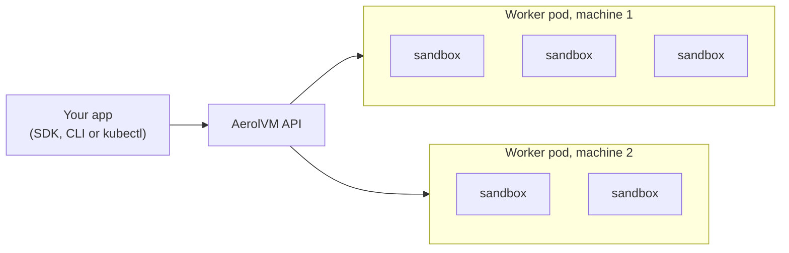

import { Aside, CardGrid, LinkCard } from '@astrojs/starlight/components';

AerolVM has a Helm chart that installs it in a Kubernetes cluster you already run: EKS, AKS, GKE, or kind on a laptop. Your apps use the same SDKs and the same API as on any other AerolVM install. Only the address and the token change.

<Aside>
**Not the same as [Cluster Setup](/cluster/).** Cluster Setup builds AerolVM's own cluster on plain Linux machines, with no Kubernetes. Use this guide if you already run Kubernetes.
</Aside>

## A sandbox is not a pod

This is the one idea to hold on to. AerolVM runs one **worker pod** per machine. Each worker pod runs many **sandboxes** inside it, each isolated with gVisor, runc, Firecracker, WebAssembly or a V8 isolate.



Kubernetes schedules the worker pods. AerolVM schedules sandboxes onto them. So:

- **A sandbox starts in milliseconds.** No pod is scheduled, and the kubelet pulls no image.
- **Sandboxes add nothing to etcd.** AerolVM keeps its own records.
- **Your cost tools see one pod per machine.** AerolVM reports [usage per team](/kubernetes/operations/#usage-per-team), so you can still split the bill.

## Pick a mode

The chart has two modes. You choose one with the `mode` value.

| | Single mode | Cluster mode |
|---|---|---|
| **Use it for** | Evaluating, CI, development, small installs | Production |
| **What the chart installs** | One pod that holds the API and every sandbox | An operator, which builds and runs servers, gateways and worker pools |
| **Machines** | One | Many, over two or more zones |
| **When a machine dies** | Its sandboxes are lost | Sandboxes that ask for it start again on another machine |
| **Scales with load** | No | Yes, with Karpenter or AKS Node Auto Provisioning |
| **Upgrades** | Swap one container image | Change one value; the operator rolls every pod, and sandboxes keep running |
| **You need** | Any cluster, even kind | Kubernetes 1.30+, cert-manager, a zonal StorageClass |
| **Value** | `mode: single` (the default) | `mode: cluster` |

**Evaluating on EKS or AKS?** Start with single mode on one node that meets [the requirements](#what-you-need). It takes about five minutes.

Moving from single mode to cluster mode is a new install. Sandboxes do not move across, and your code does not change.

## What gets installed

Helm installs the chart's two CRDs (`AerolCluster` and `AerolNode`) in either mode, so installing needs **cluster-admin**. Single mode never uses them: with `--skip-crds`, a namespace admin can install it into a namespace labelled `privileged`.

### Single mode

Everything lands in the namespace you install into. Names follow the Helm release name, `aerolvm` in this guide:

| Object | Name | What it is |
|---|---|---|
| StatefulSet | `aerolvm` | One pod, `aerolvm-0`, with three containers: `agent` (the AerolVM API server), `runtime` (containerd and every sandbox) and `egress` (filters sandbox traffic by hostname). |
| Service | `aerolvm` | The API on port 21212. ClusterIP. |
| Secret | `aerolvm-api-token` | The API token, under the key `SB_PAT_TOKEN`. Made on first install, kept across upgrades. |
| NetworkPolicy | `aerolvm-worker-egress` | Limits where the pod can connect. See [Networking](/kubernetes/networking/). |

### Cluster mode

The chart installs the operator and one `AerolCluster`. The operator makes the rest. Names follow `cluster.name`, `aerolvm` by default:

| Namespace | What runs there | Pod Security |
|---|---|---|
| `aerolvm-system` (yours) | The **operator**: a Deployment with 2 replicas, one leading. | `restricted` |
| `aerolvm-system` | **Servers** `aerolvm-server-0` to `-2` (or `-4`): one per zone, each with its own PersistentVolumeClaim. They agree on where every sandbox lives, using Raft. | `restricted` |
| `aerolvm-system` | **Gateways** `aerolvm-gateway-<id>`: at least one per zone, behind the Service `aerolvm-gateway`. They take every request and pass it to the right worker. Stateless. | `restricted` |
| `aerolvm-workers` (the chart makes it) | **Workers** `aerolvm-<pool>-<id>`: one per machine, sized to nearly the whole machine. They run the sandboxes. | `privileged` |

The operator makes each server, gateway and worker as a plain pod, tracked by an `AerolNode` of the same name. There are no Deployments or StatefulSets for them. `kubectl get aerolnodes` lists every one, with its zone, state, version and sandbox count.

The chart also adds:

- a validating webhook that stops a live worker pod from being deleted by mistake;
- a PodDisruptionBudget and a PriorityClass for workers;
- a ClusterRole for the operator;
- NetworkPolicies around every pod. The admin token is in the Secret `aerolvm-admin`, under the key `token`.

A gateway is what [Cluster Setup](/cluster/how-it-works/) calls an **ingress node**. Node certificates name the role `ingress`.

### Images

| Image | Runs in |
|---|---|
| `ghcr.io/aerol-ai/aerolvm` | The worker's `agent` and `egress` containers, servers and gateways |
| `ghcr.io/aerol-ai/aerolvm-runtime` | The worker's `runtime` container: containerd, runc and gVisor |
| `ghcr.io/aerol-ai/aerolvm-edge` | The HTTPS edge, when you turn it on |
| `ghcr.io/aerol-ai/aerolvm-operator` | The operator (cluster mode) |

All four are built for amd64 and arm64, and signed by AerolVM's release workflow. To use a mirror, set `image.registry`.

## Why the worker pod is privileged

A worker pod builds sandboxes: cgroups, network namespaces and mounts on its machine. So its `runtime` and `agent` containers run privileged; every other AerolVM pod runs as non-root under `restricted`. [Security](/kubernetes/security/) explains each right, how it is contained, and how to check a live install with one command.

## What you need

For both modes:

- **Linux nodes**, amd64 or arm64, with **cgroup v2**. Recent EKS, AKS, GKE and kind nodes have it.
- The **`br_netfilter`** kernel module loaded on the machines that run worker pods. Without it, sandboxes on one machine could reach each other, so the worker refuses to start. Stock Amazon Linux 2023 does not load it: see [the EKS user data](/kubernetes/production/#load-br_netfilter-on-eks). Docker Desktop does.
- **Bottlerocket only:** it sets `user.max_user_namespaces` to 0, which makes every gVisor create fail. Raise it in the node pool's settings: `settings.kernel.sysctl."user.max_user_namespaces" = "62775"`, and load `br_netfilter` there too.
- **Helm 3.8+** and **kubectl**.
- **cluster-admin**, to install. Single mode with `--skip-crds` needs only a namespace admin.

Cluster mode needs more. The [production install](/kubernetes/production/#before-you-start) lists it.

## Get the chart

The chart lives in the AerolVM repository. Clone the newest release from the [releases page](https://github.com/aerol-ai/microvm/releases). This guide needs a release newer than v0.7.3: older charts lack settings it uses.

```bash title="Your machine"
git clone --depth 1 --branch <version> https://github.com/aerol-ai/microvm.git
cd microvm
```

Every command in this guide runs from that folder. The chart is `charts/aerolvm`. It runs the images of its own release (its `appVersion`) unless you set `image.tag`.

## Start here

<CardGrid>
  <LinkCard title="Single mode" description="One pod on kind or any cluster. A sandbox running in about five minutes." href="/kubernetes/single-node/" />
  <LinkCard title="Production install" description="Cluster mode: servers, gateways and worker pools over zones, run by the operator." href="/kubernetes/production/" />
</CardGrid>

## Pages in this guide

1. [Single mode](/kubernetes/single-node/): one pod, from install to first sandbox.
2. [Production install](/kubernetes/production/): cluster mode over zones, on EKS or AKS.
3. [HTTPS and networking](/kubernetes/networking/): a domain with HTTPS, and keeping sandboxes off your network.
4. [Security](/kubernetes/security/): what each pod may do, and how to prove it.
5. [Operate](/kubernetes/operations/): scaling, machine replacement, upgrades, backups, monitoring and cost per team.
6. [kubectl and agent-sandbox](/kubernetes/kubectl/): `kubectl get sandboxes`, with Kubernetes RBAC (cluster mode).
7. [Helm values](/kubernetes/values/): every setting on one page.
